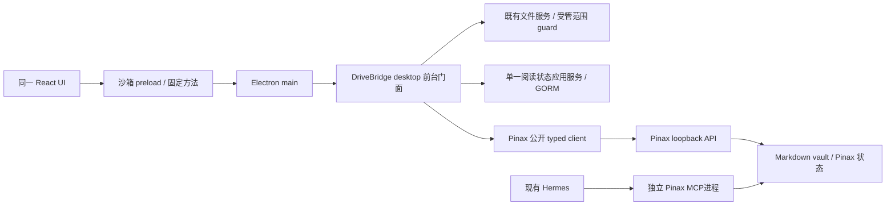

# Electron 桌面宿主与 Pinax 阅读接入

2026-10-01设计／2026-10-05更新 · **DTO及metadata-only进程/HTTP预检基础已验；CLI宿主入口已实现基础，guard准入和Electron仍待实施**。用户选择 Electron、阅读先行、macOS/Windows/Linux 同时实机验收。本文件取代旧设计中“不做 Electron / 原生框架未定”的桌面结论，不删除 Web/PWA 或移动客户端需求。实施真源为 [desktop-knowledge-reader change](../../openspec/changes/drivebridge-desktop-knowledge-reader-v1/README.md)。

## 1. Owner、模块与首片

`desktop/` 是 `cli/drivebridge` 内新增的 Electron main/preload/Forge 模块；`web/` 继续唯一 UI，既有 React/TS/Vite、tokens 和阅读器不另复制。Go 本机应用服务拥有文件、绑定保护、收藏/进度；Pinax 拥有笔记领域。Electron 不直接用 SQL、读 `.pinax` 或调用任意 shell。

首片只实现本机 Pinax 阅读和阅读状态，可在没有云账户、网络、模型和预装 CLI 时启动。远程 DriveBridge 连接继续原有认证与文件合同；它不是本机知识库登录门。Pinax 远端来源和跨设备阅读状态同步不在首片，不把云端无法访问的本机路径发给远端。

Hermes通过独立Pinax MCP消费，与桌面Pinax会话并存，不能直接读DriveBridge状态。`backend-server/client-runtime` 非必需，不创建通用 broker、插件宿主或第二调度器。

## 2. 宿主与安全边界

- Electron main/preload 使用 TypeScript。renderer 明确设置 `nodeIntegration=false`、`contextIsolation=true`、`sandbox=true`、`webSecurity=true`、`webviewTag=false`，禁止 `--no-sandbox` 和远程调试进入正式包。
- 只加载打包的 `drivebridge-app://app/` 自定义协议资产，不使用任意 `file://`。协议映射固定资源目录、标准安全 origin，不通过 URL 读取任意路径。开发 Vite 仅独立开发配置允许，不进入 release allowlist。
- CSP 禁 inline script/eval、远程 script 和对象插件。`connect-src` 只允许已配置既有文件服务来源；Pinax 读取走 IPC，不把 loopback bearer 暴露给 renderer。媒体使用受控 app asset 通道，禁自动远程图片/字体。
- `contextBridge` 一次暴露一个固定方法，不暴露 `ipcRenderer`、Event、原始 Electron API、任意 fetch/fs/shell。校验主 frame、webContents、精确 origin、会话绑定与请求大小；子 frame/about:blank/已销毁 sender 一律拒绝。
- 默认拒绝 session permission 请求、窗口创建与跨 origin 导航。外链仅用户明确点击且校验为 http/https 后交系统浏览器；禁 javascript/data/file/任意自定义 scheme。首片不注册 OS `pinax://` handler。
- Markdown/HTML/SVG/附件视为不可信。知识阅读不执行脚本；既有交互 HTML 预览在独立无 preload 的隔离内容 frame/session 内，不能通过弹窗、postMessage 或 IPC 提权；PDF/媒体继续既有 worker 与解析预算。
- production fuses 禁 RunAsNode、NodeOptions 环境注入和调试参数，启用仅从 ASAR 加载及支持平台的完整性校验；随包 Go binary 在受控 resources 目录、校验发布摘要，禁止 PATH 替换。
- 凭据与原始正文不入日志/telemetry/trace；renderer 只接收当前被授权显示的内容，不持 token、root 路径或 provider 配置。崩溃报告默认不上传，秘密阶段禁止测试截图/trace。

## 3. 本地进程与数据流

已新增 `drivebridge desktop serve` 前台入口及 `drivebridge desktop schema` 私有协议导出；需可信宿主提供stdin首帧，普通终端无帧会安全失败。当前仅metadata预检/拒绝绑定，不是完整阅读入口。它是应用打开时显式启动的前台本机门面，不注册 daemon/autostart，不开启 LAN。复用现有 Go 文件应用层和私有 state，纯 Go 构建不受 Electron 影响。

D02.6已通过同目录真实DriveBridge/Pinax CLI控制通道验证：stdin选择→HTTP metadata预检→blocked→取消→EOF，非法首帧与错摘要拒绝，源vault树字节不变。证据 `20261005T110722Z-e482e477`；不是Electron安装包或三平台证明。以下仍包含未实现的完整目标（state/guard/全文会话/进程树），当前host schema不提供这些能力。\n\n1. main 校验随包二进制及版本摘要，以固定参数启动门面，`shell=false`，环境 allowlist；仅为不泄密的进程控制持路径。
2. 通过私有 stdin 版本化首帧传入 256-bit 临时 session bearer、nonce、受控 state 位置。门面 loopback 随机端口 0，ready 仅返回 session、contract digest、地址，不返回 secret。前端拿不到服务地址或 bearer。
3. 本地模式 principal 固定为当前 OS 用户对应的私有 DriveBridge 实例，无云登录。所有请求仍需会话鉴权，origin/sender 不替代认证；门面禁止 CORS，token 不复用云凭据。
4. 用户通过 main 原生目录选择器选已有 vault，路径只传门面。门面检查其 roots/连接/挂载和保护域，用metadata-only临时Pinax会话只读校验。确认摘要必须列明正文/关系/附件读取scope与文件写保护；取消/过期关闭预检会话，不持久绑定、不读取正文。没初始化则提示，不自动init。
5. 用户确认且guard安装成功后，门面关闭预检会话，按[人类阅读合同](../../../pinax/docs/interfaces/human-reading-api.md)建立新bearer的获授权session，只开批准的reader与必要discovery，始终readonly；旧会话不原地升权。每次打开来源核对真实 manifest/digest；不兼容返回 unsupported，不执行本地文件 fallback。
6. main 的固定 IPC 调用经门面映射到 typed Pinax API；普通文件仍走既有文件服务。附件用授权流/Range，不塞大段 base64 JSON，不向 renderer 发带凭据 URL。
7. 父 stdin 在整个会话保持打开。EOF 停接请求，最多 5 秒排空；超时仅终止本应用持有的进程树（Windows Job Object、Unix 自有 process group），不按进程名杀死 Hermes/其他 CLI。启动 15 秒未 ready 清理自有进程、显示可重试错误；不无限自动重启。
8. 显式退出关闭所有自有子进程。首片窗口关闭即退出，macOS 再次打开重新建会话；不留隐藏托盘进程。休眠恢复先重新校验 session/来源，不能复用旧权限事实。

Binding guard 的权威不能只存在于桌面进程。所有 DriveBridge 本机 CLI/MCP/HTTP/worker 必须读取同一 user-level 保护登记、版本和应用层裁决；不同 state 的可写 root 无法参加保护域时不得绑定。云端实例不能凭本机声明自动改变权限。

## 4. 本机门面与类型（DTO首片已实现，运行时待实现）

D01.1已在 `server/pkg/desktopcontract` 建立来源、联合引用、阅读状态及分页/更新/lookup请求，D01.2新增绑定预览/确认/隐藏/release/lookup与topic-pin DTO，D01.3另补export/原operation查询和Range值合同，D01.5另补IPC基础响应，当前37个本机schema。`make contracts` 与 `make contracts-check`通过同一生成入口覆盖personal-workspace和desktop；单独生成可用 `node web/scripts/generate-contract-types.mjs --profile desktop`。输出为 `contracts/desktop/` 与 `web/src/generated/desktop.ts`。OpenAPI paths仍为空且标planned；下表已有23方法Go计划目录及生成IPC请求/TS签名、计划HTTP参数/envelope/状态码；runtime IPC和原生票据/握手仍未完成，binding/export也仅DTO无运行时，不能据DTO可用启动真实绑定。新增BindingView只代表已安装保护的登记，active/hidden/blocked都保持guard，released才关闭；安装前失败只返回blocked preview，不伪造受保护binding。

D01.4已由同一生成入口调用Pinax公开只读schema export，在临时空目录核对无写入及owner摘要，生成26个reader/warning schema到 `contracts/desktop/pinax-reader.openapi.json` 与 `web/src/generated/pinax-reader.ts`。不手写reader字段，不复制bootstrap凭据；导入成功不是桌面会话或reader adapter已接通。构建desktop/all profile需要兄弟Pinax源码及Go工具链，运行时不shell out读笔记。

固定方法目录由 `server/pkg/desktopcontract/ipc.go` 生成 `contracts/desktop/ipc.json` 与 `web/src/generated/desktop-ipc.ts`。每项写IPC强制原幂等键；chooseVault没有路径参数，exportSource仅固定引用；native票据由main注入。readDocument外层强制revision，Pinax原schema保持不变。23个方法均planned（含tags/graph/daily），没有安装preload/HTTP handler；资产字节不进入通用IPC。

机器合同以 Go DTO 为真源：复用 B01 的生成工具与 schema/fixture 校验，新增 desktop profile，不建第二生成器。生成 TS 供 `web/` 与 preload/main；固定 IPC 参数仍做运行时校验。Pinax 字段由其 transport catalog 派生，DriveBridge 只加外层来源引用，不复制字段定义。

| 类型 | 核心字段与边界 |
| --- | --- |
| KnowledgeSource | source_id、kind=file/pinax、instance_id、display_name、state、capabilities、binding_revision；无本机路径/token |
| ReadingRef | kind=file：instance/space/file_id/version_id；kind=pinax：instance/source_id/object_id/revision/uri；显式 discriminated union，不能用 path 作 identity |
| ReadingState | target_ref、favorite、read_later、position（revision/anchor/offset）、revision、updated_at；无正文和独立标签/项目关系 |
| SourceBinding | 服务内 canonical root identity、content roots、guard revision、active/hidden/blocked/released、nonsecret ID；路径仅留 owner 配置，不返回 UI |

D02.4已实现包内loopback HTTP预检：可信Go先登记原生选择票据，HTTP鉴权后启动metadata子进程校验并即关，返回blocked；确认永远拒绝。D02.5另有私有stdin CLI入口，但Electron尚未消费，不是已完成桌面产品面。D02.3真实Pinax链追加HTTP验证，源vault树不变；guard仍不可证明，不授权正文。

计划HTTP生成物为 `contracts/desktop/facade.openapi.json` 与 `web/src/generated/desktop-http.ts`，只表达合同；安全错误与available交集规则在Go包内，未接到runtime。

规划 HTTP 前缀 `/v1/desktop`，只供 main 调用，非云 API；成功沿用 DriveBridge data envelope，error 为安全英文。下表为唯一门面路由表：

| 方法 / 路径 | 固定 IPC 方法 | 合同 |
| --- | --- | --- |
| GET `/capabilities`、`/sources` | capabilities、listSources | 按当前会话过滤，列表默认50/max200，cursor绑定会话/权限/代次 |
| POST `/bindings/preview` | chooseVault（内部调用） | native chooser 结果只由 main 提交；只读 root/重叠/在途检查，返回短期 preview_id 与影响摘要，不返回路径 |
| POST `/bindings` | confirmBinding | preview_id、expected_guard_revision、Idempotency-Key；用户确认后原子安装 guard+绑定；先 guard 后来源可见 |
| POST `/bindings/lookup` | lookupBindingMutation | action+原幂等键，只回读当前主体原确认/release结果；不重建来源 |
| PATCH `/bindings/{id}` | setSourceVisibility | expected_revision、hidden；隐藏不撤 guard、不删 vault |
| POST `/bindings/{id}/release` | releaseProtection | 单独明确确认、expected_revision、原键；在途 mutation 未决拒绝；不删源/状态 |
| GET `/sources/{source_id}/notes`、`/sources/{source_id}/search` | listNotes、searchNotes | source 固定适配器、稳定分页；搜索先选来源，不将异源分数混排 |
| GET `/sources/{source_id}/notes/{object_id}/document`、`/sources/{source_id}/notes/{object_id}/links` | readDocument、readLinks | 原版/权限/cursor 不改义；Pinax 人读 envelope 适配为共同 UI view model |
| GET `/reading-state` | listReadingState | 本机当前用户引用状态；隐藏/失权目标不输出名称，缺失引用可清理 |
| GET/PUT `/topic-pins` | listTopicPins、updateTopicPin | source_id、kind=project/tag、owner_target_id；写需expected_revision+原键，只保存owner引用，不创建标签/项目关系 |
| POST `/topic-pins/lookup` | lookupTopicPinMutation | 原键回查同一置顶决定，不重复创建 |
| PUT `/reading-state` | updateReadingState | target_ref、expected_revision、选定字段、Idempotency-Key；无对象时 revision=0；CAS，不带正文 |
| POST `/reading-state/lookup` | lookupReadingMutation | 原键只读回查；丢响应不造新键 |
| GET `/assets/{handle}` | 受控 app asset handler | session+source+revision 绑定 handle、短期有界 Range；不接受路径/URL；handler 不增加文件权限 |

source export由固定 `exportSource(ref)` 方法发起保存对话框；native选中目标只交门面保管，renderer不持路径。规划POST `/exports` 接固定ReadingRef、native_selection_id、expected_destination_revision及原键；门面取Pinax原文Range流，经文件服务写原生选择目标，返回原operation_ref。GET `/exports/{operation_id}` 与POST `/exports/lookup`负责丢响应回查；同名默认冲突、禁止覆盖受管范围。export是显式文件副作用，不是Pinax正文mutation；不开放任意字节写IPC。

固定IPC名字只映射上表单个action，不接受任意method/path。sources、reading-state与topic-pins均默认50/max200，服务端稳定ID排序与cursor隔离；隐藏/失权引用不输出名称。binding预览有效期5分钟，确认必须重新核对guard revision/root identity和在途集合，不凭preview_id单独授权。session超时或scope变化使cursor/asset handle失效。asset handle最长5分钟，绑定source/revision及当前主阅读会话；app asset handler同时校验发起frame/内容会话，不给隔离HTML或未授权子frame使用主页面的handle。

新增门面错误：401 `desktop_session_invalid`；403 `managed_owner_required`（受管旁路拒绝）；404 `source_not_found`（缺失/不可见同形）；409 `binding_stale|managed_scope_busy|revision_conflict|idempotency_conflict|name_conflict`；410 `cursor_expired|binding_preview_expired`；422 `managed_scope_unverifiable|desktop_contract_unsupported`；503 `owner_unavailable|guard_unavailable`。Pinax错误保留origin/code投影不伪装成文件empty。body不得自选principal，POST/PATCH/PUT的绑定/状态变更以action+主体+原键幂等，不因网络失败新键重试。

会话切换递增 context revision并取消旧请求，旧响应丢弃。持久变更限于DriveBridge自身绑定/阅读状态及用户明确选择的原文文件导出，Pinax正文始终只读。CAS 冲突保留用户意图，重读后再提交；无自动最后写赢。只安全读取有界重试，未知写结果查原 key。

## 5. 管理范围与旧挂载兼容

### 绑定原子性

预览必须列出当前实例已登记 roots、连接别名、overlay/content root 重叠与在途操作。未支持的远程挂载/未知别名/多 state writer不能证明覆盖时返回 `managed_scope_unverifiable`，不能先显示绑定成功再补保护。对受支持的本机根使用 canonical identity、inode/file ID 与 Windows DACL/大小写语义，不只做字符串前缀。

确认要求 preview digest、guard revision 与在途状态仍有效。同一事务保存保护登记与 binding；保护可用后才允许来源 ready。提交或 worker 发布前统一 guard 复检；guard registry 不可读/版本未知时受影响 mutation fail closed。新连接、root 改动、同步 source/target 注册同样校验，不允许绑定后新增 alias 绕过。

### 全入口保护

| 入口 | 首片行为 |
| --- | --- |
| 普通 document/property/label 修改、上传覆盖 | 受管对象拒绝 `managed_owner_required`，不能落成新文件版本绕过 Pinax |
| rename/move/delete/恢复历史/整目录祖先操作 | 任何影响受管树即拒绝；跨入/跨出都检查 |
| sync apply、transfer target、archive/inbox publish、worker | 计划预检和逐项发布前检查；已有未决操作使绑定阻断，不自动取消或重放 |
| 普通文件读取/分享/复制出域 | 受管笔记重定向到 Pinax 受权读取；首片分享/复制出域关闭，显式 source export 是独立受权路径 |
| 新 root/连接/权限配置、解绑 | 不能通过换 alias 或删除 UI 来源解除保护；release 为独立确认 |

guard 只保证该受控实例/兼容进程的入口。用户外部编辑器、未知外部实例不在保护域内，UI 必须说明；外部正文变化按 Pinax revision 处理。不宣称 OS 文件锁或 DRM。

旧 `preset pinax-vault` 的 overlay/read-write 合同保持，receipt `writable=true` 只表示旧通道可写，不表示 owner guard 就绪；本轮不运行 mount/init 或改旧 receipt。受支持旧 root 可显式登记，不能验证的 FUSE/S3/链接组合明确 unsupported。隐藏绑定保留 guard，真正 release 检查当前 revision/在途写入、保持审计后关闭保护；不删笔记。

## 6. 阅读状态、离线与回退

阅读状态由单一 DriveBridge application service/GORM repository 存用户私有本地 state。复用 Favorite 身份、CAS 与删除不删目标规则；扩展 target kind=pinax_note，不能伪造 File row。与 B09 同一实现责任，不让本机和 server 各复制一份规则；代码共享抽取在 DriveBridge owner 内，renderer 不写 DB。首片不将本机记录上传 server，现有 server 收藏不迁移。置顶主题复用topic reference/favorite规则，唯一键为subject+source+project/tag+owner_target_id；删除置顶不改owner标签或项目。

唯一键是 authenticated local subject + instance + kind + source/space + object/file；position 再绑定 revision。favorite/read_later 按逻辑目标保存，重新打开由 owner 解析当前版；继续阅读优先固定所记录版。旧版不可达展示提示，锚点验证成功才显式转当前版。清除历史仅清阅读状态，不删目标。

本机 Pinax 就是离线正文来源，不在 DriveBridge 再复制一份明文索引/缓存。内存仅保留最多8页/8 MiB文本，超限淘汰已离开页，返回按固定 revision 重取；不把淘汰当原文丢失。资产按需读取。Pinax 退出、授权失效或 source 切换清正文；失败仅保留非敏感导航及重连动作。

新增模型增量迁移、重复运行无害，无真实库自动backfill。保护登记带最低兼容reader/writer版本；所有参与保护域的进程必须通过既有state兼容检查并校验guard代次。仅新增一个旧binary不认识的字段不能阻止旧程序，D03必须证明旧writer会在任何写入前拒绝新版state，不能证明则拒绝建立该保护域；不对用户自行运行的未登记旧程序许诺OS级阻断。回退可停Electron/新入口但保留保护与数据，由支持guard的owner在无在途操作时显式release；不能恢复旧DB或自动换state绕过。

## 7. 打包、平台与权限

- Electron Forge；Vite 构建现有 web 资产，Forge 构建 main/preload。版本在实施时核对受支持稳定版并锁定，不改无关依赖。
- macOS 14+ arm64：DMG；Windows 11 x64：Squirrel.Windows Setup EXE；Ubuntu 24.04 LTS x64：DEB，X11/Wayland 都验。其他 CPU/发行版保持 candidate，现有 CLI 包不被删除。
- 二进制/worker/字体等随包，非在线 bootstrap 安装器；包中无 fixture、演示 seed、真实 vault、token 或测试状态。Go sidecar版本与 API digest 有明确兼容表。
- 不同 OS 的 installer在对应宿主构建与实测；Linux binary存在不证明 macOS/Windows 安装能运行。
- 首片手动升级，保留用户私有 state 与 vault；卸载不删知识资产，应用自有状态清理需另行选择。无自动更新服务、自启、托盘常驻、后台同步或相册权限。
- 代码签名、公证、可信分发与发布独立授权。未签名开发包只能报告开发验收；不能关闭 Gatekeeper/SmartScreen/sandbox 来通过正式安装门。缺签名凭据不阻塞本次文档交付，但公开分发仍未验。

## 8. 官方核验与验证入口

2026-10-01 用 GitHub GET 读取 Electron 官方文档，核验参考 commit `df79406cecfd393f38d5a18b83379d4ba85cc29b`：

- [Security](https://github.com/electron/electron/blob/df79406cecfd393f38d5a18b83379d4ba85cc29b/docs/tutorial/security.md)：sandbox/context isolation、IPC sender、CSP、navigation/custom protocol/fuses；已补充读取同一commit，实施前仍复核锁定版本。
- [Context Isolation](https://github.com/electron/electron/blob/df79406cecfd393f38d5a18b83379d4ba85cc29b/docs/tutorial/context-isolation.md)：每个 IPC 单独桥方法，不能暴露 raw ipcRenderer。
- [Sandbox](https://github.com/electron/electron/blob/df79406cecfd393f38d5a18b83379d4ba85cc29b/docs/tutorial/sandbox.md)：renderer 禁 Node，preload 有限 API，不能以 no-sandbox 交付。
- [Packaging](https://github.com/electron/electron/blob/df79406cecfd393f38d5a18b83379d4ba85cc29b/docs/tutorial/tutorial-5-packaging.md)：Forge 的 package/make 与应用代码分离；[Forge makers](https://github.com/electron/forge/tree/main/packages/maker) 存在 dmg/deb/squirrel。

这只是技术依据，不是依赖安装、精确 Electron 版本兼容或三平台验证。实施前需复核版本和签名工具，不静默改用其他框架。

文档验证从 `cli/drivebridge` 执行 `openspec validate drivebridge-desktop-knowledge-reader-v1 --strict --no-interactive` 与 `git diff --check`。未来命令/用例/profile 的建立与证据见[验收矩阵](../delivery/desktop-knowledge-acceptance.md)；所有新命令在任务实现前标 planned，不运行 race。
