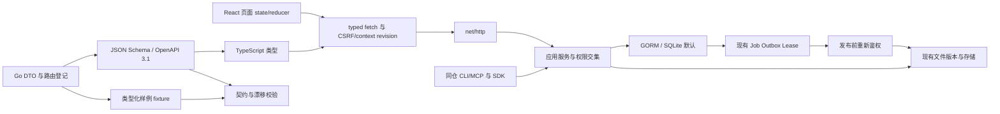

# 个人多 Agent 工作台技术选型

2026-10-08首次整体完成申请被独立审计否决；C110–V114 已补齐收件可读信息、多格式固定版本检查与稳定态视觉证据，当前待独立复审。新增SubmissionView四个可选展示字段由原upload operation/已鉴权Agent投影，不新增数据库真源；预览先重查submission/ref并固定版本，下载再鉴权，文本/HTML转义且不自动转换。当前两条本地链及PNG/PDF/二进制真实链已重验（20261008T140404Z-b6b40e0d），并非只用历史证据；完整产品的Pinax/原生/云部署仍有独立门，不作整体完成声明。唯一 owner 为 `cli/drivebridge`；本文件记录技术决定，不另存任务状态，也不复制 [API 合同](../server/personal-workspace-contracts.md)、[UI Spec](../web/ui/personal-workspace-ui-spec.md) 或 [数据模型](../server/personal-workspace-data.md)。用户已确认采用执行时固定摘要的最新 OpenDesign 快照、单机 SQLite 优先。当前参考是 [2026-10-07 冻结基线](../web/ui/workspace-visual-gap-baseline.md)；[v39 快照](../web/ui/personal-workspace-reference.md)仅保留为历史，不是本轮最新基线。

## 2026-10-01 Electron 阅读切片

桌面宿主已由用户锁定 Electron，不再是 S5 未决选型；详细唯一合同见 [Electron 架构](electron-desktop.md)。新增 D15：同仓 desktop TypeScript main/preload + Forge，复用 web，不新增Rust/Wails或另一套UI；Go领域仍pure Go。Pinax reader与受监督会话由外部owner提供，DriveBridge固定适配器只组合公开合同。本地阅读无云登录/模型依赖，macOS/Windows/Linux实机门全部必需；不等于本次已实现。移动原生/相册/后台与内置助手仍留原S5，Web/PWA原门不变。

## 1. 选择与不选择

版本以现有 package/go manifests 和锁文件为准，本轮不升级全量依赖。下列 Dxx 是文档交叉引用，不是另一套任务编号或状态。

| 决定 | 选择 / 理由 | 不采用的方案与边界 | 实施任务 |
| --- | --- | --- | --- |
| D01 前端基础 | 现有 React 19、TypeScript strict、Vite、pnpm；复用已验证的构建入口 | 不切 Next.js/SSR；这是登录后的文件客户端，不因界面重建引入第二个服务端 | F02/F03 |
| D02 视觉与组件 | Tailwind 4、现有 Base UI/shadcn 原语、Lucide；单一语义 tokens，常规动效用 CSS | 不复制原型多层覆盖样式，不引入第二套组件库或动画运行时 | F03.1/F03.3 |
| D03 路由 | 复用 workspaceRoute/hash 解析，收敛类型化路由表和 alias | 不新增路由库；公开分享、本机 view 保持独立 entry；旧 tenant/space/operation 含义不变 | F02.1/F03.2/F16 |
| D04 UI 状态 | 页面 state/reducer，Context 仅身份/范围/壳层；URL 为可分享导航状态 | 不加 Redux/Zustand，不自研查询缓存框架，不把文件/任务存成客户端 canonical 数据 | F02.1/F04/F10/F11 |
| D05 网络 | 复用 api.ts typed fetch、cookie/CSRF、AbortController/context revision；生成类型接现有适配 | 不加 axios 或第二套生成客户端；旧 normalizer 仍用于旧合同，不能宽松接受非法新期限 | F02.1/B01 |
| D06 列表/编辑 | TanStack Table 服务端分页，CodeMirror 6 Markdown；默认 50、上限 200 | 不一次请求/挂载万项；不为分页表格默认增加虚拟列表。超量需求先测量 | F04/F07/F09 |
| D07 阅读器 | 保留 PDF.js、媒体/文本/Spreadsheet 安全内核，按需加载及既有 worker | 不执行 HTML/SVG 脚本、公式/外链；超预算/未知格式受权下载，不引入在线转换服务 | F06 |
| D08 后端 | Go、net/http、现有 application service；HTTP/SDK/MCP/worker 共用裁决 | 不切 Gin/Fiber，不拆微服务，不把 handler 或 Web 变领域 owner | B03–B08/B15/B16 |
| D09 数据库 | GORM + pure-Go SQLite 首条闭环，保留 PostgreSQL adapter 与相同业务模型 | 不改 ORM，不默认 cgo，不在业务层拼 SQL；不默认双数据库同步验收或多机 writer | B02/B13 |
| D10 存储/运行时 | 复用 File/Version/CAS、存储适配、Operation/Plan、Job/Outbox/Lease | 不造平行文件库、Redis、MQ 或通用 Agent 执行器；已存在的可选分析能力不删除 | B03/B05–B08/B11 |
| D11 搜索 | file-queries 精确查询，内容候选消费已有公开合同；展示覆盖和水位 | 不新建全文/向量平台；Manju 内容理解不搬入 DriveBridge，查询不触发收费处理 | F09.2/B03.1 |
| D12 验证 | Vitest + Testing Library/既有网络替身，Go testing/httptest，既有 Playwright/fixture | 不新增平行框架、MSW/Testcontainers；浏览器 mock 不冒充真实 API，普通并发不用 race | F01.2/F17/F19/F23/B12 |
| D13 机器合同 | Go DTO → JSON Schema/OpenAPI 3.1 → TS；类型化 Go 样例 → fixture | 不手写第二份 schema/TS/fixture，不暴露 GORM 实体，不靠随机生成推断业务语义 | B01.1–B01.3 |
| D14 观察/恢复 | 有界轮询、幂等身份和原 Operation/Plan 查询 | 不加 SSE/WebSocket，不自动重试非幂等写、不显示未经服务端确认的成功 | F05/F10/F11/B03 |

## 2. 数据流与安全边界



浏览器负责未提交草稿、布局、选择和安全导航状态；文件、授权、分组/置顶、决定和执行结果只由服务端持有。secret 一次交付，禁入 URL、localStorage、IndexedDB、截图/trace。上传恢复仅保存带 instance/tenant/user/space 隔离键的非秘密请求身份。

权限状态及原操作不能由网络状态推断：401 重新登录，403/404 清敏感内容并安全返回，409 保留表单重读，410 重查并清旧选择；其他结果未知先查询原请求，不把网络超时当业务失败重建。

## 3. B01 生成合同的明确交付

### 真源与路径

以下 B01 路径现已存在。本轮只复核并复用，不重新创建机器 schema 或生成器；生成合同与运行时安装仍是不同事实：

- 现有 DTO 保持 Go 代码真源；新 DTO/路由元信息集中到 `server/internal/contract/`，对已有公开 SDK 类型使用显式引用/兼容适配，不批量改旧 import。
- DTO 之外的路由、状态码、认证/权限动作、幂等要求在同仓 Go 登记中关联类型；不能从任意 URL 或 GORM 模型猜公共合同。
- `server/cmd/drivebridge-contracts/` 为既有 Go 生成入口；`contracts/personal-workspace/openapi.json`、`schemas/`、`fixtures/` 为既有生成产物位置；`web/src/generated/personal-workspace.ts` 为既有 TS 类型入口。生成物有自动生成标记，不可手改。
- `invopop/jsonschema` 已在 Go 依赖图中；B01 使用时将其声明为直接依赖，不升级无关包。输出 JSON Schema 2020-12 与 OpenAPI 3.1，组件引用确定性排序。
- `openapi-typescript` 从 OpenAPI 派生 TS。Ajv 8（2020-12 实例）和 `ajv-formats` 仅开发期检查 fixture/schema；不进入浏览器生产包。三者现已在 web 开发依赖中，本轮不升级或重复安装。

Go 字段、指针、omitempty 与业务校验必须映射一致：`expiry_mode` 必返；`expires_at` 必返但可 null；PATCH 要保留未提交/null/值三态。禁止用普通 `*T` 解码后丢失 PATCH 字段是否存在的事实；采用有显式 presence 的 DTO 解码合同，并验证零值/false/null 场景。duration/never 的互斥与秒数枚举由合同约束表达，同时保留服务端业务校验。

### 生成与漂移

现有 `make contracts` 通过 `web/scripts/generate-contract-types.mjs --profile all` 生成 Go schema/OpenAPI/fixture 与 TS；`make contracts-check` 执行临时重生成比较、Ajv 正反例及桌面合同检查。2026-10-08返工后 personal-workspace profile 无写入漂移检查（`20261008T134558Z-3f799a7e`）与76个schema正反例（`20261008T134600Z-d60056b8`）通过，含C105受控自动化与C110收件可选展示字段；历史70schema及审计前证据保留，未运行all/desktop门；证据均在 `temp/integration-test-runs/`。生成头部保守的 planned 提示不是 handler 安装清单；运行时能力须结合实际 handler 和独立本地链路判断。旧 `/agents` 兼容仍通过业务测试单独验证，不能由 schema 检查代替。

重生成不可修改源码或状态；漂移门不自动覆盖受管文件。DTO 更新未生成、手改 TS、nullable/required/枚举错误、不同端 fixture 不一致都必须失败。未知响应 enum 在 UI 安全降级为 unknown/unsupported，未知请求动作在服务端默认拒绝；不能用宽松 TS cast 绕过。

B01.3 需为每种漂移准备一个实际失败断言，并验证正例恢复。contract 检查完成不代表 endpoint 已实现。

## 4. 单机优先与 PostgreSQL 定位

SQLite 是首发个人工作台与开发 fixture 的默认，继续单进程/单 writer 约束，不承诺多机并写。当前源码 `server/internal/service/model.go` 已有 PostgreSQL 分支，`server/cmd/drivebridge-server/metadata.go` 已有迁移入口；不再笼统写“PostgreSQL 完全未实现”。源码存在不代表当前部署可用，历史测试不能替代本次验证。

新增 GORM 模型使用可移植字段、唯一约束、nullable 期限和 CAS；不得偷偷依赖 SQLite 专属行为。首条新增闭环在 SQLite 测试；PostgreSQL 实际兼容、迁移、锁竞争和团队规模保留独立验收。没有实测的环境不标通过，也不要求每个个人切片等待 PostgreSQL 服务。

增量表/列与旧 ID 保留；回退优先停新入口、保留数据、向前修复。不认识 restriction profile 的旧 binary 不能接管新凭据。停写迁移、真实数据 backfill、反向迁移分别授权；不能默认 drop 新表或恢复旧 DB 快照。CLI 配置遵守用户级秘密配置规则，不将 DSN 写文档/命令参数/证据。

## 5. 前端行为与观察策略

- hash 路由白名单解析稳定 ID/ref，保留原 URL 语义；不引入任意外部跳转。滚动/焦点属于会话 UI，不随异步结果丢失。
- 页面 reducer 管理 loading/ready/empty/partial/stale/offline/error；取消请求与 context revision 双保险。Context 不装全量文件或任务数组；不新造查询缓存层。
- 当前页有活动任务时约 2 秒轮询；无活动任务的摘要约 30 秒。请求结束后再安排下一次，同一资源无重叠；后台标签页暂停，前台恢复先重新鉴权。失败退避 2/4/8/16/30 秒，带抖动且尊重 Retry-After（服务端要求更长时不得截为30秒）。401/403不无限重试。
- 只对安全读取自动重试；lookup 虽可能为 POST，也必须按已登记只读恢复合同处理。写入超时原键/原 ID 查询，不能新键重发。授权变更、归档、标签采纳不提前显示成功。
- 分组/置顶为跨设备服务端数据。展开/收起、授权/任务状态筛选是非秘密本机偏好，按 instance+tenant+user+space 隔离，恢复时校验 enum；搜索文本/调用对象/日期保持会话内。偏好不能暗示任务或授权跨设备状态已同步。
- 上传/预览保留现有协议与安全内核。分页不等于全量选择；固定版本不自动切新；Markdown/属性冲突不清草稿或强行覆盖。

## 6. 阶段与测试归属

CONTRACT 固定 DTO/fixture；FRONTEND 用固定合同替身验证本端状态；BACKEND 验证自己的公开入口与数据库；只有 INTEGRATION 任务验收真实跨模块路径。实现独立完成时另一侧保持 INTEGRATION_PENDING。

S2 首条 Agent 链仍为 B12.2→F19，不等待知识资源。B16.1/B16.2 和 F22 承接标签建议完整能力，B15/F20 承接组织，F23 汇合 S2 全能力；S3 的 B09.1 仅保留收藏/文件组织，不把 Agent 建议拖到信息工作台。

现有 Playwright 启动真实 Server fixture，但部分测试使用 page.route；必须按每个场景标真实/替身，不能凭 runner 名称判定 e2e。前端单端可用 Vitest/Testing Library，不要求跑整个浏览器链。桌面 Electron 阅读按 D15 的独立合同和三平台门推进；移动原生与助手继续 S5 的合同和实测门。

从仓库根执行的普通测试入口（每次运行另留新证据，命令存在不代表全量通过）：

```bash
python3 scripts/check.py -- pnpm --dir web exec vitest run src/api.test.ts
python3 scripts/check.py -- go -C server test ./internal/service ./sdk
python3 scripts/check.py -- pnpm --dir web exec playwright test
```

根 runner 直接运行底层工具，避免再嵌套 `pnpm test`/`test:e2e` 的模块 runner。集成六件套位于根 `temp/integration-test-runs/<run-id>/`；构建需先满足现有 Playwright fixture 的 web/dist 要求。旧模块证据保持原址，不改历史。所有默认/聚合命令都须静态核验不触发 race，禁止通过试跑未知命令检验这一点。

## 7. 选型复核依据、迁移成本与重评条件

本次通过本地 manifests 与源码复核，不以在线最新版本或市场采用率作为依据，也不执行依赖升级：`web/package.json` 声明 React 19.2.0、TypeScript 5.9.3、Vite 7.3.5、Tailwind 4、Base UI、CodeMirror 与 TanStack Table；根及 server 的 `go.mod` 使用 Go 1.26.4、GORM 1.30.0 和 mcp-go 0.45.0，根固定 rclone 1.75.1 并通过本地 replace 引用 `./server`。这里是声明版本核对，不等于本轮已验证安装树、锁文件一致性或供应链安全。

`server/internal/service/model.go` 的 Open 已存在 SQLite/PostgreSQL 分支、私有 state 与进程锁，SQLite 设置单连接。选 SQLite 为个人默认是在已有实现上收敛交付条件，不是引入新的数据库，也不宣称已解决团队多实例问题。跨产品面运行边界见 [统一运行架构](unified-runtime-design.md)。

| 决策组 | 已有方案的维护收益与风险 | 替代方案的实际迁移代价 | 何时重新评估 |
| --- | --- | --- | --- |
| React/Vite 与现有原语 | 复用阅读器、登录恢复、测试和团队技能；风险是旧大入口与样式累积，需按 F01–F03 清理编排 | Next.js/SSR 需要增加服务端渲染与认证边界、替换构建和路由；更换组件库需重验焦点、菜单、表格和双端交互 | 出现明确公共 SEO/服务端渲染需求再独立评估，不因后台页面多而更换框架 |
| 页面 reducer/typed fetch | 无额外运行依赖、可沿用 CSRF 和原请求恢复；风险是异步状态重复，需公共错误适配和 context revision | 查询库或全局 store 需要重新定义失效、身份隔离及 optimistic write 策略，并迁移测试；不能默认提高安全性 | 测量发现跨页面缓存/去重复杂度成为真实瓶颈后，对单一场景试验；不自研通用缓存框架 |
| GORM/SQLite 首发 | 单机部署与可丢弃 fixture 简单；风险是写争用、长事务和备份一致性 | 默认切 PostgreSQL 增加服务运维、凭据、备份与迁移成本；替换 ORM 还会重写 repository 和兼容测试 | 实测写竞争、多人规模或部署要求超出单实例边界，再推进现有 PostgreSQL 路径的独立验收 |
| 既有 Go service/Job/Outbox | 不新增网关、队列和跨服务事务；风险是应用模块边界需持续约束 | 微服务、Redis/MQ 引入额外持久化、重试、监控和升级故障面；不能解决未经定义的幂等问题 | 有可量化独立扩缩容或隔离要求，并先证明现有 worker 不足时再评估 |
| Go DTO 生成合同 | 让 schema/TS/fixture 共用真源；风险是 nullable、PATCH presence、业务互斥无法仅靠反射保证 | schema-first 同样可行，但本项目已有 Go DTO/SDK，迁移真源会增加双向适配与旧字段兼容工作 | B01 若无法确定性表达所需 schema，先验证窄范围生成器/显式注解，再决定是否变更真源；不得同时维护两份 |
| 有界轮询 | 与既有 HTTP、身份切换和原操作恢复一致；风险是请求量和可见延迟 | SSE/WebSocket 需连接鉴权、重连游标、反向代理配置与失联语义；不能代替 operation 查询 | 在明确并发量下测得轮询开销或延迟不满足需求后评估；保留 HTTP 查询恢复路径 |
| 现有阅读器与分页表格 | 复用安全限制与测试，重型解析按需加载；风险是恶意文件和大型文档内存预算 | 新阅读器/在线转换会增加数据出域、依赖与格式兼容风险；默认虚拟化会增加焦点和可访问性复杂度 | 同一代表性数据集测得分页/现有阅读器不达预算后，按格式或表格单独替换 |

成本比较是当前工程边界下的定性判断，不虚构工期、预算或性能测量结果。技术栈保留不意味着旧代码原样复制：应重建壳层和页面编排，同时保护已验证的协议、安全内核和用户恢复身份。

核心首发选型结论已明确：既有 React/Vite Web、Go application service、GORM/pure-Go SQLite、现有存储与任务运行时、Go DTO 派生合同。B01 的生成和正负 fixture 已有上述定向证据；不代表所有已登记 endpoint、桌面宿主或真实云已完成。Electron 已确定并进入独立桌面阅读设计；移动宿主及内置 runtime 仍属于 S5 决策门，不影响当前 Web 首期方案。

## 8. 设计验证与需求追溯

D01–D07 对应 R01–R06/R13，D08–D10 对应 R02/R07–R14，D11 对应 R06，D12 对应全部 AC，D13 对应 R15/AC28，D14 对应 R02/R07/R08。完整 [需求、页面、合同、spec、任务与证据矩阵](../web/ui/personal-workspace-acceptance.md) 仍是验收入口。

B01 合同生成、S2 三动作及并发恢复、SQLite 本地回读、跨身份迟到响应、双端可访问性必须各有证据。strict、技术选型和原型截图仅证明设计工作，不证明产品实现、PostgreSQL 部署、真实云或发布。
