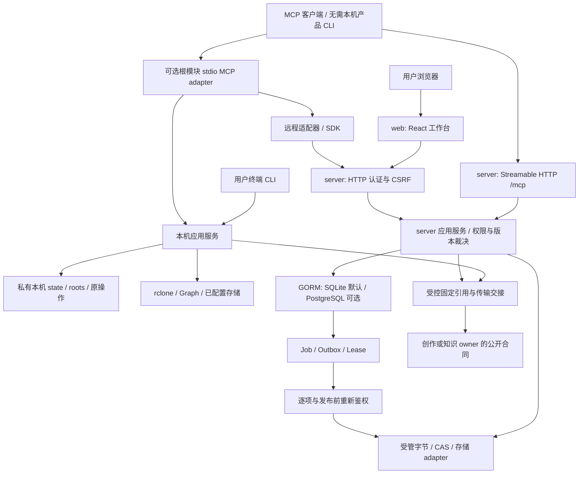
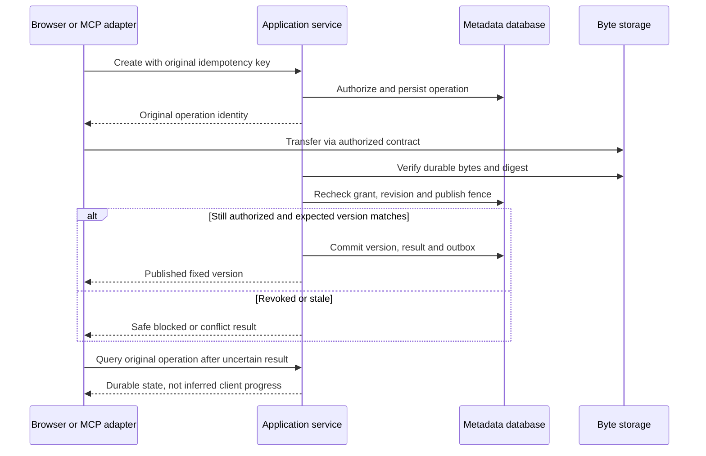

# DriveBridge 统一运行架构与恢复设计

本页补充跨模块架构，不替代 [工作台接口](../server/personal-workspace-contracts.md)、[数据模型](../server/personal-workspace-data.md) 和 [技术决定](personal-workspace-technical-decisions.md)。模块源码已有部分能力，个人工作台新增合同仍待实施；图表示职责与目标路径，不是部署通过报告。

## 桌面本机阅读增量（2026-10-01）

用户批准 Electron 同仓宿主 + Pinax 阅读空间，当前仅设计。新增模式为 Electron → 固定 typed IPC → DriveBridge 前台本机门面 → Pinax 公开 reader API；不需要云登录、不启动团队 Server 来满足本地阅读。门面只管理固定随包进程，非通用broker，不强制依赖client-runtime。秘密由私有stdin引导，stdout日志零秘密；EOF退出且不影响独立Hermes。具体路由/类型/安全与全入口guard只在 [Electron 架构](electron-desktop.md) 维护。

本机与Server既有state分离的事实不变；受管vault必须证明所有相关可写入口处于同一保护域，未知别名/远程挂载/其他state无法保护时拒绝绑定，不声称全局文件锁。旧overlay/sync不自动迁移。原生三平台门与自然使用见 [阅读验收](../delivery/desktop-knowledge-acceptance.md)，不以本图或Web成功升级为已实现。

## 1. 单一 owner，多种运行方式

同仓不等于同一个进程、同一个 state 目录或共享任意私有表。根本机 service 与 server service 目前分别维护各自模式的状态；统一的是领域职责、公开合同、兼容要求及开发入口，不假称它们已合成一个内存 service。远程 adapter 必须调用 server 的公开 SDK/HTTP，不能绕过权限读取 server 数据库。本机 view 通过本机 owner 私有通道执行动作，不另开可写数据库。

| 模式 | 进程与访问 | 状态与边界 | 本轮处理 |
| --- | --- | --- | --- |
| 本机 CLI/MCP | 本机受控进程、stdio；可选私有 socket 与回环 view | 明确 local roots、存储 drive/root；单 state writer | 保留既有能力，补兼容与恢复设计 |
| 远程个人空间 | 浏览器 → server；CLI/MCP adapter → 同 server | server state、实例身份、用户/空间权限；客户端无数据库访问权 | 新个人工作台首发模式，SQLite 优先 |
| 个人自部署 | 显式 TLS/origin、既有认证入口、私有 state 与字节存储 | 首发单实例；数据库、对象字节、实例密钥分别管理 | 仅提供设计与 runbook，不配置或部署 |
| 团队/更大规模 | 保留 PostgreSQL、治理、worker 等已有代码路径 | tenant/role 继续由 server 裁决；不因使用 PostgreSQL 宣称多实例安全 | 独立迁移、隔离与规模验收，不阻塞个人首条闭环 |

本机身份、远程实例、tenant、human owner、Agent、space 不互相推断；同一邮箱或调用者自述标签不能建立跨实例授权。引用必须携带足以验证实例与固定版本的身份。

## 2. 合同与真源

HTTP handler、MCP 和 SDK 是 surface，不自行实现另一套授权规则。新增个人工作台规则由 server 应用服务强制执行；本机操作由本机 service 强制限制 roots 和 backend 能力。机器字段以现有合同为准，后续 B01 使用 Go DTO 生成 schema/TS/fixture；当前尚未实现生成器，不能把设计文件当可调用端点。

- 文件、版本、连接权限、grant、分组置顶、人类决定及操作结果属于服务端状态；Web 仅保存隔离的非秘密偏好、选择和内存草稿。
- FileRef 固定实例/文件/版本，不以临时下载 URL 充当长期引用；新版本不能悄悄替换已选版本。
- Operation/Plan 是执行与恢复真源。任务页和 Agent 进度只是引用原 ID 的投影，不能另建可执行任务状态机。
- 知识反链、属性、搜索候选与容量统计是可重建投影；水位与覆盖不足必须可见。投影不裁决授权、配额、删除资格或领域采纳。
- 领域生成、模型收费、Skill 安装和 Pinax 结构化笔记规则仍归各自 owner。DriveBridge 只交接受权引用、传输结果与公开任务引用。

## 3. 没有产品 CLI 的 MCP 客户端

### 3.1 首选既有直连：Server Streamable HTTP

`server/internal/service/http.go` 已注册 `/mcp`，`server/internal/service/mcp.go` 的 `MCP()` 使用 stateless Streamable HTTP，经 Enabled、authenticate、bindContext 后进入同一 `CallTool` 应用裁决。它不是根 stdio adapter，也不需要在客户端安装 DriveBridge CLI。已有界面说明见 [预览协作](../web/ui/preview-collaboration.md)。

| 入口 | 客户端条件 | 字节与路径 |
| --- | --- | --- |
| server `/mcp` 直连 | 支持 Streamable HTTP 与受控 HTTP 字节请求，配置 scoped Bearer token | capabilities 明示 `local_file_access=false`；本地文件由客户端读取，字节通过 HTTP 上传；无远端 local_path |
| 根 stdio 的远程 adapter | 操作者运行根模块进程，再由 SDK 调用 server | `upload`/`download` 的 local_path 属于 adapter 宿主，不是任意聊天客户端 |
| 根 stdio 本机模式 | 操作者运行本机 service、配置 local roots 和云连接 | local_path 属于本机 service 允许根；不同工具参数不与 server 直连混用 |

**旧身份直连普通上传流程（既有源码合同，仅适用于已具备旧 write 的身份）：**

1. 操作者在 server 所在部署配置服务与授权；客户端只保存受控凭据配置，连接已批准 origin 的 `/mcp`，通过 Authorization Bearer 携带 scoped token。工具请求和 HTTP 字节请求必须保持相同授权主体及已批准 tenant/space 上下文；上下文 header/参数仍由 server 校验，不能用自述标签扩权。
2. 使用 `tools/list`/inputSchema 和 `drivebridge://capabilities`（或 `capabilities` 工具）发现合同。返回包含 `part_size`、`max_bytes`、`instance_id`、`public_base_url`、`local_file_access=false`、`byte_transport=authenticated HTTP`、context_headers。工具可见不等于拥有每个资源的操作权。
3. 上传：调用 `create_upload`，按 schema 提交 space_id、path、size_bytes、sha256 和原 idempotency_key；更新已有文件时使用实际合同的 file_id/expected_version。返回 `operation`、`part_size`、`part_path=/api/v1/operations/{id}/parts/{index}` 和 `authorization=same_scoped_agent_token`。客户端自行读取文件，按返回大小将分片原始字节以 PUT 发往同一批准服务 origin 的 part_path，携带同范围 token；不把文件内容塞进 MCP 参数，不把 secret 发给任意返回 URL。
4. 恢复：调用 `operation_get(operation_id)`，读取 `operation` 与 `received_parts`，仅续传未确认的分片；响应未知先查原操作。create 响应丢失时按相同创建参数和原键恢复，禁止换键制造新上传。新个人工作台 grant 的创建/轮转 metadata lookup 是另一规划合同，不混为现有上传工具。
5. 分片就绪后调用 `complete_upload(operation_id)`，再查询原 operation；以服务端验证与发布状态为准，PUT 成功不等于文件已发布。撤权或版本冲突保持阻断，不通过旧端点绕过新 restriction profile。
6. 读取：先 `stat(ref)` 获取固定版本，或从受权文件结果取得 file_id/version_id，再以同范围身份请求 `GET /api/v1/files/{id}/content?version={version_id}`。必须显式固定 version；不省略版本后偷偷读取最新内容。字节由客户端保存，server 不承诺直接写到客户端路径。实际下载方法、响应和格式以公开 HTTP 合同为准。
7. HTTP 能力缺失的 MCP 客户端仍可发现/查询，但不能仅凭 MCP 文本传输文件；明确缺少的是客户端字节通道，而非 server 不存在上传合同。不得改走虚构 upload_url/base64 工具或放宽授权。

**新 personal_workspace_v1 grant 的 S2 决定**：不使用上述 create_upload 建收件，调用会被拒绝。按 [合同 §4.2.1](../server/personal-workspace-contracts.md) 从受权 capabilities 发现专用 HTTP 动作：POST /api/v1/inbox-submissions（原幂等键，服务端自选 staging）→ 获得 submission_id/operation_id/part_size/part_path → 同范围 HTTP PUT → MCP operation_get/received_parts → complete_upload（仅自身 inbox_staging）→ GET submission 确认 submitted → 人类决定和归档。创建响应丢失走 inbox-submissions/lookup，禁止旧 create_upload 或新键替代。需要读取正文时另具 files.read，使用固定版本 GET；仅 submit 不附送正文读权。labels.suggest 走专用 HTTP POST /files/{id}/label-suggestions，原键重放/自身建议回读；无新 MCP 写工具，不授权旧宽标签写。无 HTTP 能力客户端明确 unsupported。

S2 B12.2 验上述**新收件链**与旧 create_upload 拒绝、两 Agent 隔离、撤权和上下文；不是把旧普通上传当收件。B16/F23补完整标签建议与三动作集成，F19接浏览器收件。S4 B12.1回归旧身份普通上传、直连与stdio兼容，不是S2首条收件的前置。

### 3.2 根模块 adapter 的发现与路径边界

无需客户端安装 CLI，不等于 MCP 服务端无需部署，也不等于远端拥有客户端文件系统。

1. 客户端连接操作者已经配置的 MCP 服务，调用标准 `tools/list` 读取实际工具名、inputSchema 与权限说明。不同本机/远程模式参数可能不同，不能跨模式复制参数。
2. 读取已公布的可读资源。本机能力资源为 `drivebridge://capabilities`；远程适配器已注册 `drivebridge://service-access` 说明认证和原操作恢复。资源是否存在仍以当前连接发现结果为准。
3. 本机模式源码注册 `upload(space_id, local_path, name, idempotency_key)`、`download(file_ref, local_path, idempotency_key)` 与 `operation_get(operation_id)`；远程 adapter 的 `upload` 参数使用 `path`，文件工具使用 `file_id` 等字段。此处是源码例证，不替代实时 schema。
4. **local_path 总是执行该工具的进程可访问、且被允许的路径。** MCP 在另一台机器运行时，用户电脑路径不可直接上传；同理 download 的落盘位置不是自动变为聊天客户端的下载目录。
5. 客户端没有共享文件系统时，只使用当前服务公开并支持的字节传输合同。如果发现结果没有可用入口，明确报告缺少传输通道，由操作者配置；不虚构 `upload_url`、base64 参数或文件附件工具。浏览器自身选择文件的 HTTP 上传是另一入口，不代表 MCP 自动具备附件读取权。
6. 控制面返回原请求身份、operation 和固定引用；原始字节通过受权 HTTP/存储通道传输，不塞进日志、回执或大段 MCP 文本。
7. 超时先 `operation_get` 回查原 ID，保持原幂等键，仅在已发现 schema 允许且原操作可恢复时恢复；不能自动新建替代操作。凭据轮转响应丢失走个人工作台规划的 metadata lookup，secret 不重放，人类显式重新签发。

配置命令应由操作者在拥有 state 和凭据的服务端主机执行；给无 CLI 客户端的错误指引应提供安全原因、资源和操作者动作，而非要求用户在本机运行不存在的命令。

## 4. 上传、发布与撤权

数据库事务不能包住整个云存储网络请求。上传字节与发布元数据分阶段：孤立暂存字节尚不成为可见文件版本；发布必须在可验证的权限/版本 fence 下完成。失败保留原 operation 和逐项结果，清理仅通过保留策略及保护引用检查，不在请求错误处理里直接删除用户数据。

撤权阻止新动作和尚未发布部分；已下载副本不能保证召回。读请求也需按当前权限校验，不能因曾发过引用而永久可读。内部下载地址应短期、窄范围，禁止被写入持久日志、审计或截图。

## 5. 同步、复制与交接

跨存储复制先冻结来源版本和目标冲突策略，逐项记录结果，默认保留源；删除源是独立授权动作。源变化、目标变化或授权变化使旧计划失效，不能用新读取的内容替换已批准内容。

本机同步沿用 SyncPlan/SyncBaseline、两端根身份和单 writer。扫描不完整不传播删除；writer 交接必须显式，超时不是旧进程已经停止的证据。MCP 的只读同步发现不升级为 apply 授权。本次目标不执行同步、挂载或清理。

创作交接使用预配置目标和固定引用；文件上传、生成任务成功、回存、文件验收及领域采纳是不同事实。远程创作 owner 不读取客户端本机路径；必要时先经 DriveBridge 复制并确认远程版本。

## 6. 故障与恢复矩阵

| 故障 | UI / 客户端行为 | 服务与恢复不变量 |
| --- | --- | --- |
| 创建或写入响应丢失 | unknown outcome；保存原身份先 lookup | 幂等重放不产生第二个对象；secret 不重放 |
| 分片断线或浏览器关闭 | 展示耐久进度而非仅发送进度；必要时重选原文件 | 校验文件身份，恢复原 operation 的未完成部分 |
| 发布前撤权 | 清敏感视图，显示安全阻断 | 同一授权 revision/fence 决定发布；不只靠进程缓存 |
| 版本/计划冲突 | 保留草稿或选择，重读后重新确认 | 不默认覆盖，不复用旧批准扩大范围 |
| worker 中断/租约到期 | pending/unknown，回读原 job | fencing 防旧 worker 发布；外部副作用先查证，不盲重做 |
| 数据库不可用 | 不显示写入成功，受保护动作 fail closed | 不用旧权限投影绕过数据库裁决 |
| 索引或聚合落后 | partial/stale 与 observed_at/watermark | 原文件和权限保持真源，不能把零候选等同无文件 |
| 连接断开或限流 | 配置与就绪分开；尊重 Retry-After | 只安全读自动退避；恢复写先确认原结果 |
| 客户端切身份后旧响应到达 | 取消请求并检查 context revision | 不输出前一身份名称、计数、正文或操作结果 |

## 7. 安全与可观测性

认证沿用项目既有用户 Session/Key/Agent 路径，逐资源授权在应用服务执行；新长期 grant 只对明确的新 restriction profile 生效，旧缺失期限不能解释为 never。new grant 默认 read，不自动探测、执行或扩大范围。

凭据保存服从当前 owner 的用户级/私有秘密存储政策：不将真实值写仓库、默认配置、浏览器持久化或证据；既有配置适配器不支持的保存方式只列为后续缺口，不在本目标改实现。历史 runbook 中不一致的“文件不允许 secret”表述不能用于否定允许的用户级私有秘密存储，也不能当成改写凭据的授权。

受控 URL、存储目标与回调必须校验允许的 origin/范围和重定向规则，拒绝通过不可信资源访问宿主秘密。HTML/SVG/模板/资源包作为不可信内容，预览隔离、限制解析预算、不自动执行或加载外链。

可观测性只保留 request/operation/plan/grant 的安全标识、动作、范围摘要、耗时、字节口径、状态与错误码；不保留原始用户文件、模型载荷、secret、临时 URL 或内部推理。建议观察上传 durable/published 差额、操作 unknown 数、恢复成功率、权限拒绝、outbox lag、worker lease/fence 拒绝与连接失败；这些是待实现/核对的指标要求，不宣称已部署监控。

## 8. 部署、备份与回退

个人首发采用一个 server 进程与私有 state，SQLite 保持单 writer；Web 静态资产与 API origin/CSRF 合同一致。生产 TLS、认证与平台字节存储由操作者显式配置，本目标不运行激活命令。PostgreSQL adapter 存在不证明多实例、共享存储或迁移已经验证。

可恢复备份包含一致的元数据、实例身份、对象清单，以及独立保管的原实例密钥和可读取的对象字节。SQLite 文件副本不能代替对象备份；实例密钥不能只放进使用该密钥加密的备份包。恢复在隔离 state 验证身份/清单/对象一致后再开放写入口。PostgreSQL 需对应数据库备份与恢复验证，不能套用复制 metadata.sqlite 的步骤。

新增数据采用增量扩展与可重复迁移设计，真实 backfill/迁移独立授权。UI 可关闭新入口回退，但签发过新 restriction profile 的凭据不能交给不认识它的旧 binary；服务端降级须隔离新凭据/worker 并验证。已产生的新文件版本与业务写入不能用旧数据库快照静默抹掉，优先向前修复。

## 9. 设计到实施的关联

- 本页权限、发布与幂等要求落在既有 B04–B08、B12 和 F10–F12/F19/F23；详细任务仍以两个 owner change 为准。
- 合同发现、跨入口一致性与原操作恢复由 B01/B05/B12.1 覆盖；本机模式兼容由 F16/F17 及既有本机测试保护。
- 数据迁移与首发数据库由 B02/B13；前端布局和响应式不在本页重复，见 UI Spec。
- 本页新增跨产品面说明应在最终交接核对关联任务是否充分；不能仅凭架构文字将未来实施任务标完成。

源码定位：`internal/bridge/mcp.go`、`internal/remote/remote.go`、`server/internal/service/mcp.go`、`server/internal/service/http.go`、`server/internal/service/model.go`。本页只读核对工具注册与数据库初始化，未验证运行中的 tools/list、真实云、备份恢复或生产部署。
