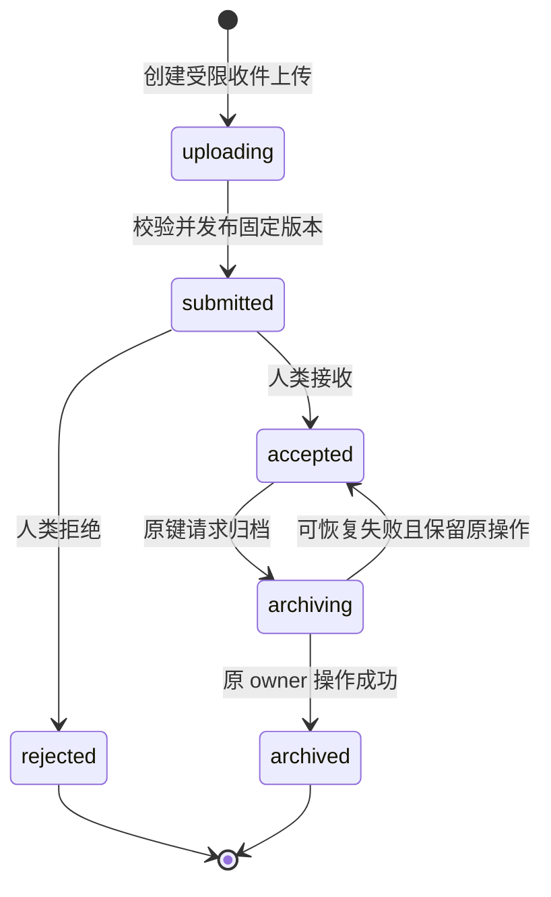

# 工作台数据模型、状态与兼容迁移

状态：设计待实施；接口与字段真源见 [工作台合同](personal-workspace-contracts.md)。按用户确认采用单机优先：现有 GORM repository/service 和 pure-Go SQLite 负责首条闭环；团队 PostgreSQL 保留既有 adapter，不要求新增切片逐个双数据库同步验收。源码已有 PostgreSQL 与迁移入口不代表本轮部署/锁竞争/规模已验证，见 [技术选型 D09](../architecture/personal-workspace-technical-decisions.md)。本包不引入新的 ORM、业务 SQL 拼接、事件平台或另一套文件对象库。

## 1. 实体与唯一约束

| 实体 | 关键关联/唯一键 | 权威与生命周期 |
| --- | --- | --- |
| AgentGrant | grant_id；agent_id 唯一；owner/tenant；creation action+actor+key 唯一 | 与现有 Agent 一对一；轮转仍是同一 Agent/grant，重新接入产生新身份；存 actions、scope、expiry_mode、nullable expires_at、issued_at、nullable expiry_changed_at、revision；secret 只保留现有 hash |
| GrantCredentialHistory | grant_id+credential_generation 唯一，哈希指向当前 Agent 凭据 | 只为轮转审计/撤销，绝不持明文；旧 token 立即失效 |
| AgentGroup | tenant+human owner+normalized name 唯一；group_id、revision、deleted_at | 个人分组；同事务删除并解除成员归属，不撤销授权，保留幂等 tombstone |
| AgentOrganization | tenant+human owner+agent_id 唯一；group_id nullable、pinned、revision | 一 Agent 至多一组；支持旧 Agent；CAS 初次创建 revision=0；组与 Agent 必须同属本人，删除组保留 pinned，组织 revision 与 grant revision 独立 |
| AgentLabelSuggestion | suggestion_id；agent+file+version+creation key 唯一 | S2 B16 承接；独立建议来源与 pending/accepted/rejected 决策；不同 Agent 不共享可覆盖的 namespace 写槽；采纳通过现有人工标签 service，版本/建议 CAS 与人工标签增量合并在同一事务 |
| InboxSubmission | submission_id；actor+creation key 唯一；upload_operation_id 唯一 | 引用原 File/Version/Operation，不复制 bytes；保留来源与审核事实 |
| SubmissionDecision | submission_id+decision revision 唯一 | 人类主体、固定版本、accept/reject、短理由；追加审计，不覆盖历史 |
| Favorite | owner+tenant+space+target_kind+canonical target identity 唯一 | 非授权对象；删除绑定不删目标；读时重新校验可见性 |
| PropertyDefinition | space+stable key 唯一，revision | 类型/显示名/分组定义；key/type 改动必须走显式迁移计划 |
| FilePropertyProjection | file+version+definition revision+key 唯一 | Markdown 由固定版本解析，sidecar 存 version 绑定值；可以重建，不能取代文件真源 |
| FileLinkProjection | source file/version+target ref+anchor 唯一 | 明示 Markdown 链接与安全解析，未授权目标不返回名称；不复制 Pinax 关系状态 |
| ResourceDescriptor / ResourceCheck | 固定 file/version 或 snapshot；check target+checker version 唯一 | 存 kind 与检查事实；新版本使旧检查变历史；不拥有安装/执行状态 |
| 工作台任务与调用视图 | 原 kind+owner ID，已有 audit ID | 投影复用 Operation/Plan/Invocation/Audit；无新可执行 Task 表、无伪 owner status |

B01/B02 必须核对现有表是否已承载相同数据；可以复用时不新建同义表。表名为设计建议，实际注册模型与迁移以 owner 工具生成结果为准。索引至少覆盖 owner/tenant/space+time+id、grant_id+time、submission state+time；不能靠前端全量过滤模拟分页。Agent 组织额外索引覆盖 tenant+human owner+group_id+pinned+agent_id；通过 GORM 事务/约束保证同 owner、删除并发和无悬空成员，不以名称作为关系键。组织写入只发安全审计与视图失效，不更新 Agent scope、grant revision、文件授权或期限。

## 1.1 本机 Pinax 阅读状态增量（2026-10-01）

新增设计由 [desktop-knowledge-reader change](../../openspec/changes/drivebridge-desktop-knowledge-reader-v1/README.md) D03/D04承接，详细字段与唯一规则见 [Electron 架构§4–6](../architecture/electron-desktop.md)。仅本机应用服务/GORM持久化，不在renderer建库，不复制Pinax正文/索引/双链，也不在本片同步至Server。

- Favorite扩展 `pinax_note` 引用身份；沿用删除不删目标、授权过滤与CAS，不能创建虚假File/Version行。B09.1与D04共享同一应用规则，不复制双实现。
- ReadingState按本机subject+instance+kind+source/space+object/file唯一；position固定revision/anchor/offset，收藏与稍后读逻辑目标分开更新。原键lookup解决未知响应，正文不落表。
- SourceBinding与ManagedRootGuard由owner初始化/修改，规范化路径只在私有配置内；UI隐藏不释放guard。保护revision、最低writer版本与在途复检必须持久，不能是桌面内存标记。
- 新表/可选列增量演进，无真实数据backfill；旧state不自动导入、旧overlay不改写。有效guard存在时不支持的旧writer不得降级打开；关闭UI不解除保护。

## 2. 状态和事务

上传失败保留 uploading + 原 operation 的 failed/recoverable；不能凭客户端进度推进 submitted。归档超时保持 archiving/unknown，查询原 operation 后裁决，不能直接退回 accepted 重新创建。accepted 回退仅适用于确认尚未成功且原操作可恢复的失败，仍复用原身份。

Grant 状态 derived 优先级：revoked > expired > disabled > active。只在 `restriction_profile=personal_workspace_v1` 且 `expiry_mode=duration`、`expires_at` 非 null 时按 server_now >= expires_at 得到 expired。新 profile 的 `never` 必须配 null，duration 必须配真实截止时间；未知 mode、缺失 mode 或不一致组合一律 fail closed，不能被解释为长期。首次签发记 issued_at；期限修改成功记 expiry_changed_at，固定秒数从该服务端时刻计时；幂等重放不重新取时间。旧 profile/缺失期限继续旧鉴权语义，不使用本派生逻辑放宽。检查连接不改变 grant 授权；来源观察带时间，不能写为“永久在线”。禁用、启用、期限修改、PATCH/rotate/revoke 都以 expected_revision 比较；轮转只更新凭据代次与 grant revision，保留身份和原 expiry_mode/expires_at/expiry_changed_at，旧凭据同事务立即失效；创建/轮转一份新 secret 后立即返回一次，后续重放只返回 metadata+not_replayable。

同一事务记录应用状态、幂等结果索引与审计/outbox；现有运行时负责 durable job 与租约。worker 在执行每项及 publish 前复检 grant/版本/策略，撤权事务和发布条件使用可验证的 revision/fencing，不靠进程内缓存保证。DB 不可用时 fail closed。

固定上下文由 instance/tenant/space + file/version refs 或 collection snapshot + context revision/digest 构成；不含 bearer URL。客户端变更选择后不能复用旧确认；服务端从 refs 重算校验，不能信任客户端报的 digest 或权限。

## 3. 文档与属性一致性

文档保存以 base_version_id 比较当前版本；写 blob、验证、提交新 Version、切换 File 当前指针使用既有安全发布机制。失败保留原版本，不能先覆盖后补审计。敏感未保存草稿不默认持久化到浏览器。

Markdown frontmatter 在服务端解析/验证/序列化，未知字段和不兼容值保留；只修改人类明确选择的键。属性显示名改动不改 YAML key。文件保存与投影更新通过 outbox 保证可恢复；投影落后显示 stale，不把旧属性当新版本。

普通 Markdown 文本与 Pinax/OpenSpec/config/policy 等结构化资产区别对待：后者只提供读取和转到 owner 操作的入口，不提供绕过 CLI/application service 的任意编辑。文件类型身份由 owner 合同标识，不能仅靠扩展名猜是否受保护。

资源包和文档内容都视为不可信数据。限制文件/条目/解析深度/解压预算，拒绝路径穿越、symlink 越界、脚本执行和外部自动加载；检查只读，不读取宿主凭据或执行安装脚本。

## 4. 增量迁移与回滚

1. 先新增 nullable/defaulted 列、grant/收件/属性等必要表与索引；使用 GORM，保留旧 Agent/File/Version/Operation/URI。
2. 旧 Agent 无 restriction profile 时继续旧合同（默认 7 天/最长 30 天/原响应）；长期只适用于新 profile。新 AgentGrant 显式持久化 expiry_mode：never 对应 nullable expires_at，duration 对应真实期限；不把旧 Agent 的非空时间列改成远期哨兵，也不批量将历史 NULL 回填为 never。底层旧 Agent 期限字段不能表达长期时由新 profile 鉴权分支读取 Grant 真源，未知 profile fail closed，旧字段绝不作为放宽依据。
3. 对新增 UI 的 grant/资源/收藏采用新端点，旧 `GET agents` 数组及 `POST agents` 入参/默认不改。新增可选 provenance/supersedes 字段不改旧幂等摘要。
4. backfill 仅可由 owner CLI/迁移服务针对 disposable fixture 或获授权数据执行；本次只设计代码。不得自动迁移真实凭据、撤销旧 Agent 或清理旧文件。
5. 迁移失败事务回滚或可继续；索引可重建。SQLite 首批迁移验收包含空库、已有旧 Agent、旧上传恢复、重复执行、故障中断和旧 SDK。新字段/唯一约束/CAS 应保持 PostgreSQL 可移植性；PostgreSQL 实际兼容、停写迁移和规模另验，不拿 SQLite fixture 替代。
6. 关闭新 capability 可回退 UI/新请求入口，但已签发的受限 Agent 不能交给不认识 profile 的旧 binary 鉴权。降级前停新签发、停止 worker、撤销/隔离这些凭据并验证；否则禁止服务端降级。仅切回旧客户端资产不要求撤销 grant。

   运维预检：停止签发入口和 worker 后，运行 `drivebridge-server metadata check-workspace-downgrade --state <state-dir> --json`。任何未撤销 grant（包括 disabled/expired）都返回 `workspace_downgrade_blocked` 非零退出；数据库错误也失败关闭，不自动撤销凭据。成功仅表示 workspace grant 已显式退役，不认证其它 schema 兼容，不授权部署，也无法阻止绕开流程直接启动外部旧 binary。命令使用当前服务的正常打开/迁移流程，不是只读原始数据库工具；先备份并在停写窗口使用。
7. 新列/表保留至少一个实际发布周期，不在新增迁移同批 drop。旧深链/接口无明确 removal release 前继续兼容。产生新版本后不回旧 DB 快照；向前修复或有明确授权的反向迁移。

### B36 调用观察增量表

`workspace_invocations`由原GORM事务迁移追加，记录已认证workspace Agent在HTTP handler/MCP tool实际边界的安全观察。invocation ID与request ID由服务端生成；只有owner/tenant/space/agent/grant、固定动作、实际protocol、started/finished及安全结果枚举。没有参数、header、正文、resource path、任意错误或凭据列，不从旧audit回填。迁移重复不补finished；回退旧业务代码无需重写业务行，新表保留不在同批drop。

采集best-effort，不因观察存储故障改变原业务回执；未完成记录保持unknown/finished null，记录缺失不代表未调用。此阶段无列表API、自动保留清理、规模或PostgreSQL实机结论；后续列表必须授权后分页并明确coverage，不将传输返回成功当作领域成功。

## 5. 保留与证据

文件字节、回收、hold、分享与固定引用沿用 retention 服务；收件拒绝不直接删除字节。审计/调用记录的保留窗口按部署策略配置，不因页面筛选被物理清除。用户可读范围撤销后不再从 projection/cache 输出旧正文或名称。

持久化只保存必要业务数据和 redacted review summary：结论、身份、动作、范围、版本、风险、结果、原 owner 引用。日志/trace/测试产物不包含用户文件正文、raw prompts、Provider payload、凭据、临时 URL 或内部推理。

后续实施测试通过普通 Go testing/httptest、现有 fixture 和仓库根 `scripts/check.py` 执行；证据统一写根 `temp/integration-test-runs/<run-id>/`，历史模块证据只保留引用。期限验收包含所有六档 duration、never、服务端边界时钟、验证/轮转不续期、修改重计时、旧缺失值 fail closed；组织验收包含两设备刷新/重启回读、跨用户租户、并发 CAS、删除归组竞争以及删除不改授权。重点是权限/幂等/冲突和发布前撤权的可重复断言；不启用 race。真实云账户、性能规模和部署分别验收。
