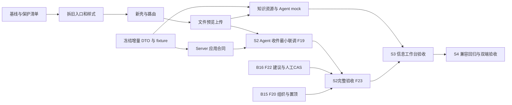

# 旧前端清理与新版开工计划

本轮是设计交付，以下源码删除/重建尚未执行。任务真源：[前端 tasks](../../../openspec/changes/drivebridge-personal-workspace-rebuild-v1/tasks.md)、[后端 tasks](../../../openspec/changes/drivebridge-personal-workspace-contracts-v1/tasks.md)。不另建一套任务状态。

## 1. 清理原则与基线

用户已要求先清理旧前端，正式实施按“保护行为 → 拆除旧页面编排 → 新壳层 → 新页面”执行。不是在旧 main/Finder 上继续加条件，也不是删除整个 src。检查时 main.tsx 2222 行、Finder.tsx 2417 行，四份主要旧布局 CSS 共 4459 行，说明应拆除页面耦合；行数不作为质量验收指标。

实施前记录当前 HEAD、未提交文件、未跟踪原型、旧路由/能力、基线截图、测试结果及文件摘要。已存在的 dirty 修改逐文件保护；尚未提交的代码不能假设 Git 可恢复。可使用本地诊断快照保存自己的基线；不得 git reset/clean，不得删除未知文件。

清理后开发预览默认进入新版壳层。开发中的未迁移能力显示可解释状态并阻止发布；不能以“未实现”绕过最终必需能力验收。无需让旧个人页面和新个人页面长期并行。

## 2. 文件级处置表

| 路径 | 处理 | 删除或迁移完成条件 |
| --- | --- | --- |
| `src/main.tsx` | 重写为薄 bootstrap；旧 App/页面 JSX/全局 effects 删除 | 登录、session/CSRF、租户隔离先提取且回归通过 |
| `src/Finder.tsx`、`Workspace.tsx`、`FinderMenu.tsx` | 新 FileBrowser/Home 替代旧页面；键盘/选择/预览能力逐项迁移 | 旧行为矩阵命中后按 import 引用删除，不另留巨型 legacy Finder |
| `src/style.css`、`finder.css`、`finder-browser.css`、`workspace-layout.css` | 提取少量有效 tokens；新壳单独建立规则，清除旧布局和 override | 新入口无旧页面样式依赖；未迁移管理页样式以局部容器隔离，不污染新页 |
| `src/info-workspace/` | 数据适配、format、兼容解析与测试复核复用；旧总览/详情外壳退役 | 容量/增长/传输/来源/讨论/活动没有丢，旧深链能到等价状态 |
| `src/consumer-flows/` | 保留恢复身份、原键查询、schema 兼容；UI 分发到新任务/搜索/收件/存储 | 未清除进行中的上传；旧数据库键有惰性读取/迁移；旧页面依赖归零 |
| `src/api.ts`、`activity.ts`、`storage.ts`、`capacity.ts` | 审查后保留，按公开合同减少 any；新 DTO 独立进入 contract 模块 | cookie/CSRF、错误 envelope、backend capability 和固定版本测试继续通过 |
| `src/finder-{keys,clipboard,undo}.ts` | 作为纯逻辑逐项复用或替代 | 回归覆盖快捷键让位、复制/移动/撤回真实性；不复制页面状态机 |
| `src/Media.tsx`、`PdfPreview.tsx`、`SpreadsheetPreview.tsx`、reader/worker | 保留安全读取/解析内核，重做工具条与详情外壳 | HTML/SVG 不执行、XLSX 不运行公式/外链、版本隔离、Range/内存预算回归 |
| `src/components/ui/`、DataTable、AppDialog/AppSheet | 复用已安装 Base UI/shadcn 供应；按新 tokens 收敛 | 检查焦点/portal/手势/手机；避免同时保留新旧两个主表格 API |
| `src/Teams.tsx`、`Governance.tsx`、`KeyDirectory.tsx`、`UserDirectory.tsx` | 兼容入口延迟加载，逐步换壳；本轮不得删业务能力 | old URL/role/tenant 语义通过；不把管理员权限派给个人视图 |
| `src/Sharing.tsx`、`LocalSharing.tsx`、`LocalWorkspace.tsx`、独立 insights entry | 保留公开分享与本机 view 生命周期，适配共用新组件 | 公开分享不误要求普通登录；本机不可写时诚实只读；独立构建入口验收 |
| `prototypes/personal-agent-workspace/`、历史 screenshots | 保留只读参考 | 不进入生产构建；不拿模拟状态接真实 API |
| `package.json`、lockfile、Vite、scripts/check.py | 只通过项目工具做必要变更；保留构建/测试入口 | 不为重建换包管理器；清理依赖须先确认无使用；runner 禁止默认触发 race |

删文件必须同时查 import/动态 import/HTML entry/CSS references/test references。不能用删测试或扩大快照容差把能力丢失变绿。旧快照可随新视觉更新，但行为断言需逐项迁移。

## 3. 路由兼容矩阵

旧 URL 在至少一个实际发布周期内保留别名；在没有明确移除版本与消费者迁移证据前不删除。合法 tenant/space/team/connection/ref/version/tab 参数必须延续；未知值给出安全错误，不回到任意个人根目录。

| 旧入口 | 新入口/行为 |
| --- | --- |
| `#/files`、`#/drives`、`#/drive/<space>` | 我的云盘；解析原 team/managed scope，不把团队目录变个人目录 |
| `#/overview` | 保留既有分析总览语义；适配至存储用量/总览兼容页，不静默改为 `#/home` |
| `#/analytics`、`#/insights` | 存储管理用量/资源态势，原 tab 与钻取条件保留 |
| `#/flows?center=upload` | 新上传/任务入口，保留 batch/operation 恢复锚点 |
| `#/flows?center=search` | 搜索页，保留当前空间与 exact/content 模式 |
| `#/flows?center=organize` | 任务计划入口，保留 plan/snapshot 身份 |
| `#/flows?center=deliver` | 分享交付入口，保留 share/manifest/version |
| `#/transfers` | 任务中心的传输过滤，仍区分上传/传出/接收事实 |
| `#/connections` | `#/storage?tab=connections`，固定原连接 |
| `#/agents`、`#/inbox`、`#/trash`、`#/shares` | 路由保留，消费新版 UI |
| `#/members`、`#/users`、`#/teams`、`#/governance` | 有权用户的独立兼容面；原 scope/tab 原样解析 |
| 公开分享 HTTP 路径、本机 view 与 insights HTML | 保留原 entry 和服务合同，不能全替换成需要会话的 SPA |

alias 是前端导航兼容，不改变 HTTP API。禁止添加任意外部 URL 跳转；回到当前 origin 内可验证路径。

## 4. 实施顺序与 workspace



以上表示依赖，不授权启动子 Agent。本轮根会话 inline 完成设计。按用户统一开发决定，实际开发默认同 checkout 保持可预览；server fixture 使用独立 loopback 端口、临时数据库、日志与进程组。只有确需并行分支时才创建同仓 worktree，不把模块当不同 owner。后端规范 source 只有一个 writer，前端只消费生成合同，不各写一份字段。

第一轮开工包是 F01/F02/F03 与 B01：先核对基线/提取受保护逻辑，再拆旧壳构建新入口，同时冻结服务端新增 DTO。随后按 S1 文件链、S2 Agent 产物链（含组织/期限）、S3 信息工作台验收。F19/B12.2 是首条 Agent 联调，不等待 F07–F09/B09/B10；S2完整退出由F23汇合F20/B15组织、F22/B16标签建议/采纳、计划与生命周期。FRONTEND任务仅fixture本端验收，真实路径由INTEGRATION任务执行。技术方案见 [技术选型](../../architecture/personal-workspace-technical-decisions.md)。阶段清单与需求追溯见验收矩阵。分阶段保留本地检查点；提交、push 或部署不在本轮自动执行范围。

## 5. 真实命令与门禁

以下统一从 `cli/drivebridge` 执行；不在 web/ 或 server/ 下执行 OpenSpec：

```bash
git status --short
pnpm --dir web exec tsc --noEmit
NODE_OPTIONS=--no-experimental-webstorage python3 scripts/check.py -- pnpm --dir web exec vitest run
pnpm --dir web build
python3 scripts/check.py -- pnpm --dir web exec playwright test
openspec validate drivebridge-personal-workspace-rebuild-v1 --strict --no-interactive
git diff --check
```

`NODE_OPTIONS` 用于现有 Node Web Storage 环境兼容，可在该问题不存在时省略。实现期间使用已有 runner 指定相关文件；稳定后才跑完整门。已只读核实 `web/scripts/check.py` 当前默认是 `pnpm exec vitest run`，不含 race；F01.2 仅核验 runner、聚合依赖及禁止 race 的回归保护，不重复安排删除。新集成证据经仓库根 runner 写 `temp/integration-test-runs/<run-id>/`；历史模块路径保留不搬移。

前端 focused 示例（文件已存在）：

```bash
python3 scripts/check.py -- pnpm --dir web exec vitest run src/api.test.ts src/workspace-route.test.ts src/finder-keys.test.ts
```

Server 定向命令同样从仓库根执行：

```bash
python3 scripts/check.py -- go -C server test ./internal/service ./sdk
go -C server vet ./...
(cd server && CGO_ENABLED=0 go build ./cmd/drivebridge-server)
openspec validate drivebridge-personal-workspace-contracts-v1 --strict --no-interactive
```

新增测试文件随各任务创建，再把 focused 命令补入 tasks；测试执行必须验证实际命中用例，禁止“0 tests”通过。UI 检查既有遗留问题先记录基线并归因；不能因其他未提交工作失败而改无关业务。任何阶段不运行 race。

## 6. 删除、回滚和交付

S0 删除的是经核对的源码编排与旧样式，不触碰服务端文件、数据库、连接、token、临时上传或用户离线副本。IndexedDB 恢复键采用兼容读取，不批量清空。旧草稿只由原用户显式丢弃或成功迁移后清理。

若新版不可验收，保留新实现分支/补丁与证据，恢复已保存的客户端构建/代码检查点；不回滚服务端用户数据、不撤销新增版本。发布以后只回退客户端资产仍须确认新请求没有超出旧 Server 支持。新 DB 表的 rollback 见后端数据文档。

最终交付须证明：生产入口不再加载旧个人页面；旧团队/分享/本机合同仍可用；原型无生产 import；没有未处理 API 占位 mock；不可用能力有真实原因；所有必需能力有迁移去向与验收记录。
