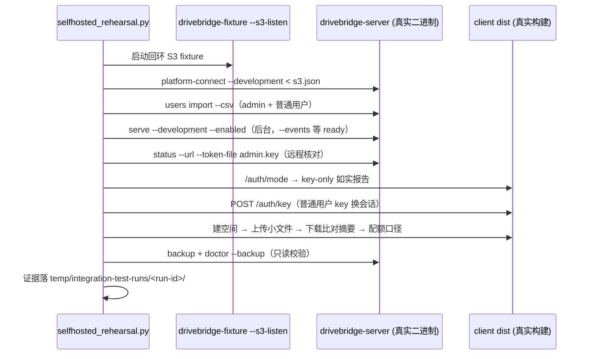

# Design: key-only 自托管激活彩排

## 目标

在接触真实服务器之前，用真实二进制离线跑通 `docs/deployment.md` §6 的四步 key-only 序列，把配置错误、序列错误、证据格式问题留在本地。

## 决策背景（操作者已定）

- 部署形态：Tailscale 私网，不暴露公网。
- 登录：key-only（`users import` 签发/导入，`POST /auth/key` 换浏览器会话），不接 OIDC。
- 存储：仅平台 S3（多租户按实例分片，可共享桶 + 前缀作用域子凭据）。
- 目标机：长期运行的服务器（访问方式与凭据由操作者后续提供）。

## 阻塞点与解法

| 阻塞点 | 现状 | 解法 |
|---|---|---|
| S3 fixture 不可独立访问 | `internal/fixtures` 的 S3 是 httptest 进程内服务 | `cmd/drivebridge-fixture --s3-listen` 独立监听回环并输出 endpoint；fixture 本就是显式命名的测试命令 |
| platform-connect 拒绝回环端点 | `openService(false, false)` 固定非 development | 增加显式 `--development` 旗标（仅 CLI，与 serve 同纪律） |

`--development` 不进入配置文件发现序（现有 spec 已规定 enabled/development 类开关只能显式命令行），不加环境变量，不改变默认行为。

## 彩排流程

## 证据合同

遵循 `docs/workflows/integration-test-evidence.md`：`summary.json`、`command.txt`、`stdout.log`、`stderr.log`、`env.json`、`artifacts/`；明文 key 只落在 artifacts 内 0600 分发文件，不进 stdout/stderr 日志正文（分发文件属证据的一部分，run 结束由操作者清理）。失败保留证据并以原退出码结束。

## 真实部署门（本 change 只到彩排）

真实部署需要操作者提供：服务器访问方式、Tailscale 状态、S3 凭据（经其凭据流程）、目标 arch。这些输入到位前，真实部署任务保持未勾；deploy runbook 章节只写步骤与门，不代执行。
