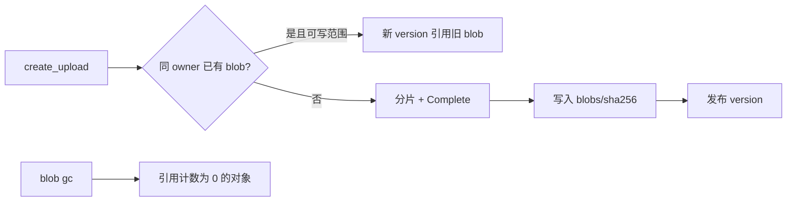

# Server blob store

## 基线

`Version.ObjectKey` 今天在 Complete 时写成 `instance/owner/space/version`。`UploadRequest.SHA256` 已是必填。加密空间对象是信封密文，元数据保留明文摘要。跨实例引用已拒绝。



## 数据

新增 `blobs` 表：`sha256`（明文，主键维度需叠加 `space_id` 当 `encrypted=true`）、`size`、`refs`、`object_key`、`encrypted`、`space_id`。Version 增加可空 `blob_sha256`；旧行回填前按自身 object_key 读。

对象键增量：

- 明文：`<instance>/blobs/<sha256>`
- 加密：`<instance>/blobs/<space>/<sha256>`
- 旧 `<instance>/<owner>/<space>/<version>` 保留直到该 version 迁移或 purge

秒传判定：当前 Principal 对目标空间可写，且已有 blob 属于同一 `dataOwner()`；加密空间还要求同一 `space_id`。他人空间即使摘要相同也当未命中。

配额仍按逻辑 size。秒传：预留→立即完成→`reserved` 回退、`used` 增加。

## 接口

- HTTP 成功体可选 `blob_reused`。
- `GET /api/v1/blobs/{sha256}`：对至少一个 version 有读权才返回计数；否则 `not_found`。
- 文件字节仍走 `GET /api/v1/files/{id}/content`（含 Range）。无 `POST /api/v1/mounts`，无匿名 blob GET。
- CLI：`drivebridge-server blob stat|gc`。
- MCP：不新增必填；`create_upload` 命中即 completed。
- 秒传范围：`dataOwner()`（个人或团队）。

并发：同一 sha256 的 Complete 用事务占 blob 行；失败者删自己刚 Put 的重复键。

错误：`blob_unavailable` 在元数据与对象漂移时使用，不返回空文件。

## 验证

```bash
python3 scripts/check.py -- go test ./internal/service ./sdk -count=1
python3 scripts/check.py -- go test -race ./internal/service ./sdk -count=1
go vet ./...
CGO_ENABLED=0 go build ./cmd/drivebridge-server
openspec validate drivebridge-cas-blob-store-v1 --strict --no-interactive
```

失败用例至少覆盖：同用户秒传、越权不泄露、加密跨空间拒绝、幂等冲突、并发双 Complete、blob 对象缺失 → `blob_unavailable`。

## 回滚

关闭复用旗标后总走分片。已共享 blob 的 version 仍按 object_key 可读。不删除旧键。
