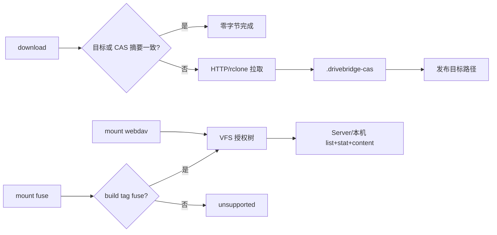

# 本机 CAS 与挂载

## 基线

`ReuseUpload` 只在同空间 + remoteCopier 时 `Transferred=0`。download 对已有不同内容拒绝覆盖，但没有跨文件 CAS 缓存。`sync` 是人工 bisync。`view` 只听回环。



## CAS 缓存

路径：`<local_root>/.drivebridge-cas/sha256/<aa>/<bb>/<sha256>`，文件 0600，目录 0700。写入先临时文件再 rename。缓存命中仍 `stat` 远端 version；version 变化不得用旧缓存。不把 CAS 目录列入 list/search 用户树。

远程模式：upload 声明 sha256，Server 秒传则本机不发分片。本机 OneDrive 模式继续 `ReuseUpload`。

## 挂载

VFS 合同真源是根包 `vfs-api.md`。本包实现 WebDAV 适配器与 CLI 生命周期。

只读默认。listen 默认 `127.0.0.1`。非回环要 `--lan`。同一 state 一个挂载。认证：用户密钥或 view 会话；拒绝 Agent token。

WebDAV：PROPFIND→Readdir，GET/HEAD→Open（Range），MKCOL→Mkdir，PUT→Create（writable retain-next），MOVE→Rename，DELETE→trash，LOCK→`unsupported`。

FUSE：默认二进制命令存在但返回 `unsupported`。`//go:build fuse` 才链 libfuse。也可文档化 `rclone mount` 指向 WebDAV。

MCP：`mount_status` 返回 listen、mode、space_ids、alive、adapter。无 `mount_start`。

隐藏：`.drivebridge-cas` / trash / output 不进树。

## 验证

```bash
python3 scripts/check.py -- go test ./... -count=1
go vet ./...
CGO_ENABLED=0 go build ./cmd/drivebridge
openspec validate drivebridge-local-cas-mount-v1 --strict --no-interactive
```

覆盖：缓存命中、version 变化拒绝、WebDAV 未授权空间不可见、默认 fuse `unsupported`、MCP 无挂载写工具。

## 回滚

停 WebDAV 进程即卸载视图；CAS 目录可留。关闭远程秒传后 upload 走分片。
