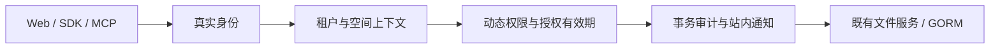

## 已确认设计

单部署包含多个租户；账号跨租户，个人存储归属按成员关系隔离。平台、租户、team 管理员只读各自范围；空间负责人独立审批。个人数据只由本人常规授权，最高管理员可应急。管理员可凭独立协作权限编辑，不得自批或自授。

## 实现

保留 Principal.UserID 为真实身份，增加显式数据归属与空间上下文；成员的存储 owner 与登录身份分离，既有成员默认 owner 不变。团队空间每空间独立数据 owner，避免查询枚举兄弟空间。所有入口复用服务端准入，客户端选择的上下文不是权限依据。角色和成员状态每请求重查。使用既有 GORM，不增加数据库或外部通知组件。

申请 24h；范围授权默认 1h、最长 8h；精确操作清单批准后 1h 一次执行，版本改变重新申请。最高管理员复核身份后启动 15min 应急。批准、执行、撤销分离；审计及通知必须成功保存。查看 30min 汇总、下载逐任务记录；不存正文或凭据。停权保留数据、撤销未完成授权。

人工恢复由本人先登记新凭据的领取证明，管理员仅批准核验；凭据不向管理员返回。恢复失效旧会话并暂停管理/审批角色，另一位有权管理员重新确认。最后最高管理员使用部署侧命令。

## 兼容、弃用与回滚

先增加表和字段，再通过显式治理引导命令将既有用户/空间归入默认租户、指定最高管理员；没有自动把旧 admin 升级。旧引用和对象路径不变。旧 API 增加字段，SDK 增加上下文选择；现有单租户未激活部署继续兼容。激活后旧密钥轮换/签发管理入口因可冒充本人而同步拒绝，按本变更的安全修复缩短弃用窗口；普通字段弃用至少一个版本，本次不删除。上线前备份 metadata、instance ID 与密钥；新租户产生写入后禁止旧版本打开数据库，只能回到明确恢复点或前向修复。

## 验收

沿用 Go testing/httptest 与现有 evidence runner：多租户/多角色矩阵、猜测资源、旁路接口、审批重放/撤销/过期、人工恢复、迁移重启。Web 使用既有 Vitest 与 Playwright。每个 owner 保存脱敏验证证据；无真实部署。
