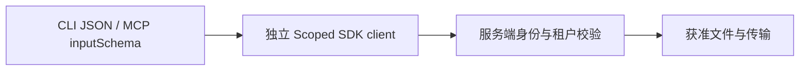

## 设计

每次调用复制 Adapter，只在复制的 SDK client 上设置租户与空间，禁止共享可变上下文污染并行调用。未提供上下文时保留原行为，Agent token 由服务端自动推导原租户与空间，仍不能越界。

仅增加可选字段；SDK 旧构造器继续工作。已有单元测试与真实远端流程继续使用原 evidence runner。客户端无需安装产品 CLI：tools/list 提供可选参数，capabilities 解释 HTTP 数据传输与服务端人工审批。权限恢复应访问服务端 Web，不使用 Agent 自批。
