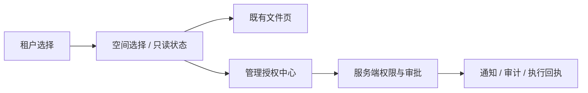

## 设计

客户端不持有权限权威。治理入口消费服务端角色与资源投影，文件请求附带租户和空间上下文，服务器验证权限。上下文只存当前标签页内存，不修改共享登录 cookie；所有异步 API 响应检查上下文版本，切换时重新挂载工作区并取消传输。

管理页提供个人申请、待我审批、通知、访问记录、团队成员和数据负责人、账号恢复。普通范围许可与精确操作清单分别呈现；清单逐项显示固定版本、动作、结果，批准后由申请人确认执行。管理员只读状态禁用直接修改入口，但保留浏览、预览与下载。应急必须单独复核登录身份并说明原因。

恢复码及新密钥只在一次性界面出现，关闭清空。人工核验仅提交恢复请求 ID，不能看到领取证明或新密钥。密钥用户、OIDC 用户均可使用统一页面；OIDC 身份复核由服务端检查近期认证时间。

## 验证与兼容

旧部署未激活治理时保留既有视图。新增 src/Governance.tsx 与上下文 helper；既有 Finder/Media 小范围适配。使用 Vitest 验证上下文隔离、陈旧响应、角色按钮及敏感信息关闭；Playwright 使用独立的治理 fixture 验证跨用户审批与只读入口。证据写入本项目 temp/integration-test-runs。服务端先加公共合同，再上线 Web；新租户写入后不回退旧服务端。
