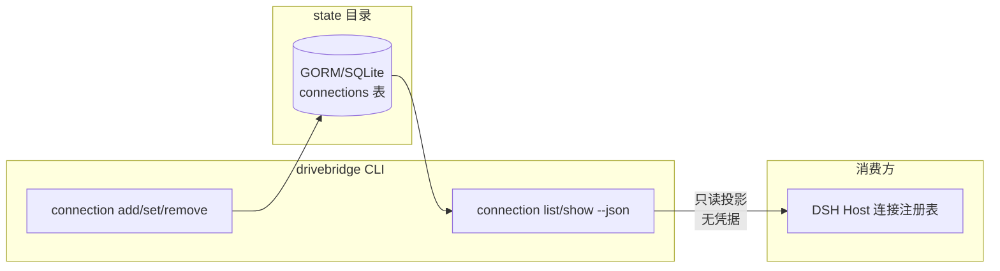

# 连接注册表设计

## 边界

DriveBridge 是连接配置的唯一 owner：连接记录只通过 `drivebridge connection` 命令组写入 state 目录的 GORM/SQLite，消费方（DSH Host 等）只读 `connection list/show --json` 投影。不在 MCP 文本、日志、回执或证据中输出 token、临时 URL、token 文件路径或原始请求。

## 决策

1. **存储**：新增 `connections` GORM 表（复用 state 目录既有 SQLite，与 `spaces` 同库），字段：`connection_id`（主键，slug）、`label`、`base_url`、`instance_id`、`space_id`（可空，引用既有 `spaces.id`）、`project_ref`、`credential_source`、`created_at`、`updated_at`。
2. **凭据来源枚举**：`local-config`（rclone/config 内）、`env`（环境变量）、`token-file`（0600 文件引用）；`keychain` 保留枚举值但无实现，`add --credential-source keychain` 明确报错未实现。token 文件路径不进入投影，投影只含 `credential_source` 与 `credential_configured` 布尔。
3. **兼容**：全局 `remote_url`/`remote_token_file` 保留；注册表为空时行为完全不变。提供幂等迁移：首次 `connection list` 时若全局 remote 已配置则投影出一条 synthesized 默认连接（不落库，标记 `synthetic: true`），由用户显式 `connection add` 固化。
4. **命令面**：`connection add --id --label --base-url --instance-id [--space-id] [--project-ref] --credential-source`；`connection set --id <field...>`；`connection remove --id`（软删，space 引用保持）；`connection list --json` / `connection show --id --json`。JSON 信封沿用 `drivebridge-cli-envelope-command-v1` 合同。
5. **校验**：`space_id` 必须指向已存在空间；`base_url` 必须是 http(s)；`connection_id` 固定 slug 词表；重复 id 拒绝。remove 不级联删除 space 或文件。

## 验证

- 单测：表 CRUD、校验、合成默认连接投影、JSON 信封字段白名单（断言无 token/路径泄露）。
- 集成：`python3 scripts/check.py` 增加 connection 场景；证据入 `temp/integration-test-runs/<run-id>/` 并脱敏。
- `go test ./...`、`go vet ./...`、`CGO_ENABLED=0 go build ./cmd/drivebridge`。
