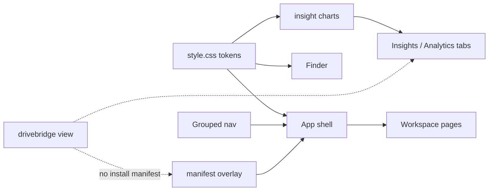

# 客户端壳与图表原语

## Context

当前壳是典型 SaaS 后台：`min-height: 100vh` 整页滚动、侧栏 12 个平铺按钮、Insights `Trend` 用 `<rect>` 堆柱并用底栏文字读数。`docs/ui/DESIGN.md` 已规定克制绿色与 lucide，但令牌不够支撑表面层次；`docs/cross-platform-client.md` 已否决 Electron/Tauri，浏览器即 client。本 change 在现有 React 上收口壳层，不引入第二套组件库、图表库或原生宿主。

## Goals / Non-Goals

**Goals**

- 已登录工作台看起来像文件客户端：视窗锁定、一行工具栏、分组导航、可扫读图表。
- 风格可复述：Precision Pine 令牌是真源，新页面不得另起一套绿。
- 导航可扩展：新入口进组，不继续往侧栏底部追加。
- 图表诚实：缺失日是缺口，有效量与观测量不得叠成一个总量。
- 客户端路径可写进文档：本阶段只强化 PWA；轻量宿主仍是评估，不是实现。

**Non-Goals**

- Tauri / Wails / Electron、系统托盘、全局快捷键、file_handlers 深度绑定。
- ⌘K 命令面板、框选、暗色主题、shadcn/Radix 迁移。
- 合并 Insights 四个数据视图的后端合同，或改扫描/审计规则。
- 手绘文件类型图标包、动画库、ECharts/Chart.js/Recharts。
- 把用户目录或 Key 的权限规则搬进客户端。

## Decisions

- **风格名**：对外文档写「Precision Pine / 墨林精工」。主色仍是 `#214f43`，点缀用 `#52b788` 只做状态点与图表高光，不用大面积渐变背景。
- **令牌真源**：`src/style.css` `:root`。新增 `--bg-app`、`--bg-sidebar`、`--border-subtle`、`--shadow-sm`、`--shadow-md`、`--shadow-popover`、`--radius-xs`。Insights 与 Finder 消费这些变量，不再各写 `#dce4d8`。
- **视窗锁定**：`.app` 为 `height: 100dvh; overflow: hidden`。`.sidebar`、`.content`、`.finder-inspector` 各自 `overflow: auto`。登录页与本机一次性 view 保持可滚动文档流。
- **导航三组**：工作台（资源态势、我的网盘、传输、收件箱）、协作（分享、团队、回收站）、系统（存储连接、Agent 授权、访问凭据）。组折叠偏好写入既有非敏感 localStorage，不写凭据。
- **入口合并**：`insights` 与 `analytics` 变为资源态势的二级 Tab（概览 / 用量）。`members` 与 `users` 变为访问凭据的二级 Tab（用户 / Key）。路由 hash 保持可深链，旧 `#/analytics` 与 `#/users` 仍打开对应 Tab。
- **图表**：从 `Insights.tsx` 抽出 `src/insights/charts.tsx`。`Trend` 增加圆角柱、水平 hairline、光标指示线、跟随浮层；保留数据表、键盘 Enter 钻取、缺失日 `·`。容量条用分段 `MeterBar`，未知配额不强行画满。
- **PWA**：`display_override: ["window-controls-overlay", "standalone"]`，`theme_color` 对齐 `--green`。桌面 `shortcuts` 指向网盘与传输。本机 insights.html 不加 manifest。
- **密度**：桌面列表行 32px、控件 32px；触控仍 44px。数字用 `font-variant-numeric: tabular-nums`。
- **动效**：沿用 120–180ms `transform/opacity`。浮层出现用 opacity，不位移。`prefers-reduced-motion` 取消位移与指示线动画。

## Risks / Trade-offs

- 合并总览与用量会改默认着陆：登录后仍进资源态势，但侧栏少一项。旧书签 `#/analytics` 必须落到用量 Tab，e2e 覆盖。
- 视窗锁定后 `fullPage` 截图不再代表整页文档流。证据改为视口截图 + 主区滚动截图，避免误报空白。
- 跟随浮层不能挡住数据表或成为唯一读数；键盘焦点仍走柱组 `aria-label` 与底栏/浮层双通道。
- `window-controls-overlay` 在不支持的浏览器静默回退 `standalone`，不得把交通灯占位做成死空白。
- 侧栏分组增加 DOM。窄屏继续用现有底栏图标导航，不把三组标题挤进 67px 高条。

## Migration Plan

无数据迁移。localStorage 仅新增 `drivebridge:nav-groups`（JSON，组 id → 展开布尔）。解析失败当全展开。PWA 已安装用户刷新清单后才看到 overlay/shortcuts。回滚还原 CSS、导航数组与 `Trend`，用量 API 不受影响。

## Open Questions

无。暗色主题、⌘K、原生宿主明确推迟，写入 `docs/ui/client-shell.md` 的非目标。
