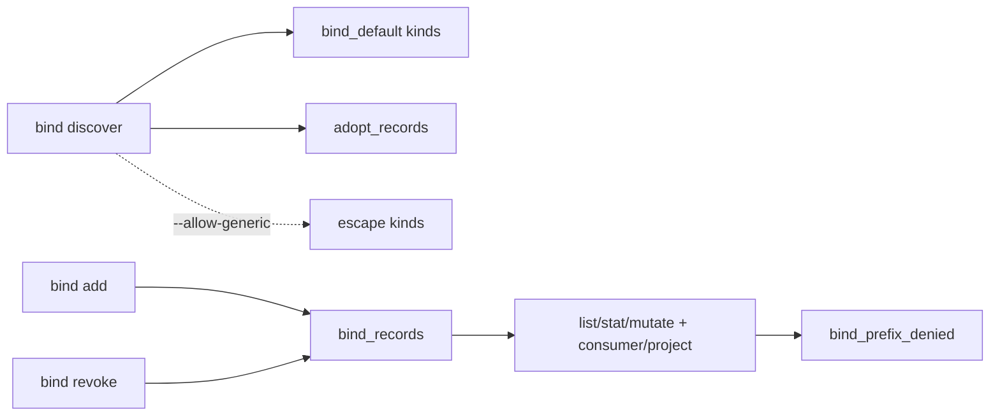
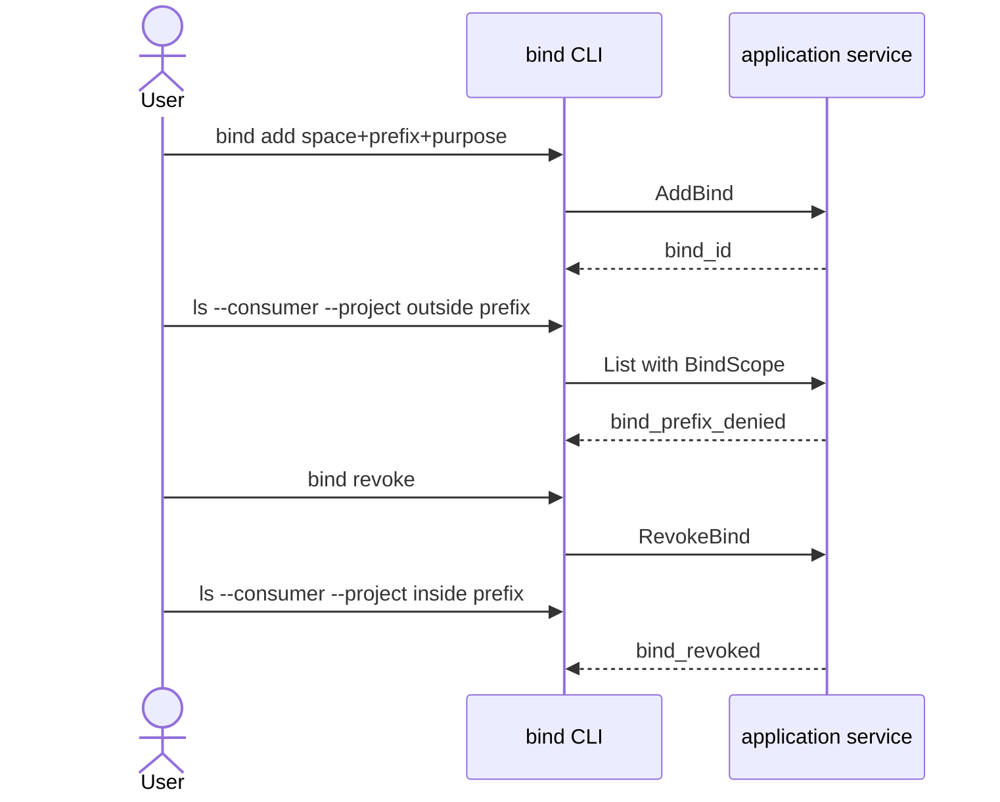

## Context

`storage kinds` 已标出 `tier` / `bind_default` / `bind_default_kinds`。`storage adopt` 把 owner local/S3 零拷贝挂成空间。本波在同一节点上增加 **consumer bind**：项目绑定到空间+前缀+purpose，默认发现与 adopt/kind 分层对齐。

## Goals / Non-Goals

**Goals:**

- CLI 写入 bind 记录并支持幂等复用/mismatch。
- 默认发现只含 bind_default kinds 与已 adopt 空间。
- 逃生舱空间默认不可绑定，提示改用已 adopt 的 local/S3 或 OneDrive/GDrive。
- 绑定范围内 list/stat/upload/delete/mkdir 前缀围栏。
- 撤销停止该 bind 的新读取；不删除空间或 adopt。
- MCP 加法只读 `bind_discover` / `bind_list`。

**Non-Goals:**

- Server `handoff-binding`（SV-2-01）。
- 改变 `storage adopt`（owner_protected、copied=false）。
- gdrive MD5 pin、OpenList 产品化。
- 把 `--consumer` 当成身份证明。
- 删除 storage/connection/relay 命令。

## Decisions

1. **记录另表，不改 Space。** `BindRecord` 由 CLI/application service 写入。缺省幂等键 `bind:<consumer>:<project>:<space>:<prefix>:<purpose>`。同键同字段复用成功；同键不同字段 → `bind_mismatch`。
2. **默认发现。** 空间 kind 由 adopt 记录、OneDrive backend 或 rclone remote type 推断：alias 指向本机绝对路径视为 `local`；`drive`→`gdrive`；`s3`→`s3`；webdav/smb/sftp/指向其它 remote 的 alias 为逃生舱。已 adopt 空间始终进入默认发现。
3. **purpose 首批白名单。** `vault`、`notes-attachments`、`materials`、`saveback`、`owner-store`。未知 → `bind_purpose_unknown`。
4. **围栏只在绑定范围。** 通过 context 传入 `BindScope`（bind-id 和/或 consumer+project）。未带范围的 ls/upload/relay 不检查前缀。带范围时路径必须落在该 consumer+project+space 的某个未撤销 prefix 内，否则 `bind_prefix_denied`。撤销后 → `bind_revoked`。
5. **撤销是状态，不是删除。** 置 `revoked_at`；show 仍可见。不 un-copy、不删空间/adopt。
6. **标签不是认证。** consumer/project 按调用方声明存储。本机单用户 CLI 写自己的配置。
7. **MCP 只读加法。** `bind_discover` / `bind_list` 与 capabilities 键；list/stat/upload/mkdir/trash 可带可选 consumer/project/bind_id。不接受任意远端 URL 或凭据。

## Risks / Trade-offs

- 空间 kind 靠 rclone type 推断：`storage add --kind local` 的 alias 视为 local；指向其它 remote 的 alias 视为逃生舱。已 adopt 记录优先，避免误伤。
- 同一 consumer+project+space 可有多个 purpose/prefix；围栏取未撤销记录的前缀并集。指定 `--bind` 则只使用该记录。
- 调用方标签可被伪造：本波只服务本机单用户 CLI，不引入认证面。
