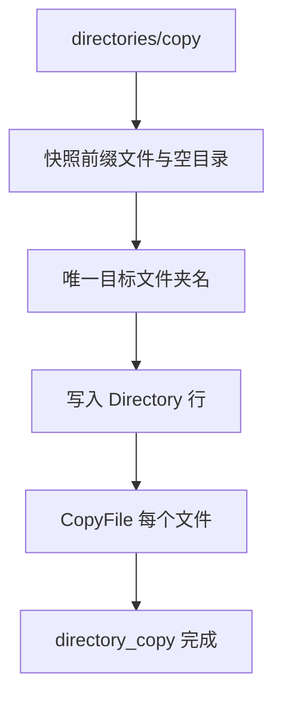

# Design: drivebridge-directory-prefix-ops-v1

## 决策

1. **目录不是第二种 file id**。作业按 `space_id + path` 前缀收集 Directory 行和 `path` 以 `prefix/` 开头的未回收文件。
2. **copy 是作业**：`kind=directory_copy`，子文件用 `Idempotency-Key + file id` 调现有 CopyFile。进度用 `progress_files`/`total_files`。目标须受管 S3。
3. **move/trash 同步**：同空间改路径或 trash 文件并删除该前缀的 Directory 行（空目录标记）。恢复仍走既有文件 restore，路径会带回隐含目录。
4. **永不覆盖**。目标文件夹名 `rename|fail`。子文件 copy 用 `fail`（目标树是新的）。
5. **不能移入自身**。`dest == src` 或 `dest` 以 `src/` 开头 → `invalid_directory`。根目录 path 为空拒绝。

