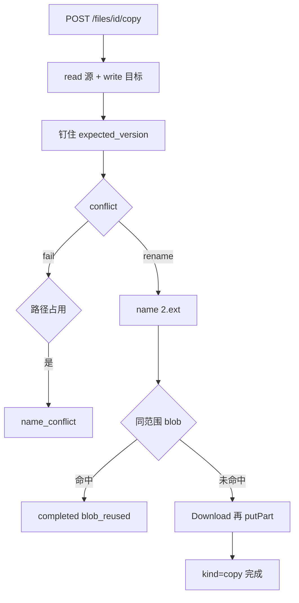

# Design: drivebridge-file-copy-v1

## 决策

1. **复制不是归档**：Finder 复制创建新文件身份并钉住源版本。不复用 archive 指纹，不把操作记成 `kind=archive`。archive 仍给 Agent 产物归档，继续排除 CAS。
2. **CAS 优先**：`kind=copy` 允许秒传。命中则 `completed` 且 `blob_reused=true`，零字节传输。加密空间只在同一 blob 范围内命中；跨空间加密必须重写。
3. **目标必须受管 S3**：与 archive 相同的 `requireManagedTarget`。OneDrive/generic 返回 `unsupported`，客户端诚实禁用。
4. **冲突**：永不覆盖。默认 `rename`；`fail` 在创建时 `name_conflict`。完成阶段不再二次改名，路径在创建时敲定。
5. **幂等**：指纹 `copy:` + origin JSON。同一 Idempotency-Key 重放返回原操作。resume 用已解析的 `op.Path` 与记录的源版本。
6. **权限**：源 `read`，目标 `write`，不授予 overwrite。回收站源 `file_trashed`；进行中源操作 `file_in_use`；头版本变化 `version_conflict`。
7. **兼容**：只增加 HTTP 方法、可选响应字段和 SDK 方法。move/archive 不变。

