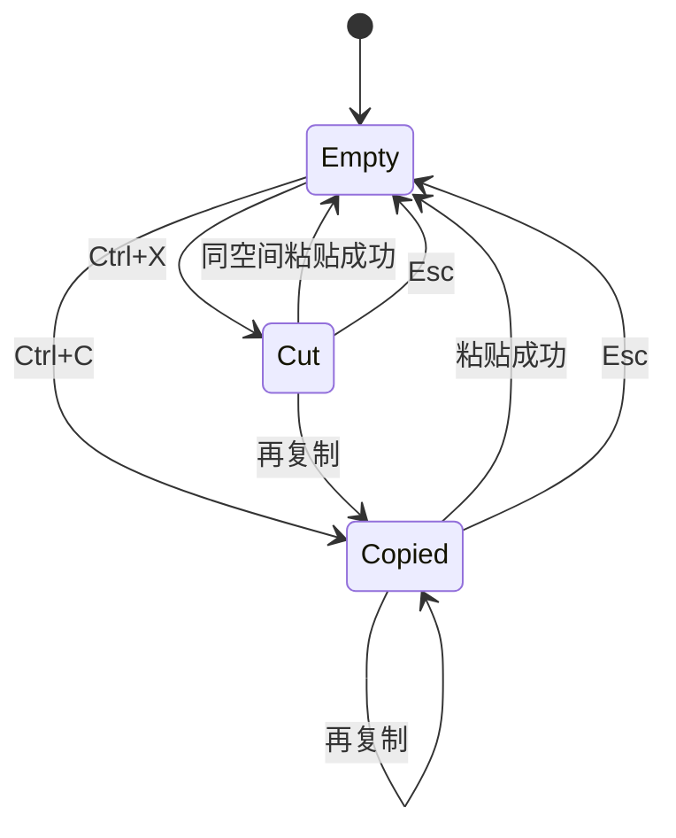

# Design: drivebridge-finder-clipboard-confirm-v1

## 决策

1. **内部剪贴板**：会话内存 `{mode, space_id, items[]}`，不写 localStorage。系统剪贴板只可选写入文件名，不能把外部文件粘成网盘复制。
2. **粘贴**：copy → `POST /files/{id}/copy`；cut 且同空间 → 现有 move。跨空间 cut 禁用。冲突交给服务端 rename。
3. **快捷键**：Finder 文件区一张表，不新增快捷键库。Mac 用 Meta，其它用 Control。菜单显示快捷键。触屏走按钮。
4. **确认**：所有入口同一 `WorkspaceDialog`。Delete 打开回收站确认。永久删除先读 usage，再输入文件名或数量，仍发送 `X-Confirm-Permanent-Delete`。
5. **本机 view**：adapter 无 copy 则禁用复制/粘贴；剪切仍走 move。

