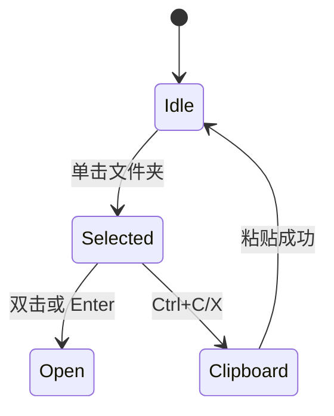

# Design: drivebridge-finder-folder-select-v1

## 决策

1. 文件夹行改成与文件相同的 article：复选框选中，名称单击选中、双击进入，chevron 打开。
2. 选择状态分 `selection`（文件 id）和 `folderSelection`（路径）。范围选择同时覆盖两类。
3. 网页不列举子页。目录项交给 `POST /directories/copy|move|trash`。
4. 树仍单击导航（那是位置，不是多选面）。

