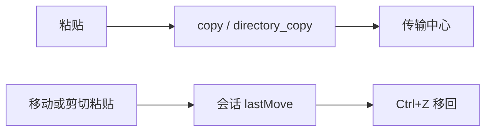

# Design: drivebridge-finder-paste-flow-v1

## 决策

1. **传输中心只展示服务端 Operation**。copy / directory_copy 完成也 `onOperation`，不另做客户端假进度。
2. **Ctrl+V 仍贴到当前目录**。选择栏“移动”和剪贴板“粘贴到…”打开目录树。树排除被移动的源文件夹。
3. **撤销只覆盖上一次 move/cut**。记住 from/to，反向调用既有 move。复制不入撤销栈。

