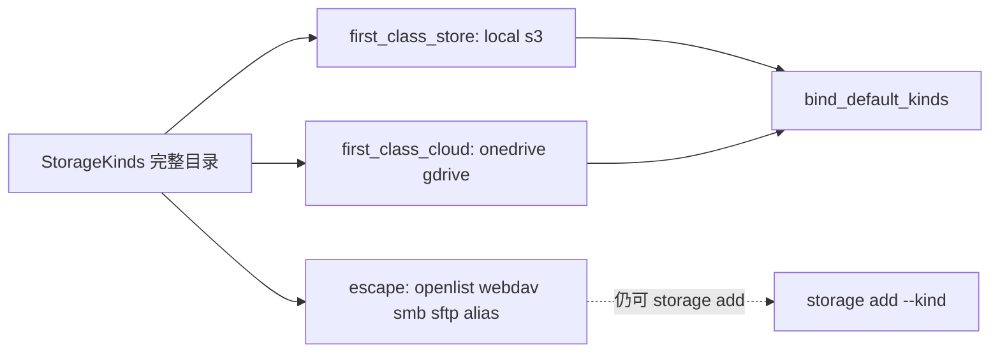

## Context

`storage kinds` 与 MCP `capabilities.storage_kinds` 已经列出全部可引导 kind，能力真值与 `backend_capabilities` 同源。根包要求产品发现分成可管理默认存储与个人网盘，并把逃生舱排除出默认 bind/adopt 发现。本波只标目录，不落地 adopt 写入围栏或消费者绑定命令。

## Goals / Non-Goals

**Goals:**

- 为每个 kind 诚实标注 `tier` 与 `bind_default`。
- 默认 bind/adopt 发现只返回 bind_default kinds。
- 保持 generic 后端可 `storage add`；不宣称特权能力。
- `local` 文档化为可管理默认存储，而不是新云厂商。

**Non-Goals:**

- `storage adopt`、写入围栏、consumer bind 命令。
- Google Drive MD5 版本钉晋升。
- OpenList 产品化或删除 generic 后端。
- 改 Server、真实云账号、commit/push。

## Decisions

1. **加法 JSON，不换代。** `KindDef` 增 `tier`（`first_class_store` / `first_class_cloud` / `escape`）与 `bind_default`（bool，始终输出）。旧客户端忽略未知键。
2. **完整目录与默认发现分开。** `StorageKinds()` 仍返回 9 个 kind；`BindDefaultKinds()` 过滤 `BindDefault=true`（local/s3/onedrive/gdrive）。CLI `storage kinds` 的 `kinds` 为完整目录，信封加法 `bind_default_kinds`；MCP `capabilities` 同步加法该键。
3. **一等不等于特权后端。** local/s3/gdrive 的 `backend` 仍为 `generic`，能力仍是 transfer-only。OneDrive 保持 `direct_url` + `reference_handoff`。`server_side_copy` 对 generic 继续缺席。
4. **`local` 不是网盘。** `tier=first_class_store` 表示可托管各项目已有目录；recipe 明确写「可管理默认存储，不是新网盘厂商」。

## Risks / Trade-offs

- 旧消费者若把完整 `storage_kinds` 当 bind 发现，仍会看到逃生舱；新键 `bind_default_kinds` 是纠正面，本波不改旧键语义。
- 将 gdrive 标为一等发现但不晋升 MD5/直链，避免产品把「可发现」误读成「特权能力」；测试锁住 generic 真值。
