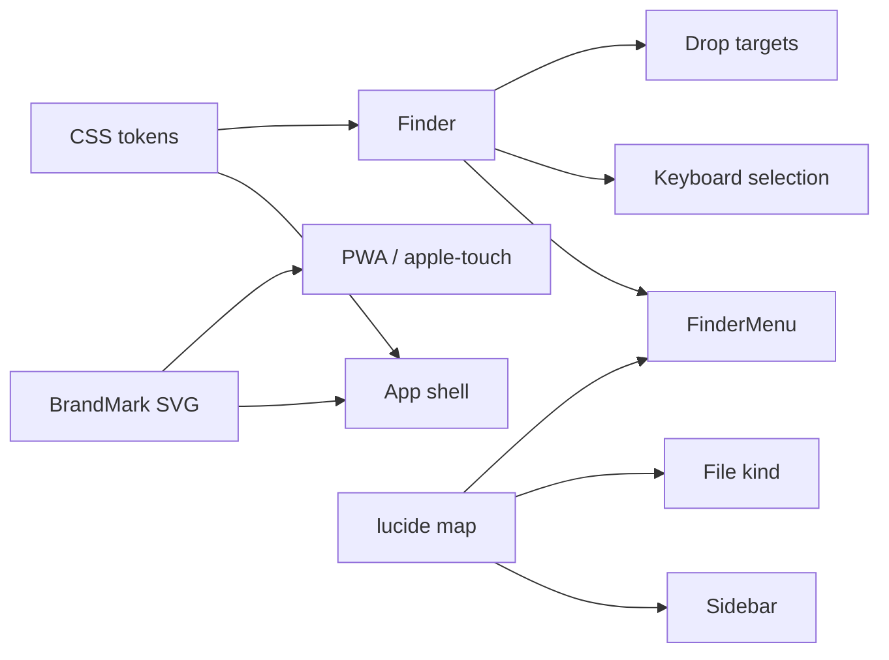

# 图标、美化与交互

## Context

绿色工作区把主题和两层网盘导航落地了，但品牌标、lucide 语义和 Finder 操作面仍是功能清单。本 change 在现有 React 组件上收口视觉语言，不引入第二套组件库或动画依赖。

## Goals / Non-Goals

**Goals**

- 安装图标、favicon 与应用内标是同一座桥。
- 折叠侧栏只看图标也能分清网盘、传输、Agent、Key、用户、团队。
- 右键菜单可扫读：图标、分组、危险项、快捷键。
- 不靠常驻 checkbox 也能用键盘选中并预览文件。
- 拖到文件夹时目标可见；390 宽无横向溢出，触控目标约 44px。

**Non-Goals**

- 暗色主题、shadcn/Radix 迁移、命令面板、框选、跨网盘拖拽。
- 手绘文件类型彩色 SVG 包；业务图标保持 lucide。
- 任何 API、权限或凭据合同变更。

## Decisions

- 唯一手绘 SVG 是产品标。应用内图标 lucide-react，侧栏 20px `strokeWidth={1.75}`。
- 令牌以 `src/style.css` `:root` 为真源；`finder.css` 不再重写 `--green` 和字体。
- 字体沿用系统栈 `"SF Pro Text", "PingFang SC", system-ui`，不引入展示字体。
- 英文 eyebrow 只留登录页；操作页用中文效用文案。
- 细指针：锚定菜单。粗指针或窄屏：底栏 action sheet。
- 动效仅 CSS：120–180ms、`transform/opacity`、`:active` 轻微缩放；`prefers-reduced-motion` 取消位移。不新增 Motion。
- 进入网盘后身份条只留返回/名称/后端短标签/类型；树里的空间选择器由 `showSpaceSwitcher` 关闭，本机 view 仍显示。

## Risks / Trade-offs

- 去掉树里的空间下拉会改变本机以外的换盘路径：用户走「全部网盘」。测试需覆盖返回网盘列表。
- 粗指针 action sheet 改变菜单坐标：现有窄屏边界断言改为允许 sheet 贴底，仍不得溢出视口。
- 对比度门（≥4.5）在 `--muted` 加深后必须继续通过 `finder-design`。

## Migration Plan

无数据迁移。PWA 图标更新后已安装用户可能仍缓存旧标，直到刷新清单。

## Open Questions

无。暗色主题明确推迟。
