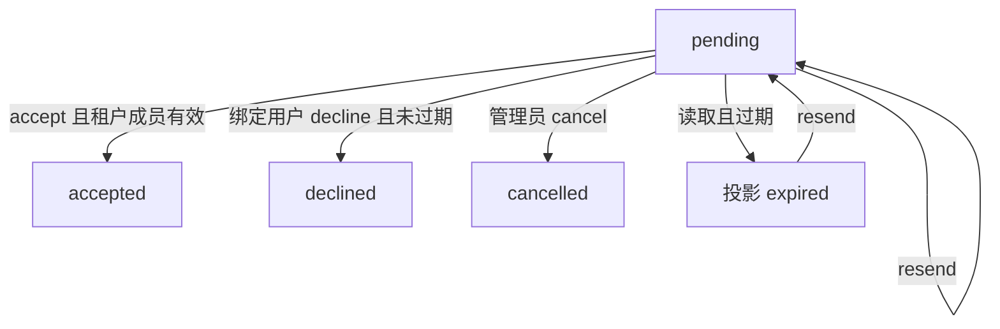

# 邀请生命周期

沿用 `POST /api/v1/governance/{action}` 与 `expected_revision`。`declined` 是既有 `status` 字符串的新值，无迁移。过期仍只在读取时改写为 `expired`，不静默 UPDATE。

拒绝只允许 `invitation.UserID == actor`。续期只允许团队管理员，且库内 status 仍为 pending。已接受/取消/拒绝返回 `invitation_not_pending`（409）。过期拒绝返回 `invitation_unavailable`。

`next_step`：当前租户不匹配为 `switch_tenant`；租户成员非 active 为 `accept_tenant`；否则 `accept_team`；过期为 `expired`。
