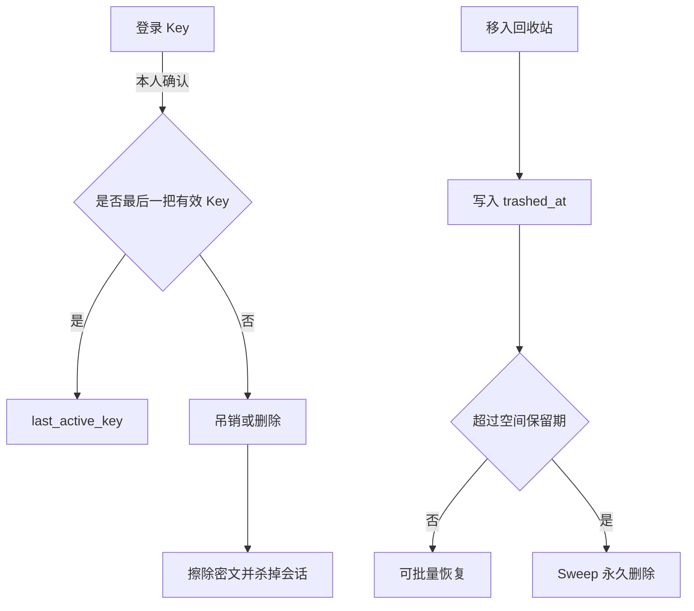

# Key 删除与回收站批量/定时清理

## 基线

Key：reveal/rotate、管理员 `users/{id}/revoke` 与 `users/{id}/archive`。本人不能删除。回收站：单文件 trash/restore/purge；无保留期。

## 流程



## 合同

- 吊销/删除：`POST /api/v1/key-directory/{id}/revoke|delete`，`{"confirm":true}`。
- 批量：`POST /api/v1/files/batch/restore|purge`，body `{"ids":[...]}`；purge 另需 `X-Confirm-Permanent-Delete: yes`。
- 保留期：`POST /api/v1/spaces/{id}/trash-policy`，`{"days":1-365}`。
- 失败码：`last_active_key`、`invalid_batch`、`invalid_trash_policy`。已有 `last_admin_required`、`confirmation_required`、`file_in_use`。

## 验证

```bash
cd backend-server/drivebridge
go test ./internal/service -count=1 -run 'KeySelfDelete|TrashRetention|TrashBatch'
python3 scripts/check.py -- go test ./internal/service -count=1 -run 'KeySelfDelete|TrashRetention|TrashBatch'
```
