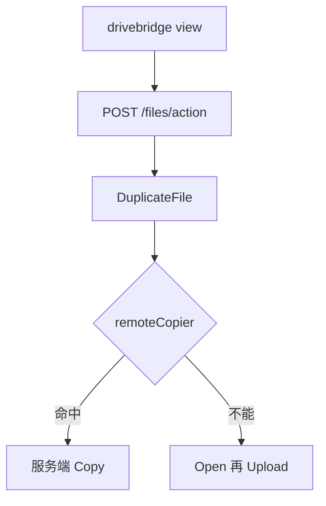

# Design: drivebridge-local-copy-v1

## 决策

1. 不把 Server 的 `POST /directories/copy` 接到本机 socket。本机仍走私有 `files/action`。
2. 复制优先 `remoteCopier.Copy`；`ErrorCantCopy` 或对象缺失则 Open+Upload。
3. 目录作业在 owner 进程内同步完成（与现有 move 一样），不新造 Operation kind。
4. 移动后若 Provider 支持 Rmdir，从深到浅去掉空的源目录。

