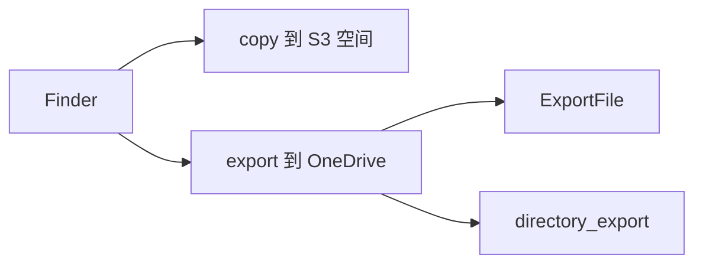

# Design: drivebridge-onedrive-export-finder-v1

## 决策

1. **空间存储仍是 S3**。copy 继续 `requireManagedTarget`。OneDrive 只做 export。
2. **generic 不进服务端**。多用户 rclone 凭据模型未决，见 `client/drivebridge-client/docs/unified-storage-visualization.md`。
3. **目录回存是作业** `kind=directory_export`，子文件复用 `ExportFile`。

