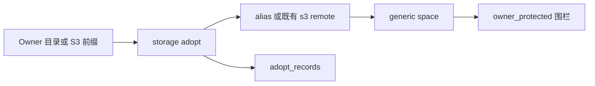
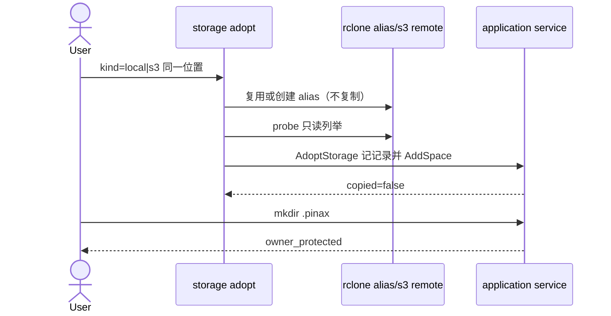

## Context

`storage add --kind local|s3` 已经能把目录或桶前缀注册为 generic 空间。Adopt 是加法控制面：同一位置、两套命令（owner 继续写领域状态，DriveBridge 只提供文件面）。本波只做 owner 默认存储 `local` 与 `s3`；个人网盘与逃生舱仍走既有 auth/setup 或 `storage add`。

## Goals / Non-Goals

**Goals:**

- 零拷贝 adopt 同一本地目录或同一 S3 bucket/prefix。
- CLI/application service 持久化 adopt 记录与幂等。
- 已 adopt 空间写入围栏：保护路径变异操作返回 `owner_protected`。
- 成功信封与 `storage adopt status` 暴露 consumer/kind/space/location/`copied=false`。
- 未知/非本节点 kind 稳定拒绝；不打印凭据。

**Non-Goals:**

- Consumer bind 命令（DB-2-02）。
- gdrive MD5 钉版、OpenList 产品化、Capsa 解密。
- 自动识别密文前缀（doctor 可声明 `opaque_encrypted` 未探测）。
- 删除或替换 `storage add`、owner 存储命令。

## Decisions

1. **复用 space 注册，不复制字节。** local 走既有 `EnsureAliasRemote`（目录的零拷贝 alias 视图）再 `AddSpace`；s3 使用调用方已有 rclone remote + `remote-path=<bucket>/<prefix>`，空间根即该前缀。Adopt 记录另表，不把密钥写入第二份文件。
2. **幂等键。** 缺省键 `adopt:<consumer>:<kind>:<space>`。同键同 location 复用成功；同键不同 location → `adopt_mismatch`。同一 space 已 adopt 且 location 一致也复用。
3. **本节点 kind。** 仅 `local` 与 `s3`。未知 kind → `storage_kind_unknown`；onedrive/gdrive/逃生舱 → `unsupported`，提示 `auth --auto`/`setup` 或 `storage add`。
4. **围栏只作用于已 adopt 空间。** 未 adopt 的 generic 空间行为不变。保护相对路径：`.pinax` 与其后裔；`.scaena` 元数据（**例外**：`.scaena/objects/sha256/**` 的 CAS 对象字节可 transfer）；`*.sqlite`/`*.sqlite-wal`/`*.sqlite-shm`/`*.db` 及对应 wal/shm；basename `token` 或 `*.token`。list/stat 不围栏。
5. **Doctor 诚实。** 不自动探测 Capsa 密文；对 s3 adopt 报 info：`opaque_encrypted not auto-detected`。
6. **local-root。** local 缺省等于 `--root`，且必须是 root 本身或其父目录（same-or-parent）。s3 仍需要既有 `--local-root` 作为本机传输沙箱。

## Risks / Trade-offs

- 双控制面可能写坏 owner 元数据：围栏拒绝保护路径写入；解除 adopt 不影响 owner 原存储（本波不实现 un-adopt 命令，删除空间/记录属后续）。
- 未探测 Capsa 密文：doctor 不假装识别，避免把密文当笔记。
- 同键约束只覆盖 DriveBridge 侧记录，不读取 Pinax/Eikona 配置；owner 侧 mismatch 仍由各项目 attach 命令负责。
