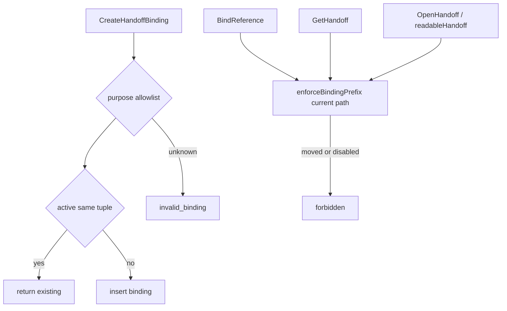
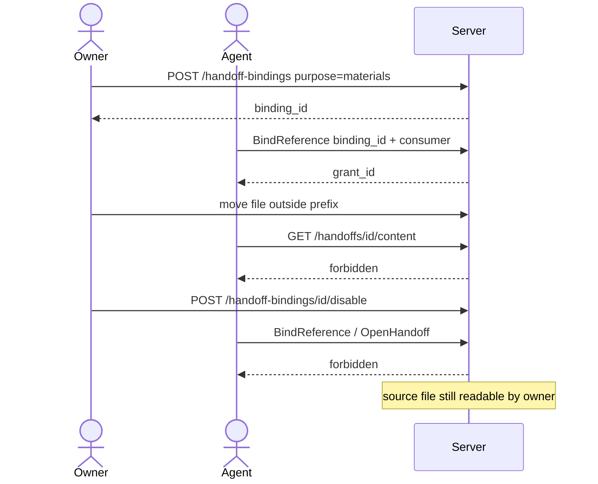

## Context

`CreateHandoffBinding` / `BindReference` / `GetHandoff` / `OpenHandoff` 已落地。`GetHandoff` 在绑定存在时用 `contains(b.Prefix, f.Path)` 与 space 比对当前文件；`readableHandoff` 先调 `GetHandoff`，但自身不再读当前 path，内容读取的前缀合同不够显式。purpose 只做 `validProvenance`，未对齐本机 bind 白名单。disable 已挡后续 Get/Open，缺少「BindReference 也失败且不宣称副本已删」的聚焦测试。

根包 `drivebridge-consumer-binding-v1` 节点 SV-2-01 要求与 DB-2-02 字段对齐，且不替换既有 handoff API。

## Goals / Non-Goals

**Goals:**

- purpose 白名单加法：`reference`（兼容）+ `vault` | `notes-attachments` | `materials` | `saveback` | `owner-store`。
- 内容读取按文件当前 path/space 复核绑定前缀；移出后 `GetHandoff` 与 `OpenHandoff` 均 `forbidden`。
- disable 停止新的 Bind 与 Open；源文件与已导入副本不被声称删除。
- Agent 不能创建绑定；`--consumer` 字符串不是认证。
- 未 disable 的相同 owner+agent+space+prefix+consumer+project+purpose 复用绑定，客户端不必新增键。

**Non-Goals:**

- mcp/drivebridge 本机 `bind` CLI、网页、真实云账号。
- 把 grant ID 变成凭据；MCP 签发签名 URL。
- 删除或重命名既有 HTTP/SDK 方法与错误码。
- 创作生成、Finder copy/trash。

## Decisions

1. **白名单只在创建绑定强制。** `CreateHandoffBinding` 未知 purpose → `invalid_binding`。`BindReference` 仍要求 purpose 与绑定一致；不把未知码改名为 `bind_purpose_unknown`（本机码），以免跨层改名。
2. **共用前缀复核。** 抽出 `enforceBindingPrefix`：读当前文件，trashed / space 不符 / `!contains(prefix, path)` → `forbidden`。`GetHandoff`、`BindReference`、`readableHandoff` 共用。`OpenHandoff` 在 `Download` 之后再调一次 `readableHandoff`，缩小 TOCTOU。
3. **错误码不改名。** 越界与 disable 继续 `forbidden`；非法绑定字段继续 `invalid_binding`。
4. **标签不是认证。** 保持 `p.Agent != nil` 则 `CreateHandoffBinding` 为 `forbidden`。Bind/Open 以 BindingID + `b.AgentID == p.Agent.ID` 为准，consumer 字符串必须与绑定相等但不能单独授权。
5. **复用而不加必填键。** 查找未 disable 且字段全等的行并返回；找不到则 `Create`。不加 unique index、不加必填 Idempotency-Key，避免破坏省略键的客户端，也允许 disable 后再建同字段绑定。
6. **CLI 只改 help。** `--purpose` 默认仍为 `reference`，help 列出允许值；校验仍在 Server。

## Risks / Trade-offs

- [无 unique index 的并发双插] → 可接受；聚焦测试覆盖串行复用。若将来加键再考虑部分唯一索引。
- [GetHandoff 已间接检查 path] → 仍在 readableHandoff 显式复核，避免后续优化跳过 file 查找。
- [本机错误码与 Server 不同] → 文档写明 Server 用 `invalid_binding` / `forbidden`，不引入跨层改名。

## Migration Plan

加法行为，GORM 无新列。回滚为还原 service 判断；已写入的非 `reference` purpose 绑定在回滚后仍是合法 provenance 字符串。CLI help 回滚不影响旧客户端。

## Open Questions

无。幂等键保持可选省略。
