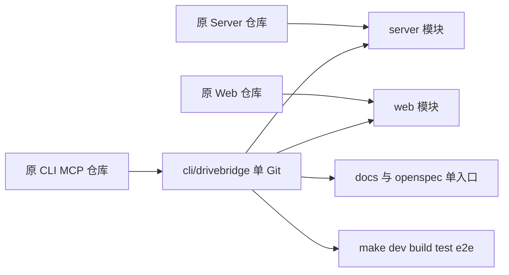

# DriveBridge 单仓迁移设计

准入 fit：本次用户明确授权仓库和开发管理合并；不删能力，不合并数据库，不把后端业务放进网页。唯一 owner 为 `cli/drivebridge`，使用既有 `yeisme/drivebridge` 仓库，内部保留 Go CLI/MCP、Go Server 和 React Web 三个模块。

## 迁移顺序

1. CLI 扫描 tracked 与非忽略 untracked 文件，记录摘要/原 HEAD/原任务勾选状态；备份根 index 与 .gitmodules。只输出计数，不输出文件内容或凭据。
2. 原 CLI 仓库原地 rename 到新路径；Server/Web 连同 ignored 运行产物移动到子目录，各自 .git 移到新仓私有 .git 内备份。历史 refs/objects/index 全部保留；新主仓保留原 CLI 历史。
3. docs 归入 docs/server 与 docs/web；active changes 按原 ID 汇总到根 openspec；重名 base specs/archives 使用来源前缀，保留内容与状态。通过迁移 CLI 更新 Markdown 相对链接，历史运行证据不改写。
4. 生成旧路径兼容链接；更新 root gitlinks/.gitmodules，保留其他模块/dirty 变更。没有 commit/push。
5. 修正源码内构建路径、测试启动目录和 SDK replace。统一开发 CLI 启动 disposable fixture + Vite，收信号后回收自己启动的进程，不停止已有服务。
6. 对迁移后原文件进行摘要复核；结构化导入清单与验证由脚本生成。运行定向验证后执行稳定结果构建、普通测试和 fixture 用户路径。

## 兼容与回滚

Go module 名称、MCP 名称、HTTP 路由、文件/版本/操作 ID、登录、权限、配置路径均不变。Server/Web 在同一仓内仍通过公开合同协作；不是重写或移动用户文件。

旧工作区源码路径以相对 symlink 过渡。Windows/新 checkout 的实际开发入口为新路径，不依赖 symlink 完成功能。旧路径至少保留一个实际发布周期，尚无移除版本。旧引用不作为新文档推荐入口。

本地回滚使用私有 .git 内保存的原 Git 元数据、根索引、路径映射和文件摘要，按逆序恢复目录；发生合并后新修改时先保全这些修改，不用 reset/clean。未迁移数据库，不需要数据回滚；远端未发布，不改线上部署。

## 验收

一个 git rev-parse 顶层覆盖三个模块；一个 openspec list 展示全部 active change，任务状态不漂移；统一 dev 的 API 与浏览器请求同源安全校验；CLI/Server pure-Go 构建、Web 构建与真实 fixture 路径验证。没有 race、真实云账户或部署调用。
