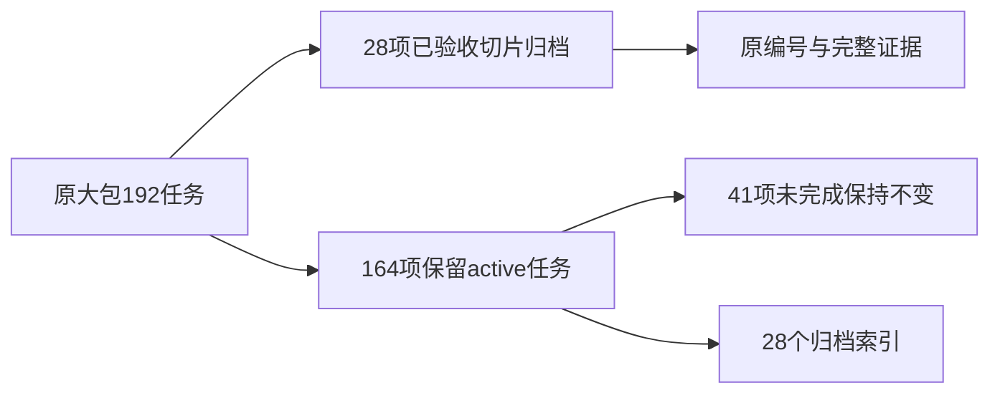

# 已验收Web交付切片归档设计

## 范围与决定

仅提取F87–V114共28项，依赖原大包较早任务的关系仍有效，不重编号、不重新勾选历史任务。原始任务表由脚本保留为 `source-tasks-before-split.md`，仅是只读拆分快照，不是第二个active任务账本。归档时不复制或同步原大包delta specs；规格所有权保持原包，未完成需求继续active。

## 验收结论

独立目标审计已批准 `muy8h9a4-4ksi7u` 的全站Web对齐及核心本地真实闭环。首次拒绝记录仍保留，不能用I109旧截图或9/9计数代替返工结果。

当前主要证据均在owner `temp/integration-test-runs/`：

- `20261008T140400Z-4ce0dd4a`：155文件、1120项Web测试。
- `20261008T140335Z-a30ed9d2`：类型/UI检查。
- `20261008T140246Z-6c6cef92`：生产构建，保留大chunk警告。
- `20261008T140335Z-8cebb779`：17页六宽度浅深主题204明确终态观察。
- `20261008T140404Z-b6b40e0d`：六条真实本地业务/布局场景，含普通笔记原键恢复、实际Agent受限调用、PNG/PDF/二进制原版本检查下载、人工决定归档和撤权隔离。
- `20261008T124821Z-ee3e4959`：Server普通测试。
- `20261008T140543Z-2c1dd519`：17页+35详情/关键弹层矩阵与227图片图集。
- `20261008T140945Z-e229219d`：链接、六件套与2020原路径完整性核验，不代替业务验收。

完整设计、失败归因和早期依赖留在原大包 `design.md`。产品设计文档位于owner `docs/`，本切片不复制第二份长期产品规格。

## 保留限制

真实云、个人vault/Pinax真实接入、Electron三平台、移动原生、内置模型与生产发布不在完成范围。部分LSP检查未确认，大chunk告警保留。未运行race，未操作真实账号、提交、推送或部署。

## 回退

拆分前完整任务快照随归档保留；需要恢复时通过任务管理脚本恢复原位置与证据，而非将未完成任务标为完成。产品源码和运行证据不移动。
