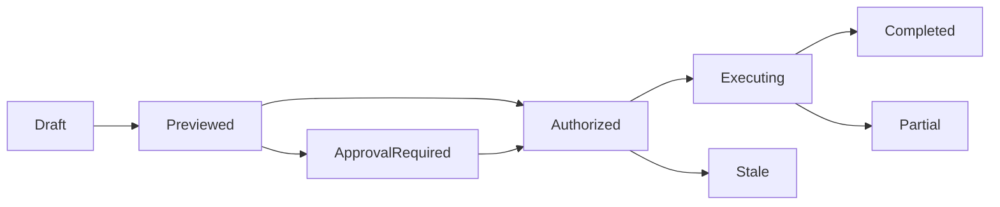

# 风险分级的Agent整理计划

## 当前依据与交付边界

Agent需要有序管理文件，但搜索候选与自然语言建议不能直接成为移动、删除或跨空间外发授权。

当前依据：[internal/service/http.go](../../../server/internal/service/http.go)、[internal/service/tools.go](../../../server/internal/service/tools.go)、[internal/service/model.go](../../../server/internal/service/model.go)、[docs/contract-map.md](../../../docs/server/contract-map.md)。检查源码只证明当前实现形状，本文没有执行新增运行时测试或真实后端验证。

本包owner：`cli/drivebridge/server`；准入：`fit`；能力账本：`required / design`。消费方只能通过公开合同；新库、新worker和新命令仍归现有owner，不新增产品仓库。

## 前置、任务依赖与唯一写入

- [drivebridge-file-organization-v1](../drivebridge-file-organization-v1/design.md)：依赖合同先稳定；本包消费其公开接口，不写其私有状态。
- [drivebridge-cross-storage-transfer-v1](../drivebridge-cross-storage-transfer-v1/design.md)：依赖合同先稳定；本包消费其公开接口，不写其私有状态。
- [drivebridge-team-runtime-projections-v1](../drivebridge-team-runtime-projections-v1/design.md)：依赖合同先稳定；本包消费其公开接口，不写其私有状态。

本包内部主链为1.1→1.2→2.1→2.2→3.1→3.2→4.1→4.2→5.1；5.2规模验收和6.1文档在5.1后推进，6.2等待二者完成。前置包的1.2合同稳定即可启动设计；运行集成需对应应用服务与入口已通过定向验证，不能以仅有spec满足运行依赖。没有子Agent自动授权，后续实现按拥有路径串行写；独立规格可分别审阅，稳定diff后才验收。

## 用户流程与状态

场景：精确查询→虚拟整理建议→规则授权→逐项执行→补偿预览。



只读检查、执行意图和最终结果分开；partial保留逐项结果，结果未知先回读原ID。恢复不更换来源、身份、目标或幂等键；取消不等于删除已完成副作用。

## 数据与版本

OrganizationPolicy（人类创建）、OrganizationPlan、OrganizationItem、ApprovalReceipt；计划冻结actor、scope、目标集合、版本、动作、规则revision及影响摘要。执行复用原Operation；补偿为新反向计划。

新增关系字段采用可空或安全默认值，新增索引可回填；不删旧列、不改旧ID或URI。引用资源通过application service建立，配置/计划/回执/清单不由Agent手写。

## 公开接口与具体行为

| HTTP / 入口（规划，非已上线） | MCP / 客户端面 | SDK / 应用服务操作（规划） | 输入与结果 |
| --- | --- | --- | --- |
| POST /api/v1/organization-plans | organize_plan | CreateOrganizationPlan | 显式file refs/精确快照、actions、policy_id、idempotency_key |
| GET /api/v1/organization-plans/{id} | organize_plan_get | GetOrganizationPlan | revision、逐项影响、风险、缺权限与等待原因 |
| POST /api/v1/organization-plans/{id}/confirm | 人类确认入口 | ConfirmOrganizationPlan | expected_revision、影响摘要；确认不扩大原文件权限 |
| POST /api/v1/organization-plans/{id}/execute | organize_apply | ExecuteOrganizationPlan | 原plan+expected_revision；已确认或匹配有效预授权 |
| POST /api/v1/organization-plans/{id}/compensations | organize_compensation_plan | CreateCompensationPlan | 生成反向计划，不立即撤销 |
| PUT /api/v1/spaces/{id}/organization-policy | 无Agent自批 | SetOrganizationPolicy | human管理；动作、前缀、批次/字节限额、有效期和revision |

表中的SDK名称是待实施应用操作名，不表示已有导出符号。落地时CLI/MCP/HTTP必须调用同一应用服务，SDK无付费重试、权限扩张或自动切换后端逻辑；开发者不能把接口表当作当前可执行命令。

- read/统计/建议遵循已有read权限；标签/集合写入需要明确预授权或本次确认；rename/move/copy默认确认，规则只能在明确前缀与额度内预授权。
- 覆盖、软删除、跨空间外发与权限变化均单独确认；永久删除、凭据管理不进入Agent整理面。相似候选不能当精确重复删除依据。
- 计划源为精确固定集合，语义Top-K不能当全集执行。动态保存搜索执行前先物化快照再展示影响；用户确认绑定确切revision而非自然语言。
- 执行前、逐项写入前、提交前复核权限、源版本、目标预期版本与policy；任何变化将对应项stale，不静默重算已批准计划。
- 批次默认最大10000项但按200项分页读取；策略可收紧。单用户和空间作业并发受运行时预算限制，不一次抢占全部队列。
- 补偿只作用于尚匹配本次结果的元数据/路径，目标被后续修改则compensation_conflict。取消保留已完成回执，不声称所有文件已恢复。
- 文件正文、模型建议和工具结果是不可信数据；不能改变规则、授权或执行工具白名单。

## 共同合同约束

本包为 **设计与待实施合同**。本文规划路径、工具、字段、类型和状态尚未上线；不能把 spec strict 成功当成实现、真实后端或部署验收。既有接口须先从实际 tools/list、inputSchema、CLI help 与公开API确认。新能力默认关闭，部署配置未启用时报告 unsupported/blocked。

- HTTP 沿用各 owner 现有错误信封及认证；身份从会话/令牌推导，body 中的 tenant/actor/project 只能收窄选择范围。CLI 保留 human/--json/--agent 与已实现输出选项，不为旧入口改变必填字段或输出类型。
- 新写请求采用 Idempotency-Key 或该工具对应 idempotency_key，作用域为 instance+tenant+actor+action，指纹覆盖所有业务输入；同键同指纹复用，同键异指纹拒绝。已有入口保持原幂等作用域，禁止重解释旧键。编辑/执行携 expected_revision/expected_version；过期拒绝，不自动重算或批准。
- DriveBridge新分页默认50、最大200；Manju既有查询保留默认20/最大100及8秒预算，旧分页不变；游标不透明，绑定规范查询、身份范围、排序与数据代次。所有页重新授权；跨查询、跨身份游标拒绝。精确列表使用keyset稳定排序，以ID破同值；语义Top-K不是全集，异步导出使用独立原Operation。
- 新元数据与类型由应用服务/CLI生成，GORM为Go业务持久访问层；禁止在handler/SDK适配器拼接SQL。迁移、专用队列领取和分析器例外集中adapter、绑定参数、限定标识符，并在实现review列明理由。
- 保持现有 File/Version/Operation、URI、旧状态枚举与字段含义。本文流程节点描述新增流程或展示阶段，不是把旧 Operation.status 替换成一套新枚举。未知外部结果以新增 certainty/恢复信息表达，不伪报失败或成功。
- 整理、传输、内容处理与领域采纳是不同事实；不会因保存文件批准生成、付费、发布或采纳。回执不含凭据、临时URL、原始模型请求或完整内部推理。
- 基本错误：invalid_query/invalid_request=400，forbidden=403，not_found=404，idempotency_conflict/version_conflict/plan_stale=409，cursor_expired=410，unsupported=400（沿用既有Server映射），budget_exceeded=429，dependency_unavailable=503。保留已有错误码及状态码，专有新码见本包表；不得把旧同名码改义。


## 输入、结果与错误样例（规划）

以下标识符为说明性占位，不是可执行请求；实现测试由fixture/CLI生成合法ID。HTTP成功结果沿用owner现有信封，下面展示payload；CLI/MCP映射保持各自旧信封。示例不授予权限。

输入：

```json
{
  "source_snapshot_id": "SNAPSHOT_ID",
  "actions": [
    {
      "kind": "add_label",
      "namespace": "rule",
      "value": "reference"
    }
  ],
  "policy_id": "POLICY_ID",
  "idempotency_key": "organize-example"
}
```

结果：

```json
{
  "plan_id": "PLAN_ID",
  "revision": 1,
  "phase": "previewed",
  "risk": "policy_scoped",
  "approval_required": false,
  "policy_revision": 4,
  "items_total": 100,
  "impact_digest": "IMPACT_SHA256"
}
```

OrganizationPlan确认固定plan revision+impact_digest；items含file/version、before/after、action、expected_target_version和item_key。policy_scoped不是免鉴权，每次执行仍校验规则范围/有效期/额度。未匹配预授权则approval_required=true。补偿计划引用原结果版本并独立确认。

| 新码/沿用码 | HTTP状态（旧码保留现有映射） | 恢复行为 |
| --- | --- | --- |
| `approval_required` | 403 | 人类确认具体计划，Agent不能自批。 |
| `plan_stale` | 409 | 重新预览，旧批准失效。 |
| `policy_revoked` | 409 | 停止尚未执行项，保留完成项。 |
| `compensation_conflict` | 409 | 不能覆盖后续修改，保留冲突待人工处理。 |

本包规模验收固定为：百万目录生成10000项计划，分页200；20并发计划/规则变更与权限撤销，断言无越界修改、部分恢复不重复，补偿保留后续版本。

## 测试规格与故障注入

| 场景 | Requirement | 正常与反例 | 必须断言 |
| --- | --- | --- | --- |
| 1 | 风险分级与不可自批 | 规则允许目录内标签整理；计划包含删除或跨空间外发 | 完成授权标签动作并留逐项回执。 / approval_required，已有write不替代确认。 |
| 2 | 计划冻结与再校验 | 用户确认十个文件；确认后文件或policy变化 | 只处理这十个固定项。 / plan_stale，不静默重新筛选。 |
| 3 | 部分成功和补偿 | 部分移动成功；文件后来又被修改 | 成功项跳过，失败项重新授权后恢复。 / compensation_conflict，后续内容保持。 |

还需覆盖相同请求重放、并发编辑、权限撤销、跨租户、来源变更、进程重启、响应丢失，以及旧客户端缺新字段时的行为。性能验收只覆盖本包相关部分，统一目标见 [本owner验收与路线文档](../../../docs/server/file-platform/verification.md)。

实施任务先加入明确测试入口后运行以下命令；无匹配测试或输出no tests to run属于失败，不能以空运行关闭任务。当前文档轮次不执行产品测试。

```bash
python3 scripts/check.py -- go test ./internal/service -run TestFPAgentOrganization -count=1
python3 scripts/check.py -- go test -race ./internal/service -run TestFPAgentOrganization -count=1
```

集成证据由现有runner写入本owner `temp/integration-test-runs/<run-id>/`，包含summary.json、command.txt、stdout.log、stderr.log、env.json与artifacts/；失败同样保留并脱敏。真实存储、身份、模型费用与部署分别验证，不由fixture代替。

代码、定向测试和文档稳定后，才执行本包所需最终门：

```bash
python3 scripts/check.py
go vet ./...
CGO_ENABLED=0 go build ./cmd/drivebridge-server
openspec validate drivebridge-agent-organization-v1 --strict --no-interactive
git diff --check
```

## 迁移、回滚与完成定义

- 当前只新增设计文档，运行时迁移未执行；实现按expand-then-contract，兼容既有客户端、元数据和凭据来源。
- 默认关闭新能力；关闭开关停止新意图，保留原Operation、文件、版本、计划、回执与审计。新版本已产生业务写入时，不允许回滚为丢弃这些写入的旧数据库快照。
- 本包负责自身配置与状态，不替消费者执行部署、发消息、真实云写入、付费调用或发布；这些门由相应owner独立验收。
- 设计完成=proposal/design/spec/tasks可追溯且strict通过。实现完成=任务指定运行证据通过。真实后端验证与发布部署是后续独立事实。

## 范围记录

2026-09-25：按用户确认的百万文件/万文件批次/100GiB目标和分层数据方案建立本包；目标未验收，required能力仅分期，不删除。
