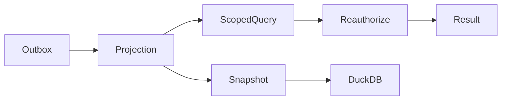

# 分析查询、ClickHouse与DuckDB快照

## 当前依据与交付边界

当前统计从事务库加载聚合，缺少百万文件、千万事件的查询预算与可解释分析投影；需要支持在线和离线分析而不复制权限真源。

当前依据：[internal/service/http.go](../../../server/internal/service/http.go)、[internal/service/tools.go](../../../server/internal/service/tools.go)、[internal/service/model.go](../../../server/internal/service/model.go)、[docs/contract-map.md](../../../docs/server/contract-map.md)。检查源码只证明当前实现形状，本文没有执行新增运行时测试或真实后端验证。

本包owner：`cli/drivebridge/server`；准入：`fit`；能力账本：`required / design`。消费方只能通过公开合同；新库、新worker和新命令仍归现有owner，不新增产品仓库。

## 前置、任务依赖与唯一写入

- [drivebridge-team-runtime-projections-v1](../drivebridge-team-runtime-projections-v1/design.md)：依赖合同先稳定；本包消费其公开接口，不写其私有状态。
- [drivebridge-file-organization-v1](../drivebridge-file-organization-v1/design.md)：依赖合同先稳定；本包消费其公开接口，不写其私有状态。

本包内部主链为1.1→1.2→2.1→2.2→3.1→3.2→4.1→4.2→5.1；5.2规模验收和6.1文档在5.1后推进，6.2等待二者完成。前置包的1.2合同稳定即可启动设计；运行集成需对应应用服务与入口已通过定向验证，不能以仅有spec满足运行依赖。没有子Agent自动授权，后续实现按拥有路径串行写；独立规格可分别审阅，稳定diff后才验收。

## 用户流程与状态

场景：资源分布→权限内钻取→投影故障→受控快照分析。



只读检查、执行意图和最终结果分开；partial保留逐项结果，结果未知先回读原ID。恢复不更换来源、身份、目标或幂等键；取消不等于删除已完成副作用。

## 数据与版本

AnalyticsQuery、SnapshotManifest、ProjectionGeneration归Server；ClickHouse file_current、transfer_facts、audit_facts、capacity_daily为派生视图；DuckDB只读同一版本化快照。共享typed analytics adapter归本owner SDK，本机仅消费，不复制查询规则。

新增关系字段采用可空或安全默认值，新增索引可回填；不删旧列、不改旧ID或URI。引用资源通过application service建立，配置/计划/回执/清单不由Agent手写。

## 公开接口与具体行为

| HTTP / 入口（规划，非已上线） | MCP / 客户端面 | SDK / 应用服务操作（规划） | 输入与结果 |
| --- | --- | --- | --- |
| POST /api/v1/analytics/queries | analytics_query | QueryAnalytics | dataset、filters、dimensions、metrics、sort、limit≤200、cursor、consistency |
| GET /api/v1/analytics/queries/{id} | analytics_query_get | GetAnalyticsQuery | 超预算导出作业原ID；状态与分页 |
| POST /api/v1/analytics/snapshots | analytics_snapshot | CreateAnalyticsSnapshot | 需显式导出权限和范围；快照由服务生成 |
| POST /api/v1/analytics/snapshots/{id}/queries | analytics_snapshot_query | QueryAnalyticsSnapshot | 同一typed查询，DuckDB进程无自由SQL/路径 |
| 既有 usage_summary/series/breakdown/audit_events | 原工具保留 | 原SDK保留 | 指标口径与返回类型不重解释 |

表中的SDK名称是待实施应用操作名，不表示已有导出符号。落地时CLI/MCP/HTTP必须调用同一应用服务，SDK无付费重试、权限扩张或自动切换后端逻辑；开发者不能把接口表当作当前可执行命令。

- 在线首选ClickHouse；主库GORM负责精确目录及必要安全回退。分析库不是事务或权限数据库；不能直接执行文件修改。
- 查询对象只允许固定dataset、field、operator、group和metric枚举；权限条件由服务注入。参数值绑定，标识符白名单。常规ClickHouse读取使用GORM适配；专有分析函数/DDL放repository adapter，逐处记录无法由ORM表达的理由，禁止handler裸SQL。
- file_current按资源ID与revision选最新，不依赖后台merge完成就假设唯一；事件按event_id去重，墓碑优先。分面与总计使用相同代次和授权过滤。
- consistency=live用于精确当前清单，由事务库承担；observed用于分析，返回generation、水位、observed_at、coverage、partial、missing及backend。默认observed，不能把滞后结果用于删除批准。
- 权限变动先使授权epoch失效。授权投影未追平时不在分析库做聚合；转到安全精确路径或返回authorization_projection_stale。仅结果后过滤不足以保护count和facet。
- ClickHouse≥26.2文本索引按实际版本能力启用；文件名/路径/标签中文、Unicode规范化与子串行为有独立golden。文本加速不承担Manju正文和语义索引。
- DuckDB通过固定版本的可选可执行程序/受控子进程消费服务生成快照；主程序不链接cgo。禁网络、扩展自动安装、任意文件和SQL输入；进程设置内存/时间/临时目录限制；未安装返回analytics_backend_unavailable。
- DuckDB输入是显式授权导出副本：只含必要字段，不含凭据/临时URL/文件正文。导出后不能承诺远程撤回用户已取得的副本；在线快照读取仍重授权。
- 逻辑容量、物理blob、缓存、预留、有效字节、观测字节分别计量；交叠观测根不相加，unknown不是0，观测流量不是云商账单。
- 查询默认30天/最多366天、limit默认50最大200；在线预算3秒，超预算的全量导出转显式异步作业，不暗自执行全表大导出。

## 共同合同约束

本包为 **设计与待实施合同**。本文规划路径、工具、字段、类型和状态尚未上线；不能把 spec strict 成功当成实现、真实后端或部署验收。既有接口须先从实际 tools/list、inputSchema、CLI help 与公开API确认。新能力默认关闭，部署配置未启用时报告 unsupported/blocked。

- HTTP 沿用各 owner 现有错误信封及认证；身份从会话/令牌推导，body 中的 tenant/actor/project 只能收窄选择范围。CLI 保留 human/--json/--agent 与已实现输出选项，不为旧入口改变必填字段或输出类型。
- 新写请求采用 Idempotency-Key 或该工具对应 idempotency_key，作用域为 instance+tenant+actor+action，指纹覆盖所有业务输入；同键同指纹复用，同键异指纹拒绝。已有入口保持原幂等作用域，禁止重解释旧键。编辑/执行携 expected_revision/expected_version；过期拒绝，不自动重算或批准。
- DriveBridge新分页默认50、最大200；Manju既有查询保留默认20/最大100及8秒预算，旧分页不变；游标不透明，绑定规范查询、身份范围、排序与数据代次。所有页重新授权；跨查询、跨身份游标拒绝。精确列表使用keyset稳定排序，以ID破同值；语义Top-K不是全集，异步导出使用独立原Operation。
- 新元数据与类型由应用服务/CLI生成，GORM为Go业务持久访问层；禁止在handler/SDK适配器拼接SQL。迁移、专用队列领取和分析器例外集中adapter、绑定参数、限定标识符，并在实现review列明理由。
- 保持现有 File/Version/Operation、URI、旧状态枚举与字段含义。本文流程节点描述新增流程或展示阶段，不是把旧 Operation.status 替换成一套新枚举。未知外部结果以新增 certainty/恢复信息表达，不伪报失败或成功。
- 整理、传输、内容处理与领域采纳是不同事实；不会因保存文件批准生成、付费、发布或采纳。回执不含凭据、临时URL、原始模型请求或完整内部推理。
- 基本错误：invalid_query/invalid_request=400，forbidden=403，not_found=404，idempotency_conflict/version_conflict/plan_stale=409，cursor_expired=410，unsupported=400（沿用既有Server映射），budget_exceeded=429，dependency_unavailable=503。保留已有错误码及状态码，专有新码见本包表；不得把旧同名码改义。


## 输入、结果与错误样例（规划）

以下标识符为说明性占位，不是可执行请求；实现测试由fixture/CLI生成合法ID。HTTP成功结果沿用owner现有信封，下面展示payload；CLI/MCP映射保持各自旧信封。示例不授予权限。

输入：

```json
{
  "dataset": "file_current",
  "filters": [
    {
      "field": "space_id",
      "op": "eq",
      "value": "SPACE_ID"
    }
  ],
  "dimensions": [
    "mime_type"
  ],
  "metrics": [
    "logical_bytes",
    "file_count"
  ],
  "consistency": "observed",
  "limit": 50
}
```

结果：

```json
{
  "backend": "clickhouse",
  "generation": "GEN_ID",
  "source_watermark": 12000,
  "applied_watermark": 11980,
  "authorization_epoch": 9,
  "observed_at": "2026-09-25T00:00:00Z",
  "coverage": "partial",
  "partial": true,
  "rows": [
    {
      "mime_type": "image/png",
      "logical_bytes": 4096,
      "file_count": 1
    }
  ],
  "next_cursor": null
}
```

查询只允许dataset=file_current/transfer_facts/audit_facts/capacity_daily，filters≤32、dimensions≤3、sort≤3。每数据集有固定metric集合，禁止用户提交函数表达式。SnapshotManifest含schema_version、generation、水位、范围、字段清单、内容摘要及创建/过期时间，由服务生成。query返回自己的ID只用于读取结果，不授予文件权限。

| 新码/沿用码 | HTTP状态（旧码保留现有映射） | 恢复行为 |
| --- | --- | --- |
| `authorization_projection_stale` | 503 | 禁止基于旧ACL聚合；安全事务路径可用才回退。 |
| `analytics_backend_unavailable` | 503 | 显示缺依赖，不自动安装或改后端。 |
| `query_budget_exceeded` | 429 | 收窄条件或显式创建异步导出，不暗自扩大预算。 |
| `snapshot_expired` | 410 | 重新申请当前授权范围快照。 |

本包规模验收固定为：100万文件/1000万事件，20并发常用分面/30天趋势P95≤3秒；冻结快照在SQL基线/ClickHouse/DuckDB结果一致，中文查询golden与ACL滞后计数反例必须通过。

## 测试规格与故障注入

| 场景 | Requirement | 正常与反例 | 必须断言 |
| --- | --- | --- | --- |
| 1 | 事务与分析独立 | ClickHouse故障；数据未采集 | 显示分析不可用，可安全读取当前文件。 / 保留缺口，不补0。 |
| 2 | 安全查询和分面 | 目录受限Agent；撤权事件尚未投影 | 只统计该目录，结果可钻取同范围。 / 拒绝或安全回退，不泄露计数。 |
| 3 | 幂等投影与代次 | 重放相同事件；旧修改晚于墓碑到达 | 计数和字节不增加。 / 不复活已删资源。 |
| 4 | DuckDB进程隔离 | 可选DuckDB缺失；查询包含SQL或任意路径 | analytics_backend_unavailable，不影响在线上传。 / invalid_query，进程不访问请求指定文件。 |

还需覆盖相同请求重放、并发编辑、权限撤销、跨租户、来源变更、进程重启、响应丢失，以及旧客户端缺新字段时的行为。性能验收只覆盖本包相关部分，统一目标见 [本owner验收与路线文档](../../../docs/server/file-platform/verification.md)。

实施任务先加入明确测试入口后运行以下命令；无匹配测试或输出no tests to run属于失败，不能以空运行关闭任务。当前文档轮次不执行产品测试。

```bash
python3 scripts/check.py -- go test ./internal/service -run TestFPAnalyticsSearch -count=1
python3 scripts/check.py -- go test -race ./internal/service -run TestFPAnalyticsSearch -count=1
```

集成证据由现有runner写入本owner `temp/integration-test-runs/<run-id>/`，包含summary.json、command.txt、stdout.log、stderr.log、env.json与artifacts/；失败同样保留并脱敏。真实存储、身份、模型费用与部署分别验证，不由fixture代替。

代码、定向测试和文档稳定后，才执行本包所需最终门：

```bash
python3 scripts/check.py
go vet ./...
CGO_ENABLED=0 go build ./cmd/drivebridge-server
openspec validate drivebridge-analytics-search-v1 --strict --no-interactive
git diff --check
```

## 迁移、回滚与完成定义

- 当前只新增设计文档，运行时迁移未执行；实现按expand-then-contract，兼容既有客户端、元数据和凭据来源。
- 默认关闭新能力；关闭开关停止新意图，保留原Operation、文件、版本、计划、回执与审计。新版本已产生业务写入时，不允许回滚为丢弃这些写入的旧数据库快照。
- 本包负责自身配置与状态，不替消费者执行部署、发消息、真实云写入、付费调用或发布；这些门由相应owner独立验收。
- 设计完成=proposal/design/spec/tasks可追溯且strict通过。实现完成=任务指定运行证据通过。真实后端验证与发布部署是后续独立事实。

## 范围记录

2026-09-25：按用户确认的百万文件/万文件批次/100GiB目标和分层数据方案建立本包；目标未验收，required能力仅分期，不删除。
