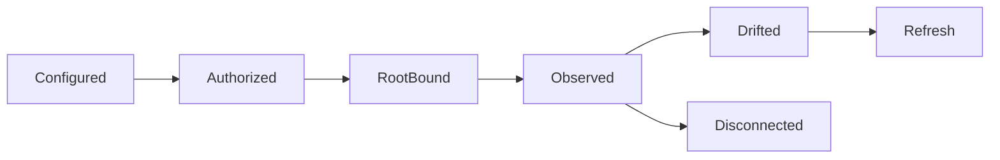

# 三类云端连接与外部目录管理

## 当前依据与交付边界

S3/OneDrive 服务端入口与本机 Google Drive 已存在，但统一网页直管三类云盘尚无一致的目录、身份、版本与增量合同。

当前依据：[internal/service/http.go](../../../server/internal/service/http.go)、[internal/service/tools.go](../../../server/internal/service/tools.go)、[internal/service/model.go](../../../server/internal/service/model.go)、[docs/contract-map.md](../../../docs/server/contract-map.md)。检查源码只证明当前实现形状，本文没有执行新增运行时测试或真实后端验证。

本包owner：`cli/drivebridge/server`；准入：`fit`；能力账本：`required / design`。消费方只能通过公开合同；新库、新worker和新命令仍归现有owner，不新增产品仓库。

## 前置、任务依赖与唯一写入

- [drivebridge-capability-readiness-v2](../drivebridge-capability-readiness-v2/design.md)：依赖合同先稳定；本包消费其公开接口，不写其私有状态。
- [drivebridge-team-runtime-projections-v1](../drivebridge-team-runtime-projections-v1/design.md)：依赖合同先稳定；本包消费其公开接口，不写其私有状态。

本包内部主链为1.1→1.2→2.1→2.2→3.1→3.2→4.1→4.2→5.1；5.2规模验收和6.1文档在5.1后推进，6.2等待二者完成。前置包的1.2合同稳定即可启动设计；运行集成需对应应用服务与入口已通过定向验证，不能以仅有spec满足运行依赖。没有子Agent自动授权，后续实现按拥有路径串行写；独立规格可分别审阅，稳定diff后才验收。

## 用户流程与状态

场景：网页绑定云目录→分页浏览→源漂移→明确导入固定副本。



只读检查、执行意图和最终结果分开；partial保留逐项结果，结果未知先回读原ID。恢复不更换来源、身份、目标或幂等键；取消不等于删除已完成副作用。

## 数据与版本

连接器输出 ExternalEntry：connection_id、root_id、provider_item_id、observed_revision、path、kind、size、modified_at、version_strength。ExternalEntry 是外部观测；File/Version 是受管身份，二者通过明确 import/adopt 关联，不能直接互换。

新增关系字段采用可空或安全默认值，新增索引可回填；不删旧列、不改旧ID或URI。引用资源通过application service建立，配置/计划/回执/清单不由Agent手写。

## 公开接口与具体行为

| HTTP / 入口（规划，非已上线） | MCP / 客户端面 | SDK / 应用服务操作（规划） | 输入与结果 |
| --- | --- | --- | --- |
| POST /api/v1/connections/gdrive | 无 Agent 管理工具 | BeginGoogleDriveConnection | 人类会话发起OAuth；回调绑定同一内部用户 |
| GET /api/v1/connections/{id}/entries | cloud_entries | ListCloudEntries | root_id、parent_ref、cursor、limit≤200 |
| POST /api/v1/connections/{id}/entries/stat | cloud_entry_stat | StatCloudEntry | entry_ref、expected_revision；检查当前授权与版本 |
| GET /api/v1/connections/{id}/changes | cloud_changes | ReadCloudChanges | 不透明游标；过期需重新枚举 |
| POST /api/v1/connections/{id}/scan | cloud_scan（仅已启用范围） | ScanCloudConnection | root与预算由owner策略限定；返回Operation |
| 既有 items/import/export | 旧工具不变 | 旧SDK不变 | 不把现有 OneDrive items 静默重定义为通用入口 |

表中的SDK名称是待实施应用操作名，不表示已有导出符号。落地时CLI/MCP/HTTP必须调用同一应用服务，SDK无付费重试、权限扩张或自动切换后端逻辑；开发者不能把接口表当作当前可执行命令。

- 服务端使用按连接隔离的 typed OneDrive/Google Drive/S3 adapter，不在多用户进程切换 rclone 全局配置。原有本机 rclone 路径保留。
- OAuth 由用户发起，PKCE/state/回调主体一致性及 refresh 锁沿用既有安全模型；申请权限与用户选定根在界面分别说明。Agent 不能创建、扩权或换身份恢复连接。
- OneDrive以item/revision，Google以file ID/revision观测，S3以key及可用VersionId识别。ETag/mtime只能变更检测，不代替SHA-256；无历史字节保证时显示 observed_only。
- Google Docs 原生文档首版仅列举与能力说明，不伪装为可直接下载的普通文件；导出格式/修订稳定性为独立后续能力，当前返回 export_required。
- S3目录是前缀投影；跨前缀重命名按复制/校验/清理计划，不声称原子目录移动。没有变化游标则预算化扫描，不能伪造原生增量。
- root、parent_ref每次解析到当前授权范围。禁止用户提交任意 provider URL、任意bucket或将本机路径发送给远程服务。
- 游标、根和账号绑定；重复页按provider身份去重；短期缺项不是删除证明。外部删除需确认后写墓碑并使旧观测失效。

## 共同合同约束

本包为 **设计与待实施合同**。本文规划路径、工具、字段、类型和状态尚未上线；不能把 spec strict 成功当成实现、真实后端或部署验收。既有接口须先从实际 tools/list、inputSchema、CLI help 与公开API确认。新能力默认关闭，部署配置未启用时报告 unsupported/blocked。

- HTTP 沿用各 owner 现有错误信封及认证；身份从会话/令牌推导，body 中的 tenant/actor/project 只能收窄选择范围。CLI 保留 human/--json/--agent 与已实现输出选项，不为旧入口改变必填字段或输出类型。
- 新写请求采用 Idempotency-Key 或该工具对应 idempotency_key，作用域为 instance+tenant+actor+action，指纹覆盖所有业务输入；同键同指纹复用，同键异指纹拒绝。已有入口保持原幂等作用域，禁止重解释旧键。编辑/执行携 expected_revision/expected_version；过期拒绝，不自动重算或批准。
- DriveBridge新分页默认50、最大200；Manju既有查询保留默认20/最大100及8秒预算，旧分页不变；游标不透明，绑定规范查询、身份范围、排序与数据代次。所有页重新授权；跨查询、跨身份游标拒绝。精确列表使用keyset稳定排序，以ID破同值；语义Top-K不是全集，异步导出使用独立原Operation。
- 新元数据与类型由应用服务/CLI生成，GORM为Go业务持久访问层；禁止在handler/SDK适配器拼接SQL。迁移、专用队列领取和分析器例外集中adapter、绑定参数、限定标识符，并在实现review列明理由。
- 保持现有 File/Version/Operation、URI、旧状态枚举与字段含义。本文流程节点描述新增流程或展示阶段，不是把旧 Operation.status 替换成一套新枚举。未知外部结果以新增 certainty/恢复信息表达，不伪报失败或成功。
- 整理、传输、内容处理与领域采纳是不同事实；不会因保存文件批准生成、付费、发布或采纳。回执不含凭据、临时URL、原始模型请求或完整内部推理。
- 基本错误：invalid_query/invalid_request=400，forbidden=403，not_found=404，idempotency_conflict/version_conflict/plan_stale=409，cursor_expired=410，unsupported=400（沿用既有Server映射），budget_exceeded=429，dependency_unavailable=503。保留已有错误码及状态码，专有新码见本包表；不得把旧同名码改义。


## 输入、结果与错误样例（规划）

以下标识符为说明性占位，不是可执行请求；实现测试由fixture/CLI生成合法ID。HTTP成功结果沿用owner现有信封，下面展示payload；CLI/MCP映射保持各自旧信封。示例不授予权限。

输入：

```json
{
  "root_id": "ROOT_ID",
  "parent_ref": "ENTRY_REF",
  "limit": 200,
  "cursor": null
}
```

结果：

```json
{
  "items": [
    {
      "entry_ref": "ENTRY_REF",
      "provider_item_id": "PROVIDER_ID",
      "observed_revision": "REVISION",
      "version_strength": "observed_only",
      "kind": "file",
      "size_bytes": 4096
    }
  ],
  "next_cursor": "OPAQUE_CURSOR",
  "coverage": "partial",
  "observed_at": "2026-09-25T00:00:00Z"
}
```

ExternalEntry 的revision是provider观测，managed_ref仅在明确导入后出现。schema保留type=file/directory/native_document。capabilities分别报告native_copy、historical_read、soft_delete、conditional_write和change_cursor，不从provider名字推断true。

| 新码/沿用码 | HTTP状态（旧码保留现有映射） | 恢复行为 |
| --- | --- | --- |
| `source_changed` | 409 | 刷新观测并由用户决定新意图；原导入不换来源。 |
| `version_unavailable` | 409 | 历史字节不可读；不能返回最新版。 |
| `export_required` | 422 | 原生云文档需独立格式导出能力。 |
| `cursor_expired` | 410 | 在同一root重新建立枚举基线。 |

本包规模验收固定为：每后端100万entry分页fixture，页内重复/页间漂移/游标过期/部分失败；有界内存、不完整扫描不推导删除；各后端真实目录与OAuth独立另验。

## 测试规格与故障注入

| 场景 | Requirement | 正常与反例 | 必须断言 |
| --- | --- | --- | --- |
| 1 | 三类云端能力矩阵 | 用户连接Google Drive；后端不支持版本读取 | 服务端可分页列举允许根；本机未在线不阻止云端读取。 / 明确 version_unavailable，不返回最新版。 |
| 2 | 外部观测与受管版本 | 外部文件导入；读取期间源变化 | 返回受管固定引用及来源关联。 / source_changed，旧观测不能冒充已保存版本。 |
| 3 | 范围和游标失效 | 分页完成；游标过期或权限缩小 | 返回有界页与coverage。 / 要求重建基线或拒绝，不扩大为全盘扫描。 |

还需覆盖相同请求重放、并发编辑、权限撤销、跨租户、来源变更、进程重启、响应丢失，以及旧客户端缺新字段时的行为。性能验收只覆盖本包相关部分，统一目标见 [本owner验收与路线文档](../../../docs/server/file-platform/verification.md)。

实施任务先加入明确测试入口后运行以下命令；无匹配测试或输出no tests to run属于失败，不能以空运行关闭任务。当前文档轮次不执行产品测试。

```bash
python3 scripts/check.py -- go test ./internal/service -run TestFPCloudConnectors -count=1
python3 scripts/check.py -- go test -race ./internal/service -run TestFPCloudConnectors -count=1
```

集成证据由现有runner写入本owner `temp/integration-test-runs/<run-id>/`，包含summary.json、command.txt、stdout.log、stderr.log、env.json与artifacts/；失败同样保留并脱敏。真实存储、身份、模型费用与部署分别验证，不由fixture代替。

代码、定向测试和文档稳定后，才执行本包所需最终门：

```bash
python3 scripts/check.py
go vet ./...
CGO_ENABLED=0 go build ./cmd/drivebridge-server
openspec validate drivebridge-cloud-connectors-v2 --strict --no-interactive
git diff --check
```

## 迁移、回滚与完成定义

- 当前只新增设计文档，运行时迁移未执行；实现按expand-then-contract，兼容既有客户端、元数据和凭据来源。
- 默认关闭新能力；关闭开关停止新意图，保留原Operation、文件、版本、计划、回执与审计。新版本已产生业务写入时，不允许回滚为丢弃这些写入的旧数据库快照。
- 本包负责自身配置与状态，不替消费者执行部署、发消息、真实云写入、付费调用或发布；这些门由相应owner独立验收。
- 设计完成=proposal/design/spec/tasks可追溯且strict通过。实现完成=任务指定运行证据通过。真实后端验证与发布部署是后续独立事实。

## 范围记录

2026-09-25：按用户确认的百万文件/万文件批次/100GiB目标和分层数据方案建立本包；目标未验收，required能力仅分期，不删除。
