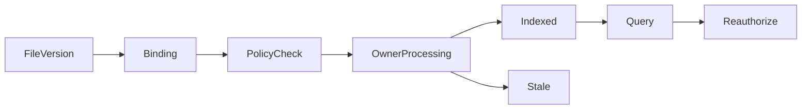

# 文件内容绑定与统一检索入口

## 当前依据与交付边界

用户需要从文件管理入口检索正文、图片和音视频片段；既有Manju/Anatomia/Sonora能力需通过版本与授权交接，不能在DriveBridge复制理解引擎。

当前依据：[internal/service/http.go](../../../server/internal/service/http.go)、[internal/service/tools.go](../../../server/internal/service/tools.go)、[internal/service/model.go](../../../server/internal/service/model.go)、[docs/contract-map.md](../../../docs/server/contract-map.md)。检查源码只证明当前实现形状，本文没有执行新增运行时测试或真实后端验证。

本包owner：`cli/drivebridge/server`；准入：`split-owner`；能力账本：`required / design`。消费方只能通过公开合同；新库、新worker和新命令仍归现有owner，不新增产品仓库。

## 前置、任务依赖与唯一写入

- [drivebridge-file-organization-v1](../drivebridge-file-organization-v1/design.md)：依赖合同先稳定；本包消费其公开接口，不写其私有状态。
- [drivebridge-capability-readiness-v2](../drivebridge-capability-readiness-v2/design.md)：依赖合同先稳定；本包消费其公开接口，不写其私有状态。
- [drivebridge-team-runtime-projections-v1](../drivebridge-team-runtime-projections-v1/design.md)：依赖合同先稳定；本包消费其公开接口，不写其私有状态。

本包内部主链为1.1→1.2→2.1→2.2→3.1→3.2→4.1→4.2→5.1；5.2规模验收和6.1文档在5.1后推进，6.2等待二者完成。前置包的1.2合同稳定即可启动设计；运行集成需对应应用服务与入口已通过定向验证，不能以仅有spec满足运行依赖。没有子Agent自动授权，后续实现按拥有路径串行写；独立规格可分别审阅，稳定diff后才验收。

## 用户流程与状态

场景：指定目录策略→内容owner处理→证据检索→版本更新失效。



只读检查、执行意图和最终结果分开；partial保留逐项结果，结果未知先回读原ID。恢复不更换来源、身份、目标或幂等键；取消不等于删除已完成副作用。

## 数据与版本

ContentBinding关联DriveBridge instance/file/version/sha256与Manju project/asset_revision；ContentPolicy记录目录、MIME、处理层级、外发授权、额度及revision。只保存关联、作业引用和状态投影，理解证据仍归Manju。

新增关系字段采用可空或安全默认值，新增索引可回填；不删旧列、不改旧ID或URI。引用资源通过application service建立，配置/计划/回执/清单不由Agent手写。

## 公开接口与具体行为

| HTTP / 入口（规划，非已上线） | MCP / 客户端面 | SDK / 应用服务操作（规划） | 输入与结果 |
| --- | --- | --- | --- |
| GET/POST /api/v1/content-bindings | content_bindings_list、content_binding_create | ListContentBindings、CreateContentBinding | 固定ref、manju_connection_id、project_ref、purpose；连接由人类配置 |
| PUT /api/v1/spaces/{id}/content-policy | 不向Agent开放策略扩权 | SetContentPolicy | 人类配置范围、类型、处理预算、egress与expected_revision |
| POST /api/v1/content-bindings/{id}/process | content_process | ProcessContent | 绑定原版本、已批准policy revision与idempotency_key；返回owner operation refs |
| POST /api/v1/content-queries | content_query | QueryContent | text/image-ref、filters、mode、evidence_required；转Manju typed查询 |
| GET /api/v1/content-bindings/{id} | content_binding_get | GetContentBinding | 未处理/处理中/可检索/失败/过期/不支持与原owner恢复链接 |

表中GET/POST和花括号动作表示分别注册的路由，顿号分隔的是独立工具/SDK名称，不能作为字面路径或工具别名调用。表中的SDK名称是待实施应用操作名，不表示已有导出符号。落地时CLI/MCP/HTTP必须调用同一应用服务，SDK无付费重试、权限扩张或自动切换后端逻辑；开发者不能把接口表当作当前可执行命令。

- Manju接收绑定只在两个owner授权交集内生效：明确issuer/subject/tenant/project映射，不能按邮箱或caller标签自动合并；未映射返回identity_mapping_required。
- 默认不自动处理。用户启用指定目录策略后，新提交版本产生单独可对账意图；历史文件回填需显式有界任务。策略变更不追认旧外发；执行与提交时再次检查policy revision。
- 内容处理与文件上传是两个操作：处理失败、预算耗尽或Manju离线不影响原件可读。费用与模型选择由内容owner准入，DriveBridge不自动换模型或付费重试。
- 纯查询不触发新分析；原件权限与Manju资源权限都有效才可返回标题、摘要、locator和计数。有效grant只允许固定接收方读取固定版本，source URL不暴露到MCP。
- 文档正文/OCR、图片描述/视觉索引归Manju；视频时序由Anatomia producer提供。Anatomia已退役独立ASR/OCR，不重新启用；音频由Sonora已发现的公开合同提供，缺真实合同返回unsupported而非伪造转写。
- 精确元数据结果与内容相关Top-K分组显示；相似图像候选不作人物身份确认。结果保留evidence_ref、version、locator、truth_level、index_generation、coverage。
- 换版本、撤权或墓碑使旧binding停止新消费；晚到结果不能挂到新版本。旧记录保留审计但正文按当前权限过滤；Manju墓碑及索引清理由Manju完成。

## 共同合同约束

本包为 **设计与待实施合同**。本文规划路径、工具、字段、类型和状态尚未上线；不能把 spec strict 成功当成实现、真实后端或部署验收。既有接口须先从实际 tools/list、inputSchema、CLI help 与公开API确认。新能力默认关闭，部署配置未启用时报告 unsupported/blocked。

- HTTP 沿用各 owner 现有错误信封及认证；身份从会话/令牌推导，body 中的 tenant/actor/project 只能收窄选择范围。CLI 保留 human/--json/--agent 与已实现输出选项，不为旧入口改变必填字段或输出类型。
- 新写请求采用 Idempotency-Key 或该工具对应 idempotency_key，作用域为 instance+tenant+actor+action，指纹覆盖所有业务输入；同键同指纹复用，同键异指纹拒绝。已有入口保持原幂等作用域，禁止重解释旧键。编辑/执行携 expected_revision/expected_version；过期拒绝，不自动重算或批准。
- DriveBridge新分页默认50、最大200；Manju既有查询保留默认20/最大100及8秒预算，旧分页不变；游标不透明，绑定规范查询、身份范围、排序与数据代次。所有页重新授权；跨查询、跨身份游标拒绝。精确列表使用keyset稳定排序，以ID破同值；语义Top-K不是全集，异步导出使用独立原Operation。
- 新元数据与类型由应用服务/CLI生成，GORM为Go业务持久访问层；禁止在handler/SDK适配器拼接SQL。迁移、专用队列领取和分析器例外集中adapter、绑定参数、限定标识符，并在实现review列明理由。
- 保持现有 File/Version/Operation、URI、旧状态枚举与字段含义。本文流程节点描述新增流程或展示阶段，不是把旧 Operation.status 替换成一套新枚举。未知外部结果以新增 certainty/恢复信息表达，不伪报失败或成功。
- 整理、传输、内容处理与领域采纳是不同事实；不会因保存文件批准生成、付费、发布或采纳。回执不含凭据、临时URL、原始模型请求或完整内部推理。
- 基本错误：invalid_query/invalid_request=400，forbidden=403，not_found=404，idempotency_conflict/version_conflict/plan_stale=409，cursor_expired=410，unsupported=400（沿用既有Server映射），budget_exceeded=429，dependency_unavailable=503。保留已有错误码及状态码，专有新码见本包表；不得把旧同名码改义。


## 输入、结果与错误样例（规划）

以下标识符为说明性占位，不是可执行请求；实现测试由fixture/CLI生成合法ID。HTTP成功结果沿用owner现有信封，下面展示payload；CLI/MCP映射保持各自旧信封。示例不授予权限。

输入：

```json
{
  "mode": "discovery",
  "query": {
    "text": "雨天街道的镜头"
  },
  "space_ids": [
    "SPACE_ID"
  ],
  "modalities": [
    "video"
  ],
  "evidence_required": true,
  "limit": 20
}
```

结果：

```json
{
  "mode": "discovery",
  "coverage": "partial",
  "items": [
    {
      "file_ref": "FIXED_FILE_REF",
      "asset_revision_ref": "ASSET_REV",
      "evidence_ref": "EVIDENCE_REF",
      "locator": {
        "kind": "time_range",
        "start_ms": 1000,
        "end_ms": 2500
      },
      "truth_level": "inferred",
      "index_generation": "GEN_ID"
    }
  ],
  "missing": [
    "audio"
  ],
  "next_cursor": null
}
```

ContentPolicy含policy_revision、prefixes、mime_allowlist、requested_layers、max_items/max_bytes、budget_ref、egress_scope、enabled；由人类创建且默认false。ContentBinding状态not_processed/processing/searchable/failed/stale/unsupported只投影内容owner状态，不替代其Operation。所有摘要/locator必须通过双边授权。

| 新码/沿用码 | HTTP状态（旧码保留现有映射） | 恢复行为 |
| --- | --- | --- |
| `identity_mapping_required` | 403 | 由owner配置双边映射，不按邮箱/actor标签猜测。 |
| `content_policy_required` | 403 | 选择已批准范围或人工配置策略。 |
| `content_index_stale` | 409 | 返回旧版本标记或显式重建意图；不把旧证据当新字节。 |
| `modality_unsupported` | 422 | 返回缺模态并保留元数据检索；不调用替代模型。 |

本包规模验收固定为：四模态至少1000条固定fixture证据，覆盖locator、truth和撤权；与百万文件目录链接分页，语义检索8秒预算且Top-K不当全集；模型质量用owner真实评测独立报告。

## 测试规格与故障注入

| 场景 | Requirement | 正常与反例 | 必须断言 |
| --- | --- | --- | --- |
| 1 | 内容owner边界 | 用户提交视频检索；缺音频producer合同 | 返回原时间段和truth level。 / unsupported并保留元数据搜索，不伪造摘要。 |
| 2 | 空间策略与独立处理 | 用户启用指定目录策略；只执行搜索或预算耗尽 | 形成独立原任务引用并在预算内处理。 / 返回缺失原因，不发起付费模型。 |
| 3 | 版本和双边授权 | 固定旧版本仍获授权；删除后处理完成 | locator和摘要属于旧版本并明确标记。 / 拒绝激活并请求Manju清理派生索引。 |

还需覆盖相同请求重放、并发编辑、权限撤销、跨租户、来源变更、进程重启、响应丢失，以及旧客户端缺新字段时的行为。性能验收只覆盖本包相关部分，统一目标见 [本owner验收与路线文档](../../../docs/server/file-platform/verification.md)。

实施任务先加入明确测试入口后运行以下命令；无匹配测试或输出no tests to run属于失败，不能以空运行关闭任务。当前文档轮次不执行产品测试。

```bash
python3 scripts/check.py -- go test ./internal/service -run TestFPContentRetrieval -count=1
python3 scripts/check.py -- go test -race ./internal/service -run TestFPContentRetrieval -count=1
```

集成证据由现有runner写入本owner `temp/integration-test-runs/<run-id>/`，包含summary.json、command.txt、stdout.log、stderr.log、env.json与artifacts/；失败同样保留并脱敏。真实存储、身份、模型费用与部署分别验证，不由fixture代替。

代码、定向测试和文档稳定后，才执行本包所需最终门：

```bash
python3 scripts/check.py
go vet ./...
CGO_ENABLED=0 go build ./cmd/drivebridge-server
openspec validate drivebridge-content-retrieval-v1 --strict --no-interactive
git diff --check
```

## 迁移、回滚与完成定义

- 当前只新增设计文档，运行时迁移未执行；实现按expand-then-contract，兼容既有客户端、元数据和凭据来源。
- 默认关闭新能力；关闭开关停止新意图，保留原Operation、文件、版本、计划、回执与审计。新版本已产生业务写入时，不允许回滚为丢弃这些写入的旧数据库快照。
- 本包负责自身配置与状态，不替消费者执行部署、发消息、真实云写入、付费调用或发布；这些门由相应owner独立验收。
- 设计完成=proposal/design/spec/tasks可追溯且strict通过。实现完成=任务指定运行证据通过。真实后端验证与发布部署是后续独立事实。

## 范围记录

2026-09-25：按用户确认的百万文件/万文件批次/100GiB目标和分层数据方案建立本包；目标未验收，required能力仅分期，不删除。
