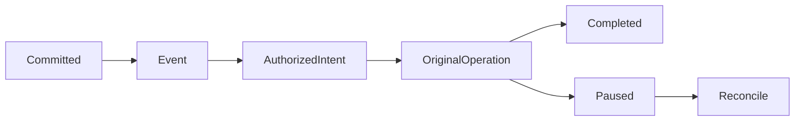

# 持久变化流与受限自动化

## 当前依据与交付边界

本机changes已有游标，但可靠触发需要事务事件、重放去重、策略版本与对原操作的恢复；不能由文件变化直接批准付费或外发。

当前依据：[internal/service/http.go](../../../server/internal/service/http.go)、[internal/service/tools.go](../../../server/internal/service/tools.go)、[internal/service/model.go](../../../server/internal/service/model.go)、[docs/contract-map.md](../../../docs/server/contract-map.md)。检查源码只证明当前实现形状，本文没有执行新增运行时测试或真实后端验证。

本包owner：`cli/drivebridge/server`；准入：`fit`；能力账本：`required / design`。消费方只能通过公开合同；新库、新worker和新命令仍归现有owner，不新增产品仓库。

## 前置、任务依赖与唯一写入

- [drivebridge-team-runtime-projections-v1](../drivebridge-team-runtime-projections-v1/design.md)：依赖合同先稳定；本包消费其公开接口，不写其私有状态。
- [drivebridge-agent-organization-v1](../drivebridge-agent-organization-v1/design.md)：依赖合同先稳定；本包消费其公开接口，不写其私有状态。
- [drivebridge-content-retrieval-v1](../drivebridge-content-retrieval-v1/design.md)：依赖合同先稳定；本包消费其公开接口，不写其私有状态。

本包内部主链为1.1→1.2→2.1→2.2→3.1→3.2→4.1→4.2→5.1；5.2规模验收和6.1文档在5.1后推进，6.2等待二者完成。前置包的1.2合同稳定即可启动设计；运行集成需对应应用服务与入口已通过定向验证，不能以仅有spec满足运行依赖。没有子Agent自动授权，后续实现按拥有路径串行写；独立规格可分别审阅，稳定diff后才验收。

## 用户流程与状态

场景：变化提交→重复投递→唯一整理意图→失败暂停→原操作对账。



只读检查、执行意图和最终结果分开；partial保留逐项结果，结果未知先回读原ID。恢复不更换来源、身份、目标或幂等键；取消不等于删除已完成副作用。

## 数据与版本

ChangeSubscription、AutomationRule、AutomationIntent、ConsumerCheckpoint由Server持有；事件引用事务Outbox。规则由人类创建；intent绑定event_id+rule_revision+actor+scope并关联原Operation。

新增关系字段采用可空或安全默认值，新增索引可回填；不删旧列、不改旧ID或URI。引用资源通过application service建立，配置/计划/回执/清单不由Agent手写。

## 公开接口与具体行为

| HTTP / 入口（规划，非已上线） | MCP / 客户端面 | SDK / 应用服务操作（规划） | 输入与结果 |
| --- | --- | --- | --- |
| GET /api/v1/changes | changes_v2 | ReadChanges | opaque cursor、space、limit≤200；过期返回cursor_expired |
| POST /api/v1/change-subscriptions | change_subscription_create | CreateChangeSubscription | 授权范围内消费者ID；不能开启全空间策略 |
| POST /api/v1/change-subscriptions/{id}/ack | change_subscription_ack | AckChanges | 单调checkpoint，不能越过未交付页 |
| GET/PUT /api/v1/spaces/{id}/automation-rules | list只读；无Agent扩权 | AutomationRules | human管理动作/范围/预算/有效期/revision |
| GET /api/v1/automation-intents/{id} | automation_intent_get | GetAutomationIntent | 原rule/event/operation和暂停原因 |
| POST /api/v1/automation-rules/{id}/run | （无Agent自批入口；执行携调用者现时权限） | RunAutomationRule | 处理checkpoint后事件：幂等意图、预授权复核、失败计数与暂停 |

表中的SDK名称是待实施应用操作名，不表示已有导出符号。落地时CLI/MCP/HTTP必须调用同一应用服务，SDK无付费重试、权限扩张或自动切换后端逻辑；开发者不能把接口表当作当前可执行命令。

- 第一批认证轮询，不开放任意webhook URL。新变化合同与原本机changes兼容分开，不把since=0语义改成历史回放。
- 事件至少一次；consumer按event_id去重，rule revision变化不自动重放全部历史。default事件保留90天，cursor过期需显式授权范围内快照重建，不能跳过丢失段称完整。
- 文件事务提交后发布事件；投影回写带origin/correlation避免规则自触发循环；每条规则同一source revision只产生一次意图。
- 名称、正文、临时URL不放事件；事件仅安全引用，消费者读实体再次鉴权。ack只确认投递处理，不表示业务采纳。
- 自动动作仅限现有预授权文件规则；跨空间、删除、付费理解与外部通知按各自门执行。没有授权则暂停，不自动换身份/模型/通道。
- 连续3次同类确定失败暂停规则并报告原意图；瞬态读/传输错误最多2次退避且先对账未知副作用；取消或过期意图不复活。
- 本机自动化消费由本机适配包承接，不能通过远程事件直接启动本机挂载或同步写入。

## 共同合同约束

本包为 **设计与待实施合同**。本文规划路径、工具、字段、类型和状态尚未上线；不能把 spec strict 成功当成实现、真实后端或部署验收。既有接口须先从实际 tools/list、inputSchema、CLI help 与公开API确认。新能力默认关闭，部署配置未启用时报告 unsupported/blocked。

- HTTP 沿用各 owner 现有错误信封及认证；身份从会话/令牌推导，body 中的 tenant/actor/project 只能收窄选择范围。CLI 保留 human/--json/--agent 与已实现输出选项，不为旧入口改变必填字段或输出类型。
- 新写请求采用 Idempotency-Key 或该工具对应 idempotency_key，作用域为 instance+tenant+actor+action，指纹覆盖所有业务输入；同键同指纹复用，同键异指纹拒绝。已有入口保持原幂等作用域，禁止重解释旧键。编辑/执行携 expected_revision/expected_version；过期拒绝，不自动重算或批准。
- DriveBridge新分页默认50、最大200；Manju既有查询保留默认20/最大100及8秒预算，旧分页不变；游标不透明，绑定规范查询、身份范围、排序与数据代次。所有页重新授权；跨查询、跨身份游标拒绝。精确列表使用keyset稳定排序，以ID破同值；语义Top-K不是全集，异步导出使用独立原Operation。
- 新元数据与类型由应用服务/CLI生成，GORM为Go业务持久访问层；禁止在handler/SDK适配器拼接SQL。迁移、专用队列领取和分析器例外集中adapter、绑定参数、限定标识符，并在实现review列明理由。
- 保持现有 File/Version/Operation、URI、旧状态枚举与字段含义。本文流程节点描述新增流程或展示阶段，不是把旧 Operation.status 替换成一套新枚举。未知外部结果以新增 certainty/恢复信息表达，不伪报失败或成功。
- 整理、传输、内容处理与领域采纳是不同事实；不会因保存文件批准生成、付费、发布或采纳。回执不含凭据、临时URL、原始模型请求或完整内部推理。
- 基本错误：invalid_query/invalid_request=400，forbidden=403，not_found=404，idempotency_conflict/version_conflict/plan_stale=409，cursor_expired=410，unsupported=400（沿用既有Server映射），budget_exceeded=429，dependency_unavailable=503。保留已有错误码及状态码，专有新码见本包表；不得把旧同名码改义。


## 输入、结果与错误样例（规划）

以下标识符为说明性占位，不是可执行请求；实现测试由fixture/CLI生成合法ID。HTTP成功结果沿用owner现有信封，下面展示payload；CLI/MCP映射保持各自旧信封。示例不授予权限。

输入：

```json
{
  "subscription_id": "SUB_ID",
  "cursor": "OPAQUE_CURSOR",
  "limit": 200
}
```

结果：

```json
{
  "events": [
    {
      "event_id": "EVENT_ID",
      "resource_ref": "FIXED_FILE_REF",
      "resource_revision": 8,
      "kind": "file_committed",
      "origin": "upload"
    }
  ],
  "next_cursor": "NEXT_CURSOR",
  "coverage": "complete"
}
```

AutomationIntent唯一键为event_id+rule_revision+actor+scope，保存original_operation_id和pause_reason。ack绑定本subscription已投递最大sequence；不得向前跳跃。cursor是投递位置，不是权限令牌。

| 新码/沿用码 | HTTP状态（旧码保留现有映射） | 恢复行为 |
| --- | --- | --- |
| `cursor_expired` | 410 | 受控快照重建，不能静默跳段。 |
| `rule_paused` | 409 | 检查原意图错误后由有权主体恢复。 |
| `ack_ahead` | 409 | 只确认实际投递范围。 |
| `policy_revoked` | 409 | 停止新动作，已完成回执保留。 |

本包规模验收固定为：1000万事件含重复乱序，100events/s持续15分钟及暂停重启；每source/rule意图唯一，连续3确定失败暂停；规则回写不自触发循环。

## 测试规格与故障注入

| 场景 | Requirement | 正常与反例 | 必须断言 |
| --- | --- | --- | --- |
| 1 | 持久投递与幂等 | 重复投递同事件；提交后进程崩溃 | 复用原意图与原Operation。 / 事件可恢复，不丢业务变化。 |
| 2 | 游标与撤权 | 游标过期；投递后Agent撤权 | cursor_expired并提供受控重建入口。 / 拒绝读取与执行，事件不泄漏正文。 |
| 3 | 自动化边界与暂停 | 规则要求付费理解但无额度授权；相同确定失败连续三次 | 等待对应owner准入。 / 暂停并保留原记录，不无限创建任务。 |

还需覆盖相同请求重放、并发编辑、权限撤销、跨租户、来源变更、进程重启、响应丢失，以及旧客户端缺新字段时的行为。性能验收只覆盖本包相关部分，统一目标见 [本owner验收与路线文档](../../../docs/server/file-platform/verification.md)。

实施任务先加入明确测试入口后运行以下命令；无匹配测试或输出no tests to run属于失败，不能以空运行关闭任务。当前文档轮次不执行产品测试。

```bash
python3 scripts/check.py -- go test ./internal/service -run TestFPAutomation -count=1
python3 scripts/check.py -- go test -race ./internal/service -run TestFPAutomation -count=1
```

集成证据由现有runner写入本owner `temp/integration-test-runs/<run-id>/`，包含summary.json、command.txt、stdout.log、stderr.log、env.json与artifacts/；失败同样保留并脱敏。真实存储、身份、模型费用与部署分别验证，不由fixture代替。

代码、定向测试和文档稳定后，才执行本包所需最终门：

```bash
python3 scripts/check.py
go vet ./...
CGO_ENABLED=0 go build ./cmd/drivebridge-server
openspec validate drivebridge-controlled-automation-v1 --strict --no-interactive
git diff --check
```

## 迁移、回滚与完成定义

- 当前只新增设计文档，运行时迁移未执行；实现按expand-then-contract，兼容既有客户端、元数据和凭据来源。
- 默认关闭新能力；关闭开关停止新意图，保留原Operation、文件、版本、计划、回执与审计。新版本已产生业务写入时，不允许回滚为丢弃这些写入的旧数据库快照。
- 本包负责自身配置与状态，不替消费者执行部署、发消息、真实云写入、付费调用或发布；这些门由相应owner独立验收。
- 设计完成=proposal/design/spec/tasks可追溯且strict通过。实现完成=任务指定运行证据通过。真实后端验证与发布部署是后续独立事实。

## 范围记录

2026-09-25：按用户确认的百万文件/万文件批次/100GiB目标和分层数据方案建立本包；目标未验收，required能力仅分期，不删除。
