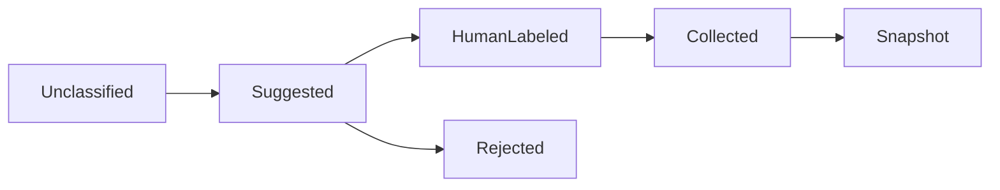

# 文件标签、集合与保存搜索

## 当前依据与交付边界

用户需要先虚拟组织文件，再决定实体移动；不能把客户端收藏或模型标签当成团队共享权威元数据。

当前依据：[internal/service/http.go](../../../server/internal/service/http.go)、[internal/service/tools.go](../../../server/internal/service/tools.go)、[internal/service/model.go](../../../server/internal/service/model.go)、[docs/contract-map.md](../../../docs/server/contract-map.md)。检查源码只证明当前实现形状，本文没有执行新增运行时测试或真实后端验证。

本包owner：`cli/drivebridge/server`；准入：`fit`；能力账本：`required / design`。消费方只能通过公开合同；新库、新worker和新命令仍归现有owner，不新增产品仓库。

## 前置、任务依赖与唯一写入

- [drivebridge-capability-readiness-v2](../drivebridge-capability-readiness-v2/design.md)：依赖合同先稳定；本包消费其公开接口，不写其私有状态。
- [drivebridge-team-runtime-projections-v1](../drivebridge-team-runtime-projections-v1/design.md)：依赖合同先稳定；本包消费其公开接口，不写其私有状态。

本包内部主链为1.1→1.2→2.1→2.2→3.1→3.2→4.1→4.2→5.1；5.2规模验收和6.1文档在5.1后推进，6.2等待二者完成。前置包的1.2合同稳定即可启动设计；运行集成需对应应用服务与入口已通过定向验证，不能以仅有spec满足运行依赖。没有子Agent自动授权，后续实现按拥有路径串行写；独立规格可分别审阅，稳定diff后才验收。

## 用户流程与状态

场景：标签建议→人工确认→规则集合→固定快照→撤权过滤。



只读检查、执行意图和最终结果分开；partial保留逐项结果，结果未知先回读原ID。恢复不更换来源、身份、目标或幂等键；取消不等于删除已完成副作用。

## 数据与版本

FileLabelAssignment、FileCollection、CollectionMember、SavedFileQuery、CollectionSnapshot通过GORM持久化。人工标签、规则标签、AI建议使用不同source；集合不持有Manju主体/资产revision。

新增关系字段采用可空或安全默认值，新增索引可回填；不删旧列、不改旧ID或URI。引用资源通过application service建立，配置/计划/回执/清单不由Agent手写。

## 公开接口与具体行为

| HTTP / 入口（规划，非已上线） | MCP / 客户端面 | SDK / 应用服务操作（规划） | 输入与结果 |
| --- | --- | --- | --- |
| POST /api/v1/file-queries | files_query | QueryFiles | typed filters、sort、limit≤200、cursor；无任意SQL |
| PUT /api/v1/files/{id}/labels | file_labels_set | SetFileLabels | namespace、labels、expected_revision；规则不覆盖人工字段 |
| GET/POST /api/v1/file-collections | file_collections_list、file_collection_create | ListFileCollections、CreateFileCollection | manual或rule，scope、规则版本 |
| PUT /api/v1/file-collections/{id}/members | collection_members_set | SetCollectionMembers | 显式成员/纳入/排除项及expected_revision |
| POST /api/v1/file-collections/{id}/snapshots | collection_snapshot | CreateFileSnapshot | 服务生成固定文件/版本清单 |
| GET/POST /api/v1/saved-searches | saved_searches_list、saved_search_create | SavedFileQueries | 保存查询而非权限；读取时重授权 |

表中GET/POST和花括号动作表示分别注册的路由，顿号分隔的是独立工具/SDK名称，不能作为字面路径或工具别名调用。表中的SDK名称是待实施应用操作名，不表示已有导出符号。落地时CLI/MCP/HTTP必须调用同一应用服务，SDK无付费重试、权限扩张或自动切换后端逻辑；开发者不能把接口表当作当前可执行命令。

- 标签namespace为manual/rule/suggested，模型只能写suggested；人工接受形成明确来源记录。私人集合默认仅本人可见，团队集合需要管理权限。
- manual集合保存文件ID并默认跟随当前版本；snapshot冻结版本。rule集合保存精确条件、排序、rule_revision和人工纳入/排除；语义Top-K只保存候选池，不称完整规则成员。
- 精确查询支持空间、规范化目录前缀、MIME、大小、时间、标签、来源caller/task_ref、trashed及固定版本选择；stable cursor绑定query hash和catalogue revision。
- 重复候选仅在可读范围按已验证SHA-256分组，未知摘要不入精确重复；相似检索另标similar，不自动删除。
- 新版本、移动和墓碑改变规则结果；展示computed_at与coverage。集合快照不授予文件读取权，也不自动固定保留期。
- 文件组织不改变Pinax笔记标签/正文、Manju主体集合或Scaena领域状态；需要领域采纳走对应owner。

## 共同合同约束

本包为 **设计与待实施合同**。本文规划路径、工具、字段、类型和状态尚未上线；不能把 spec strict 成功当成实现、真实后端或部署验收。既有接口须先从实际 tools/list、inputSchema、CLI help 与公开API确认。新能力默认关闭，部署配置未启用时报告 unsupported/blocked。

- HTTP 沿用各 owner 现有错误信封及认证；身份从会话/令牌推导，body 中的 tenant/actor/project 只能收窄选择范围。CLI 保留 human/--json/--agent 与已实现输出选项，不为旧入口改变必填字段或输出类型。
- 新写请求采用 Idempotency-Key 或该工具对应 idempotency_key，作用域为 instance+tenant+actor+action，指纹覆盖所有业务输入；同键同指纹复用，同键异指纹拒绝。已有入口保持原幂等作用域，禁止重解释旧键。编辑/执行携 expected_revision/expected_version；过期拒绝，不自动重算或批准。
- DriveBridge新分页默认50、最大200；Manju既有查询保留默认20/最大100及8秒预算，旧分页不变；游标不透明，绑定规范查询、身份范围、排序与数据代次。所有页重新授权；跨查询、跨身份游标拒绝。精确列表使用keyset稳定排序，以ID破同值；语义Top-K不是全集，异步导出使用独立原Operation。
- 新元数据与类型由应用服务/CLI生成，GORM为Go业务持久访问层；禁止在handler/SDK适配器拼接SQL。迁移、专用队列领取和分析器例外集中adapter、绑定参数、限定标识符，并在实现review列明理由。
- 保持现有 File/Version/Operation、URI、旧状态枚举与字段含义。本文流程节点描述新增流程或展示阶段，不是把旧 Operation.status 替换成一套新枚举。未知外部结果以新增 certainty/恢复信息表达，不伪报失败或成功。
- 整理、传输、内容处理与领域采纳是不同事实；不会因保存文件批准生成、付费、发布或采纳。回执不含凭据、临时URL、原始模型请求或完整内部推理。
- 基本错误：invalid_query/invalid_request=400，forbidden=403，not_found=404，idempotency_conflict/version_conflict/plan_stale=409，cursor_expired=410，unsupported=400（沿用既有Server映射），budget_exceeded=429，dependency_unavailable=503。保留已有错误码及状态码，专有新码见本包表；不得把旧同名码改义。


## 输入、结果与错误样例（规划）

以下标识符为说明性占位，不是可执行请求；实现测试由fixture/CLI生成合法ID。HTTP成功结果沿用owner现有信封，下面展示payload；CLI/MCP映射保持各自旧信封。示例不授予权限。

输入：

```json
{
  "mode": "exact",
  "space_ids": [
    "SPACE_ID"
  ],
  "filters": [
    {
      "field": "mime_type",
      "op": "eq",
      "value": "image/png"
    },
    {
      "field": "labels.manual",
      "op": "contains",
      "value": "approved"
    }
  ],
  "sort": [
    {
      "field": "updated_at",
      "direction": "desc"
    }
  ],
  "limit": 50
}
```

结果：

```json
{
  "mode": "exact",
  "items": [
    {
      "file_id": "FILE_ID",
      "version_id": "VERSION_ID"
    }
  ],
  "catalogue_revision": "CATALOGUE_REV",
  "next_cursor": null,
  "coverage": "complete",
  "total_count": 1
}
```

FileCollection含kind=manual/rule、revision、scope、rule、manual_include/exclude、computed_at；Snapshot成员钉file/version，不给读权限。SavedQuery仅存允许字段。count只有在该精确授权范围完整计算时给值，否则null并声明partial；namespace=manual仅人类显式动作写；预授权规则写rule，模型建议写suggested。

| 新码/沿用码 | HTTP状态（旧码保留现有映射） | 恢复行为 |
| --- | --- | --- |
| `query_changed` | 409 | 旧cursor不适用于新条件；重新第一页。 |
| `label_namespace_forbidden` | 403 | 模型建议仅进suggested，不能覆盖manual。 |
| `collection_revision_conflict` | 409 | 重读集合再显式合并，不覆盖并发编辑。 |

本包规模验收固定为：百万目录精确分页20并发P95≤2秒；10000成员集合/快照，重复摘要与部分权限分组；跨页撤权不能泄漏计数或成员。

## 测试规格与故障注入

| 场景 | Requirement | 正常与反例 | 必须断言 |
| --- | --- | --- | --- |
| 1 | 虚拟组织与标签权威 | Agent建议分类；模型重跑 | 文件路径不变且人工标签不被覆盖。 / 保留人工决定与拒绝记录。 |
| 2 | 集合与快照语义 | 文件更新；成员失权 | 动态集合显示新版，旧快照仍指原版本。 / 均过滤失权资源，旧快照不扩权。 |
| 3 | 精确重复和相关候选 | 同摘要两个可读文件；只有相近名称或描述 | 显示两个独立引用和来源。 / 标记similar或unknown，不能自动purge。 |

还需覆盖相同请求重放、并发编辑、权限撤销、跨租户、来源变更、进程重启、响应丢失，以及旧客户端缺新字段时的行为。性能验收只覆盖本包相关部分，统一目标见 [本owner验收与路线文档](../../../docs/server/file-platform/verification.md)。

实施任务先加入明确测试入口后运行以下命令；无匹配测试或输出no tests to run属于失败，不能以空运行关闭任务。当前文档轮次不执行产品测试。

```bash
python3 scripts/check.py -- go test ./internal/service -run TestFPFileOrganization -count=1
python3 scripts/check.py -- go test -race ./internal/service -run TestFPFileOrganization -count=1
```

集成证据由现有runner写入本owner `temp/integration-test-runs/<run-id>/`，包含summary.json、command.txt、stdout.log、stderr.log、env.json与artifacts/；失败同样保留并脱敏。真实存储、身份、模型费用与部署分别验证，不由fixture代替。

代码、定向测试和文档稳定后，才执行本包所需最终门：

```bash
python3 scripts/check.py
go vet ./...
CGO_ENABLED=0 go build ./cmd/drivebridge-server
openspec validate drivebridge-file-organization-v1 --strict --no-interactive
git diff --check
```

## 迁移、回滚与完成定义

- 当前只新增设计文档，运行时迁移未执行；实现按expand-then-contract，兼容既有客户端、元数据和凭据来源。
- 默认关闭新能力；关闭开关停止新意图，保留原Operation、文件、版本、计划、回执与审计。新版本已产生业务写入时，不允许回滚为丢弃这些写入的旧数据库快照。
- 本包负责自身配置与状态，不替消费者执行部署、发消息、真实云写入、付费调用或发布；这些门由相应owner独立验收。
- 设计完成=proposal/design/spec/tasks可追溯且strict通过。实现完成=任务指定运行证据通过。真实后端验证与发布部署是后续独立事实。

## 范围记录

2026-09-25：按用户确认的百万文件/万文件批次/100GiB目标和分层数据方案建立本包；目标未验收，required能力仅分期，不删除。
