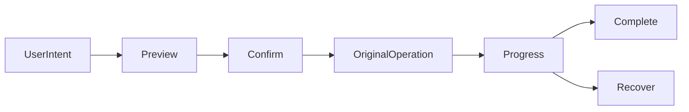

# 上传、检索、整理与交付客户端流程

## 当前依据与交付边界

总览信息架构之外，写入流程需要可恢复状态和明确确认；Client不能自行决定配额、权限或执行计划。

当前依据：[src/api.ts](../../../web/src/api.ts)、[src/nav-groups.ts](../../../web/src/nav-groups.ts)、[docs/ui/preview-collaboration.md](../../../docs/web/ui/preview-collaboration.md)。检查源码只证明当前实现形状，本文没有执行新增运行时测试或真实后端验证。

本包owner：`cli/drivebridge/web`；准入：`split-owner`；能力账本：`required / design`。消费方只能通过公开合同；新库、新worker和新命令仍归现有owner，不新增产品仓库。

## 前置、任务依赖与唯一写入

- [drivebridge-information-workspace-v2](../drivebridge-information-workspace-v2/design.md)：依赖合同先稳定；本包消费其公开接口，不写其私有状态。
- [drivebridge-upload-batch-recovery-v2](../drivebridge-upload-batch-recovery-v2/design.md)：依赖合同先稳定；本包消费其公开接口，不写其私有状态。
- [drivebridge-cross-storage-transfer-v1](../drivebridge-cross-storage-transfer-v1/design.md)：依赖合同先稳定；本包消费其公开接口，不写其私有状态。
- [drivebridge-agent-organization-v1](../drivebridge-agent-organization-v1/design.md)：依赖合同先稳定；本包消费其公开接口，不写其私有状态。
- [drivebridge-content-retrieval-v1](../drivebridge-content-retrieval-v1/design.md)：依赖合同先稳定；本包消费其公开接口，不写其私有状态。
- [drivebridge-fixed-delivery-v2](../drivebridge-fixed-delivery-v2/design.md)：依赖合同先稳定；本包消费其公开接口，不写其私有状态。
- [drivebridge-version-discussion-v1](../drivebridge-version-discussion-v1/design.md)：依赖合同先稳定；本包消费其公开接口，不写其私有状态。

本包内部主链为1.1→1.2→2.1→2.2→3.1→3.2→4.1→4.2→5.1；5.2规模验收和6.1文档在5.1后推进，6.2等待二者完成。前置包的1.2合同稳定即可启动设计；运行集成需对应应用服务与入口已通过定向验证，不能以仅有spec满足运行依赖。没有子Agent自动授权，后续实现按拥有路径串行写；独立规格可分别审阅，稳定diff后才验收。

## 用户流程与状态

场景：上传恢复→云端查询→整理预览→固定交付→版本讨论。



只读检查、执行意图和最终结果分开；partial保留逐项结果，结果未知先回读原ID。恢复不更换来源、身份、目标或幂等键；取消不等于删除已完成副作用。

## 数据与版本

界面只持有上传选择、非秘密幂等身份、草稿和筛选；Server batch/plan/manifest/thread为真源。IndexedDB恢复元数据按instance/user/space隔离，登出清理敏感显示缓存；不存长期token或文件正文。

客户端不新增领域数据库或schema迁移；消费类型兼容旧服务缺字段和unsupported。配置/计划/回执/清单由owner service创建，客户端仅保存界面临时状态与规定的上传恢复身份。

## 公开接口与具体行为

| HTTP / 入口（规划，非已上线） | MCP / 客户端面 | SDK / 应用服务操作（规划） | 输入与结果 |
| --- | --- | --- | --- |
| 上传中心 | upload-batches、operation lookup、原parts | 上传API client | Worker摘要、相对目录枚举、重选文件与原任务恢复 |
| 云端浏览/检索 | entries、file-queries、content-queries | 云端/搜索API client | 后端能力标签、coverage、exact/Top-K区分 |
| 整理中心 | organization-plans及policy只读投影 | 计划API client | 逐项before/after、风险、确认、部分成功、补偿 |
| 交付与讨论 | shares manifests、delivery receipts、threads/private-note | 协作API client | 发布完整性、分级接收、版本讨论、隐私预览 |

表中的SDK名称是待实施应用操作名，不表示已有导出符号。落地时CLI/MCP/HTTP必须调用同一应用服务，SDK无付费重试、权限扩张或自动切换后端逻辑；开发者不能把接口表当作当前可执行命令。

- 文件夹选择/拖拽采用渐进增强；不支持目录API时提供普通多文件选择并明确不保留目录，不伪造支持。空目录在能力允许时上传显式条目。
- 上传前保存稳定幂等身份；刷新后从Server回读批次，重选同文件核验digest；进度区分摘要、已耐久字节、验证和发布，不用100%网络发送表示完成。
- 整理预览展示来源版本、目标、冲突策略、风险、规则授权和预计影响；确认提交expected_revision。stale时要求重看，不自动重新批准。
- 搜索支持元数据精确列表、内容候选和片段证据分组；可保存条件与固定集合；显示缺失模态、索引代次和观测时间。
- 交付缺项不可点击完整发布；界面不把opened/bytes_served映射为accepted。讨论失败保留草稿、旧版本标记，私人备注公开前展示团队。
- 覆盖loading/empty/offline/partial/forbidden/stale/unsupported；移动端确认页保留影响数量和关键风险，键盘焦点返回发起按钮。
- 功能分片由各Server change稳定后启用；客户端包完成不能代替Server/Manju端到端验收。

## 共同合同约束

本包为 **设计与待实施合同**。本文规划路径、工具、字段、类型和状态尚未上线；不能把 spec strict 成功当成实现、真实后端或部署验收。既有接口须先从实际 tools/list、inputSchema、CLI help 与公开API确认。新能力默认关闭，部署配置未启用时报告 unsupported/blocked。

- HTTP 沿用各 owner 现有错误信封及认证；身份从会话/令牌推导，body 中的 tenant/actor/project 只能收窄选择范围。CLI 保留 human/--json/--agent 与已实现输出选项，不为旧入口改变必填字段或输出类型。
- 新写请求采用 Idempotency-Key 或该工具对应 idempotency_key，作用域为 instance+tenant+actor+action，指纹覆盖所有业务输入；同键同指纹复用，同键异指纹拒绝。已有入口保持原幂等作用域，禁止重解释旧键。编辑/执行携 expected_revision/expected_version；过期拒绝，不自动重算或批准。
- DriveBridge新分页默认50、最大200；Manju既有查询保留默认20/最大100及8秒预算，旧分页不变；游标不透明，绑定规范查询、身份范围、排序与数据代次。所有页重新授权；跨查询、跨身份游标拒绝。精确列表使用keyset稳定排序，以ID破同值；语义Top-K不是全集，异步导出使用独立原Operation。
- 新元数据与类型由应用服务/CLI生成，GORM为Go业务持久访问层；禁止在handler/SDK适配器拼接SQL。迁移、专用队列领取和分析器例外集中adapter、绑定参数、限定标识符，并在实现review列明理由。
- 保持现有 File/Version/Operation、URI、旧状态枚举与字段含义。本文流程节点描述新增流程或展示阶段，不是把旧 Operation.status 替换成一套新枚举。未知外部结果以新增 certainty/恢复信息表达，不伪报失败或成功。
- 整理、传输、内容处理与领域采纳是不同事实；不会因保存文件批准生成、付费、发布或采纳。回执不含凭据、临时URL、原始模型请求或完整内部推理。
- 基本错误：invalid_query/invalid_request=400，forbidden=403，not_found=404，idempotency_conflict/version_conflict/plan_stale=409，cursor_expired=410，unsupported=400（沿用既有Server映射），budget_exceeded=429，dependency_unavailable=503。保留已有错误码及状态码，专有新码见本包表；不得把旧同名码改义。


## 输入、结果与错误样例（规划）

以下标识符为说明性占位，不是可执行请求；实现测试由fixture/CLI生成合法ID。HTTP成功结果沿用owner现有信封，下面展示payload；CLI/MCP映射保持各自旧信封。示例不授予权限。

输入：

```json
{
  "batch_id": "BATCH_ID",
  "item_key": "ITEM_ID",
  "selected_source_fingerprint": "SOURCE_SHA256"
}
```

结果：

```json
{
  "view_state": "needs_source_selection",
  "original_operation_id": "OP_ID",
  "can_resume": true,
  "bytes_durable": 8388608,
  "phase": "transferring"
}
```

此例是UI模型，不新增服务端状态。IndexedDB记录instance/actor/space/batch/item/key/fingerprint，不保存完整文件、私密下载URL或认证token。登出/身份切换清理显示缓存；从Server重新授权读回。

| 新码/沿用码 | HTTP状态（旧码保留现有映射） | 恢复行为 |
| --- | --- | --- |
| `content_mismatch` | 400 | 提示重选原文件，已验证进度保留。 |
| `plan_stale` | 409 | 重新预览具体影响，禁止自动再次确认。 |
| `forbidden` | 403 | 撤权后移除旧敏感内容和动作。 |

本包规模验收固定为：万项上传/整理分页、百万目录检索fixture；多文件拖拽、原键恢复、空间切换晚响应；320/390/768/1440px、键盘、焦点与中文错误下一步。

## 测试规格与故障注入

| 场景 | Requirement | 正常与反例 | 必须断言 |
| --- | --- | --- | --- |
| 1 | 上传恢复交互 | 创建响应丢失且刷新页面；网络发送达到100%但仍验证 | 通过原键查询并重选同文件，保留原操作。 / 标记验证中而非上传完成。 |
| 2 | 整理与交付确认 | 确认前计划变化；交付缺一项 | 显示stale并要求重新预览。 / 显示缺项及恢复原任务入口，不发布不完整集合。 |
| 3 | 检索和隐私体验 | 语义返回20项；空间切换时旧查询返回 | 显示Top-K候选而非全量。 / 丢弃旧响应，保留新空间上下文。 |

还需覆盖相同请求重放、并发编辑、权限撤销、跨租户、来源变更、进程重启、响应丢失，以及旧客户端缺新字段时的行为。性能验收只覆盖本包相关部分，统一目标见 [本owner验收与路线文档](../../../docs/web/file-platform-evolution.md)。

实施任务先加入明确测试入口后运行以下命令；无匹配测试或输出no tests to run属于失败，不能以空运行关闭任务。当前文档轮次不执行产品测试。

```bash
pnpm test
pnpm test:e2e
```

集成证据由现有runner写入本owner `temp/integration-test-runs/<run-id>/`，包含summary.json、command.txt、stdout.log、stderr.log、env.json与artifacts/；失败同样保留并脱敏。真实存储、身份、模型费用与部署分别验证，不由fixture代替。

代码、定向测试和文档稳定后，才执行本包所需最终门：

```bash
pnpm test
pnpm build
pnpm test:e2e
openspec validate drivebridge-file-platform-consumers-v2 --strict --no-interactive
git diff --check
```

## 迁移、回滚与完成定义

- 当前只新增设计文档，运行时迁移未执行；实现按expand-then-contract，兼容既有客户端、元数据和凭据来源。
- 默认关闭新能力；关闭开关停止新意图，保留原Operation、文件、版本、计划、回执与审计。新版本已产生业务写入时，不允许回滚为丢弃这些写入的旧数据库快照。
- 本包负责自身配置与状态，不替消费者执行部署、发消息、真实云写入、付费调用或发布；这些门由相应owner独立验收。
- 设计完成=proposal/design/spec/tasks可追溯且strict通过。实现完成=任务指定运行证据通过。真实后端验证与发布部署是后续独立事实。

## 范围记录

2026-09-25：按用户确认的百万文件/万文件批次/100GiB目标和分层数据方案建立本包；目标未验收，required能力仅分期，不删除。
