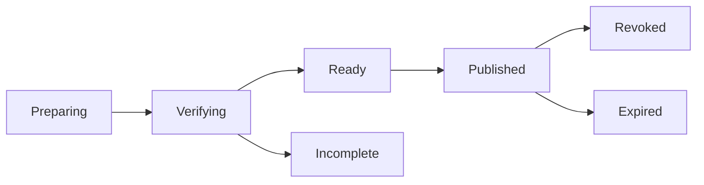

# 固定文件交付与完整性清单

## 当前依据与交付边界

既有分享可固定成员，但完整交付还需要清单校验、保留保护和分级接收状态，不能把下载请求成功当作验收。

当前依据：[internal/service/http.go](../../../server/internal/service/http.go)、[internal/service/tools.go](../../../server/internal/service/tools.go)、[internal/service/model.go](../../../server/internal/service/model.go)、[docs/contract-map.md](../../../docs/server/contract-map.md)。检查源码只证明当前实现形状，本文没有执行新增运行时测试或真实后端验证。

本包owner：`cli/drivebridge/server`；准入：`fit`；能力账本：`required / design`。消费方只能通过公开合同；新库、新worker和新命令仍归现有owner，不新增产品仓库。

## 前置、任务依赖与唯一写入

- [drivebridge-file-organization-v1](../drivebridge-file-organization-v1/design.md)：依赖合同先稳定；本包消费其公开接口，不写其私有状态。
- [drivebridge-upload-batch-recovery-v2](../drivebridge-upload-batch-recovery-v2/design.md)：依赖合同先稳定；本包消费其公开接口，不写其私有状态。
- [drivebridge-retention-guards-v2](../drivebridge-retention-guards-v2/design.md)：依赖合同先稳定；本包消费其公开接口，不写其私有状态。

本包内部主链为1.1→1.2→2.1→2.2→3.1→3.2→4.1→4.2→5.1；5.2规模验收和6.1文档在5.1后推进，6.2等待二者完成。前置包的1.2合同稳定即可启动设计；运行集成需对应应用服务与入口已通过定向验证，不能以仅有spec满足运行依赖。没有子Agent自动授权，后续实现按拥有路径串行写；独立规格可分别审阅，稳定diff后才验收。

## 用户流程与状态

场景：冻结集合→核验清单→发布→接收确认→撤销。



只读检查、执行意图和最终结果分开；partial保留逐项结果，结果未知先回读原ID。恢复不更换来源、身份、目标或幂等键；取消不等于删除已完成副作用。

## 数据与版本

在既有Share/ShareItem上加DeliveryManifest和DeliveryReceipt，保持分享ID/权限语义。Manifest包含固定成员、版本、SHA-256、大小、来源与完整性结果；仅服务生成。

新增关系字段采用可空或安全默认值，新增索引可回填；不删旧列、不改旧ID或URI。引用资源通过application service建立，配置/计划/回执/清单不由Agent手写。

## 公开接口与具体行为

| HTTP / 入口（规划，非已上线） | MCP / 客户端面 | SDK / 应用服务操作（规划） | 输入与结果 |
| --- | --- | --- | --- |
| POST /api/v1/shares/{id}/delivery-manifests | delivery_prepare | PrepareFileDelivery | 固定成员snapshot、expected_share_revision、幂等键；用户分享管理权限 |
| GET /api/v1/shares/{id}/delivery-manifests/{revision} | delivery_get | GetFileDelivery | 逐项可读性/校验及完整标志 |
| POST /api/v1/shares/{id}/delivery-manifests/{revision}/publish | 人类授权 | PublishFileDelivery | 全部必需项与清单核验，保留保护已提交 |
| POST /api/v1/delivery-receipts | delivery_receipt | RecordDeliveryReceipt | manifest revision、receiver身份、receipt kind及摘要；不承认自报他人 |

表中的SDK名称是待实施应用操作名，不表示已有导出符号。落地时CLI/MCP/HTTP必须调用同一应用服务，SDK无付费重试、权限扩张或自动切换后端逻辑；开发者不能把接口表当作当前可执行命令。

- 固定交付冻结成员和版本；持续目录分享保持原语义，不转成固定交付。扫描期间冻结成员不冒充全局同一时刻快照。
- 发布仅在全部必需成员可读、摘要验证、清单提交和保留保护成功后完成；部分文件可已存在但不可标完整。配额不足发布失败，保留原准备组可恢复。
- 状态区分accessible、opened、bytes_served、receiver_verified、receiver_confirmed。接收校验回执绑定已认证接收方与manifest；匿名分享仅有服务端观测，不能冒充实名确认。
- DriveBridge接收确认不是Manju/Scaena/Eikona领域采纳；两类回执通过外部引用并列，不相互覆盖。
- 撤销先拒未来读取，不承诺收回已有副本。新manifest不改写旧清单，替换缺项须新revision并重新确认。
- 保留保护依赖服务端retention-guards-v2；不存在保护能力时可准备但不得以保证期限发布。

## 共同合同约束

本包为 **设计与待实施合同**。本文规划路径、工具、字段、类型和状态尚未上线；不能把 spec strict 成功当成实现、真实后端或部署验收。既有接口须先从实际 tools/list、inputSchema、CLI help 与公开API确认。新能力默认关闭，部署配置未启用时报告 unsupported/blocked。

- HTTP 沿用各 owner 现有错误信封及认证；身份从会话/令牌推导，body 中的 tenant/actor/project 只能收窄选择范围。CLI 保留 human/--json/--agent 与已实现输出选项，不为旧入口改变必填字段或输出类型。
- 新写请求采用 Idempotency-Key 或该工具对应 idempotency_key，作用域为 instance+tenant+actor+action，指纹覆盖所有业务输入；同键同指纹复用，同键异指纹拒绝。已有入口保持原幂等作用域，禁止重解释旧键。编辑/执行携 expected_revision/expected_version；过期拒绝，不自动重算或批准。
- DriveBridge新分页默认50、最大200；Manju既有查询保留默认20/最大100及8秒预算，旧分页不变；游标不透明，绑定规范查询、身份范围、排序与数据代次。所有页重新授权；跨查询、跨身份游标拒绝。精确列表使用keyset稳定排序，以ID破同值；语义Top-K不是全集，异步导出使用独立原Operation。
- 新元数据与类型由应用服务/CLI生成，GORM为Go业务持久访问层；禁止在handler/SDK适配器拼接SQL。迁移、专用队列领取和分析器例外集中adapter、绑定参数、限定标识符，并在实现review列明理由。
- 保持现有 File/Version/Operation、URI、旧状态枚举与字段含义。本文流程节点描述新增流程或展示阶段，不是把旧 Operation.status 替换成一套新枚举。未知外部结果以新增 certainty/恢复信息表达，不伪报失败或成功。
- 整理、传输、内容处理与领域采纳是不同事实；不会因保存文件批准生成、付费、发布或采纳。回执不含凭据、临时URL、原始模型请求或完整内部推理。
- 基本错误：invalid_query/invalid_request=400，forbidden=403，not_found=404，idempotency_conflict/version_conflict/plan_stale=409，cursor_expired=410，unsupported=400（沿用既有Server映射），budget_exceeded=429，dependency_unavailable=503。保留已有错误码及状态码，专有新码见本包表；不得把旧同名码改义。


## 输入、结果与错误样例（规划）

以下标识符为说明性占位，不是可执行请求；实现测试由fixture/CLI生成合法ID。HTTP成功结果沿用owner现有信封，下面展示payload；CLI/MCP映射保持各自旧信封。示例不授予权限。

输入：

```json
{
  "snapshot_id": "SNAPSHOT_ID",
  "expected_share_revision": 3,
  "idempotency_key": "delivery-example"
}
```

结果：

```json
{
  "share_id": "SHARE_ID",
  "manifest_revision": 1,
  "phase": "verifying",
  "required_items": 10,
  "verified_items": 9,
  "complete": false,
  "retention_ready": false
}
```

Manifest成员含file/version/size/sha256、verification与hold引用。Receipt含manifest revision、server-authenticated receiver、kind、observed_at与可验证摘要。客户端自报下载成功只能成为声明，不能由服务端升级为已校验事实。

| 新码/沿用码 | HTTP状态（旧码保留现有映射） | 恢复行为 |
| --- | --- | --- |
| `delivery_incomplete` | 409 | 恢复原准备组缺项，不自动移除必需项。 |
| `retention_not_ready` | 409 | 先建立真实保留保护和容量保证。 |
| `receiver_identity_required` | 403 | 不能为匿名下载伪造实名确认。 |

本包规模验收固定为：10000成员固定清单有界分页与核验；缺项、hold/purge竞态、接收确认伪造、撤权和旧版不可读；发布前完整性不可被UI进度替代。

## 测试规格与故障注入

| 场景 | Requirement | 正常与反例 | 必须断言 |
| --- | --- | --- | --- |
| 1 | 固定清单完整性 | 十项全部校验且保留保护成功；十项缺一项 | 完整且版本固定。 / delivery_incomplete，不能自动删掉缺项。 |
| 2 | 接收事实分级 | 浏览器触发下载；未认证接收者提交验收 | 最多bytes_served，不自动receiver_confirmed。 / 拒绝冒充身份，已传出事实保留。 |
| 3 | 撤销和领域采纳 | 分享撤销；接收方已下载 | 拒绝读取。 / 说明已取得副本不可收回，不能标领域审核通过。 |

还需覆盖相同请求重放、并发编辑、权限撤销、跨租户、来源变更、进程重启、响应丢失，以及旧客户端缺新字段时的行为。性能验收只覆盖本包相关部分，统一目标见 [本owner验收与路线文档](../../../docs/server/file-platform/verification.md)。

实施任务先加入明确测试入口后运行以下命令；无匹配测试或输出no tests to run属于失败，不能以空运行关闭任务。当前文档轮次不执行产品测试。

```bash
python3 scripts/check.py -- go test ./internal/service -run TestFPFixedDelivery -count=1
python3 scripts/check.py -- go test -race ./internal/service -run TestFPFixedDelivery -count=1
```

集成证据由现有runner写入本owner `temp/integration-test-runs/<run-id>/`，包含summary.json、command.txt、stdout.log、stderr.log、env.json与artifacts/；失败同样保留并脱敏。真实存储、身份、模型费用与部署分别验证，不由fixture代替。

代码、定向测试和文档稳定后，才执行本包所需最终门：

```bash
python3 scripts/check.py
go vet ./...
CGO_ENABLED=0 go build ./cmd/drivebridge-server
openspec validate drivebridge-fixed-delivery-v2 --strict --no-interactive
git diff --check
```

## 迁移、回滚与完成定义

- 当前只新增设计文档，运行时迁移未执行；实现按expand-then-contract，兼容既有客户端、元数据和凭据来源。
- 默认关闭新能力；关闭开关停止新意图，保留原Operation、文件、版本、计划、回执与审计。新版本已产生业务写入时，不允许回滚为丢弃这些写入的旧数据库快照。
- 本包负责自身配置与状态，不替消费者执行部署、发消息、真实云写入、付费调用或发布；这些门由相应owner独立验收。
- 设计完成=proposal/design/spec/tasks可追溯且strict通过。实现完成=任务指定运行证据通过。真实后端验证与发布部署是后续独立事实。

## 范围记录

2026-09-25：按用户确认的百万文件/万文件批次/100GiB目标和分层数据方案建立本包；目标未验收，required能力仅分期，不删除。
