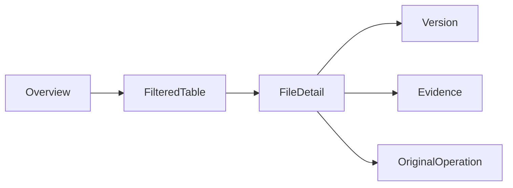

# 总览、文件详情与可钻取信息架构

## 当前依据与交付边界

现有Finder、容量页和审计页已有基础；新增数据必须提供可追溯层次和状态，而不是堆叠更多图表或在客户端计算业务真值。

当前依据：[src/api.ts](../../../web/src/api.ts)、[src/nav-groups.ts](../../../web/src/nav-groups.ts)、[docs/ui/preview-collaboration.md](../../../docs/web/ui/preview-collaboration.md)。检查源码只证明当前实现形状，本文没有执行新增运行时测试或真实后端验证。

本包owner：`cli/drivebridge/web`；准入：`split-owner`；能力账本：`required / design`。消费方只能通过公开合同；新库、新worker和新命令仍归现有owner，不新增产品仓库。

## 前置、任务依赖与唯一写入

- [drivebridge-capability-readiness-v2](../drivebridge-capability-readiness-v2/design.md)：依赖合同先稳定；本包消费其公开接口，不写其私有状态。
- [drivebridge-analytics-search-v1](../drivebridge-analytics-search-v1/design.md)：依赖合同先稳定；本包消费其公开接口，不写其私有状态。
- [drivebridge-file-organization-v1](../drivebridge-file-organization-v1/design.md)：依赖合同先稳定；本包消费其公开接口，不写其私有状态。

本包内部主链为1.1→1.2→2.1→2.2→3.1→3.2→4.1→4.2→5.1；5.2规模验收和6.1文档在5.1后推进，6.2等待二者完成。前置包的1.2合同稳定即可启动设计；运行集成需对应应用服务与入口已通过定向验证，不能以仅有spec满足运行依赖。没有子Agent自动授权，后续实现按拥有路径串行写；独立规格可分别审阅，稳定diff后才验收。

## 用户流程与状态

场景：资源总览→筛选钻取→固定文件版本→证据和操作回读。



只读检查、执行意图和最终结果分开；partial保留逐项结果，结果未知先回读原ID。恢复不更换来源、身份、目标或幂等键；取消不等于删除已完成副作用。

## 数据与版本

客户端仅保存筛选、布局和草稿；URL承载安全筛选与选择，不承载token/临时URL/正文。沿用DataTable、DirectoryLayout、既有图表和Precision Pine样式。

客户端不新增领域数据库或schema迁移；消费类型兼容旧服务缺字段和unsupported。配置/计划/回执/清单由owner service创建，客户端仅保存界面临时状态与规定的上传恢复身份。

## 公开接口与具体行为

| HTTP / 入口（规划，非已上线） | MCP / 客户端面 | SDK / 应用服务操作（规划） | 输入与结果 |
| --- | --- | --- | --- |
| 资源总览：GET既有usage及POST analytics/queries | 人用UI | 复用typed API client | URL共享时间/空间/目录/类型/身份筛选 |
| 文件详情：files/versions/content-bindings/threads | 人用UI | 版本选择器固定ref | 概览、版本、来源与引用、内容、讨论、活动 |
| 搜索探索：file-queries/content-queries | 人用UI | exact与discovery分组 | 列表/图库/片段；不在浏览器重建全文索引 |
| 状态与钻取：Operation/plan/collection ID | 人用UI | 原ID跳转 | 图表到同口径明细，旧路由继续可访问 |

表中的SDK名称是待实施应用操作名，不表示已有导出符号。落地时CLI/MCP/HTTP必须调用同一应用服务，SDK无付费重试、权限扩张或自动切换后端逻辑；开发者不能把接口表当作当前可执行命令。

- 总览六组：容量、增长、传输、连接、整理、Agent活动。逻辑/物理/缓存/预留容量分开；流量不称账单，未知不补零。
- 文件详情六页签：概览、版本、来源与引用、内容理解、讨论、活动；优先显示名称/版本/存储/可读性/下一步，技术ID折叠但可复制。
- 图表选择形成同一query/filter进入明细；显示观察时间、覆盖、延迟、样本或Top-K标记。后端未提供明细时禁用虚假钻取并说明原因。
- 保留既有工作台/协作/系统导航，搜索与整理作为工作台入口；连接管理继续系统入口，文件详情不嵌入管理员扩权面。
- 空间切换取消旧请求并验证context revision，旧响应不得覆盖新租户页面。页面不可见暂停轮询；可见默认30秒刷新，小范围操作用回读原ID。
- 320/390px窄屏使用单列和详情抽屉；768px以上按可用宽度逐步双栏；桌面支持列表/图库。触控目标44px，键盘顺序、焦点恢复、表格替代和减少动效可用。
- loading/empty/partial/stale/forbidden/offline/unsupported/error分开；保留用户筛选与未发送草稿。原始错误映射中文下一步，不能给不可执行重试按钮。
- 本机页面仅在私有owner socket明确启用且动作获权时提供既有受控写；缺owner退回只读索引。不会将本机view改成远程可写API。

## 共同合同约束

本包为 **设计与待实施合同**。本文规划路径、工具、字段、类型和状态尚未上线；不能把 spec strict 成功当成实现、真实后端或部署验收。既有接口须先从实际 tools/list、inputSchema、CLI help 与公开API确认。新能力默认关闭，部署配置未启用时报告 unsupported/blocked。

- HTTP 沿用各 owner 现有错误信封及认证；身份从会话/令牌推导，body 中的 tenant/actor/project 只能收窄选择范围。CLI 保留 human/--json/--agent 与已实现输出选项，不为旧入口改变必填字段或输出类型。
- 新写请求采用 Idempotency-Key 或该工具对应 idempotency_key，作用域为 instance+tenant+actor+action，指纹覆盖所有业务输入；同键同指纹复用，同键异指纹拒绝。已有入口保持原幂等作用域，禁止重解释旧键。编辑/执行携 expected_revision/expected_version；过期拒绝，不自动重算或批准。
- DriveBridge新分页默认50、最大200；Manju既有查询保留默认20/最大100及8秒预算，旧分页不变；游标不透明，绑定规范查询、身份范围、排序与数据代次。所有页重新授权；跨查询、跨身份游标拒绝。精确列表使用keyset稳定排序，以ID破同值；语义Top-K不是全集，异步导出使用独立原Operation。
- 新元数据与类型由应用服务/CLI生成，GORM为Go业务持久访问层；禁止在handler/SDK适配器拼接SQL。迁移、专用队列领取和分析器例外集中adapter、绑定参数、限定标识符，并在实现review列明理由。
- 保持现有 File/Version/Operation、URI、旧状态枚举与字段含义。本文流程节点描述新增流程或展示阶段，不是把旧 Operation.status 替换成一套新枚举。未知外部结果以新增 certainty/恢复信息表达，不伪报失败或成功。
- 整理、传输、内容处理与领域采纳是不同事实；不会因保存文件批准生成、付费、发布或采纳。回执不含凭据、临时URL、原始模型请求或完整内部推理。
- 基本错误：invalid_query/invalid_request=400，forbidden=403，not_found=404，idempotency_conflict/version_conflict/plan_stale=409，cursor_expired=410，unsupported=400（沿用既有Server映射），budget_exceeded=429，dependency_unavailable=503。保留已有错误码及状态码，专有新码见本包表；不得把旧同名码改义。


## 输入、结果与错误样例（规划）

以下标识符为说明性占位，不是可执行请求；实现测试由fixture/CLI生成合法ID。HTTP成功结果沿用owner现有信封，下面展示payload；CLI/MCP映射保持各自旧信封。示例不授予权限。

输入：

```json
{
  "view": "overview",
  "filters": {
    "space_id": "SPACE_ID",
    "from": "2026-08-26",
    "to": "2026-09-25"
  },
  "selected_file_ref": null
}
```

结果：

```json
{
  "panel": "capacity",
  "state": "partial",
  "scope_label": "当前授权空间",
  "observed_at": "2026-09-25T00:00:00Z",
  "drilldown_query": {
    "dataset": "file_current",
    "filters": [
      {
        "field": "space_id",
        "op": "eq",
        "value": "SPACE_ID"
      }
    ]
  }
}
```

此例为UI消费模型，不新增HTTP端点。视图状态固定loading/ready/empty/partial/stale/forbidden/offline/unsupported/error；operation certainty在详情单独展示。URL持安全筛选，正文/token/临时URL不入URL或持久缓存。

| 新码/沿用码 | HTTP状态（旧码保留现有映射） | 恢复行为 |
| --- | --- | --- |
| `forbidden` | 403 | 切换到仍授权的范围，不保留旧明细。 |
| `dependency_unavailable` | 503 | 展示上次观测时间或空状态，不把缓存当实时。 |

本包规模验收固定为：百万目录分页fixture、万项批次；已挂载表格行≤200，320/390/768/1440px和键盘可用；20并发请求fixture只呈现当前context，图表钻取口径一致。

## 测试规格与故障注入

| 场景 | Requirement | 正常与反例 | 必须断言 |
| --- | --- | --- | --- |
| 1 | 总览与钻取同口径 | 选择传输失败柱；后端只有部分扫描 | 筛选不变并能打开原Operation。 / 显示partial与观测范围，不称全盘总量。 |
| 2 | 文件详情与版本 | 从旧交付打开文件；该版本不可读 | 版本选择钉住原ref。 / 显示版本不可用与恢复入口，不偷换新文件。 |
| 3 | 权限和响应交互 | 查询中切换租户；仅键盘或390px屏幕 | 不渲染旧租户数据。 / 可进入数据表、关闭详情并回原焦点，无必要控件裁切。 |

还需覆盖相同请求重放、并发编辑、权限撤销、跨租户、来源变更、进程重启、响应丢失，以及旧客户端缺新字段时的行为。性能验收只覆盖本包相关部分，统一目标见 [本owner验收与路线文档](../../../docs/web/file-platform-evolution.md)。

实施任务先加入明确测试入口后运行以下命令；无匹配测试或输出no tests to run属于失败，不能以空运行关闭任务。当前文档轮次不执行产品测试。

```bash
pnpm test
pnpm test:e2e
```

集成证据由现有runner写入本owner `temp/integration-test-runs/<run-id>/`，包含summary.json、command.txt、stdout.log、stderr.log、env.json与artifacts/；失败同样保留并脱敏。真实存储、身份、模型费用与部署分别验证，不由fixture代替。

代码、定向测试和文档稳定后，才执行本包所需最终门：

```bash
pnpm test
pnpm build
pnpm test:e2e
openspec validate drivebridge-information-workspace-v2 --strict --no-interactive
git diff --check
```

## 迁移、回滚与完成定义

- 当前只新增设计文档，运行时迁移未执行；实现按expand-then-contract，兼容既有客户端、元数据和凭据来源。
- 默认关闭新能力；关闭开关停止新意图，保留原Operation、文件、版本、计划、回执与审计。新版本已产生业务写入时，不允许回滚为丢弃这些写入的旧数据库快照。
- 本包负责自身配置与状态，不替消费者执行部署、发消息、真实云写入、付费调用或发布；这些门由相应owner独立验收。
- 设计完成=proposal/design/spec/tasks可追溯且strict通过。实现完成=任务指定运行证据通过。真实后端验证与发布部署是后续独立事实。

## 范围记录

2026-09-25：按用户确认的百万文件/万文件批次/100GiB目标和分层数据方案建立本包；目标未验收，required能力仅分期，不删除。
