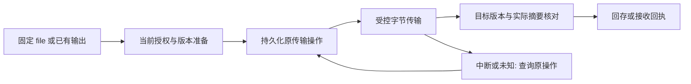

## Context

基线：稳定文件引用、prepare_reference、save_output 与原 transfer 恢复。本工作保持现有私有存储、权限与运行任务的 owner；接口存在、离线通过、真实本地媒体、真实模型和正式接受分别报告。

## Goals / Non-Goals

补齐素材进入制作与成片回存的版本、摘要、受控传输和回执说明。引用不是远端可读路径；上传、生成和采用分别记录。版本漂移后重新准备，unknown 恢复原传输。

不复制生成任务或成片接受，不泄漏临时访问地址、宿主路径或凭据。

## Decisions

1. 输出 file ref/version/digest、transfer identity、permission/source facts 与 handoff receipt；固定来源和版本，拒绝过期、跨项目、缺失或不支持的输入。
2. 复用 application/service；transport 不复制业务逻辑，不 shell out 到其他 owner CLI。
3. 旧接口不改义，历史数据可读；新字段与新能力增量引入。需要持久化时使用既有 GORM repository，禁止旁路状态文件。
4. 新操作绑定稳定幂等键；未知提交结果查询原身份。取消受理、取消完成、候选完成和人工采用不是同一状态。
5. 人工和模型提供的文本仅作为内容；不允许内容扩大权限。证据不含凭据、提示词或 Provider 原始响应。

## Verification

本仓聚焦检查：`go test ./internal/bridge/... -run 'Handoff|Version|Resume' -count=1`。规格检查：`openspec validate drivebridge-semantic-video-handoff-v1 --strict`。

集成结果由现有 runner 写入本仓 temp/integration-test-runs；覆盖成功、缺失、来源版本变化、跨项目、重复请求、unknown、取消与恢复。使用 fake owner 验证边界不要求其他仓库在线；真实媒体和模型效果另记。

## Compatibility / Rollback

保留旧来源与回执；停用新能力即可回退，不删除数据。未装配或能力不支持返回 unavailable，不回退成模拟成功。

## 本轮细化：固定文件与成片回存（待实施）

准入为 fit；生成、剪辑和成片接受为 split-owner。根 CLI/MCP、server/ 和 web/ 仍在 cli/drivebridge 单一 owner 内，不恢复旧三个独立项目。新增 4.x 复用 bridge/传输/授权合同；大规模上传恢复与固定交付已有独立 change，本 change 只补生产消费者所需映射与 conformance。

### 文件版本与字节

File 的 version、Operation 的 source_version 和 operation ID 各有语义。远端 ETag/version 不是天然 SHA-256；准备时冻结版本，传输前后检查源版本和实际 bytes，再返回本地/远端可证明的摘要事实。没有远端读回或摘要证据时只报告已有事实，不把 metadata 一致写成字节已验证。

| 路径 | 输入 | 输出边界 |
| --- | --- | --- |
| prepare_reference | 现有授权空间内的固定 file_ref 与用途 | 准备/可用性事实；不生成、不返回私有临时 URL |
| 媒体传输 | 固定文件版本、当前 grant、方向和目标 | 原 operation、实际字节/摘要与接收回执 |
| save_output | 已存在的 succeeded/imported Scaena submission_ref、space_id、幂等键 | 保存既有产物；不提交新的生成任务 |
| 重查/恢复 | 原 operation ID 和当前授权 | 当前传输与取消事实；不能换目标规避冲突 |

现有 save_output 对来源状态的支持不等于 Scaena 正式交付接受；调用方如要求正式成品，应另外核对相应接受回执，不能由 DriveBridge 制造。空文件可由文件平台持有，但不能伪装可用视频素材。

### 访问与多端

MCP 控制面返回稳定引用、状态和下一步；实际 bytes 走既有 HTTP/本地传输路径。客户端路径不表示远端服务器可读路径。无 CLI 客户端从 tools/list/inputSchema/resource 获得已支持参数，不回退为 shell 命令或任意文件读取。

临时 grant 绑定当前主体、固定文件版本、目的/方向与有效期；大文件和 Range 请求按既有授权重新核对，不以一次准备永久授权。撤权/过期后停止新的受限读写，私有 URL、宿主路径、token 和 bearer header 不进普通证据。

### 恢复和取消

上传成功但应答丢失时，原操作核对目标身份与 source fingerprint；不改文件名再次上传。相同幂等键不同目标/源版本应冲突。取消是可持久化结果，不在重启后自动恢复已取消项；晚到的远端副作用如仍发生，单独记录待核对事实，不能抹掉。遇到本地目标已存在保留旧文件，覆盖必须由现有显式政策授权。

### 兼容与测试

生产 handoff 不复制 drivebridge-fixed-delivery-v2 的交付账本，也不复制 drivebridge-upload-batch-recovery-v2 的批次调度/性能任务。优先消费已存在的稳定版本/operation/grant projection，缺少必要字段再做加法扩展并保留旧客户端。

新增回归覆盖版本在准备后漂移、分片读取中变化、撤权/过期、跨空间、路径逃逸、源为空、目标已存在、应答丢失、原操作恢复、取消晚到及 save_output 无新增生成。检查：`go test ./internal/bridge -run 'Handoff|Version|Resume|CancelIsDurable|UploadResume' -count=1`；CLI/MCP 与 server 边界分别通过本仓现有 runner 取证，不能拿其中一个模块的成功替代整个单仓运行。真实 OneDrive 写入与大规模传输另列运行记录。
