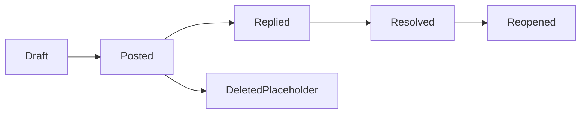

# 固定版本讨论与私人备注

## 当前依据与交付边界

客户端已有讨论设计但没有Server持久合同；需要版本锚点、权限和并发，不以localStorage模拟共享评论。

当前依据：[internal/service/http.go](../../../server/internal/service/http.go)、[internal/service/tools.go](../../../server/internal/service/tools.go)、[internal/service/model.go](../../../server/internal/service/model.go)、[docs/contract-map.md](../../../docs/server/contract-map.md)。检查源码只证明当前实现形状，本文没有执行新增运行时测试或真实后端验证。

本包owner：`cli/drivebridge/server`；准入：`fit`；能力账本：`required / design`。消费方只能通过公开合同；新库、新worker和新命令仍归现有owner，不新增产品仓库。

## 前置、任务依赖与唯一写入

- [drivebridge-capability-readiness-v2](../drivebridge-capability-readiness-v2/design.md)：依赖合同先稳定；本包消费其公开接口，不写其私有状态。
- [drivebridge-team-runtime-projections-v1](../drivebridge-team-runtime-projections-v1/design.md)：依赖合同先稳定；本包消费其公开接口，不写其私有状态。

本包内部主链为1.1→1.2→2.1→2.2→3.1→3.2→4.1→4.2→5.1；5.2规模验收和6.1文档在5.1后推进，6.2等待二者完成。前置包的1.2合同稳定即可启动设计；运行集成需对应应用服务与入口已通过定向验证，不能以仅有spec满足运行依赖。没有子Agent自动授权，后续实现按拥有路径串行写；独立规格可分别审阅，稳定diff后才验收。

## 用户流程与状态

场景：旧版本评论→新版本→私人备注→明确公开→撤权。



只读检查、执行意图和最终结果分开；partial保留逐项结果，结果未知先回读原ID。恢复不更换来源、身份、目标或幂等键；取消不等于删除已完成副作用。

## 数据与版本

FileThread、ThreadMessage、PrivateNote、DiscussionRevision；线程file_id/version_id不可隐式改变。作者来自认证身份；删除保留审计占位，正文访问仍校验原件权限。

新增关系字段采用可空或安全默认值，新增索引可回填；不删旧列、不改旧ID或URI。引用资源通过application service建立，配置/计划/回执/清单不由Agent手写。

## 公开接口与具体行为

| HTTP / 入口（规划，非已上线） | MCP / 客户端面 | SDK / 应用服务操作（规划） | 输入与结果 |
| --- | --- | --- | --- |
| GET/POST /api/v1/files/{id}/threads | file_threads_list、file_thread_create | ListFileThreads、CreateFileThread | version_id、纯文本body、idempotency_key；默认file级anchor |
| POST /api/v1/threads/{id}/replies | thread_reply | ReplyFileThread | body、幂等键 |
| PATCH/DELETE /api/v1/thread-messages/{id} | thread_message_edit、thread_message_delete | EditThreadMessage、DeleteThreadMessage | expected_revision；仅本人正文管理 |
| POST /api/v1/threads/{id}/{resolve,reopen} | thread_resolve、thread_reopen | SetThreadResolution | 专门讨论权限；不是领域审核 |
| GET/PUT /api/v1/files/{id}/private-note | private_note_get、private_note_set | PrivateFileNote | 当前作者+文件权限；expected_revision |
| POST /api/v1/files/{id}/private-note/publish-preview | private_note_publish_preview | PreviewNotePublication | 仅预览目标团队/正文；实际发布需显式create thread |

表中GET/POST和花括号动作表示分别注册的路由，顿号分隔的是独立工具/SDK名称，不能作为字面路径或工具别名调用。表中的SDK名称是待实施应用操作名，不表示已有导出符号。落地时CLI/MCP/HTTP必须调用同一应用服务，SDK无付费重试、权限扩张或自动切换后端逻辑；开发者不能把接口表当作当前可执行命令。

- 第一批文件级线程；正文纯文本，最长10000字符，不渲染任意HTML。创建幂等，编辑expected_revision冲突保留用户草稿。
- 每次列表/搜索/通知摘要/回复都检查当前文件read和独立comment write权限；成员退出或团队归档不得仅隐藏输入框。
- 旧版本讨论保留旧标记；新版本讨论为显式新线程。原版本清理后可读讨论按权限保留但提示原件不可读，不替换为最新图。
- 私人备注只对作者可见且必须仍有文件权限；公开是显式复制到团队评论，预览目标团队并保留来源，不改变原私密记录。
- 图片区域采用纠正方向后归一化坐标，视频时间点绑定时基和duration；作为第二切片任务，第一批不伪造定位。HTML不接受任意DOM selector/脚本锚点。
- 仅应用内通知，不自动接入聊天SDK或外部消息。机器人使用自己的身份并标记，不冒充人类。

## 共同合同约束

本包为 **设计与待实施合同**。本文规划路径、工具、字段、类型和状态尚未上线；不能把 spec strict 成功当成实现、真实后端或部署验收。既有接口须先从实际 tools/list、inputSchema、CLI help 与公开API确认。新能力默认关闭，部署配置未启用时报告 unsupported/blocked。

- HTTP 沿用各 owner 现有错误信封及认证；身份从会话/令牌推导，body 中的 tenant/actor/project 只能收窄选择范围。CLI 保留 human/--json/--agent 与已实现输出选项，不为旧入口改变必填字段或输出类型。
- 新写请求采用 Idempotency-Key 或该工具对应 idempotency_key，作用域为 instance+tenant+actor+action，指纹覆盖所有业务输入；同键同指纹复用，同键异指纹拒绝。已有入口保持原幂等作用域，禁止重解释旧键。编辑/执行携 expected_revision/expected_version；过期拒绝，不自动重算或批准。
- DriveBridge新分页默认50、最大200；Manju既有查询保留默认20/最大100及8秒预算，旧分页不变；游标不透明，绑定规范查询、身份范围、排序与数据代次。所有页重新授权；跨查询、跨身份游标拒绝。精确列表使用keyset稳定排序，以ID破同值；语义Top-K不是全集，异步导出使用独立原Operation。
- 新元数据与类型由应用服务/CLI生成，GORM为Go业务持久访问层；禁止在handler/SDK适配器拼接SQL。迁移、专用队列领取和分析器例外集中adapter、绑定参数、限定标识符，并在实现review列明理由。
- 保持现有 File/Version/Operation、URI、旧状态枚举与字段含义。本文流程节点描述新增流程或展示阶段，不是把旧 Operation.status 替换成一套新枚举。未知外部结果以新增 certainty/恢复信息表达，不伪报失败或成功。
- 整理、传输、内容处理与领域采纳是不同事实；不会因保存文件批准生成、付费、发布或采纳。回执不含凭据、临时URL、原始模型请求或完整内部推理。
- 基本错误：invalid_query/invalid_request=400，forbidden=403，not_found=404，idempotency_conflict/version_conflict/plan_stale=409，cursor_expired=410，unsupported=400（沿用既有Server映射），budget_exceeded=429，dependency_unavailable=503。保留已有错误码及状态码，专有新码见本包表；不得把旧同名码改义。


## 输入、结果与错误样例（规划）

以下标识符为说明性占位，不是可执行请求；实现测试由fixture/CLI生成合法ID。HTTP成功结果沿用owner现有信封，下面展示payload；CLI/MCP映射保持各自旧信封。示例不授予权限。

输入：

```json
{
  "version_id": "VERSION_ID",
  "body": "请确认这个版本的标题。",
  "idempotency_key": "thread-example"
}
```

结果：

```json
{
  "thread_id": "THREAD_ID",
  "file_id": "FILE_ID",
  "version_id": "VERSION_ID",
  "revision": 1,
  "state": "open",
  "author_kind": "user"
}
```

Message正文最长10000字符，列表默认50最大200；修改以expected_revision提交。anchor首批file，后续image_region/time_point必须含源版本与坐标/时基定义，unknown定位不伪造。私人备注公开预览不产生团队消息。

| 新码/沿用码 | HTTP状态（旧码保留现有映射） | 恢复行为 |
| --- | --- | --- |
| `revision_conflict` | 409 | 保留草稿并重读，不能last-write-wins覆盖。 |
| `comment_write_forbidden` | 403 | 允许读不等于允许发言。 |
| `anchor_version_unavailable` | 409 | 保留授权讨论并说明原件缺失，不切最新版。 |

本包规模验收固定为：10000条讨论分页，20并发编辑及撤权；双用户/private-note、XSS纯文本、旧版本锚点与移动端草稿恢复。

## 测试规格与故障注入

| 场景 | Requirement | 正常与反例 | 必须断言 |
| --- | --- | --- | --- |
| 1 | 版本线程与并发 | 文件产生新版本；两个客户端同时编辑 | 保持旧锚点并提供明确旧版入口。 / revision_conflict且保留输入。 |
| 2 | 私人备注与撤权 | 作者查看自己的备注；作者失去文件权限 | 仅作者能读。 / 拒绝正文，不从历史通知泄漏。 |
| 3 | 讨论不授予领域批准 | 用户解决线程；评论内包含脚本 | 只改变线程，不改变领域review。 / 作为纯文本，不执行。 |

还需覆盖相同请求重放、并发编辑、权限撤销、跨租户、来源变更、进程重启、响应丢失，以及旧客户端缺新字段时的行为。性能验收只覆盖本包相关部分，统一目标见 [本owner验收与路线文档](../../../docs/server/file-platform/verification.md)。

实施任务先加入明确测试入口后运行以下命令；无匹配测试或输出no tests to run属于失败，不能以空运行关闭任务。当前文档轮次不执行产品测试。

```bash
python3 scripts/check.py -- go test ./internal/service -run TestFPVersionDiscussion -count=1
python3 scripts/check.py -- go test -race ./internal/service -run TestFPVersionDiscussion -count=1
```

集成证据由现有runner写入本owner `temp/integration-test-runs/<run-id>/`，包含summary.json、command.txt、stdout.log、stderr.log、env.json与artifacts/；失败同样保留并脱敏。真实存储、身份、模型费用与部署分别验证，不由fixture代替。

代码、定向测试和文档稳定后，才执行本包所需最终门：

```bash
python3 scripts/check.py
go vet ./...
CGO_ENABLED=0 go build ./cmd/drivebridge-server
openspec validate drivebridge-version-discussion-v1 --strict --no-interactive
git diff --check
```

## 迁移、回滚与完成定义

- 当前只新增设计文档，运行时迁移未执行；实现按expand-then-contract，兼容既有客户端、元数据和凭据来源。
- 默认关闭新能力；关闭开关停止新意图，保留原Operation、文件、版本、计划、回执与审计。新版本已产生业务写入时，不允许回滚为丢弃这些写入的旧数据库快照。
- 本包负责自身配置与状态，不替消费者执行部署、发消息、真实云写入、付费调用或发布；这些门由相应owner独立验收。
- 设计完成=proposal/design/spec/tasks可追溯且strict通过。实现完成=任务指定运行证据通过。真实后端验证与发布部署是后续独立事实。

## 范围记录

2026-09-25：按用户确认的百万文件/万文件批次/100GiB目标和分层数据方案建立本包；目标未验收，required能力仅分期，不删除。
