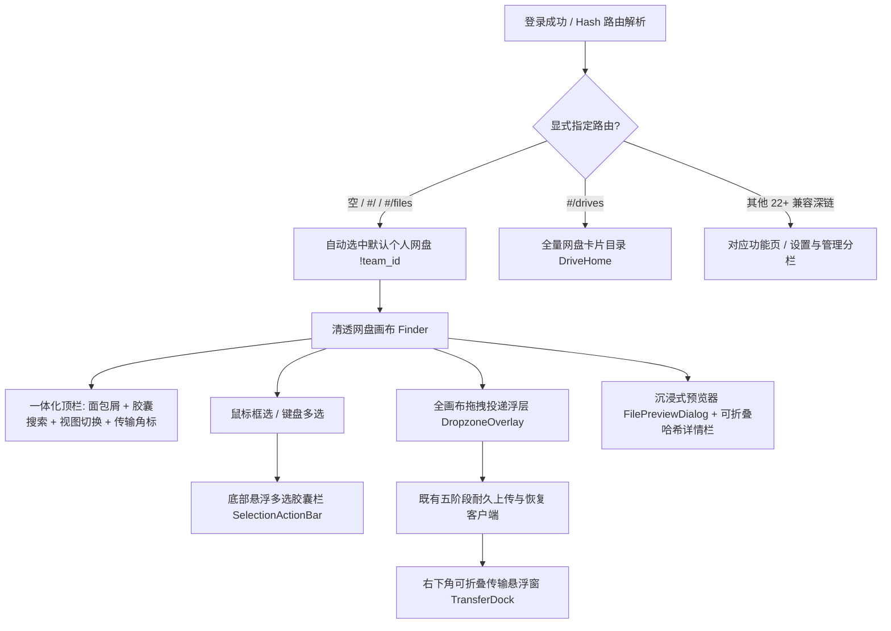

# C 端网盘体验与清透视觉重构设计

## 1. 架构与状态流总览

前端继续作为纯 API/IPC 消费层，所有权限裁决、固定版本引用、五阶段耐久上传与恢复槽继续由既有应用层与服务层拥有。

## 2. 视觉令牌映射（清透果味网盘风）

- **浅色模式**：`--ui-sidebar: #f4f6f5`、`--ui-sidebar-foreground: #1d2d24`、`--navigation-selected: #dff0e6`、`--ui-background: #ffffff`、`--ui-card: #ffffff`、`--ui-primary: #1f6a4c`、`--ui-border: #e6ece8`。确保侧栏与主画布文字对比度均 ≥ 4.5（实际侧栏正文对比度 > 10:1）。
- **深色模式**：`--ui-sidebar: #141b18`、`--ui-background: #0f1412`、`--ui-card: #17201c`、`--ui-primary: #7fd4a8`、`--ui-border: #2a3a32`。
- **彩色文件类型徽标（`lib/file-display.ts`）**：统一由扩展名 + MIME 推导语义色槽（`--file-doc`、`--file-sheet`、`--file-pdf`、`--file-media`、`--file-audio`、`--file-archive`）与中文可读类型名（如 `Markdown 笔记`、`PDF 文档`、`Excel 表格`），消除裸 `text/plain; charset=utf-8` 展示。

## 3. 壳层、导航与设置收口设计

- **侧栏结构**：品牌标识 → 「＋ 新建 / 上传」主按钮 → 7 项核心菜单（全部文件 + 内嵌多盘切换器、最近使用、收藏与图集、知识笔记、AI 投递箱、我的分享、回收站）→ 团队待处理邀请提示（按需）→ 空间容量进度卡 → 账户与「设置与空间管理」。
- **设置与空间管理中心（`PersonalSettings` 扩展）**：左侧分栏切换「账户与外观」「存储与云盘挂载」「AI 助手授权」「自动整理与高级工具」「空间安全与团队」，一键触达或内嵌原系统组功能，保证功能可发现性高于原 22 项折叠菜单。
- **移动端底部五栏**：`文件`、`最近`、`＋（新建/上传抽屉）`、`AI 投递`、`我的（聚合空间切换、容量与全部管理入口）`。

## 3.5 Apple 晶透微拟物（Crystal Tactile Glass）与物理弹簧动效（Phase 2）

- **微立体折角文件艺术卡（`components/file-art/`）**：提供 `FileArtwork`（右上折角纸张模型、类型排版肌理与渐变胶囊角标）、`FolderGlyph`（双层微立体文件夹，与 `FolderArt` 5 色身份同源）、`NavGlyph`（双色晶透导航底托图标）与 `EmptyDropIllustration`（多图层悬浮空态插画）。
- **物理弹簧动效（`motion/react`）**：在 `AppearanceProvider` 全局包裹 `<MotionConfig>` 联动 `prefers-reduced-motion` 与应用内 `data-motion="reduced"`；主导航激活胶囊与 `ViewModeSwitch` 采用 `layoutId` 弹簧滑块跟随；`SelectionActionBar`、`TransferDock` 采用 `AnimatePresence` 阻尼弹出；网格卡片提供柔和微浮起与点击回弹。
- **晶透材质与去框线光影**：应用画布增加极淡顶部环境光晕，主工作面与主操作按钮引入 1px 顶部镜面内高光（Specular Hairline）与多层柔和环境投影。

## 4. Finder 与传输交互设计

- **顶栏收敛**：当处于网盘文件视图时，Finder 内部不再重复渲染全宽搜索行与次级大按钮排，统一收敛为紧凑的面包屑 + 搜索过滤 + 视图/排序工具行，使首屏文件滚动区顶边 `y ≤ 160px`。
- **框选（`marquee.ts`）**：细指针下在 `.finder-scroll` 空白区按下拖拽计算选框与 `[data-file-id]` / `[data-directory-path]` 元素矩形交集，支持 `⌘/Ctrl` 增量框选与 `prefers-reduced-motion` 静态选框。
- **悬浮多选胶囊栏（`SelectionActionBar.tsx`）**：选中文件或文件夹时在文件画布底部居中浮现，收纳下载、分享、移动、复制、复制 AI 引用、重命名与移入回收站。
- **右下角传输悬浮窗（`TransferDock.tsx`）**：消费既有 `ops` 状态，实时反映上传、校验、完成、失败可续传状态；字节发送 100% 但服务端仍处 `verifying` 时明确显示「云端校验保存中…」，绝不提前显示已完成。
