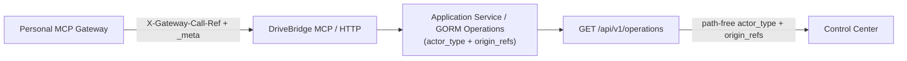

## Architecture

## Decisions

1. **零路径零文件名承诺不变**：`origin_refs` 严格限制在 `^[A-Za-z0-9_.:-]{1,128}$`，任何带 `/`、`\`、`..` 或协议前缀的字符串一律拒绝或剥离。
2. **Agent 身份源于认证令牌**：当操作由空间级 Agent 令牌或已认证 MCP 会话发起时输出 `actor_type: "agent"`，不接受客户端自由文本伪造。
