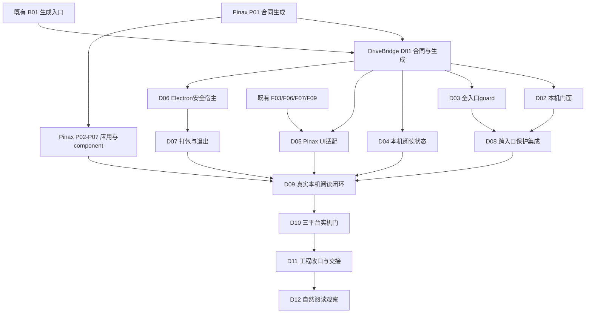

## Context

用户已锁定 Electron、阅读先行和三平台实机门。本包已进入分片实施，历史设计期任务数量不代表当前实现进度；公共reader、知识库、收藏继续归原任务，新增任务只补Pinax/宿主/保护域缺口。后续用户批准真实编辑集成，以D14独立writer消费任务承接，不改变D05只读验收。

## D01.7：Pinax最新只读schema同步（2026-10-06）

同一generate-contract-types.mjs desktop profile重新调用Pinax公开OpenAPI导出，reader闭包26→36 schema，覆盖daily document、rich/composed和recovery request。owner摘要4c85fe7909c8575546deee3ae2d5f0d85c20f30e5d3ab1e6e1617d1824f595a8；生成TS、reader schema、IPC摘要和facade类型随同源输出更新，不手写机器资产。没有新增IPC：仍23固定方法，rich/composed/recovery/writer方法均未开放；paths仍空且integration=pending。OperationV1、bootstrap及私有grant不在renderer闭包，Pinax HTTP已有能力不等DriveBridge准入。

新增pinax-reader-current-contract.test.ts验证真实生成物摘要与隔离、Ajv oneOf expanded/cycle分支预算及depth_limit无target、duplicate page/execute/max_depth/额外授权字段拒，TypeScript satisfies验证生成联合类型可消费；schema形状测试不冒来源关系/渲染或owner权限验证。首红check-only172938Z-d039634c报告5产物真实漂移，生成173001Z-b73dba2e；13项合同测试173155Z-7f6b384d、UI/type173159Z-0afda204、all-profile重导出漂移173236Z-50079e8f通过（均20261006），六件套核验。生成器无需修改、personal-workspace保持现有44 paths/70 schemas。未build Web或重打desktop，不冒Webdist已更新、正文绑定或D03通过。

## Goals / Non-Goals

在一个DriveBridge应用内，以最多两次首页导航读取已有本机笔记；离线无云/模型/预装CLI依赖。非目标：正文编辑首片、自动同步、移动Pinax UI、独立Reader、通用broker、第二数据库/笔记后端、真实部署或发布。

详细规范不在本文件重复：[架构与门面合同](../../../docs/architecture/electron-desktop.md)、[三屏UI](../../../docs/web/ui/knowledge-reading-spec.md)、[验收矩阵](../../../docs/delivery/desktop-knowledge-acceptance.md)、[Pinax reader合同](../../../../pinax/docs/interfaces/human-reading-api.md)。

## Decisions

1. `desktop/`只持TypeScript main/preload/Forge；`web/`是唯一React UI。Go文件/阅读状态服务保持pure Go与CGO_ENABLED=0，Pinax由公开typed client消费。
2. 原生选择器与固定IPC→本机DriveBridge门面→Pinax loopback；不通过每次shell out操作笔记，不把paths/tokens交renderer。无cloud login本机principal仍须会话鉴权。
3. 随包binary+固定参数+私有stdin bootstrap；EOF排空退出，不留daemon，不杀用户Hermes。Pinax会话的正式字段由Pinax合同持有，DriveBridge不能自造恢复语义。
4. 普通Markdown与Pinax用两个固定adapter，共用UI primitives；Pinax语义由owner返回，不扫描vault补图谱。
5. 管理保护在应用层与持久登记，确认绑定先guard后ready；所有已知可写根/连接重叠受控，未知范围fail closed。旧overlay不自动采用，外部编辑器仍可改正文。
6. 本机阅读状态由单一DriveBridge application/GORM持有，复用Favorite语义，不复制正文/索引、不上传跨设备。renderer只持布局和有界内存阅读缓存。
7. Electron安全按官方核验固定sandbox/contextIsolation/无Node/逐方法IPC/CSP/来源与导航白名单。首片不注册pinax协议、不启自动更新/托盘/自启。
8. 版本、正文分段、资产身份由Pinax新reader合同裁决，旧Agent默认权限与预算不变。依赖未实现时显式unsupported，不以mock回退生产。

## Architecture and dependency graph

图中PBackend由Pinax自己验收，直接依赖Pinax P01，不依赖DriveBridge D01；消费者合同对齐不应变成反向依赖。F/B公共切片可先做阅读所需部分并保留原任务未完成，D09通过不等于F17全部完成。

## 任务归属与停止点

- D01 CONTRACT负责Go DTO/固定IPC/生成fixture；复用B01工具，Pinax字段由其生成源引用。
- D02–D04 BACKEND分别负责门面、guard、本机状态；D04复用B09共享Favorite不另起同义规则。
- D05/D06/D07 FRONTEND负责适配UI、宿主、打包；不接管数据库，单端用生成fixture，另一侧INTEGRATION_PENDING。
- D08/D09/D10 INTEGRATION分别验全入口、真实链路和三平台。D11工程总结不得以文档strict替代证据。
- D12自然使用单列，D13 CONTRACT保留后续捕获/编辑/提案/整理；不能因D09完成关闭D12/D13或旧Pinax真实任务。

同路径一个writer；不自动用子Agent。文档交付当前checkout，不启动服务或新worktree；后续执行沿DriveBridge既有同仓工作模式，用独立端口/state/log，Pinax代码进入其owner。跨端任务只能一个PHASE，集成需显式具名任务。

## 数据与兼容、迁移及回退

新增reader/desktop协议与状态为experimental加法，File/Version/Operation、旧URI/API/MCP、Web/PWA和mount不改义。新来源显式启用；新表/列用GORM增量迁移，旧数据不自动转换。机器资产/生成合同/证据由CLI/service/runner写，不手工JSON。

受管binding建立后最低writer版本是安全门。仅回滚UI资产可保留guard；参与保护域的旧binary必须能由已有state版本门在写前拒绝；D03无法证明旧writer admission时不得建立该保护域，不能仅写一个新字段便声称老程序已受控。停新入口、保留数据、向前修复优先；解除保护需单独确认且无在途mutation。隐藏来源不释放保护，卸载不删除vault。

## D01.1 实施切片：来源与阅读状态 DTO

公开Go合同置于 `server/pkg/desktopcontract`，根Go模块已有server模块引用，可供本机application消费；不把领域实现放入renderer，也不新增模块或第二生成器。原 `server/cmd/drivebridge-contracts` 增加 `--profile desktop`，默认和显式personal-workspace输出逐字相同。Web原生成器增加profile选择，`make contracts`/`make contracts-check`覆盖两个profile。

本片10个schema覆盖KnowledgeSource、文件/Pinax的ReadingRef联合身份、ReadingState/position、按选定字段CAS更新、原键lookup请求和分页。对象closed，混合身份、缺固定版本、未知来源状态、正文/secret/主体字段拒绝。position显式nullable响应；请求不接受null，用clear_position=true清除，不能同时写position。Go语义验证再检查URI与object/revision、position revision一致。JSON Schema负责结构而非跨字段字符串相等，未来handler必须同时调用语义验证。

生成物为 `contracts/desktop/` 和 `web/src/generated/desktop.ts`。目前OpenAPI paths为空且implementation-status=planned，不宣称HTTP/IPC/来源绑定可用。D01仍未完成：下面D01.2/D01.3仅补binding/topic及export/Range DTO；错误、完整路由与固定IPC映射留在后续切片；Pinax reader schema导入见D01.4，不复制Pinax payload字段。

## D01.2 实施切片：绑定与主题置顶 DTO

新增15个schema，与D01.1合计25个；原10个schema规范化摘要固定为 `8e00a3f7d3133ab0d833da90174c650de3508642fa2bbd191e4b0a5e669c8f26`。仅扩展相同Go源和生成入口，不修改原personal-workspace输出。

- native_selection_id是未来main→门面私有选择票据，不是renderer可填写的路径，也不是授权；实际选择器、票据登记和session绑定由D02/D06实现。不会从字段存在推导选择可用。
- BindingPreview只含短期ID、digest、展示名、guard revision、reader scopes、保护域计数与时间；ready要求none原因且无在途mutation，blocked必须有明确原因；不输出canonical root/overlay路径。scope仅reader四项且必须metadata，不接受writer scope。Go验证时间顺序和最多5分钟有效期，后续service仍须校验当前时间、签名/主体/根身份/guard代次，不能信任renderer提供preview投影。
- ConfirmBinding固定preview/digest/expected_guard_revision与confirmed=true；它是调用方确认断言，不是可验证的人批准。release独立expected_revision与confirmed=true；visibility只有hidden字段，不能顺带解除guard。BindingView active/hidden/blocked均保留protection_active=true，released则false。未成功安装保护的来源不创建这个BindingView，应返回blocked preview或错误。
- binding lookup只接action=confirm|release和原键，主体来自会话；found=false必须receipt=null，found=true必须有相符action/state的receipt。主题置顶只保存source+project/tag+owner_target_id，无标签正文/路径/owner变更；取消置顶也有CAS revision，不删除目标。
- 新revision限制为JS安全整数；旧D01.1类型不在此切片悄改，后续运行时会统一验证传输预算。原键由固定IPC包装或HTTP头部携带，完整IPC映射尚未交付，不暗示无键即可写。

验证：Go/CLI `20261005T085041Z-a18b96eb`、vet `20261005T085041Z-4a85c86b`，双profile漂移 `20261005T085043Z-0210fe35`，旧39schema `20261005T085045Z-d1ece924`、desktop25schema正负及旧10摘要 `20261005T085045Z-5b3d8dd9`，Web typecheck `20261005T085046Z-45ff7520`。均在本owner evidence目录；不是HTTP/IPC或真实绑定证据。

## D01.3 实施切片：导出与Range值合同

新增7个schema，总32个；此前25个schema规范化摘要固定 `8483df38081404d7856d552b44a8f032e6bad3ecb2ecdd23dfc163ba88b67a90`，扩展不能悄改旧DTO。ExportRequest是main→门面专用：固定ReadingRef、native_selection_id、expected_destination_revision；renderer的exportSource只给固定ref，native票据/目标现状必须由可信main和门面建立。absent表示预检时无目标，不允许覆盖选项；CAS票据不意味着目标可写，D03与发布前复检仍必需。原键在后续固定IPC/HTTP头部传递。

ExportOperation仅投影已有文件operation，保留owner_status与ui_state分离、原operation_id、固定源、进度/总字节和观察时间，无目标路径、正文、bearer或第二执行队列。unknown保留原ID；lookup=false必须operation=null，不能推断为允许重建。completed要求已知总量且已传量一致，Go语义验证负责跨字段比较，JSON schema负责closed/null/enum/数值边界。

ByteRange是单一闭区间[start,end]，不允许suffix/open/multipart。原文每窗≤1MiB、附件每窗≤8MiB，安全整数、非负、end≥start、差值不溢出；Go验证后生成Range头，不接受调用方原始header/URL。实际206/416、Content-Range/ETag校验、零字节资源无Range响应和授权流都须由后续adapter实现，这里不返回字节。asset handle只是会话/来源/revision下的短期引用，不是权限。

验证：Go/CLI `20261005T085940Z-8e79ce55`，vet `20261005T085941Z-a8f7f38c`，双profile漂移 `20261005T085918Z-2c1260e8`，旧39schema `20261005T085919Z-4154b43b`、新32schema正负/旧25摘要 `20261005T085920Z-40cd08d9`，Web类型 `20261005T085921Z-d59b1fd5`。DTO没有启用HTTP/IPC或任何文件副作用。

## D01.4 实施切片：Pinax owner schema消费

同一生成器的desktop/all profile调用兄弟Pinax owner公开命令 `go run ./cmd/pinax api schema export --format openapi --vault <temporary-empty-directory> --json`。只在构建期导出，不用于运行时笔记操作；显式临时空目录避免默认个人vault，结束后检查目录无写入并回收；缺owner checkout/命令失败/摘要不符明确退出，不拿陈旧缓存假装通过。继承GOFLAGS含race时在执行前拒绝。

`pinax-reader-contract.mjs`核对projection命令/状态/OpenAPI版本和Go JSON规范摘要，从owner取所有reader schema及封闭依赖，只允许reader与共享warning，拒绝外部/缺失/非reader依赖。递归document_node保留原义，不手写字段、不复制会话bootstrap/bearer模型。输出 `contracts/desktop/pinax-reader.openapi.json` 与 `web/src/generated/pinax-reader.ts`，26个schema，paths为空、DriveBridge integration=pending。当前owner OpenAPI digest为 `sha256:8260370086dcb5a10949fe989a68ef5157b04fea8d9079d4fbb1e0add19cfa39`，reader闭包digest为 `sha256:67bebc02183cdf14b79eeefd02ae3b7b20f9ab7ed87577d6f2a711e937e34a0b`。实际运行时握手仍须按能力与兼容合同检查，不能把构建摘要当授权。

`make contracts-check`同时重导出owner并比较生成物；personal-workspace单profile不需要Pinax。测试覆盖生成物被改后check拒绝且不覆盖，包含新增desktop和Pinax reader产物。证据：11项Vitest `20261005T091054Z-1292cf75`、真实owner重导出check `20261005T091056Z-2392653d`、Web类型 `20261005T091058Z-1c067bdd`；此前all profile与旧39/desktop32 schema回归分别 `20261005T090747Z-a33ad57c`、`20261005T090749Z-ee79c95a`、`20261005T090750Z-232c451f`。未启动HTTP、Electron或读取个人vault；writer schema消费仍归D14。

## D01.5 实施切片：固定IPC目录与生成签名

`server/pkg/desktopcontract/ipc.go`是20个固定方法的唯一构建目录，含HTTP方法/计划路径、request/response schema、opaque target字段、原键和native选择标记。`ipc`输出只允许desktop profile。原生成器消费该目录、37个本机schema及26个Pinax owner schema，生成 `contracts/desktop/ipc.json` 与 `web/src/generated/desktop-ipc.ts`。不另建RPC通用invoke，不安装handler，不把目录直接作为runtime available列表。

每个方法使用closed `{input, source_id|binding_id|operation_id?, idempotency_key?}`；confirm/visibility/release/reading-state/topic-pin/export必须原键，main映射到门面Idempotency-Key，禁止网络失败新键。chooseVault input为空，exportSource仅固定ref，native_selection_id/目标revision由main内部获得，不能由renderer传入。错误返回 `data|error` 联合；DesktopError只允许origin/code/message/recovery/nullable operation_id，禁止provider原始payload，实际安全消息白名单与HTTP映射待下一片。

reader输入和输出直接引用Pinax生成类型；readDocument在外层额外要求revision，不修改owner允许首次非固定读取的原schema。查询sort/cursor/outline_cursor保持owner结构。生成器拒绝重复方法、未知schema、任意target字段和含路径/票据的renderer输入；读取普通文件仍使用原文件reader，此reader方法集当前只定义Pinax适配，不暗示异源合同相同。资产字节走独立app asset通道，不把base64字节塞进IPC目录。

验证：Go目录/CLI测试 `20261005T092045Z-a6b0e97e`；生成漂移 `20261005T092805Z-589507bf`；旧39/schema37正负 `20261005T092808Z-712b3602`/`20261005T092808Z-bd417bc4`；13项IPC/owner闭包/产物漂移测试 `20261005T092809Z-1e66e73b`，Web typecheck `20261005T092812Z-d8787f97`，Go vet `20261005T092831Z-fd17e8f0`。Ajv验证副本将OpenAPI refs重定位为$defs并去组件$id，保留生成owner原文不变；否则会把组件当独立JSON schema资源导致重复ID或引用解析失败。

该检查点的HTTP映射缺口由D01.6承接；D03/D02/实际IPC/真实桌面链路仍未实施。

## D01.6 实施切片：计划HTTP与安全错误

目录新增listTags/readGraph/findDaily，合计23方法；schema均来自Pinax闭包。`desktop-http-contract.mjs`从同一目录生成 `contracts/desktop/facade.openapi.json` 与 `web/src/generated/desktop-http.ts`，主进程专用鉴权、原Idempotency-Key、path/query与成功data/error envelope、201确认/202导出、no-store、closed body与128KiB预算。重复scalar query拒绝，owner tag数组保留form/explode重复值语义；readDocument/readLinks外层revision要求sha256固定值，owner原schema不变。独立asset通道声明200/206/416、8MiB窗、ETag/Content-Range及无Range零字节资源，不出现任意fetch IPC。

SafeError仅输入origin/code/原operation，不接原始异常文本；本机错误使用固定英文安全消息，Pinax代码保留origin并按已知错误分类，未知owner错误不当empty。unknown仅合法原operation才能给lookup_original；没有ID时要求owner检查。AvailableMethods取已实现/已配置/已授权三者交集且过滤非目录动作，不把planned自动变available。实际依赖健康仍须由服务在传入事实前判断，不由DTO推测。

验证：Go目录/安全错误/能力交集及CLI `20261005T093917Z-a37b3563`；生成漂移 `20261005T094323Z-8cf8e762`；旧39schema `20261005T094326Z-63292f7f`、desktop37schema `20261005T094326Z-2d6abbd0`；15项4文件合同/IPC/owner/漂移测试 `20261005T094327Z-26bb6eb3`；Web typecheck `20261005T094330Z-a60cedc3`；vet `20261005T094350Z-2df2a267`。全部planned，没有注册HTTP或IPC。

D01总项继续保留：选择票据传递、asset handle签发、bootstrap/ready握手及错误的运行时适配仍须随D02/D06实现在同一合同源补齐，并核对语义验证不能只依赖schema；不能把原生流程尚无入口包装成完整合同。下一前沿转D03准入证明与既有writer保护调查，不再用DTO切片代替真正实现。

## D03.1 旧准入反证与adopt错误路径修复

本轮保持当前checkout单writer，因为合同及owner实现依赖既有未提交基线；仅运行临时目录fixture，不启动持久服务，不迁移用户state。新增 `internal/bridge/managed_vault_admission_test.go` 的测试是保护能力反证，不是D03安装guard通过：

- `TestManagedVaultLegacySeparateStateBypassesAdoptRegistry`：真实本地rclone alias指向临时目录。state A adopt后拒绝 `.pinax` 写入，但仍允许 `notes`；state B注册同一alias而未adopt，可以创建 `.pinax/cross-state-proof`。因此同state process lock及adopt登记不是跨state准入。
- `TestManagedVaultLegacyNewTableDoesNotGateStartup`：用GORM在可丢弃state登记模拟未来保护表，关闭后重新调用当前 `New`，仍能执行真实目录mutation。证明当前legacy启动不理解新增保护表；不声称运行了所有历史binary，也不采用破坏旧schema令AutoMigrate报错的伪迁移门。
- `TestManagedVaultAdoptRegistryUnavailableFailsClosed`：原实现忽略Count错误，保护表丢失后返回未adopt并放行。现修 `rejectOwnerProtected` 查询失败/缺失service/DB为 `guard_unavailable`，检查在provider调用与Upload队列登记前发生，safeError保留该安全码。现存非adopt普通操作不变。测试删除的仅临时测试DB表，不操作个人数据。

代码调查矩阵（不是完整覆盖声明）：

| 写入面 | 已读入口与事实 | D03仍需的保护 |
| --- | --- | --- |
| CLI/MCP普通目录、文件、copy/move/trash | `model.go:Mkdir`、`workspace.go`、`local_copy.go`通过现有adopt检查；仅名称规则，不保护全部正文 | 真实root身份/祖先重叠及发布前lease复检 |
| 上传/恢复worker | `transfer.go:Upload`入队前adopt检查；`Resume/start/transfer`发布调用Provider.Upload没有受管域登记复检 | 在途冻结、恢复原operation与发布期保护 |
| 本地下载/CAS | `transfer.go:Download/transfer`通过os.Root.Link写LocalRoot，未将该目标与Pinax范围关联 | 本机目标/别名/祖先保护，不能只检查remote目标 |
| sync | `sync.go:Sync`直接建立fs pair并调用bisync，无managed域检查 | 两侧保护域准入，engine期间lease；未知remote拒绝 |
| mount/overlay | `vfs.go`代理到文件接口；`overlay.go`直接建立/删除symlink并写marker | 禁自动迁移旧overlay；marker不是保护凭据，路径稳定性另验 |
| 进程/state | `cmd/drivebridge/root.go:openService`锁state/process.lock；`model.go:New`直接AutoMigrate并恢复operation | 新字段不能阻止旧writer；跨state映射仍未可证明 |
| server | `storage.go`独立S3 StorageFactory；`model.go`独立DB启动迁移 | 根本机表不覆盖server/remote挂载，不声称server保护已安装 |

初次红测试 `20261005T095557Z-2c977a7d`：registry缺表真实fail-open；另有新测试LocalRoot用兄弟路径造成invalid_space，为introduced fixture错误，改为owner允许的same-root。最终17项定向真实临时存储/保护/复制移动回归 `20261005T095846Z-1c87b070`；vet `20261005T095850Z-fede7520`。没有race，没有云账号。

准入结论：当前旧state/另一state/overlay/未知writer仍不可证明安全，不能提供ready绑定；D03总项未完成。不能加入 `legacy_safe=true` 之类调用方布尔量绕过证据，也不能以关闭当前进程代替全保护域。后续应先在D02门面实现诚实blocked预检并继续无正文授权的宿主链，合成vault也不得据“测试专用”绕过正式guard。若要允许此类环境ready，必须有实际可执行的writer隔离/迁移合同及独立验收，不能仅改文档把要求降级。

## D02.1 本机只读预检基础（无HTTP/Pinax进程）

新增根模块 `internal/desktop/preflight.go`，复用公开desktopcontract而不复制DTO。每个可信main/facade会话独立Preflight对象，原生选择路径只进入Go私有内存字段；Select不是renderer IPC或HTTP路径入口。票据256-bit随机、5分钟上限、selection+preview合计最多32项，单次消费；Preview仅Lstat目录及祖先，不读取Pinax config/index/正文，不init。选择时和消费/确认时比对目录身份，别名/symlink/非绝对/非规范路径拒绝，路径长度有界。Cancel幂等清理该session pending对象，Close释放全部内存；无持久化、无凭据、无子进程。

预检始终blocked/managed_scope_unverifiable，只声明metadata scope；未实现全域盘点，零计数不代表无在途writer或无重叠。显示固定安全名称，不回传路径/目录名。digest绑定随机preview identity，不是路径hash或保护证明。ConfirmBlocked核对版本/确认断言/原preview及目录身份后仍拒绝，没有force/测试绕过；它不是成功绑定命令，未登记operation，也未代替未来mutation原键合同。

Pinax监督合同已核对公开docs与owner代码：固定 `pinax api serve --session-stdin`，首帧16KiB/10秒、readonly与scopes一致、stdout ready/error/shutdown，EOF 5秒排空。当前SessionBootstrapFrame/SessionEvent定义在Pinax internal/api，DriveBridge不能import internal或手写第二份；下一片需从公开schema生成宿主私有类型或由Pinax公开pkg消费，不能把bootstrap模型放web generated。当前不声称完成Pinax监督生命周期。

四项测试覆盖临时真实目录、无文件创建/正文修改、跨会话/过期/取消/篡改、目录替换、祖先symlink拒绝、16并发仅一次票据消费、32项上限、过期回收和scope切片不共享。证据 `20261005T100702Z-57e60860`；desktopcontract包回归 `20261005T100702Z-884d1259`；vet `20261005T100703Z-b3808b5b`。Lstat并非durable lease，无TOCTOU保护成功声明；三平台实机仍未验。当前checkout单writer，复用dirty owner合同，不启动持久服务。

## D02.2 metadata-only 子进程管理基础

`internal/desktop/process.go` 直接消费Pinax公开 `pkg/localsession`，不复制wire DTO。ownerBinary仅为包内可信composition输入，校验绝对非symlink普通文件、非组/其他可写、512MiB读取预算、身份/mtime与SHA256；manifest digest须来自可信随包元数据。固定argv `api serve --session-stdin`，不查PATH，不继承调用方环境（Windows仅SystemRoot）；bearer/root只进private stdin，stderr写OS null，stdout按16KiB帧及后续总64KiB有界处理，不向日志转储。scope固定metadata且readonly，任何调用都不能选body/writer。

启动帧写入和ready共用15秒预算，owner DecodeReady校验nonce/binding/manifest/loopback；context取消或输出协议丢失关闭stdin，最多5秒排空，必要时只Kill所记录子进程并Wait回收。并发Close用sync.Once，forced stop明确返回session_forced_stop，不伪装优雅关闭。失败启动只返回安全code，不输出exec错误或路径。没有任意HTTP调用入口，未连接Preflight或Electron。

测试复用Go测试binary的TestMain作固定argv子进程替身，**不是真Pinax集成**：拒错误摘要、坏nonce/非loopback/错manifest、超长ready、无ready超时、ready前退出，验证metadata-only/无环境泄漏、EOF、取消及不退出替身强停。原Go test binary受umask影响可能组可写，测试复制到0700临时package目录后才启动，不放松验证。证据：8顶层desktop测试（含8子例）`20261005T102901Z-5d218ba7`；原adopt/managed反证和本地roundtrip `20261005T102902Z-e8a5c129`；vet `20261005T102904Z-a28257b7`。

根go.mod由go mod edit/go test -mod=mod加入Pinax v0.0.0及兄弟replace；Go MVS随Pinax要求把GORM从1.30.0提升1.31.1，go.sum补两条。缺sum的introduced失败已保留并修复，未对全repo跑tidy或降级owner依赖；server独立模块不改。此轮只做相关存储回归，稳定后需完整根模块门。当前dirty checkout单writer，不自行提交。

限制：摘要校验不是exec文件描述符lease，安装目录不可被不可信writer替换的保证须由D07提供；当前只回收直属child，macOS/Linux process group、Windows JobObject与后代继承句柄清理仍未实现/未验。不宣称三平台或完整D02。Pinax真实binary metadata纵切应另登记INTEGRATION任务，且D03未可证明时依旧不能ready绑定或授body。

## D02.3 真实Pinax metadata纵切

新增带integration build tag的 `internal/desktop/pinax_integration_test.go`，通过真实owner编译binary及 `pinax init` / `note add --stdin` 创建临时vault，CLI使用隔离HOME/config；不手写owner metadata，不访问个人vault。测试构建计算binary SHA256并从公开manifest导出读取预期digest，不当作签名发行证明。DriveBridge实际startMetadataProcess引导后用Pinax公开typed client读source/notes，固定正文请求403/insufficient_scope、无token401、writer组未暴露404；EOF关闭listener，第二次context取消退出且新session/bearer，普通目录启动拒绝且不init。

首轮writer期望403而实际404属于introduced测试假设，按owner隐藏route组语义修正，不放宽成任意错误。随后源vault树比较发现新WAL/SHM，是Pinax现存mode=ro副作用；保留失败证据103437Z-acc5a8e7、103517Z-3406f511，经Pinax N05.2修复后，不豁免sidecar，完整前后文件路径/字节摘要一致。fixture inventory仅测试，不进入产品fallback。

验证入口 `python3 scripts/check.py -- go test -tags=integration ./internal/desktop -run TestDesktopSessionPinaxIntegration -count=1 -v`；最终连同原8顶层desktop测试通过 `20261005T104313Z-dbb108ee`。本阶段INTEGRATION仅真实Go宿主→Pinax metadata边界，无HTTP门面/Electron/guard绑定成功，不勾D09/D10；未授权body，未写笔记，三平台无新增证明。

## D02.4 本机HTTP预检门面

新增 `internal/desktop/facade.go`，只在127.0.0.1随机端口提供capabilities、POST bindings/preview与只拒绝的POST bindings。会话随机bearer、精确Host与loopback peer、拒Origin/Sec-Fetch-Site/重复Authorization，不启CORS；no-store/nosniff、安全error envelope，未知路由422不伪造空source。JSON最多128KiB，拒未知/重复/大小写变体/null/缺字段/尾随JSON，禁止query与路径编码别名。capabilities只列capabilities/chooseVault，不列可写binding。

HTTP不接native path/argv/env，只收已由可信composition调用Preflight.Select登记的session票据。单并发metadata probe，忙时409且不消费票据；preview消费后启动真实metadata-only child、typed ReaderSource核对session/binding，立即EOF关闭child，成功仍返回blocked/managed_scope_unverifiable，owner失败为blocked/owner_unavailable。取消/关闭/过期后不返回仍有效preview，Close取消请求与子进程再Shutdown；确认必须原Idempotency-Key但永远拒绝，不登记成功mutation/receipt。路径只私有内存，无正文返回。

BACKEND边界测试覆盖真实HTTP鉴权/Host/Origin/query/闭JSON/预算/容量/票据/原键/拒绝确认与关闭。既有D02.3 INTEGRATION用同一真实Pinax binary追加HTTP→metadata→blocked→确认拒绝→源vault树不变路径；最终11顶层desktop测试通过 `20261005T105229Z-ea87ce48`，vet `20261005T105234Z-e75329de`。只验证当前本机，非Electron/三平台。

仍无CLI入口或private stdin宿主协议；native选择登记目前只能可信Go调用，Electron main跨进程传递待实现，不能把门面library当作用户可运行desktop serve。生成合同继续planned，不能因两个handler实现将全表改available；D01/D02/D03总项不勾选。

## D02.5 私有宿主stdin与CLI入口

新增 `cmd/drivebridge/desktop.go` 注册 `drivebridge desktop serve` 和 `drivebridge desktop schema`。专用PersistentPreRun不发现普通配置/云凭据，拒继承state/config/json/agent/events等flags，stdout使用独立host协议。serve只取自身os.Executable，同目录固定pinax（Windows pinax.exe），不接受frame可执行路径/argv/env。首帧host版本、nonce、256bit bearer、binary/manifest digest来自可信native main；二进制仍校验摘要，信任来源不是renderer。schema从同一Go host DTO直接生成，独立CLI出口，不放web generated。

`internal/desktop/host.go`消费最多64KiB每帧，首帧10秒，输出阻塞3秒关闭；严格字段/重复/null/大小写/尾随拒绝。之后仅select(native_path/request_id)与cancel(selection_id/request_id)，secret/root仅私有stdin，ready只nonce/address，selection只opaque ticket，error只固定code；EOF关闭门面并shutdown，context关闭管道和门面。不涉及数据库/绑定持久化，默认无scope升级。host取消仅移除pending票据/preview，metadata probe仍即查即关；不宣称跨端取消中断UI体验已验。

证据 `20261005T110114Z-7983a34e`：host OS管道bootstrap→HTTP鉴权→select→cancel→EOF，坏帧/重复/超长拒绝，Cobra独立schema及继承flags拒绝，连同真实Pinax集成回归通过；vet `20261005T110119Z-097c530c`。仍未做打包DriveBridge CLI进程加真实Pinax的全控制通道e2e，Electron尚不存在；D02不总勾。后续宿主协议事件语义与运行时类型生成需在Electron消费时继续钉住，不用宽松HostEvent结构代替event-by-type验证。

## D02.6 真实CLI私有控制通道集成

新增integration-tag `host_process_integration_test.go`，复用D02.3的同一真实Pinax构建及owner CLI合成vault，不建第二fixture体系。真实go build DriveBridge到同目录，以固定 `desktop serve` 子进程运行；私有stdin bootstrap→ready nonce→select关联ticket→HTTP真实metadata probe→blocked→原key确认422→cancel→确认410→EOF shutdown→进程exit0→端口关闭。另验非法首帧/错binary digest的error事件和非零退出。

测试日志只输出状态，stdout/stderr私有内存有界收集并检查bearer、vault、binary路径、正文标记不泄漏；失败只回收自有command，全部stdout pipe/Wait完成后比较。所有setup/metadata执行前后vault文件树及字节摘要不变。无mock Pinax、无page.route，但只是当前OS本地CLI链；临时构建不是签名/不可变发行包，不冒称Electron与平台后代进程树验收。

证据：独立真实纵切 `20261005T110634Z-24d1c32a`，含3个CLI情景；合并desktop/CLI定向回归 `20261005T110722Z-e482e477`，integration-tag vet `20261005T110729Z-d7ae97d4`。D02.6可勾，D01/D02/D03父任务保留。下一阶段优先Electron同Web入口与固定preload，公开地展示未准入状态，不能降级guard使演示成功。

## D06.1 Electron安全宿主构建骨架

新建同仓 `desktop/`（非第二Git），TypeScript main/preload+Electron Forge，AGENTS/CLAUDE定义本地边界。配置由 `node desktop/scripts/configure.mjs`生成，pnpm lock钉住依赖。2026-10-05查询npm registry锁定Electron44.5.1、Forge8.0.1、fuses2.1.3、esbuild0.28.2；核对官方v44.5.1 `docs/tutorial/security.md` 和 `docs/api/protocol.md`（https://github.com/electron/electron/tree/v44.5.1/docs）。包管理器要求Node>=22.12，当前22.23.2满足。以ignore-scripts安装，没有执行Electron安装脚本/下载binary，未启动GUI。

build先构建既有 `web/`，复制同一dist到忽略的desktop/web，esbuild仅编译main/preload，不建第二页面。main全局sandbox、contextIsolation/webSecurity开启、Node/webview关闭，临时partition无持久cookie；默认拒permission/download/window/subframe导航/redirect。自定义drivebridge-app://app协议只读正式index/assets/pdfjs，限制root containment/realpath、文件类型/大小与CSP，不提供API proxy、任意URL或SPA fallback；严格IPC mainFrame/webContents/origin/closed empty request。preload只公开独立capabilities方法，引用原生成DesktopBridge，当前available=[]（Go尚未集成），无通用invoke或Electron对象。Forge配置ASAR及禁RunAsNode/NodeOptions/inspect等fuses；makers空，未构包/签名，不声称fuse实际包验收。

安全测试4项 `20261005T111923Z-af503300`；typecheck `20261005T111924Z-019a1cd3`；host build `20261005T111925Z-8735068e`。此前完整shared Web+host构建 `20261005T111747Z-bb8ce553`通过，有既有>500KiB chunk警告，不作性能通过声明。初始NodeNext对共享generated imports扩展报错，改为符合esbuild的Bundler解析；esbuild0.25与Vitest传递Vite8 peer不符，按npm升级0.28.2，peers check无问题。未修改原Web依赖或样式。

当前仅FRONTEND安全骨架，不证明现有Web在custom origin的登录/状态路由可用；/api请求被拒且无云配置。Electron动态检查/共享Web本地模式入口/原生选择接Go、平台进程树均待下一片。CSP frame-src none使既有隔离预览暂不可用，后续须设计无preload独立预览，而非放宽主frame；remote服务连接也须explicit配置，不默认allow-all。不得勾D06父项或任何三平台证据。

## D06.2 同Web本机入口与Electron组件烟测

`web/src/main.tsx`仅对精确drivebridge-app://app来源选择DesktopWorkspace；普通浏览器与share入口不改。新入口复用WorkspaceShell/Main、DesktopNavigation、ThemeToggle、BrandMark、Button及现有响应式sidebar规则，不虚构用户/空间/文件，不调用云session。没有instance身份时sidebar偏好仅内存；只展示本机知识库/能力说明，来源操作尚未接入明确说明，不把其他Web功能需求删除或宣称桌面已支持。

通过preload固定capabilities请求，严格校验版本/closed envelope/非重复动作列表，5秒超时与安全错误、重试、组件换bridge后丢弃旧结果；未知能力不会自动生成操作按钮。无preload时fail closed而不回落云登录。UI未注册原生选择或正文功能，不出现可点击但无行为的假绑定按钮。

按锁定版本执行Electron install脚本取得binary；`web/scripts/desktop-smoke.mjs`复用现有Playwright，在Xvfb下启动开发Electron，拒root以防Playwright自动no-sandbox，未禁sandbox。验证实际BrowserWindow sandbox/contextIsolation/webSecurity，renderer无require、仅capabilities桥、available空，能力页导航及重新检查通过。此开发烟测使用Playwright调试端口，仅component，不进入release参数；未验实机显示/三平台/像素矩阵，不替代D10。未触碰个人vault/云账号。

证据：6组件测试 `20261005T112728Z-eea7bb81`，Web typecheck `20261005T112731Z-937789a6`，同Web+host build `20261005T112814Z-347feb0e`（既有chunk警告仍在）；真实Electron Xvfb组件烟测 `20261005T112944Z-b11022f1`。下一前沿是main私有Go协议与原生选择接入，不可把当前无来源UI升级为完整知识工作台；D06父项未完成。

## D06.3 主进程私有host合同消费

`internal/desktop/host_schema.go`为既有HostEvent导出按ready/selection/cancelled/shutdown/error分支的closed oneOf，不改服务wire；类型特有required/禁止交叉字段、固定版本/错误code/身份pattern。`desktop/scripts/host-contracts.mjs`只调用现有 `drivebridge desktop schema`，生成desktop/src/generated/host.ts及host-schemas.json；不放web/preload。复用原applyArtifacts check-only且不覆盖漂移产物，禁继承race GOFLAGS，导出有timeout/buffer预算。现有owner命令是唯一Go字段真源。

`host-protocol.ts`主进程专用：Ajv2020消费生成schema；在JSON.parse前用仅字符串字段的flat event语法拒重复解码key、大小写变体/null/非UTF8/尾随对象，错误只固定code；ready仅规范127.0.0.1有效端口。HostFrames处理分片/多帧，64KiB上限，EOF残帧拒绝；HostExchange绑定nonce、就绪状态和原request_id/action，最多32待回复，错序/重复/不匹配后终止，shutdown不当新的ready。输出请求同样用生成schema和UTF8预算验证。没有spawn，也没有把这些类型引入preload；capabilities仍空。

初次生成因当前jsonschema版本MinLength为指针/orderedmap无FromOldest导致编译失败，属于introduced代码错误，按已装库API修复，未升级Go依赖。最终12项desktop测试 `20261005T114125Z-79a95ef3`、host生成漂移 `20261005T114123Z-616e144c`、typecheck `20261005T114126Z-465d0abb`，含真实Go CLI/Pinax集成回归 `20261005T114128Z-429697e2`、vet `20261005T114136Z-def62632`。普通Web生成合同没改。此片只FRONTEND协议消费，Electron进程控制/原生dialog/HTTP预检仍须下一片接通，不勾D06父项。

## D06.4 / D06.5 Electron main真实宿主预检

`desktop/scripts/prepare-host.mjs`从两owner编译同目录固定binary，公开Pinax manifest导出后计算两binary摘要，由脚本写忽略的host-bin/bundle.json；仅开发资源，不是签名发布元数据。main-only HostClient校验bundle闭字段/version/hash、非symlink和尺寸/权限，固定spawn desktop serve、无shell/继承环境，私有随机bearer/nonce通过stdin；使用D06.3严格帧与身份状态机，ready15秒、请求5秒、HTTP预检25秒、输出预算，错误不带上游文本。HTTP固定loopback路径、无代理/redirect跟随，DTO由既有Go public schema校验，当前仅允许blocked+metadata；错响应关闭session释放未知preview，成功展示后cancel释放预览。关闭EOF7秒后Kill直属进程，9秒明确cleanup超时，不伪称进程树完整回收。

main在sender/frame/origin/empty input检查后开放单一chooseVault，dialog只允许已有目录且dontAddToRecent；取消返回安全native_selection_cancelled。dialog前后及异步预检返回前复验frame，路径只到HostClient，不回renderer。preload新增固定chooseVault，不暴露任意invoke。shared DesktopWorkspace依据capability显示真实选择按钮，处理中禁重复、显示取消/guard拒绝/安全错误；换bridge丢晚响应，不提供确认绑定按钮。无body或writer scope升级。

FRONTEND验证：desktop14测试（含显式opt-in真实host/plain目录负例）`20261005T115643Z-f999373a`、typecheck `20261005T115645Z-a0235c2e`，Web6测试 `20261005T115647Z-4d42c2a7`、typecheck `20261005T115650Z-cb2c34a0`、host build `20261005T115709Z-989fb48a`。开发资源准备 `20261005T115033Z-d579e73e`。

INTEGRATION：`web/scripts/desktop-smoke.mjs`复用Playwright/Xvfb及owner CLI临时vault，唯一替身为main原生dialog返回值（取消或合成vault路径），后续Electron→真实DriveBridge→真实Pinax→HTTP预检全部真实。检查sandbox、renderer require缺失、桥仅capabilities/chooseVault、取消及blocked文案、正文/path不出renderer；`20261005T115710Z-1c54911a`通过。无测试专用产品路径绕过。此为Linux开发/Xvfb，不是三平台实机/原生对话框人工操作/视觉矩阵或成功binding验收。

限制仍在：HostClient只直属进程回收；安装目录不可变及签名/可信bundle来源由D07负责，Forge尚未打包host-bin。休眠恢复、来源持久化/阅读状态、全文与编辑均未交付。D03旧writer跨state准入证据仍不足，UI正确拒绝不是目标全文链完成。后续应优先推进D04或已批准的真实guard方案，不无限打磨blocked预检替代全站工作。

## D04.1 共享个人状态包与本机阅读CAS

盘点发现B09收藏仅有模型/唯一键迁移测试，尚无可复用应用服务。现将模型移到公开 `server/pkg/personalstate.Favorite`，server保留WorkspaceFavorite类型别名，TableName固定workspace_favorites，旧列/index/check不变，不对云表加Pinax或迁移云数据。root现有server module replace可直接引用同一个包，无第二套本机规则。

新增ReadingStore仅用于调用方显式提供的本机GORM DB，MigrateReading与构造分离，local_reading_states/receipts独立表。可信Scope=subject+instance，不来自请求body；逻辑target hash含kind/instance/space-or-source/object，不含版本。state保存固定ReadingRef/flags/position/revision/time，无正文或名称；CAS expected_revision、JS安全上限、明确clear、版本变更清旧position但保留逻辑收藏/稍后读。事务同时写state与原key/digest/receipt，同键原请求返回历史原结果，不返回最新状态；同键漂移冲突，失败回滚无回执。不操作目标文件。

每次Update/Get/Lookup含重放都调用owner Authorize，拒绝后只安全reading_target_unavailable；Get还验证保存的固定版本。授权在本机事务前，避免单连接owner DB回读死锁；调用方需在全过程持有实际授权/guard lease，不能把回调返回nil视为全局撤权原子保证。当前Pinax仍无ready binding，未注册HTTP/CLI能力、未迁移真实state，只有合成fixture authorizer测试。列表/cursor/清理/置顶主题/HTTP适配尚未交付，D04和B09父项不勾选。

证据 `20261005T120847Z-6a1abcb8`：5阅读测试（重启/原回执/CAS、scope-source撤权、并发胜者+receipt故障事务回滚、单连接授权回读、预算/clear），旧Favorite及4 migration顶层回归通过；migration helper单独skip是子进程专用，不能算额外通过。vet `20261005T120854Z-ad2f7f35`。本轮仅当前dirty checkout单writer/临时SQLite，无race/个人数据；另端INTEGRATION_PENDING。

## D04.2 有界阅读列表与session游标

ReadingStore新增List，默认50/最多200，稳定row ID排序，scope固定subject/instance，逐条owner授权后才返回。ErrTargetHidden仅表达明确失权/隐藏并过滤；其他owner错误安全reading_target_unavailable，不能把故障当空结果。最多检查1000条，若仍无法确定下个可见条目或结束，显式reading_scan_budget_exceeded而不是假空页。无总量或隐藏计数；next_cursor仅在确有下一可见条目时生成，不输出隐藏目标标识。预算错误不证明全库无匹配，调用方必须展示不完整检查。

cursor使用每store实例随机AES-GCM密钥，只有内存，不持久秘密；绑定subject/instance/可信accessEpoch/limit/after/状态代次与固定5分钟截止。accessEpoch由应用的权限/绑定代次提供，不能来自renderer。构造新store或权限代次改变即失效。新增local_reading_generations按subject/instance登记，在状态+receipt同事务CAS推进；失败及原key replay不推进，另一store更新同DB也使旧cursor失效。列表读取前后比较代次，避免并发更新混页；权限lease仍由调用方保持，不虚构OS级冻结。

证据 `20261005T121817Z-7b41e253`：9阅读顶层测试加原Favorite兼容通过，覆盖权限过滤全页去重、主体/实例/页大小/epoch/密文篡改/过期/新session隔离、原receipt replay保cursor、另一store更新与读取中更新失效、1001条预算/owner故障与非法limit。vet `20261005T121824Z-55cf36ea`。只临时SQLite、无race；D04.2可勾，真实本机state初始化/HTTP/preload与清理/topic-pin仍未实现，D04父项继续未完成。

## D03 准入复查与候选边界（未获准替代现合同）

再次核对root openService/model.New、server New与现有managed_vault_admission_test：仅发现各state进程锁，没有已被旧writer理解的最低writer/state版本准入门。不能通过新guard表、锁文件、chmod同用户目录或停止当前进程证明跨state旧writer受控；0700也不能阻止同UID旧进程。当前预检继续blocked，无新增ready/正文/writer授权。

可能的后续工程路径需要单独证明：所有参与DriveBridge writer经独立OS权限域/受控broker访问原vault，而旧进程没有直接写权限，并验证既有打开句柄、祖先rename/delete、挂载别名、worker恢复和降级；这涉及安装/服务身份/跨平台权限与已有连接迁移，不是给预检传一个布尔量。私有副本或只读快照不能悄悄代替用户选择的原vault写回；普遍禁止同用户外部程序也与允许外部编辑器的边界不同。未执行权限修改、用户数据迁移或系统服务安装，D03父项保留。

## D07.1 宿主休眠失效（单端验证）

新增main-only HostLifetime管理单次启动寿命。powerMonitor suspend同步撤销可用性，随后共享一次close promise；宿主启动在途时完成后也会关闭，不能重新发布为可用。原生选择返回及HTTP预检返回都比对仍为当前host，休眠前晚响应不返回renderer。resume不注册自动恢复/重新授scope，必须重启客户端；window closed/before-quit共用清理，错误仅固定安全码。

不是OS电源抑制器：系统实际冻结前不保证异步清理完成，也不声称已经终止所有后代或阻止外部writer。当前HostClient仍只回收直属child，进程树、异常强杀、包内安装信任与真实休眠验收继续归D07/D10；Pinax仍metadata-only/guard blocked。

5定向生命周期测试 `20261005T163026Z-09a0871e`覆盖pending start/close错误/重复关闭，以及真实main模块的Electron替身suspend事件在dialog/preview两处拒迟响应、resume无重新启动；type `163027Z-1c34b1bf`、host build `163029Z-52e872e0`通过。桌面19例（开启真实Go host fixture，无skip）`163047Z-23167ab9`及既有真实Electron→Go→Pinax metadata Xvfb回归 `163049Z-c004d8ee`通过；后者不是真实OS休眠事件或三平台验收。D07父项未完成，无race/真实账号/commit。

## D07.2 本机未签名包资源准入

Forge extraResource复制host-bin到resources/host-bin，与main packaged路径一致；ASAR仍只包含dist/web/package.json，makers继续为空，不新增安装器或发布。prePackage验证native platform/arch，不支持all/跨平台；host-bin严格只含bundle.json/drivebridge/pinax，拒目录别名、符号链接文件、额外文件、组/其他用户可写及摘要漂移。读取Go buildinfo核GOOS/GOARCH/CGO_ENABLED=0/-race非true，不执行候选binary。摘要和本机打包检查不是不可变安装lease或签名验证，TOCTOU/安装目录信任仍未关闭。

configure.mjs通过pnpm config set node-linker hoisted --location project生成本模块pnpm-workspace.yaml；不改用户全局配置。首次Forge失败 `20261005T163753Z-dc6fda11`为pnpm布局要求，尝试.npmrc后 `163901Z-e0587e5b`仍失败（当前pnpm12不从该文件取node-linker），删除本轮创建的无效.npmrc，改用pnpm命令生成有效配置。离线frozen-lockfile/ignore-scripts重装下载0包。此为构建环境兼容修复，不是应用业务失败。

可运行入口：先node desktop/scripts/prepare-host.mjs与pnpm --dir desktop build:host；设置DRIVEBRIDGE_ELECTRON_ZIP_DIR为本机已缓存Electron ZIP目录后运行pnpm --dir desktop exec electron-forge package --platform linux --arch x64，再node desktop/scripts/check-package.cjs desktop/out/drivebridge-desktop-linux-x64。可选ZIP路径只用于可信本地构建，不传renderer；本次使用已有44.5.1 archive，不下载/发布。check-package当前只实现Linux产物检查，不冒macOS/Windows支持。

本地package `20261005T164033Z-2169b979`通过；产物检查 `164129Z-de8c9b9a`核resources两个真实Go binary、ASAR必要入口与排除额外文件、六个fuse开关。21桌面测试含真实native资源/摘要漂移/额外文件/别名负例和既有Go host `164130Z-5cdb9724`及type `164132Z-37bf5ed3`通过。定向资源2例 `163656Z-5c09adc3`。未运行安装器或该包的桌面实机流程；不是签名、发布、D10平台验收或D03成功binding证据。D07父项保留。

## D07.3 已打包Linux启动/退出验证

新增web/scripts/desktop-package-smoke.mjs，直接启动D07.2产物而非开发Electron，临时HOME/XDG/user-data-dir；保留ASAR及所有fuse，禁止root/--no-sandbox/Node inspector。仅测试命令启用loopback随机端口renderer CDP，不进入生产默认启动参数，不修改main或植入测试入口。检查正式Web的metadata预检入口已就绪、preload仅capabilities/chooseVault、window.require/process不存在，并通过/proc验证真实直属Go进程exe来自此产物resources/host-bin且argv为desktop serve。

window.close走正常window-all-closed/before-quit，要求Electron exit_code=0且无signal，随后确认原Go PID已退出。测试失败清理只针对本次detached进程组，不扫描/杀未知进程；stdout/stderr不转储上游日志，不截图或记录用户内容。没有模拟原生选择或读取vault，本片不证明随包Pinax阅读；既有开发预检链证据不能替代这里缺少的产物完整Pinax纵切。

运行入口：python3 scripts/check.py -- xvfb-run -a node web/scripts/desktop-package-smoke.mjs desktop/out/drivebridge-desktop-linux-x64。初次 `20261005T164625Z-f688ef4b`通过，补exit_code/signal断言后 `164705Z-cb53ee96`通过。这是Linux Xvfb产物启动/退出证据，不是安装器、OS休眠、异常崩溃进程树、三平台实机或D03成功绑定。D07/D10父项保持未完成。

## Risks and validation

- 原本机与server state不同：共享guard规则不代表已共享数据库；绑定预检必须识别实际保护域，覆盖不了就拒绝。
- Pinax长文、人读权限、资产HTTP已有owner组件证据，但DriveBridge门面/adapter尚未接通，不能把上游可用直接升级为桌面可用。
- Electron增大分发与安全面：不声称比原生更省资源，三平台实测内存/启动只报告测量，不虚构性能承诺。
- 签名/公证与公开分发另门；缺机器保持任务未完成，不降级用户要求。

规格校验 `openspec validate drivebridge-desktop-knowledge-reader-v1 --strict --no-interactive`；产品测试复用现有runner，详情见验收文档。禁止race/真实账号/云同步；失败保留六件套并按introduced/pre-existing/concurrent/environmental/ambiguous归因。
