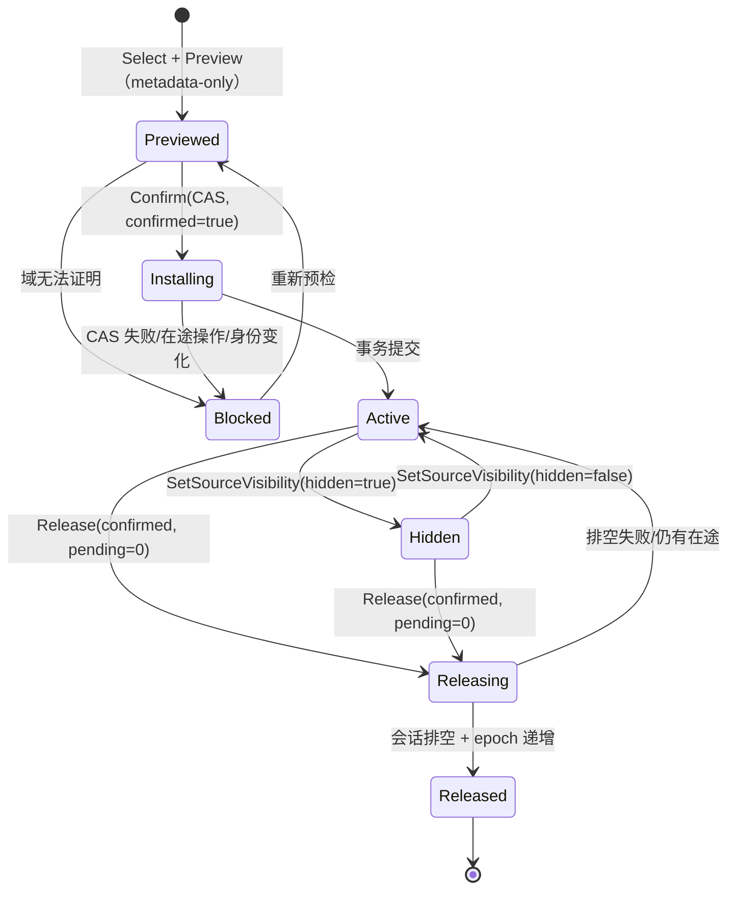
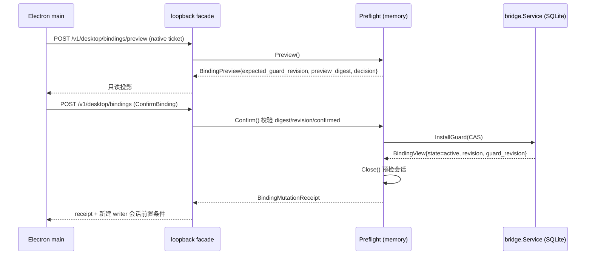

# Managed vault 保护域与 guard 协议（D03/D08 设计）

## 2026-10-26 本地推进（当前状态，早期进度段保留为历史）

`D08.1` 在每次 Pinax owner 调用前通过 `AcquireGuardLease` 校验确认时的 binding/source/instance/epoch、物理 root 与 content root、当前保护域和 fenced state。lease 复用 owner 的 `guardMu`，持续到有界 Pinax 子进程关闭；release 在同一互斥门排空调用后才递增 epoch。调用结束再次复检目录与保护域，变化时不投影成功结果。epoch 只留 host 私有状态，不进入 IPC、renderer 或 Pinax 合同；release 后即使重新绑定，旧 epoch 仍失效。隐藏只改导航，保持保护及当前 epoch。实例内调用暂时串行，沿用现有 15 秒启动、5 秒请求和 5 秒关闭预算。

`D03.6` 将已安装的 active/hidden/未知未释放 guard 纳入共享 provider/local mutation gate，普通正文、元数据、同 space、另一 space 的本地别名、祖先操作和持久化 worker 复检均使用相同 owner 裁决；不可读 registry 失败闭锁。released 只撤完整树的 binding 写门，原 adoption 的 `.pinax/**`/数据库等元数据保护保留。绑定前须存在同一 space、同一物理 root 的明确 Pinax local adoption，普通 file root 注册不足以成为 ready。fixture 由测试 application harness 建立对应 adoption，不自动改用户 state。`completed` 纳入真实 bridge operation 的终态，避免已完成历史操作永久阻塞预检或 release。

仍未关闭 D03/D08：历史分发 artifact 的 C1/C11、跨 state writer 完整枚举、全入口 R3/R4 并发反例矩阵和旧 mount 迁移准入。当前 lease 的进程内互斥不约束未登记外部程序，不提供 OS 隔离；正文 apply 尚未接入此宿主，不能据此宣称 apply 的 TOCTOU 保护完成。macOS/Windows 及三平台实机继续保持原门槛。

验证入口（在 `cli/drivebridge` 执行）：

```bash
go test ./internal/bridge ./internal/desktop -run 'Test(Guard|ManagedVault|DesktopAdmission|DesktopOwner)' -count=1
go test -tags integration ./internal/desktop -count=1
make contracts-check
make check
```

证据由 owner runner 写入 `temp/integration-test-runs/`；当前任务回执以 `tasks.md` 为准，不用本文代替真实平台/外部证据。

2026-10-24。本文是 D03/D08 的设计真源，承接 `managed-vault-admission-options.md`（D03.2 方案选择与 OS 实测）与 `state-fence-protocol.md`（D03.4 state 栅栏组件）。设计已冻结，实现状态以 `tasks.md` 的 D03/D03.5/D08 为准；本文只定义合同，不声称已准入。

## 保护目标与否证边界

保护对象是**显式登记保护域**：一个 binding 的 canonical root、其 content root、参与该 root 的已登记 state/连接/别名，以及经这些入口排队的在途操作。

必须做到的：

1. 域内已登记的可写入口在写入前被拒绝，不因关闭 UI、隐藏来源、删除导航或降级到旧版本而解除。
2. 无法证明覆盖时拒绝绑定，不自动迁移、不自动建替代 state、不删除登记来"修好"。
3. 保护由共享应用裁决（CLI/MCP/HTTP/UI/worker 同一判据），不是 UI 隐藏。

明确**不在**保证范围，文档与 fact 不得暗示相反：

- 未登记的外部编辑器、用户自行启动的未登记程序、OS 层强制隔离；
- 已通过符号链接指向保护根之外又指回的外部路径（按当前 canonical 解析处理，见反例 C5）；
- 平台范围：Linux 为本轮实现验证范围，其余平台在对应平台证据前保持 `unsupported`。

## 三层保护

任一层不具备即拒绝绑定。三层都必要，均不充分。

| 层 | 机制 | 解决的问题 | 失败语义 |
| --- | --- | --- | --- |
| L1 state 栅栏 | `server/pkg/managedstate` 格式标记 | 旧 binary 在写前就无 DB 可开 | `state_unavailable` / `state_layout_invalid` |
| L2 应用 guard | `ManagedGuard` 记录 + 全入口复检 | 新 binary 内部所有入口同一判据 | `guard_unavailable` / `owner_protected` |
| L3 会话隔离 | preflight 会话与 writer 会话分离 | 消费者面不能靠确认原地升权 | `desktop_session_invalid` / `binding_stale` |

L1 只提供"旧 writer 被拒绝"的条件，不授予 binding ready；L2 只在 L1 已 fenced 时允许安装；L3 只在 L2 active 且 revision 匹配时签发。

## Guard 生命周期



`hidden` 与 `active` 的区别只是导航可见性；两者 `protection_active=true`。`released` 是唯一 `protection_active=false` 的状态，且必须 `confirmed=true`、CAS 匹配、在途操作为 0、writer 会话已排空。这一不变量已经固化在 `server/pkg/desktopcontract/binding.go` 的 `BindingView.Validate()`（`active|hidden|blocked` 必须 `ProtectionActive`），设计不新增第二条判据。

## Guard 数据模型

`internal/bridge`（owner 私有持久化，不返回 renderer）：

```go
// ManagedGuard 以 ID+Revision 作为 CAS 锚点；Epoch 在 release 时递增。
type ManagedGuard struct {
    ID               string    // 等于 binding_id，opaque
    InstanceID       string    // DriveBridge 实例身份
    SourceID         string    // 消费者来源身份
    Revision         uint64    // CAS 锚点，从 1 开始
    Epoch            uint64    // 会话失效代际
    State            string    // active|hidden|releasing|released
    MinWriterVersion string    // 声明的旧 writer 拒绝条件
    Scopes           string    // 授予的 reader scope 有序集合
    RootDigest       string    // 已解析 canonical root 的摘要（仅内部）
    RootDevice       uint64
    RootInode        uint64
    ContentDigest    string
    InstalledAt      time.Time
    UpdatedAt        time.Time
    ReleasedAt       *time.Time
}

// ManagedGuardMember 冻结保护域枚举结果，供复检与 release 排空使用。
type ManagedGuardMember struct {
    GuardID string // 复合主键
    Kind    string // state|connection|alias|adopt|worker
    Ref     string // 稳定内部引用，不对外
    Digest  string // 枚举时的身份摘要
}
```

`BindingMutationReceipt` 复用既有 operation ledger 语义：`confirm`/`release` 以幂等键绑定原 operation，重放返回同一 receipt，不新建 operation。

## 预检合同（preflight）

预检只授 metadata，且必须**枚举并证明**以下全部项，任一项为未知即 `blocked`：

1. canonical root：解析符号链接后的真实路径、device/inode 身份、是否位于已登记 overlay/mount 之下。
2. content root：`generic` space 的 alias content root（`AliasContentRoot`）必须与 root 同域。
3. 已登记可写连接/别名：所有 `kind=local` adopt 记录与可写 connection 的重叠判定（复用 `sameOrNested`）。
4. 在途操作：`Operation` 表中属于该域且未终结的行数（`PendingMutations`，仅统计域内，不做 vault 扫描）。
5. 独立 state：同实例内其它 state 目录能否写到同一物理 root。
6. L1 前置条件：state 布局必须已是 `fenced`；`legacy` 布局直接 `blocked/managed_scope_unverifiable`，因为此时无法证明旧 writer 被拒绝。

计数只表示域内事实，`0` 不等于"没有别的 writer"。当前实现返回固定 `blocked/managed_scope_unverifiable`（`internal/desktop/preflight.go:88-105`），这是本设计的合法退化分支，不是证据。

## Guard 安装（confirm，CAS）



安装是一个 GORM 事务，顺序固定：

1. `SELECT` 当前 guard `FOR UPDATE` 语义下的 revision（SQLite 用单写事务 + `guardMu`），与请求 `expected_guard_revision` 比较；不等即 `binding_stale`，不写入。
2. 复验 canonical root device/inode 与 `preview_digest` 覆盖的域事实；变化即 `binding_stale`。
3. 复验 `PendingMutations=0`；否则 `managed_scope_busy`。
4. 复验 `managedstate.Inspect` 为 `fenced`；否则 `managed_scope_unverifiable`。
5. `INSERT/UPDATE ManagedGuard`（`revision = expected+1`，`epoch` 保持）、写 `ManagedGuardMember`、写 receipt；事务提交。
6. 关闭预检会话与其票据；不在此处签发 writer 会话。

CAS 失败、身份变化、在途操作三项都不允许"重试到成功"；调用方必须重新预检。原始 operation identity 在整个链路保持不变。

## 只读／writer 会话隔离

- **preflight 会话**（`internal/desktop.Preflight`）：仅内存票据与 preview，只授 `reader.metadata`；`Close()` 即失效。永不持久化。
- **reader 会话**：`reader.body|relations|assets` 需要独立创建，绑定 `guard revision + epoch`；`epoch` 不匹配立即 `desktop_session_invalid`。
- **writer 会话**：仅在 guard `active` 时创建，自带 opaque token 与 revision；不复用 preflight 票据，不原地升权。释放或降级时递增 `epoch` 使全部已发 token 失效。
- 渲染器 IPC 方法表（`server/pkg/desktopcontract/ipc.go`）保持 `Status: "planned"` 直到对应会话实现；退出码/按钮禁用不构成准入证据。

## 全入口复检与发布前复检

已知入口按 `adopt.go` 六函数族复检（文件见 `guard-map` 盘点，测试 `managed_vault_publication_test.go`）。设计规定的复检点固定为五个：

| 点 | 时机 | 要求 |
| --- | --- | --- |
| R1 | 请求进入 | 目标/祖先/别名判定，先于任何 staging 目录创建 |
| R2 | 排队取出 | 用**持久化 operation** 重判，不用调用方新请求；原 key 不变 |
| R3 | 字节就绪后、发布前 | 二次判定目标与临时名；发布必须原子 |
| R4 | 发布后 read-back | guard 已 release/epoch 变化时返回 conflict/unknown，保留 receipt |
| R5 | 后台全树引擎 | 重叠 root 一律拒绝（`rejectSyncMutation`），不做逐条豁免 |

R1 入口状态（2026-10-24）：`webdav.go` 的 PUT/MOVE 已改为先 `VFS.Admit` 再创建 staging（`TestManagedVaultWebDAVPutAndMoveRejectBeforeStaging`）；`local_preview.go` 预览缓存在写盘前调用 `rejectStateRootAlias`，state 位于已 adopt 根内时拒绝（`TestManagedVaultPreviewCacheRefusesStateInsideVault`）。`RemoteSurfaces.UploadLocalFile` 也已在读字节前应用同一 owner 路径谓词，拒绝把 `.pinax/**`、`*.sqlite`、`token` 作为上传源（`TestManagedVaultRemoteSurfaceRefusesOwnerMetadataSource`）。

`local_creative.go` 复核结论：它只把请求转发给 share client，`/creative/receipts/{id}/save` 是远端侧动作，本地没有写路径，因此 R1 不适用；此前的待办条目据此关闭。provider 直调仍是低层实现，按设计只允许由已复检入口调用，不承载准入。`providerFor` 是低层，不承载准入；调用方负责，且设计要求所有 provider 写方法只能由已复检的入口调用。

## 降级与失败闭锁

- guard 表不可读/不可判定 → `guard_unavailable`，按"已保护"处理，绝不按未保护放行（已有反例 `TestManagedVaultAdoptRegistryUnavailableFailsClosed`）。
- 旧 writer：由 L1 提供，不由"新增一个旧程序不认识的字段"提供。`MinWriterVersion` 是事实声明，不是机制。
- 回退到不理解 guard 的版本：state 为 `fenced`，旧构造在 `bridge.New`/server `Open` 阶段失败，不回退旧 DB、不删除登记。
- 关闭 UI、隐藏来源、删除导航：guard 保持 `active|hidden`。
- 系统级 DA 证明（D03.2 probe）只作为**反例证据**：同 UID 0700 可写、旧 FD 跨 chown 仍可写、可写祖先可 rename。因此本设计不宣称"文件权限即保护"，也不要求变更系统权限或安装服务。

## 反例矩阵（每项必须有真实证据才可勾选 D03/D08）

| ID | 反例 | 期望 | 证据手段 | 状态 |
| --- | --- | --- | --- | --- |
| C1 | 已发布的旧 binary 打开 fenced state | 写前拒绝，不建空库 | 固定旧版本+摘要的真实进程（D03.5） | **已验证（固定 tag 源码重建）**：v0.1.2 / commit 66c06285，历史 binary 对 fenced 可丢弃 state 返回 `state_unavailable` exit 1，marker 与快照摘要不变、无空库、无 WAL（20261024T150500Z-c1-legacy-fence）。分发 artifact 仍未验 |
| C2 | 当前源码重建的 binary 打开 fenced state | 拒绝；**不作为 C1 证据** | 构造期测试 | **已验证**：Server `TestManagedVaultServerOpenRejectsFencedState` 拒绝 fenced state 并保留原库字节（20261024T145714Z-4ba836a5）；根 CLI 现在按设计解析 managed 布局，故 C2 只适用于尚未接布局解析的构造器 |
| C3 | 迁移前已打开的可写句柄 | 迁移必须拒绝或要求排空，不因 chown 通过 | 真实 FD + 子进程 | 部分（probe 反证已记录；`managedstate` 排空合同未接产品入口） |
| C4 | 同一物理 root 的独立 state | 拒绝 adopt/绑定 | 临时双 state | 已有反例，guard 维度未证 |
| C5 | 符号链接/别名指向保护根 | 解析后拒绝 | `canonicalMutationPath` + 真实 symlink | 已有（`TestManagedVaultLocalParentAndAliasAdmission`） |
| C6 | 祖先目录 rename/delete | 受控祖先或拒绝绑定 | 容器 DAC probe（D03.2） | 反证已记录，不构成保护 |
| C7 | 未知新表/新字段 | 旧启动仍可写 → 不能作为保护 | 构造期反例 | 已有（`TestManagedVaultLegacyNewTableDoesNotGateStartup`） |
| C8 | 校验后替换（TOCTOU） | R3 复验目录身份，失败 publish 失败 | 并发替换 fixture | 部分（guard 侧 `TestGuardRootReplacementInvalidatesPreview` 已证预览失效；发布期并发替换仍待 D08） |
| C9 | 隐藏来源/删除导航 | guard 保持 active/hidden | 服务级测试 | **已验证** `TestGuardHideKeepsProtectionAndReleaseRevokes`（20261024T145142Z-c8917067）：hide 后仍 `ProtectionActive`，release 才清除并递增 epoch |
| C10 | 跨 vault 同 ID | 以 binding 隔离，不按对象 ID 复用 | 双 vault fixture | 部分：guard 以 instance+source 唯一定位（`TestGuardInstallRejectsStaleRevision` 覆盖同 source 的 CAS），跨 vault 的真实 source 隔离仍待 D14.3 |
| C11 | 降级到旧版本后 release | 旧版本不能解除保护 | C1 复用 | 未验证 |
| C12 | 未登记外部编辑器 | 明确不在保证范围 | 文档声明 | 已声明 |

## D08 跨入口证据（2026-10-24）

`TestManagedVaultIntegrationCrossEntryRefusal` 把同一保护域同时打到三条入口：Go 应用服务（`Mkdir`/`Upload`/`Sync`/`RunLocalFileAction`）、loopback HTTP（`PUT /files/upload`、`POST /files/action`）与 MCP dispatcher（`Call("mkdir")`、`Call("upload")`）。六条路径一律返回 `owner_protected`，且事后 `Operation` 计数为 0、无 `.drivebridge-staging`、无 `.pinax` 目录——拒绝来自应用裁决而不是适配器或 UI。

`TestManagedVaultIntegrationAdoptionDoesNotMigrateState` 证明 adoption 不会顺手升级 state 布局（`managedstate.Inspect` 仍为 `legacy`），并且 legacy 布局下 guard 预检保持 `managed_scope_unverifiable`。

`TestManagedVaultIntegrationNewConnectionNeedsSameDomain` 区分两种连接：同一 space 的连接不阻塞自身绑定；位于另一重叠 space 的连接使整个域不可证，绑定继续拒绝。

Server 模块：`TestManagedVaultIntegrationServerFencedStateDeniesAllEntries` 证明 fenced state 下 `Open` 不返回可用 service（因此 HTTP/SDK/MCP/worker 无法构造），且被拒绝的 `Open` 会释放 process lock 以便批准迁移后重试。

证据：`20261024T151446Z-6af6f85c`（根）、`20261024T151450Z-0958a995`（server）。仍未覆盖：Electron/host 侧 binding 与 reader/writer 会话、release 端到端确认、旧 mount 迁移入口、`RemoteSurfaces.UploadLocalFile` 与 `local_creative.go` 两个 R1 入口。

## Host 准入接缝（2026-10-24）

`internal/desktop` 新增 `Admission` 接缝，把「宿主」与「owner guard」分离：

- `Admission.Preview(root, scopes)` / `Admission.Confirm(root, bindingID, expected, digest, scopes, key)`。
- `NewPreflightWithAdmission(a)` 才具备准入能力；`NewPreflight()` 保持 deny-only，两条路径都只有一套裁决，不存在 adapter 自己实现的域检查。
- `bridge.BridgeAdmission`（`internal/desktop/bridgeadmission.go`）按**物理身份**把选中目录解析到 owner space（`EvalSymlinks` 相等），未登记的目录直接返回 `managed_scope_unverifiable`，不会用 renderer 路径推断来源。
- source identity 由 canonical root 摘要派生（`src-<hex>`），instance 固定为 `cli`，因此同一 vault 重建会话仍命中同一条 binding，而不是每次新建 guard。
- `Preflight.Confirm` 校验 preview digest 与 expected revision、复验目录身份，再调用 owner CAS 安装；成功后消费该 preview（不原地升权），回执为 `BindingMutationReceipt`。
- façade `POST /v1/desktop/bindings` 改为调用 `Confirm`：无接缝时仍返回 `managed_scope_unverifiable`；有接缝时返回真实 receipt。
- owner 探针失败不再产生 `decision=ready` + `reason=owner_unavailable` 这种自相矛盾的投影，而是 `blocked/owner_unavailable`。

证据：`TestDesktopAdmissionConfirmInstallsGuard`（真实 fenced state → ready preview → CAS confirm → `active`/revision 1 → preview 被消费 → 新 preview 读到 revision 1 → 旧确认返回 `binding_stale`）、`TestDesktopAdmissionAbsentStaysRefused`、`TestDesktopAdmissionUnregisteredRootRefused`（`20261024T152831Z-a30fd56f`、desktop 全包 `20261024T152834Z-03deaa48`、`make check` exit 0 `admission-slice-20261024/`）。

release / visibility 路由已按 D01 冻结合同实现：`PATCH /v1/desktop/bindings/{binding_id}` 与 `POST /v1/desktop/bindings/{binding_id}/release`（单段 opaque id，多段/空 id/无关路径一律 `desktop_contract_unsupported`），`Admission` 增加 `SetVisibility`/`Release`，`Preflight` 维护会话内 binding→root 映射，release 成功后移除该 ticket；`TestDesktopAdmissionVisibilityAndRelease` 覆盖 hide 保持保护、show、无 `confirmed` 拒绝、release 后 revision=4 且 `ProtectionActive=false`、同一 ticket 再变更返回 `binding_unknown`（`20261024T153050Z-dfc203e6`）。

仍未接线（因此 D08 不勾选）：谁在 product 路径上持有 owner service 并把它注入 `desktop serve`（当前 `drivebridge desktop serve` 不打开 owner state）、reader/writer 会话签发、`lookup` 路由、Electron 端到端 binding、旧 mount 迁移入口。writer 会话与 `epoch` 失效已在 owner 侧具备语义，但没有任何消费者 token 使用它。

## Host 消费路由（2026-10-24）

准入接缝之后，host 增加三条 owner 消费路由，全部要求一个已绑定的 source：

| 路由 | 方法 | owner 调用 | 返回给 renderer |
| --- | --- | --- | --- |
| `/v1/desktop/sources/{source_id}/notes` | GET | `ReaderNotes` | owner 的有界 note 列表 |
| `/v1/desktop/sources/{source_id}/writer/editor-source` | GET（唯一允许 query 的路由） | `ReaderSourceExport(objectID, revision)` | `object_id`、`revision`、`body`（≤64KiB，超出返回 `source_too_large`）、`bytes` |
| `/v1/desktop/sources/{source_id}/writer/editor:propose` | POST | `WriterPropose(note_edit, note_ref, expected_revision, body)` | 仅 `schema_version`、`object_id`、`revision`、`preview_digest`、`state` |

`source_id` 只能解析到本会话已确认的 binding（`Preflight.SourceRoot`），未绑定或已释放返回 `source_unknown`。owner 错误经 `ownerFailure` 归一化为安全码：上游 message、路径和 diff 正文都不进入 renderer。

已知偏差：消费的 `pinax v0.3.0` 没有 `writer.editor_source`，因此固定版本源码走 `reader.source_export` 语义。这是有界替代，不返回伪 schema；跟进项写在 owning change 的 tasks 中。

## 待决策项：desktop host 如何取得 owner state（2026-10-24）

准入接缝已具备，但 product 路径上还没有任何进程持有 owner `bridge.Service`，所以生产环境的 `desktop serve` 仍只能拒绝。接通需要先决定一件事：**宿主如何获得 owner state，而不违反 D02.5 的"不继承普通配置"边界**。

现有约束是刻意的：`cmd/drivebridge/desktop.go` 的 `PersistentPreRunE` 拒绝一切继承 flag，`internal/desktop/host.go` 在收到私有 bootstrap 之前不发现云/配置状态。`c.openService` 读配置文件、环境变量与 `--state`，因此不能在 bootstrap 之前调用。

三个候选，都需要一条明确决定，本文不预选：

1. **固定默认 state（推荐先评审）**：bootstrap 校验通过后，宿主按固定平台默认路径打开 owner state；路径不来自 renderer、不来自 flag。需要在 `desktop serve` 内做一次"state 已存在才附加 admission，否则保持 deny-only"，不得自动初始化。
2. **bootstrap 携带 opaque state 引用**：Electron main 在受信帧里给出不透明 state id，宿主映射到本机路径；引入新的私有协议字段与映射表，需要 host schema 版本演进。
3. **外部注入**：由打包层或另一个 owner 进程持有 state 并通过本机受控通道提供 guard，等于把保护域扩到进程间；需要单独的威胁建模。

未决定前，`desktop serve` 保持 deny-only；任何实现都不得让 renderer 影响 state 路径、不得自动创建 state、不得在 guard 未 active 时签发 reader/writer 会话。

同时仍待契约层决定：reader/writer 会话签发需要新增声明式方法（`ipc.go` 目前 32 个方法都是 `planned`，没有 session 创建方法），属 D14.1 同源的合同变更，不能由宿主私下新增路由。

## 与 owner 的接口

- **Pinax**：`.pinax/**` 是被保护路径，DriveBridge 只读不写；guard/binding 是 DriveBridge 概念，不进入 Pinax 合同。Pinax 侧 D03/D08 引用本文，不复制实现。
- **server 模块**：同一 guard 语义与独立 state 路径（`metadata.sqlite`），必须分别验证构造期拒绝（C2）。
- **D08 集成**：跨 Go/HTTP/SDK/MCP/worker 入口的 `TestManagedVaultIntegration`，证明拒绝来自应用裁决而非 UI。

## 交付顺序

1. D03.5：固定已发布旧 binary 版本/摘要运行 C1/C11；补 Server 真实构造 C2。
2. Guard 存储与 CAS 安装：表、事务、receipt、fenced 前置检查。
3. 入口补齐：R1 缺失的五个入口 + R3/R4 复验。
4. hide/release/epoch：C9 与释放排空。
5. D08 跨入口集成矩阵，然后才允许 D09/D14.3 打开 reader/writer 会话。

全部步骤使用本 owner 的 `temp/integration-test-runs/<run-id>/` 六件套证据，不运行 race，不操作真实用户 vault、不安装系统服务、不修改系统权限。

## 2026-10-24 本地实现切片（未接产品入口）

已实现并通过定向+全包回归（证据 `cli/drivebridge/temp/integration-test-runs/20261024T145142Z-c8917067`（25 例）、`20261024T145150Z-46a0c51f`（`go test ./internal/bridge` 全包 143s）、`20261024T145415Z-b1898a3d`（`go vet ./...`）、`20261024T145416Z-aeb97b79`（`go build ./...`））：

- `internal/bridge/guard.go`：`ManagedGuard`/`ManagedGuardMember`/`ManagedGuardReceipt` 三表、`PreviewGuard` 域枚举、`InstallGuard` CAS 事务（digest 复核 → fenced 复核 → `revision+1` CAS → 成员与 receipt 同事务）、`SetGuardVisibility`、`ReleaseGuard`（confirmed + 无在途 + epoch 递增）。
- `internal/bridge/guard_identity_{linux,other}.go`：Linux 用 device/inode 摘要作为物理身份；其他平台返回 `guard_identity_unsupported`，因此这些平台的 guard 安装保持拒绝而不是按路径名猜测。
- `internal/bridge/model.go` + `stateDatabase`：当前 owner 解析 `fenced` 布局并打开 `.managed-state-v1/` 下的真实数据库；旧路径保持惰性 marker。原先断言"当前构造函数拒绝候选布局"的测试已改写为 `TestManagedVaultStateFenceRejectsDirectDatabaseOpen`（直接打开 marker 路径拿不到数据库、快照字节不变、原迁移身份可 reconcile、当前 owner 能打开），不再声称已验旧 release。
- `TestManagedVaultLegacyNewTableDoesNotGateStartup` 等反例保留，未被弱化。

仍然开放（不计完成）：

1. C1 已发布旧 binary 的真实进程证据（D03.5）：本切片只有机制证据，没有固定历史版本/摘要的运行记录。
2. C2 Server `Open` 的真实构造拒绝未验证；`stateDatabase` 目前只接根 CLI。
3. 生产 startup/CLI/guard admission 未接：没有迁移命令、没有 façade `Confirm` 路径、`Preflight` 仍固定返回 blocked。
4. R1 外围入口：`webdav.go` 与 `local_preview.go` 已补并验证（20261024T145902Z-cd7dd047、全包 20261024T145907Z-5cf00e41）；`RemoteSurfaces.UploadLocalFile` 已补（本地源 owner 路径谓词）；`local_creative.go` 复核为远端侧转存、无本地写路径，R1 不适用。
5. writer 会话、D14.2 产品 preload、D14.3 真实 Electron 纵切未开始。

因此 D03/D08 仍为未完成；本切片只关闭"guard 存储与 CAS 安装、fenced 启动解析、hide/release 不变量"三项设计交付，并按上表更新 C 矩阵状态。
