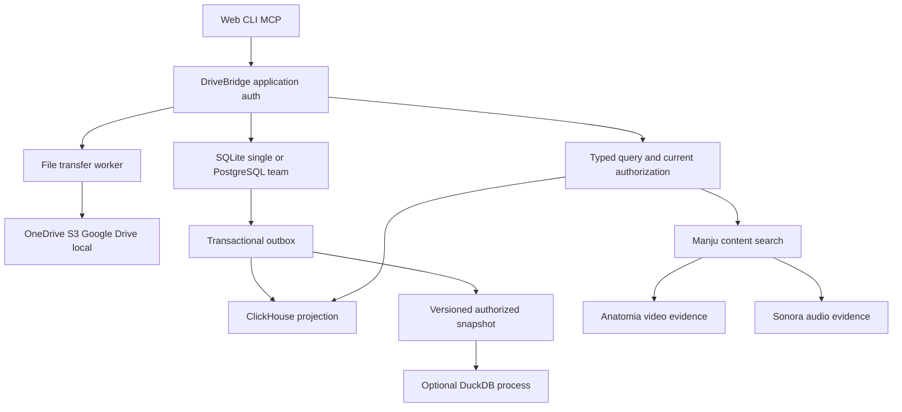
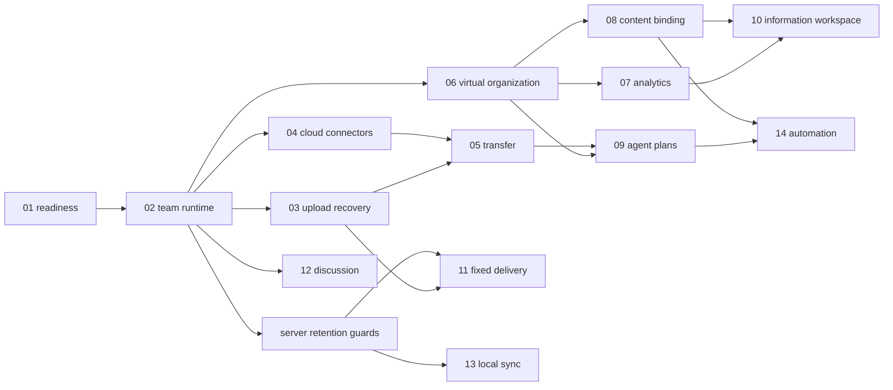

# DriveBridge 文件平台演进设计

## 决定与范围

用户确认：素材生产团队规模；三类云端直管；元数据与完整内容检索；按空间策略处理内容；总览与文件详情双层；Agent风险分级；虚拟整理优先；事务与分析数据库分层。

整体准入为split-owner。DriveBridge拥有字节、文件版本、范围权限、文件任务和文件组织；Manju拥有资产理解、语义检索与证据；Anatomia拥有视频时序producer；Sonora拥有音频领域合同。客户端只消费这些公开接口。无新产品仓、无新生成/聊天引擎。

## 数据流与职责

事务库存文件、版本、权限、配额、原操作与规则；分析库存可删可重建投影。DuckDB不链接进默认Go二进制；调用端不能提交自由SQL或文件路径。内容字节走授权HTTP/适配器；MCP只控制与传引用。跨owner使用固定版本/digest和双边权限映射，不按邮箱合并身份。

## 能力账本与实现边界

14项能力全部required，没有隐含删减。服务端保留保护、本机remote消费、客户端流程消费及Manju联调作为4个配套包。完整链接与依赖见[handoff](handoffs.md)，场景与分层证据见[场景矩阵](scenarios.md)。

原owner的local/S3/Capsa/object/backup入口、Pinax远程工作副本、Eikona/Scaena/Sonora绑定以及Auctra/Anatomia接入继续保留。DriveBridge文件标签不成为Pinax笔记元数据；文件集合不成为Manju主体/资产集合；保存与讨论解决不等于领域采纳。

## 阶段依赖

可独立设计不代表授权子Agent；本轮由root顺序完成，未来路径写入仍按owner隔离。runtime先提供队列/事件，业务包随后使用，不为每个场景再建状态机或队列。

## 对外体验

用户从总览看到容量、增长、传输、连接、整理与Agent活动，并按同一筛选钻取明细。文件详情固定所选版本，展示来源、可读性、引用、内容理解、讨论与历史。Agent使用相同受限查询和计划合同；读取与建议可在现有范围内执行，文件修改需有效预授权或逐次确认。

所有新公共路径、SDK类型、命令和工具均在owner design中标注规划。这里不复制wire schema，防止根与owner双写。新能力关闭时旧客户端继续工作；原上传8MiB合同不被云端分片策略重解释。

## 证据与回滚边界

就绪分为设计、源码实现、本地验证、真实后端验证、发布部署五层，分别记录。规格校验只关闭设计门。性能目标不是已达到指标；100GiB验证要求真实字节写入、重启恢复和读回摘要。

本轮文档无需运行时迁移。后续新功能以默认关闭入口渐进启用，旧ID/版本/操作保留。数据库切换前可撤回，新库已有写入后不能直接回旧快照。真实费用、凭据、存储写入、外部消息及部署按已有独立授权边界执行。

## 2026-09-25 范围记录

- 相比先前恢复优先设计，新增团队规模、云端Google Drive直管、分析引擎与完整内容检索；全部进入owner包。
- 旧文档“本机永远只读”改为按具体页面和私有owner能力说明；仍不开放远程可写view。
- Anatomia独立ASR/OCR已经退役；新联调仅消费当前truth标注证据。Sonora无匹配公开合同的场景保持unsupported且保留required任务。
