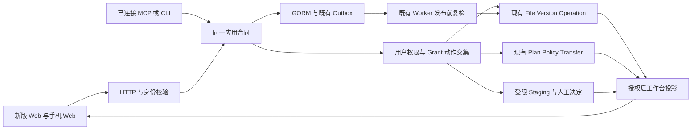

## Context and goals

唯一 owner 为 `cli/drivebridge`。internal/service、sdk 相对 server/，根 CLI/MCP 是同仓 surface；OpenSpec、任务工具、统一证据在仓库根。默认同 checkout+独立端口和 disposable 数据，见 [开发入口](../../../docs/development.md)。

[接口合同](../../../docs/server/personal-workspace-contracts.md) 固定新增 request/response、权限、错误、分页、幂等和兼容；
[数据设计](../../../docs/server/personal-workspace-data.md) 固定实体、状态、事务与回滚；
[PRD](../../../docs/web/product/personal-agent-workspace-prd.md) 固定必需能力 R01–R15。以上链接为唯一详细真源。

目标是让当前原型接真实文件服务，复用既有 GORM/HTTP/SDK/worker。非目标：重新实现文件平台、将 domain 状态交给客户端、创建第二个任务引擎或隐式启用内容分析。

## 2026-10-01 本机阅读交接

新增 [desktop-knowledge-reader包](../drivebridge-desktop-knowledge-reader-v1/design.md) 采用Electron+本机受控门面，不依赖云登录。B09.1与D04共享Favorite/application规则，扩展Pinax引用而非虚构File；本机阅读状态不在首片上传Server。B09.2所有受管文档/属性写经D03 guard，B09.3仅拥有普通文件投影，不能复制Pinax canonical关系。B14.2仍保留移动/后台/设备合同，桌面部分由D01/D02明确承接；独立D09/D10不等待S2全链。本包旧任务ID/状态不变，新合同详细真源为 [Electron架构](../../../docs/architecture/electron-desktop.md)。

## B75 retention 逐项策略/停止状态复核

retentionPlanCurrentOn集中原policy revision校验并增加category/status闭范围，在入口、每项计划行锁后与aggregate计划锁后复用；取消/未知状态retention_plan_stale，policy DB错database_unavailable，真缺失仅revision0兼容。已有completed/failed的原结果可读，但这两状态下残留candidate不得派发；只有preview/executing可执行新候选。没有新增cancel API、策略修改API或改变Enabled旧合同，不把该复核冒完整执行租约。

新增retention_policy_recheck_test.go用GORM Update回调在首item同事务提交策略或状态改变，不用goroutine/sleep/race。首红20261006T150437Z-ffeca6f2四例均继续删除第二项且completed，policy错误第二次查询甚至未发生。最终150723Z-04076f50十四顶层通过，新增六子例含policy revision变、cancelled、unknown、policy读取故障、最后一项后cancelled、伪completed带remaining candidate；保首项deleted及原证据，剩余candidate/File保持，aggregate不覆盖停止状态。B69–74故障/权限/预览/原回执等回归保持；vet150758Z-6ea2e8c2通过，六件套核，四路径LSP error级clean。

边界：仅各事务起点观察到的状态必须有效，不是持久策略行CAS/跨进程租约，若策略存储允许同revision改语义仍需其owner保证；不宣称事务内并发修改或PG实测。中止不会自动回滚已提交项或重建计划。已终态回执范围绑定、source target/tenant、历史候选和多version索引/预算仍待。无race/真实账号/生产清理/commit，WebdistF82/desktop旧，父项未关。

## B74 retention 预览当前读取准入

retentionHumanOn提取共同retentionActorOn，human执行仍显式拒Agent，preview保留合法Agent可读能力，不把删除授权下放。共同actor检查当前用户/credential、外部身份、非gov伪DataOwner；Agent即使空候选也从DB重读当前空间/前缀并沿allowOn核read、撤权/expiry/restriction。retentionFileDeleteOn复用内部retentionFileAccessOn的space/tenant/scope检查，preview仅传read。在B70同事务内，每个将返回的trash/history候选先核当前read；任一不可读候选整次拒绝且不写plan/items，不隐藏部分候选后冒完整清理计划。没有放宽执行权限或新增前端hold写。

首红20261006T145723Z-1afbacf9七反例均返回越界候选且保存计划。最终150040Z-6f89a223十三顶层通过，新增八反例含scope/tenant/Agent前缀/撤权/禁用/external/伪DataOwner/历史候选前缀；均无返回且零plan/item。正例保合法read-only前缀Agent application和真实SDK preview；撤权后即使无历史候选也拒缓存principal。B69–73故障/回滚/聚合/执行权限、原hold identity/expiry/HTTP-SDK-MCP回归，vet150111Z-5c23e796通过，六件套核，三路径LSP error级clean。无race/个人账号/生产清理/commit，WebdistF82/desktop旧。

局限明确：preview仍按owner范围扫描并对不可读候选整次failclosed，不是面向任意scope的可分页完整预览；未改预算/索引/历史live识别。plan没有tenant/scope不可变字段，已完成item/aggregate历史读取准入、来源target/tenant绑定及执行中策略变化仍待，不据此开放hold写UI或关闭父项。

## B73 retention 执行当前主体与删除权限

新增retention_authorization.go内部合同，retentionHumanOn在ExecuteRetention入口read transaction、每项transaction及最终aggregate transaction重核真实human：拒Agent/service identity/external/share/access grant，拒空actor、disabled/archived user；非governance禁止DataOwner覆盖actor，governance保留既有受权代管能力而不强套个人workspaceGroupHumanOn。当前session/key通过governanceCredential在调用tx复核，DB读错不冒已授权。

retentionItemEffects读到当前File后，retentionFileDeleteOn读当前owner Space、核ScopeSpace和tenant（governance沿spaceTenant兼容legacy空tenant），再调原allowOn(tx,principal,space,path,delete)。不是只凭plan创建者或File.Owner删数据；沿B72 savepoint把拒绝记为failed且不做副作用，普通human早期拒绝不派发item。相同事务避免SQLite单连接嵌套读。无新schema/路由/UI删除权限。

首红20261006T145018Z-497bc7d1九场景都删除了可丢弃测试File。最终145326Z-fd3c6956十二顶层通过，新增十场景含external/share/access grant、disabled/archived、失效session、非governance伪DataOwner、scope、tenant、governance只读platform admin；后者明确item approval_required，scope/tenant明确not_found，前者forbidden/unauthorized，均保File/Version。其余B69–72/原identity/schema/shared blob/expiry/HTTP-SDK-MCP入口回归，vet145354Z-0f4c778b过，六件套核，四路径LSP error级clean。service identity guard有代码但未在外部package构造私有identity，未冒该分支独立实测。

边界：本片仅执行当前human与逐项delete授权；preview依然owner-wide、历史已完成item/aggregate范围可见性未完整重构，plan没有tenant/scope不可变绑定、来源target绑定与中途策略变化仍待；不要把失败回执当新执行许可。无race/生产或真实个人数据/commit，WebdistF82/desktop旧，hold写UI与永久删除仍禁用，父项不关。

## B72 retention 副作用与原候选结果原子提交

新增retention_execute_item.go替换原内部executeRetentionItem，不另建保存/清理引擎。每项在s.mu内开启WithContext事务，锁当前owner计划行（GORM clause.Locking；SQLite写事务/本机mutex），重读原item和目标identity；已非candidate原样返回、不覆写原结果。原file/version/hold/space/blob查询与数据库副作用统一使用该tx，不调用外层blobScopeForVersion而死锁单连接；blob按已读取space scope定位，读取错误/缺blob不再吞掉。file/versions删除、blob refs、usage、outbox与item最终状态同事务提交，item更新用candidate条件并核RowsAffected，不用Save upsert补新行。

副作用在显式savepoint内执行，失败必须先成功RollbackTo才能写failed item；rollback失败则整个事务失败。context取消也回滚外层。候选结果写失败整笔回滚，原candidate可在当前重新准入后人工重试；提交连接错误仍不能证明未提交，必须保原plan/item。最终聚合重新锁计划并读取持久items计数，拒candidate/未知状态或数量漂移，检查Update错误/行数，已有相同聚合不覆写。只要有failed item，status=failed（仍沿旧items_skipped包含所有非deleted项，未扩schema）；无失败才completed。重复执行读取原item结果不会重新删除或把deleted计数归零。没有自动补偿/换plan重试。

首红20261006T143807Z-4d823ca1证明item写失败后File已删除而item仍candidate、plan写失败假成功及重放计数归零。最终144358Z-871f866a十一顶层测试通过，含新增item/plan/space/blob四故障子例：item写错File/Version保留且blob/usage回滚；plan写错已deleted回执保留，两次重放计数稳定/原UpdatedAt不变；副作用写错failed不重做，B69 source故障同样顶层failed。B69–71、旧身份/schema/shared blob/expiry/HTTP-SDK-MCP权限回归。vet144424Z-4ddbba25通过，六件套核，四路径LSP error级clean，不冒全warnings清理。

边界：不是完整跨进程执行租约或PostgreSQL并发实测；只锁retention计划并不能涵盖其他写引擎，跨不同plan同目标、策略中途变更、当前tenant/路径权限/source绑定仍须后续准入。历史版本计费/引用完整矩阵与旧plan-file唯一索引问题仍待。无race、并发/race命名测试、真实账号/生产清理/commit，WebdistF82/desktop旧，永久删除/hold写UI仍不放行。

## B71 retention 执行前完整计划读取

ExecuteRetention原入口把plan DB错误当notfound、policy错误且revision0时继续、items错误当空完成，亦不核ItemsTotal和context。现在先用WithContext只读事务取同一计划/策略/items视图：真plan缺失not_found，DB错误database_unavailable，policy仅真缺失且原revision0可继续，否则stale；负计数或实际items数与header不符dependency_unavailable。事务成功且context未取消后才进入旧执行循环，每项派发前再检查context。执行前拒绝不更新任何plan/item、不删除File/Version，合法零候选计划保持原行为。

首红20261006T143206Z-f273f6e8六子例均失败：policy读取错、缺item、负计数及取消context仍删测试对象，items读取错冒completed，plan读错冒404。最终143301Z-c3f9dee6七顶层（新6子例+真空/missing正控制、B69/B70与旧保护到期/入口权限回归）通过，vet143323Z-c20db4e3通过，六件套核；新例同时检查执行前零Update、原File/Version数量、plan仍preview且计数未动。两路径LSP error级clean，不冒warnings全清。无race/真实账号/生产清理/commit。

边界严格保留：本片不是执行租约/CAS，也不保证读取结束后无并发改动；删除与item结果、最终aggregate未原子化，旧Save/update错误与completed含failed问题仍待，取消发生在已派发项不能据此宣称零副作用。当前仅阻断不完整/不可读取计划进入删除，不把B11/F21.2或hold UI放行。WebdistF82/desktop旧。

## B70 retention 预览读取失败与原子保存

先修执行之前的预览准入。PreviewRetention原先任意策略读错回退默认、files/versions Find忽略error、空间错误返回0导致候选被当立即到期；plan与items逐条独立提交，第二item失败留下半份计划。现在公开方法通过同一GORM事务调用私有previewRetentionOn，策略/候选/空间读取与plan/items写同一连接，避免SQLite单连接嵌套读；仅策略真ErrRecordNotFound用既有禁用默认，其他读错database_unavailable。trashDaysFor改显式(tx,File)(int,error)，缺space dependency_unavailable不使用默认0。plan头与所有items任一失败全rollback；返回成功前事务须提交。注释明确preview会写计划元数据，不是零写读取，也不删除源文件。

首红20261006T142558Z-6d7afb06六故障目标中五个失败：策略/files/spaces/versions读错仍成功或空预览；第二item失败残留头和首项。最终142759Z-8373dfd4五顶层通过，含六点注入、合法空预览、缺空间拒绝、无残留计划/候选、移除fault后新完整预览及source files数量不变；B69八子例与原保护到期/HTTP-SDK-MCP准入回归。vet142813Z-72d2a4a9通过，六件套核，LSP两路径error级clean不冒warning全清。无race/个人账号/生产清理/commit；WebdistF82/desktop旧。

范围仅preview DB故障与原子性，不宣称所有候选权限/规模/历史版本选择已验收。历史候选仍有旧按created第一条假定live的问题，RetentionItem现有plan+file唯一索引也不支持同文件多历史候选；不得静默改schema，本次重复约束失败只保证全rollback。ExecuteRetention聚合completed含failed及item/plan写错处理、source/tenant/target绑定与安全恢复仍待后续，hold写UI不准入，B11/F21.2父项不关。

## B69 hold 查询故障拒绝清理

盘点retention.go已有hold创建/读取/解除与三条删除消费路径，不能直接把存在API当安全可消费。activeHoldForVersion原来把hold查询失败变nil，holdSourceValidTx把来源DB错误变false，直接Purge/retention file/history可能继续删除。另file item事务closure把任意rollback变nil，外层仍返回deleted。修为显式(bool,error)/(*Hold,error)，来源仅ErrRecordNotFound可判不存在，未知SourceKind为dependency_unavailable，数据库错误database_unavailable；三个调用点在原事务内传播并停止，不制造假hold ID。已释放/到期hold仍无需查来源；已证取消/撤销来源保持既有不保护语义。

retention file item保留事务error并返回failed安全码，不把rollback冒deleted。GetRetentionHold区分hold/File真缺失与数据库失败，存在file须当前read授权，不再把权限失败包装成inactive；Create/Get计算source verdict时也传播错误。创建后查询错误不代表创建未提交，现有同key恢复要求保持，未新增自动重试。未放宽永久删除策略、未增加UI删除按钮/hold写入口，所有测试对象为可丢弃fixture。

首红20261006T141804Z-efbbe8d8四例显示hold或source查询故障下purge/plan均实际删除了测试File；最终142141Z-bc612c64六顶层测试（新8个故障子例及既有身份、schema、shared blob、保护到期重计划、HTTP/SDK/MCP权限）通过，vet142213Z-eb5faff9通过、六件套核。新例覆盖直接purge、file plan、history plan、hold read；故障必须命中，文件/Version保持、计划项failed且items_deleted=0。三路径LSP error级零诊断，不冒全warning清零。未执行race或并发/race命名测试、真实账号/个人数据/commit。

边界：ExecuteRetention顶层仍沿旧completed+items_skipped表达已处理（其中可含failed item），不代表清理全部成功；该聚合语义与持久化错误传播、hold来源target/tenant绑定、恢复lookup及前端准入仍须后续片，不能据此关闭B11/F21.2或直接接写UI。WebdistF82/desktop旧，D03仍failclosed。

## B67 / B68 调用观察真实时间排序

能力fit于既有调用观察owner。增量可选order=started_desc按StartedAt真实瞬间DESC、InvocationID ASC，省略仍ID ASC；空/未知/重复值400。先沿原1000候选预算和逐条当前授权构造views，再sort.Slice按time.Equal/After与ID比较，不按SQLite含offset字符串排序；纳秒不截断。排序发生在generation和分页前，原LastKey仅在同一完整代次已排序视图定位，不另造时间cursor或更换持久层。sorted domain在现有legacy/half-open domain后加固定.started-desc，未传order的绑定编码保持；两个方向模式互换均410，可见记录时间或finish变化同样失效。生成参数只覆盖invocations的order，不把agent-grants原pinned enum改掉。

新增workspace_invocation_order_test.go：真实HTTP+合成GORM行验证倒序跨单条分页、同刻异offset按ID打平、相差1ns精确先后、legacy顺序/两方向cursor隔离、开/半开组合、非法值、改变时间使cursor410；预算测试新增sorted及超窄空范围仍1001候选429，旧授权与half-open回归。首红20261006T135652Z-8619df7c新order400，最终service/contract135907Z-cdc09df9、vet135913Z-18336195通过；生成135828Z-458b812d/schema135830Z-3d24a916/drift135831Z-7465f04f通过，44paths/70schemas不变，六件套核。LSP4clean/1findings：既有6条N+1辅助warning及固定domain拼接string-builder hint保留，不冒clean或为lint重写授权层。

本片CONTRACT/BACKEND独立完成，Web排序消费INTEGRATION_PENDING，WebdistF80/desktop旧。不改变调用事实、保存请求正文、伪造业务成功或放宽预算；未跑race/个人账号/commit，父项仍未关。

## B65 / B66 调用观察半开时间区间

能力fit于既有DriveBridge调用观察owner。原workspaceInvocationList已实现started_after与started_before双开区间，但文档曾把started_after写为包含，不能直接改实现破坏旧客户端。新增可选started_at_or_after，和started_before形成[start,end)，两个下界同时出现一律invalid_request；单值RFC3339Nano解析，UTC瞬间比较到纳秒，双界须严格正长。只下界/只上界继续有效，零time由参数presence区别缺省。新模式独立workspace.invocations.half-open.v1 query domain，旧domain与binding序列保持原样；模式/界值变化拒旧cursor，即使当页成员一样也不能偷用。

复用原human owner/tenant/scope/grant/space/Agent逐条准入、1000候选预算、stable ID分页与best_effort返回，不增加写入、schema、路径、状态机或原始调用数据。时间筛选仍在有界候选内比较，不把SQLite异offset字符串做词法比较。新增OpenAPI参数与三个边界的date-time语义说明，TS从Go重新生成，44paths/70schemas不变。接口文档修正旧半开命名歧义，日期选择器/DST和按时间排序显式待交付；F79旧开区间UI不自动升级或宣称F10.3已完成。

首红20261006T134401Z-245b56db为新参数400。最终service/contract定向134439Z-26a2a7ad验证旧开区间、包含下界/排除上界、纳秒相邻点、offset等价cursor、跨模式cursor410、双下界/相等/逆序/重复/空/坏时间400，以及原Bob/租户/失权/绑定漂移/DB错误/预算回归。生成134448Z-faf708c8/schema134449Z-1683bf25/drift134451Z-98f3fdd9、vet134551Z-e1afd761、Web type134552Z-3d1b8daf均passed，六件套核。LSP2clean/1findings/1inconclusive：旧查询过滤循环及逐条权限查询触发6条N+1辅助warning，未声称全clean，也未为清warning改授权路径。无race/外部账号/commit，前端半开消费与真实browser另片。

## B64 Markdown 属性类型读取与修改后语义验证

新增markdown_property_read.go/.test.go，内部readMarkdownProperties只解释≤200个字典定义的六type，校key/type/重复定义；未知字段仅排序UnknownKeys不公开值。已知type不符返回ReadOnly[key]=type_mismatch且无值；可读但B63不能逐字节修改的block/multiline/quoted-key等为unsupported_representation并保类型值。只读标记是表示层能力，不是文件权限，reference仍仅shape、不resolve或授权，应用层交付前必须再次授权。

Node映射不走Decode(float64)：number直接原token与B56复验，保1.250/指数/负零，hex/octal/underscores/NaN/超safe拒而不coerce；text仅!!str、date允许严格日期的!!str/!!timestamp、checkbox bool、list纯字符串顺序重复保留。markdownPatchable抽取B63单行二次parse同Node证明，reader和writer共用，不产生第二序列化引擎。patch最终verifyMarkdownPatch重新读取结果，用UseNumber保token的JSON语义比较核全部updates，并核remove键消失；任一不符不返回可写结果。源码正文仍原bytes拼接而非AST反建。明确语义精确不意味所有十进制客户端可精确表示。

9 Markdown顶层+2 B56顶层20261006T070003Z-df3a6859/vet070035Z-024808fa通过；六type read/roundtrip、特殊字符/NEL-LS-PS escape、科学计数法/1.250/-0、unknown隐私、复杂类型只读、错误结果/删除未生效反例、非法定义与既有无损测试覆盖。LSP1clean2inconclusive，六件套核。仍是纯内存helper，无HTTP/DB/application authorizer/文件mutation；reference纯parse可接foreign形状不表示可访问。新增Markdown写入口必须有owner/结构化资产/managed准入、fixed-version正文读取校验、字典revision、当前引用授权、原upload CAS/receipt恢复后再交付。D03仍blocked，WebdistF77/desktop旧，无race/真实账号/commit，父项不关闭。

## B63 Markdown frontmatter 纯内存无损修改核心

新增markdown_properties.go/.test.go，复用已有gopkg.in/yaml.v3，仅处理传入字符串，不接文件路径、DB、HTTP、权限、引用解析或写入引擎。parseMarkdownProperties识别首行精确---与LF/CRLF、64KiB frontmatter/2MiB document/有效UTF8无NUL；YAML mapping按Node只读解析，4096nodes/深32预算，嵌套重复key拒；anchor/alias/merge、BOM/非mapping/flow root/歧义delimiter/bareCR或Unicode分隔符原文拒，避免Node.Line与LF字节切片错位。预算限制不代表完整YAML streaming parser资源证明。

patchMarkdownProperties复用B56六type校验，仅显式已定义key更新/删除且合计≤200，无null删除。未修改YAML（未知tag/嵌套/block内容/数字字面/注释）和Markdown body按原bytes复制，不从projection重建。目标必须顶层column1 plain key、同一物理行value，单独解析该行并比Node结构证明无多行续接；复杂目标unsupported_action，不用YAML emitter整段归一化。更新值用紧凑JSON兼容YAML形式，保数字token/数组顺序；NEL/LS/PS转Unicode escape防YAML折行为不同字符串。同行注释与结尾空白保留；删除保注释为独立行。新key排序追加，空frontmatter/无frontmatter支持，新metadata沿CRLF约定，正文不变。

5个Markdown顶层+2个B56顶层20261006T065402Z-613b0f77/vet065410Z-8bc7088d过；CRLF/中文/未知自定义tag/nested block/1.250/空值/重复list/缺key删除不变、类型/预算/duplicate/alias/复杂目标拒均覆盖。新增反例首红065055Z-ffa36461发现comment-only null行及字面Unicode分隔符会改变值或注释语义，修注释归属与escape后通过；又拒原文Unicode换行避免错误行偏移。LSP2inconclusive，非clean。纯函数测试不是HTTP、owner授权或Markdown端到端验收。

尚未新增应用服务、定义映射读取、save preview/receipt、HTTP/schema/UI，也未开放Markdown属性写。未来必须fixed base原bytes、引用当前授权、dictionary revision/权限/managed guard、复用SaveDocument上传CAS；现DocumentCapability/SaveDocument不构成Pinax/结构化资产新增准入。D03保护未证仍failclosed，不能用此helper绕过。WebdistF77/desktop旧，无race/真实账号/commit，B09.2父未关。

## B62 历史快照只读HTTP与生成合同

新增GET `/file-collections/{id}/snapshots`，保同路径legacy POST。human当前collection授权，禁止全部query（含裸?、unknown、重复或畸形参数），wrapObserved(false)/no-store；复用B61 bounded1000 header索引，不引入cursor或隐式条目展开。SnapshotIndexEnvelope由Go生成，44paths/70schemas，明确429超预算；只有collection_id/items/observed_at，每项snapshot_id/collection_revision/created_at，不含计数、文件、回执或next_cursor。历史header不是原创建回执或当前可读证明。

7顶层20261006T063210Z-28a080c8通过（Index/Creation/Read）：真实human HTTP空历史、legacy POST及keyed创建兼容、header-only查询、GORM全部写拦截零业务write、禁止entries/files/receipts查询、Bob404/Agent拒、closed query400、依赖500、1001 headers429无部分结果。生成063332Z-446f1dc5/contract063333Z-6e5bc932/70schema063334Z-60819cee/type063335Z-3b2bfaa6/vet063357Z-2ad99323/drift063359Z-83ee19d4通过，LSP1clean3inconclusive。Schema反例覆盖多余计数/receipt/cursor、非法ID/revision/time、null/1001数组；六件套核。HTTP不是SDK新方法或Web历史管理完成；下一F77消费，WebdistF76/desktop旧。无race/真实账号/commit，父项未关。

## B61 历史快照 header 索引应用服务

新增ListCollectionSnapshots与contract/SnapshotIndex（目前未注册HTTP/schema）。复用snapshotCreationAdmissionOn只读准入，human当前owner/tenant/collection space/read；Agent/external禁止，空历史也鉴权。单只读事务按collection_id+owner过滤，SELECT仅id/collection_id/owner/revision/created_at，created_at DESC/id DESC稳定序，Limit1001探测，最多1000；超额query_budget_exceeded而非截断成功，不冒分页。响应collection_id/items/observed_at，每项仅snapshot_id/collection_revision/created_at，不带entry count/path/file refs/current可读计数，不查members/entries/files/versions/WorkspaceRequest或storage。header正revision/ID/time核验，坏行整表dependency_unavailable，数据库失败database_unavailable不伪空。末尾复核当前collection身份/修订/rule/scope，混代query_changed；不是跨事务全局授权快照。

legacy与keyed快照均可观察header，列表不是原创建回执，不因缺项或旧行而推断提交状态/补回执；打开内容仍须独立ReadSnapshot逐entry重新授权。列出header不证明旧条目仍可读、provider健康或完整性检查通过。没有新增删除或迁移能力，没有读取私有个人数据。

6顶层20261006T062705Z-b7b0a28d（Index/Creation/Read定向）与vet062716Z-9601c9bf通过；1000/1001、同时间ID排序/foreign owner不消耗budget、Bob/Agent/tenant/scope/external/disabled拒、空历史、四依赖故障、坏revision、同tx callback代次漂移、全GORM写拦截与禁止entries/files/receipts query均验证。预算fixture用metadata插行，非1000次真实发布；不冒PG并发全部交错。LSP1clean2inconclusive。B62合同HTTP、F77页面与真实集成另片；WebdistF76/desktop旧，父项未关，无race/真实账号/commit。

## B60 规则集合 Go 生成合同

新增contract/collection_create.go与collection_create_schema.go，service CreateFileCollectionRequest/FileCollectionView改为公开DTO别名，保字段/类型/JSON tag及现有调用。CollectionRule原始filters/sort仍RawMessage，服务逐项闭解码，公开Schema再生成带field/op/value对应关系的oneOf与typed sort；mode exact、64filters、1sort、单space/空cursor/limit0..200。创建请求按manual/rule联合：rule必填typed规则，manual旧接口会忽略任何可解码rule（包含null），保兼容但新客户端应省略。重复键、Unicode原词法、64KiB规则/200bytes名称/4096bytes值和包含集合的space一致性归application校验，Schema字符长度不能冒字节预算或授权。

注册既有POST /file-collections，200 FileCollectionViewEnvelope不是receipt；身份标注human或legacy Agent private，session CSRF与Idempotency-Key保持。lookup仍独立human原回执合同。registry planned标记沿旧约定，不冒runtime discovery。新增5schemas，合计43paths/69schemas；Go生成TS、OpenAPI、synthetic fixture，不手改产物。未来客户端计算原digest必须保原嵌套rule bytes，HTTP继续closed检验后Unmarshal原raw，不靠被重编码的DTO生成新identity。

最终生成20261006T060021Z-eb8e9168/contract060023Z-ba1d6f41/69schema060024Z-9cf1e0e7/service定向060025Z-4a629708/type060048Z-89f44799/vet060111Z-7cfe94cf/drift060113Z-f459112b通过。Go正控制manual null/原raw/Agent和200兼容；strict Ajv覆盖7条件族正例、错误操作类型/空值/超预算/多sort/unknown负例；service原创建receipt、闭规则、大小游标、快照回归。LSP3clean2inconclusive。未新增UI/SDK动作，WebdistF74.2/desktop旧；F75规则创建消费另片，不关闭父任务，无race/真实账号/commit。

## B59.1 大小排序 keyset 修复与规则准入恢复

QueryFiles大小排序游标改为十进制int64 size|id，比较绑定int64而非时间字符串；升降序与ID同方向tie-break保持。旧错误timestamp大小游标、负数/非canonical整数/溢出/缺id拒query_changed，不猜续页；path/time旧游标格式不改。collectionRule恢复单项size_bytes asc/desc排序，B59暂拒不再是当前能力边界；多排序仍因引擎仅首项执行而拒。未改查询指纹或原rule字节，不更新DB/payload格式。

新增file_query_size_test.go以205条metadata-only GORM File fixture验证大小分布含0与同size多ID，limit7完整升降序、不重复不遗漏；规则集合超过200页界完整有序；排序变化与catalogue代次变化拒旧cursor。metadata fixture不冒真实provider上传或跨进程PG证据。file_query_size_cursor_test.go在真实本地store上传fixture上构造合法sealed但历史格式/无效大小键，全部query_changed；原path查询、集合、快照回归。

首红20261006T054816Z-43c24021：asc只7/205，desc重复file。最终29顶层20261006T055112Z-9ea92d4b与vet055135Z-191289e0通过，LSP1clean3inconclusive；六件套核。无race/真实账号/commit，Webdist未变化。下一规则生成合同/UI独立片，直接查询其他宽操作校验与total授权语义不因本修复声称全面完成。

## B59 规则集合闭输入、执行语义与原创建回执

新增collection_rule.go，由CreateFileCollection与ReadFileCollection共用，只校验/构造执行副本，不重写持久化原rule字节或旧fingerprint。原JSON≤64KiB/有效UTF8/无孤立surrogate，顶层与每个filter/sort closed且重复key拒；mode必须exact。space_ids可省略，显式只能等于集合space；cursor可省略或空（非空拒）；limit兼容0..200但集合仍完整有界枚举，不当总成员限制。filters最多64、sort最多1；缺mode/null/unknown/坏类型/预算拒invalid_query，不先创建再报错。合法旧mode exact省space及空filter仍支持，原raw含空白创建/重放不变。

条件仅准入引擎实际执行组合：path_prefix prefix/contains非空文本；mime_type/caller/task_ref eq文本；labels.manual/rule/suggested eq/ne/contains非空文本；updated_at gt/gte/lt/lte且RFC3339；size_bytes gt/gte/lt/lte且非负安全整数，原数值token用B56与big.Rat拒float舍入伪整数；trashed仅eq false（集合只返回live成员，不承诺回收站集合）。sort仅updated_at/name/path_prefix与asc/desc；size排序既有cursor使用timestamp不是size，暂拒，单独修复后恢复；其他sort原先默默退updated亦拒。此处收紧规则持久化与读取，不冒直接file-query所有组合缺陷已修。

新human manual和rule均同事务创建WorkspaceRequest collection.create；legacy行重放不补回执，Agent仍无human原receipt。lookup接受两类已保存原事实，核原creation字段digest/CreatedAt、当前owner/tenant/scope/read，不执行rule或读members；当前成员rev增加仍原result_revision1。规则创建HTTP仍原200 current FileCollectionView，须lookup确认原事实，未新增route/schema或把HTTP当新SDK。

首红20261006T054037Z-ba137328证明25种无效规则全部被旧create保存。最终29顶层20261006T054354Z-66ed88ac（Collection/Snapshot/SavedQuery定向）与vet054412Z-b4b95803过。新增真实humanHTTP原raw创建+receipt、nested重复/unknown/UTF16拒、执行仅命中文件、receipt注入失败整事务rollback、后续member revision不替回执、lookup全GORM零写、模拟legacy无receipt重放不补造、坏持久规则不退全库；支持组合正控制。LSP1clean3inconclusive，非全clean。原receiptHTTP兼容回归保留，未跑race/真实账号/commit。Web规则创建及Go生成公开规则schema另片，父F09/B09未关。

## B58 sidecar HTTP、写gate与生成合同

新增GET/PATCH `/files/{id}/properties`与POST `.../lookup`；GET仅required version_id query，无重复/unknown，固定48hex；PATCH256KiB closed base_version_id/definition_revision/expected_revision/updates/remove_keys，原bytes先UTF8/surrogate校验，再flat DTO及原updates逐key解码，duplicate含转义等价key拒，防重编码吞原词法错误；null值不代表删除。lookup2KiB closed version_id/idempotency_key，缺记录404非未提交。GET/lookup wrapObserved(false)保零业务写、no-store；读不受写gate影响。

Config.PropertyEditing与serve --property-editing默认false，Patch应用入口强制拒unsupported_action，显式开关才允许变更；关闭后仍能当前授权读取/原回执恢复。普通fixture保持默认false，B57服务用例显式启用不改通用fixture；新增CLI默认值与显式设置测试，未启动真实生产服务。Markdown仍unsupported，supported binary列表见B57，不把sidecar开放变成Pinax正文准入。

Go生成42paths/64schemas：values/updates仅string/number/bool/string[] shape，实际key对应type/数值/日期/bytebudget/引用授权由app再次裁决，schema非权限。unknown raw不输出。首contract044519Z-c66e8376分页测试错误假定所有query GET都是list，为getFilePropertySidecar专门断言required fixed version而非加虚构limit。

最终service13顶层+CLI1顶层20261006T044817Z-7e60d86b（另1migration helper skip）通过；生成044517Z-f1d6c512/contract044611Z-4a1ade24/schema044612Z-0d3dbffb/type044613Z-b5ef8e70/vet044635Z-848d7a27/drift044641Z-9d9de5bd过。HTTP默认关零行→开后patch精确1.250→重复key/surrogate/非法UTF8/oversize/查询拒→关后read/lookup原receipt且全GORM零写→Bob隔离，lookup闭输入过。LSP3clean/1inconclusive。Web值编辑与真实新版上传链仍待F74，Webdist仍F73、desktop旧；无race/真实账号/commit。

## B57 固定二进制版本sidecar应用服务（HTTP/UI待接）

新增WorkspacePropertySidecar为file/version唯一canonical外置人类元数据（不借WorkspaceFilePropertyProjection做真源、不写provider bytes）；整体ValuesJSON≤256KiB/≤200keys，每raw值≤16KiB。初片仅pdf/png/jpg/jpeg/gif/webp/mp3/wav/mp4/webm扩展名；Markdown/纯文本/配置与未知类型unsupported，扩展名只决定支持面不授任何Pinax权限。新表经原migration增量，旧投影存在而无sidecar拒dependency_unavailable，需独立迁移，不开启空store覆盖历史投影。

FilePropertySidecar当前human/user/tenant/space/path/read/nontrash-purge-staging及固定Version存在校验；Patch另要求当前head=base_version和write，锁File及Catalog（SQLite普通事务/其他DB FOR UPDATE），原值revision与当前definition_revision同时核；仅已定义key可typed更新/删除，B56六type真接应用。reference除形状还resolveRef本instance+resourceFileOn固定目标当前权限，每次读也重验，隐藏引用整view拒；未知旧keys的raw原字节保留但值不公开，只报告unknown_keys，不强制清理或允许未知key删除。删除已知隐藏reference可安全移除，不返回目标元数据。

patch原摘要Go JSON {file_id,request:{base_version_id,definition_revision,expected_revision,updates,remove_keys}}，WorkspaceRequest property.sidecar与aggregate CAS/ValuesJSON同事务。原key同body回原receipt不重写，head变后仍可查原version原receipt；新key旧head/version_conflict。新版本不复制旧属性，旧固定版本可读旧值；lookup不返回旧值/ref。读取首尾file路径/space、catalog及sidecar revision复核，不冒所有DB的全授权原子snapshot。新contract/property_sidecar.go为应用DTO，未注册公开schema/HTTP。

12顶层20261006T043542Z-881a619a+1migration helper skip/vet043554Z-425e4dc9过；测试真实本地文件fixture+app写值/删值/原replay、未知raw保留且不泄露、receipt两写点failure rollback、零写read/lookup、6依赖DB错误、Bob/Agent/scope拒、Markdown拒、foreign/隐藏reference拒、dictionary drift拒。head换版用真实Version行与fixture数据库更新模拟publisher，不冒真实上传并发/PG；旧migration回归。LSP1clean/3inconclusive。HTTP/UI与Markdown无损属性仍待；新入口未公开，无race/真实账号/commit。

## B56 属性值严格类型基础（尚未接写入）

新增workspace_property_value.go validatePropertyValue，仅共用纯校验基础，无HTTP/DB写路径。单值raw JSON≤16KiB且UTF8有效、单JSON；text≤8192解码bytes/noNUL；checkbox只bool；date只真实公历YYYY-MM-DD/year≥1；list为≤100字符串（每项≤1024bytes/noNUL，保顺序/重复/空字符串），不自动转标量；number只JSON number、字面≤128字符、显式指数[-308,308]、finite/nonunderflow且精确绝对值≤2^53-1，big.Rat界限比较避免边界浮点舍入误接受；小数仍binary64消费语义，不承诺任意十进制精度。null/未知type/字符串数字拒，删除须未来显式remove，不以null暗删。

reference仅drivebridge固定file/version形状，48lowerhex、无user/query/fragment/百分号/尾slash，长度≤2048；foreign instance格式可成立但不授权，未来应用必须resolveRef本实例与当前fixed-version/read准入，不能把此validator作为安全门。JSON孤立surrogate escape会被encoding/json替换成U+FFFD，新增有界检查拒绝孤立高低代理，正确pair与转义反斜线保留；校验不改原字节，不lossy coercion。已有未知投影值未触及，不能拿validator强制清理历史值。

定向7顶层20261006T042611Z-7c2d6521/vet042621Z-5eee72eb通过（六类型正负例、text/列表/编码与raw预算，边界日期、指数/精确数字上限、固定引用格式与foreign格式非授权正控制），六件套/strict/diff。LSP2inconclusive非clean，无新增依赖。尚无属性值持久化/Markdown无损变更/sidecar原子CAS/HTTP/UI，B09.2父不完成；下一须接真实owner值服务而不是再增加纯helpers。无race/真实账号/commit。

## B55 属性字典HTTP与生成合同

workspace_property_definitions_http.go注册GET/PUT `/spaces/{id}/property-definitions`及POST `.../lookup`，统一properties.definitions_read/update观测action、application仍裁决human/read/manage。GET/lookup wrapObserved(false)，真实HTTP全GORM写拦截证明当前个人范围零业务写；PUT256KiB顶层closed expected_revision/definitions（≤200），逐RawMessage独立DecodeRequest检查nested key/display_name/group/type四必填/非null/unknown/duplicate，防普通json.Unmarshal吞nested重复。无query/单Idempotency-Key；lookup2KiB原key。响应保data envelope/no-store，PUT返回原receipt，不冒当前view；旧metadata端点不改。

Go DTO/schema注册与类型生成40paths/60schemas，中文名称/分组与稳定ASCII key分开；schema key采用pattern `^[a-z][a-z0-9_]*$`+maxLength64，与service相同，避免struct tag逗号切断正则。真实HTTP create→presentation update→旧keyreplay→只读原lookup仍rev1，current为rev2；nested闭输入/null/unknown/duplicate/oversize/多key、type删除migration422、Bob/Agent隔离、receipt依赖500全通过。

10顶层20261006T040751Z-6d50dd81+1migration helper skip；最终生成040851Z-0a34aabe/contract040853Z-4906acb8/60schema040854Z-e90add6d/type040855Z-3697520f/vet040917Z-05c951de/drift040923Z-6fb82f3f通过。首schema040803Z-6b292b55揭示Go tag `pattern=...{0,63}`被逗号解析器截断，改Go源等价pattern+maxLength并重生成，不手改产物。LSP3inconclusive。Web属性页仍INTEGRATION_PENDING，文件属性值/迁移/标签字典仍未完成；无race/真实账号/commit。

## B54 属性定义应用层与聚合CAS

盘点已有WorkspacePropertyDefinition/WorkspaceFilePropertyProjection仅模型迁移，无HTTP/app实现；复用原定义行，不重复建字典。新增WorkspacePropertyCatalog space primary key聚合revision头，经migrateWorkspaceModels增量AutoMigrate；不存在且无定义为虚拟revision0、读不初始化，有旧定义却无头fail dependency_unavailable，不猜修订/自动迁移。每字典最多200字段，stable key小写ASCII64、display_name120/group80 Unicode无控制、text/number/date/checkbox/list/reference。新增PropertyDefinitions/UpdatePropertyDefinitions/LookupPropertyDefinitionUpdate，当前human owner/tenant/scope/root read，修改manage。当前完整定义数组expected_revision CAS，head原子insert或revision谓词update后才新增/改显示名与group；省略已有key/type改变unsupported_action留显式迁移，稳定key无隐式rename/delete。

WorkspaceRequest action property.definitions原key摘要为Go JSON {space_id,request:{expected_revision,definitions}}，同key原回执不改最新字典，异body冲突，新key旧rev拒；head/rows/receipt同事务任何失败rollback。返回receipt space_id/request_digest/result_revision/committed_at，不冒当前定义。读取按key排序、201探测、持久定义/owner/type/revision异常拒，首尾head含virtual0核验避免空观察吞新代。字典修改不改File/Version、frontmatter、sidecar投影与既有值，不构成B09.2属性值写入完成。HTTP/DTO schema注册及Web在下一片，当前contract/property_definition.go只定义Go DTO，尚未发布生成合同。

9顶层20261006T040028Z-7e4c08c7+1migration subprocess helper skip、vet040038Z-d2473e30通过；旧迁移原身份/失败rollback/进程恢复回归。应用测试新增/展示修改/原replay与lookup/旧projection完整保留、type和删除拒、Bob/Agent/tenant/scope/disabled拒、3写点failure全rollback、全GORM写拦截read/lookup零写、4读依赖500、无head旧定义拒、200/201预算、virtual0读期间注入head→query_changed、两goroutine同rev单赢家；仅本机并发非PG/跨process全交错。LSP3clean/2inconclusive。采用当前dirty checkout符合单writer用户约束，无race/真实账号/commit。

## B53/B53.1 快照原创建身份与恢复

新增CreateCollectionSnapshot(ctx,p,id,expectedRevision,key)/LookupSnapshotCreation与POST `/file-collections/{id}/snapshots/creations`、`.../lookup`。human当前collection read+write才创建或重放；lookup只要求当前collection read，不授entry/body权限。原snapshot发布抽private createFileSnapshotOn(tx)，旧CreateFileSnapshot仍复用同核心、旧route/SDK不改。新key流程先事务鉴权/原receipt查找→既有有界动态读取→事务再鉴权/查原key→同核心写header+entries→WorkspaceRequest action=collection.snapshot原子提交；原key已成功不再枚举source。digest为Go JSON `{collection_id,expected_revision}` SHA256；receipt仅collection_id/snapshot_id/request_digest/collection_revision/committed_at，原revision/time与snapshot header一致。后续集合变更与新snapshot不替原事实。

缺receipt404非未执行，不取最新snapshot补造；异body/目标409，新key旧revision拒。snapshot entry读取仍走ReadSnapshot当前逐项过滤，原receipt不证明当前全entry可见/存储健康。动态rule初始枚举不是全库事务快照，提交重新核所捕获版本/路径/权限与collection revision；本片未扩大成全catalogue原子快照。旧接口仍可无key创建，不自动迁移旧事实。新create1KiB closed expected_revision，lookup2KiB closed key，无query/单key，38paths/57schemas生成。

定向snapshot6顶层20261006T033936Z-700da3d3；最终42顶层034117Z-fab7daa7+1scale skip，生成034115Z-ee403f6a/contract034145Z-8b79513a/schema034146Z-0f00295f/type034147Z-3917dbfa/vet034209Z-38670064/drift034210Z-dadaca2c过。真实HTTP创建→集合新revision/新snapshot→原lookup/replay同ID/time且零source枚举；GORM全写拦截lookup零写；header/entry/receipt各失败全rollback；Bob/Agent/scope/closed/5依赖500及旧snapshot回归。LSP4inconclusive不当clean。Web按钮/人确认/丢响应browser/资源包交接待F72独立验；未跑race/真实账号/commit。

## B52/B52.1 完整显式成员编辑基线

CollectionMemberDecisions(ctx,p,id)与GET `/file-collections/{id}/members/decisions`（human、无query）返回collection_id/revision/items[file_id,space_id,path,decision]，不是dynamic规则结果/visible count。单GORM事务当前user/owner/tenant/scope/read+write，最多10001探测后10000上限，逐决策owner/lower48hex唯一/include|exclude和file当前read/space/nontrash/purge/staging校验。任何隐藏exclude/include拒整表、不返回部分items；坏持久决策503、DB500、超预算429；按file_id/id排序。JSON item累计预算1MiB-2048给envelope留余量；首尾collection revision/kind/rule/space复核防混代，未声称所有DB隔离下全授权全局原子快照。lookup/read不写audit/usage、不读正文/不运行rule。

新增真实HTTP空基线/完整include+exclude、全GORM写拦截零写、Bob/Agent/scope拒、无query、5依赖故障、trash exclude不静默过滤、坏decision拒；10001持久行预算、1MiB路径预算、同事务query callback推revision后query_changed反例。定向2顶层20261006T031957Z-3c30a2c1；最终40顶层032111Z-84674ed2+1scale skip，生成032110Z-3c01c929/contract032139Z-43336519/55schema032140Z-d9f862ab/type032142Z-731473e4/vet032203Z-77f70846/drift032205Z-92e45e92过。36paths/55schemas，LSP1clean/2inconclusive。

F71编辑消费仍INTEGRATION_PENDING，完整编辑基线不能用动态可见成员替代；异常隐藏项的人工治理后续，不绕过为可编辑。无race/真实账号/commit。

## B51/B51.1 集合成员原请求回执

旧SetCollectionMembers提取private setCollectionMembersOn(tx)事务核心，旧PUT与SDK保原CAS语义；新人类ChangeCollectionMembers调用同核心，同tx写WorkspaceRequest action=collection.members，key域owner/tenant/actor/action，digest为Go JSON `{collection_id,request:{expected_revision,include,exclude}}` 保数组顺序。POST `/file-collections/{id}/members/changes` 接收required闭数组/include+exclude总≤10000、唯一lowercase48hex fileID、revision1..9007199254740990、1MiB；不把动态规则结果误作显式决策。新写仍逐file当前scope/read、集合write与CAS。

同key同digest先回原receipt、不重新修改，异请求/换collection409；新key旧revision冲突。LookupCollectionMembersChange与POST `.../changes/lookup`仅查原WorkspaceRequest，当前human/collection owner/tenant/scope/read，每次重验；回执只含collection_id/request_digest/result_revision/committed_at，不公开旧文件标识。后续rev/成员变化甚至旧成员trash不改变历史提交事实，不将历史成功冒当前成员可读。无receipt404不证明未提交，不自动重建；全GORM写拦截证明lookup不写audit/usage，DB失败500；receipt保存失败CAS/members整事务rollback。旧PUT无key仍不造receipt。

35paths/54schemas由Go生成，数组单列unique/max10000/48hex，跨数组总额与交集由application校验。定向4顶层20261006T031219Z-44e71350通过；38顶层031413Z-d00187da+1scale skip、生成031411Z-f48e2fa3/contract031441Z-ef1986d2/schema031442Z-ccf06cfa/type031443Z-7c49fea6/vet031505Z-b1b0a7fa/drift031507Z-18feeffc通过。LSP4中1clean/3inconclusive。真实HTTP提交→旧PUT推进成员rev3→原key重放/lookup仍rev2且最新成员不变；旧包含文件trash、Bob/Agent/scope拒、closed反例、四依赖故障、receipt失败回滚、跨集合key拒通过。

UI仍INTEGRATION_PENDING：现有GET集合是过滤后的动态成员，不含完整include/exclude决策；不能反推编辑表单替换而丢隐藏决策。下一先补当前显式决策读取/完整性准入（不可见项不得静默过滤为可完整编辑），然后picker/预览/确认/原key恢复UI及browser。没有新增第二保存引擎/数据表，无race/真实账号/commit。

## B50/B50.1 手动集合原创建事实与只读恢复合同

新human manual创建同事务写WorkspaceRequest action=collection.create、actor/owner/tenant/key、原fingerprint/ID/result_revision=1/CreatedAt；receipt失败回滚集合，不另建数据库模型。仅新行记录，不为旧行或Agent行补造human actor。CreateFileCollection原响应仍当前view，只有LookupCollectionCreation/POST `/file-collections/lookup`返回原事实；members revision增长后仍原1，不返回当前成员/名称/规则。lookup核当前human/tenant/scope/root read，原creation字段digest/key/createdAt与receipt一致，变更409；无receipt404但不证明未提交，DB故障500。wrapObserved(false)与全GORM写拦截证明无业务audit/usage写，不读成员或规则/body。

closed lookup2KiB无query；旧create顶层128KiB closed拒unknown/duplicate/null/缺必填/query，多Idempotency-Key拒。保旧rule RawMessage字节fingerprint：closed检查后从原raw解码保nested空白，新增旧格式rule同key正控制，未把闭输入重编码变成幂等冲突。typed rule完整校验仍待，不扩大rule receipt支持。

新CollectionCreationReceipt由Go生成，result_revision限定1、digest64hex；33 paths/52 schemas。36顶层20261006T025353Z-6705043f通过+1scale skip；生成025433Z-5c9f4042、contract025434Z-4f7bdf63、52schema025435Z-f356293a、type025436Z-dab2d060、vet025458Z-366d9b44、drift025459Z-fedc9456通过；最后schema负例025611Z-daf35236通过，RawMessage兼容补充后17顶层025719Z-a972230a+1scale skip/vet025736Z-bdf63c9f通过。LSP4中2confirmed clean/2inconclusive，不当全clean。

首红024839Z-afd7d063证明缺原子receipt，同时初HTTP测试忘key未创建；随后025029Z-427ffb34暴露mustSDK实际Agent身份，正确拒human receipt；修为真实cookie+CSRF+key请求，不放宽身份。025419Z-bf27c565仅生成fixture未刷新，按Go源重生成后contract通过。旧无receipt重放/Agent行不冒人类回执、Bob与scope隔离、依赖故障、全写拦截、成员变版原receipt均验证。正式Web创建/丢响应browser仍INTEGRATION_PENDING，F09/集合members原key与snapshot完整闭环未完成；未跑race/真实账号/commit。

## B49 集合创建与原key重放的当前准入

CreateFileCollection原先只在事务外space查询/可选team manage，未校当前user或tenant/ScopeSpace。首红20261006T023638Z-e250161b复现跨权限创建/重放与user依赖错误被忽略。现同GORM事务内savedQueryActorOn、collectionReadSpaceOn、根read/write；team另校manage且明确Agent拒。旧合法root read+write Agent private创建继续兼容，read-only Agent不再创建。key唯一仍owner/key，不另改数据库schema；跨tenant旧key冲突不回传别tenant行。

重放比较fingerprint及当前创建字段space/name/kind/scope/rule，漂移不冒原请求结果；fileCollectionViewOn计数与create同事务，Count/授权/依赖故障全回滚。不声称返回当前revision/计数是原创建receipt，后续须独立lookup固定提交事实。保现rule原字节fingerprint及legacy rule解析语义；typed rule/closed HTTP/原receipt仍另片，未默许无效规则安全。

最终34顶层20261006T023746Z-248e143d通过，1scale skip；vet023834Z-ebc96751通过，LSP2inconclusive。新增create/replay跨tenant/scope/share/external/空身份与disabled拒、旧root Agent允许/read-only拒/team拒、users/spaces/collections/members四依赖故障零残留、原key重试固定ID与异body冲突；旧集合/快照/资源回归。strict/diff/六件套通过，无race/真实账号/commit。

## B48 集合成员事务CAS与当前权限

SetCollectionMembers旧实现事务外校revision、事务内无条件delete/insert/update，真实并发同revision两请求都成功，且跨tenant/ScopeSpace可写。首红20261006T022924Z-350a53f1两个反例均复现。现先校输入预算/安全revision，局部s.mu串行后GORM事务内savedQueryActorOn当前用户/身份、collectionReadAdmissionOn与root write，逐file owner/current space tenant/scope/read且非trash/purge/staging。未限定scope的同owner/tenant跨space成员继续可用；不授prefix更宽write。

事务内先UPDATE WHERE id/owner/tenant/revision CAS，RowsAffected非1冲突，成功才删除/重建成员；最后同tx计数生成返回view，任何DB错误全回滚且不重新GET可能变更的当前版本。显式事务谓词而非仅进程锁保证拒旧revision；本片仅证明本机并发及同事务模拟CAS漂移，不冒PG/跨进程全交错。无新原key receipt，响应丢失仍不可把当前集合当历史回执；后续创建/成员原操作恢复单列。

32顶层20261006T023033Z-357a5143通过、1scale skip；vet023108Z-d61ff29a通过。最终补确定性Update callback推进revision，原CAS必须失败并回滚成员/版本，定向2顶层023226Z-6924ea23通过。Count故障在成员重建后触发仍全回滚；跨scope/disabled拒与原集合/快照/资源回归。LSP2inconclusive，六件套/strict/diff；不跑race/真实账号/commit。F09写页/CreateFileCollection准入及原回执后续。

## B47 集合列表当前准入与计数故障

全站盘点后转F09集合缺口；D03复查仍无旧writer跨state隔离证明，继续blocked，不为fixture解锁。已有ListFileCollections未复用当前user/tenant/scope/read检查且fileCollectionView吞Count错误。首红20261006T021242Z-bf420b2f复现跨scope与prefix Agent整空间元数据泄漏。修列表在GORM事务内核当前user非disabled/archived、collectionReadSpaceOn owner/tenant/ScopeSpace、allowOn根read；按owner/tenant/space过滤候选，旧Agent仅private集合不改。prefix Agent没有root read时拒列表，但已知ID的ReadFileCollection仍按实际成员path授权，不回退原宽列表。

保旧数组响应，created_at/id稳定顺序，1001探测、超过1000 query_budget_exceeded。fileCollectionViewOn使用同tx，Count失败database_unavailable，不跳过坏项或伪零；原create/members调用也不再吞Count错误。members_total仍是显式include决策计数，不是动态rule全部结果或当前可见成员总数；未来UI须标清此口径，跨space成员计数的更细可见性治理未由本片声称完成。旧create/members整体事务与回执边界不在本片扩张。

最终30顶层20261006T021334Z-164be761通过，1scale skip不是通过；vet021359Z-f3568083通过。新增真实HTTP列表/直接服务身份scope/disabled、users/spaces/collections/members四依赖故障、1001实体预算与foreign tenant不计入预算；原prefix detail、集合/快照/资源回归。LSP2inconclusive；strict/diff/六件套检查，F09页面仍下一片，无race/真实账号/commit。

## B46 / B46.1 编码检查公开合同与历史查询

contract/resource_check.go统一ResourceCheckRequest与ResourceIntegrityReceipt，service旧名alias复用；请求closed expected_revision安全整数+checker_version仅utf8-integrity-v1，返回check_scope固定fixed_bytes_sha256_utf8_no_nul、原check_id/descriptor/revision/state/time，无正文/私有target digest或对象键。POST /resource-descriptors/{id}/checks显式执行或回放相同descriptor/revision/checker唯一事实；POST .../checks/lookup只查询原持久事实，不调用执行方法。双方1KiB请求/无query，CSRF/human/当前target权限与digest一致性核验，lookup用wrapObserved false不写DB audit/usage。不存在check时404，不代表失败或可以宣称从未启动；仅用户确认后的执行接口可首次读取字节。保持ResourceView.check_state=unknown，窄passed不是广义安全、Skill格式、安装许可或现在storage健康。无任意checker/provider选择。

最终13顶层 `20261006T002902Z-caf1c95d`通过：新增真实HTTP空lookup零check、显式执行、关闭fixture S3后lookup和同身份执行回放仍原历史receipt（不当当前健康）、全GORM写拦截零写、Bob隔离、闭请求反例、digest漂移409、check表DB500、失权404；100文件测试增加lookup Get计数保持不变，原B45读取后撤权/cancel与资源回执回归。生成 `002921Z-4b7e0dbb`、contract `002922Z-2e26d55f`、51schema正反例 `002923Z-6e1860c7`、type `002924Z-4bfbb744`、vet `002947Z-d5652bbd`、drift `002948Z-feeb91df`通过。32paths51schemas；LSP3clean1inconclusive，UI明示执行/历史证据呈现另验。无race/真实账号/commit，Skill格式检查/handoff与全站/Pinax/三平台父门未关。

## B45.1 检查完成前失权与数量边界

仅增加workspace_resource_check_boundary_test.go，无生产hook或新执行路径。复用blobRig/memoryStore，以Close channel屏障停在真实字节读完、检查事务尚未提交之间；六子例分别disable用户、trash文件、改descriptor名称、改file path、cancel context、保持不变。前五例必须返回无receipt且check/audit零行，对照例提交一条；defer取消/release/join在失败也释放测试goroutine，go test timeout有界，不用sleep调度或race。它证明最终复检拦截这些交错，不冒所有读取中权限/stream取消或强制超时覆盖。

数量测试用可丢弃metadata别名共享实际fixture bytes但独立file/version，101固定成员在provider.Get之前budget拒绝且零receipt；移除fixture第101项后100成员恰好100次Get并生成receipt，重放原receipt不额外读storage。不是100文件外部真实云负载或PG规模证据。

定向2顶层/6子例 `20261006T001923Z-5092fef0`通过；最终16顶层 `002002Z-6a8c0d26`通过、1migration helper skip，vet `002013Z-66ee67b7`通过。原resource register/lookup/迁移及B45编码/hash/audit回滚回归。LSP1inconclusive不冒clean，无race/真实账号/commit。B46公开合同与历史只读回执入口尚未开始，Web dist仍F67。

## B45 固定字节完整性与UTF-8检查应用服务

workspace_resource_check.go新增CheckResourceIntegrity应用方法，固定checker_version=utf8-integrity-v1，尚无HTTP/UI入口。目标必须当前human可读、expected descriptor revision匹配；复用资源完整目标准入，单文件或snapshot最多100文件、累计2MiB，空snapshot拒unsupported不做空集passed。先取固定file/version/size/hash及目标digest，复用Download原版本流（15秒context预算）读取最多expected size+1；核真实字节长度/SHA256，只有完整读取并验证后才判UTF8且无NUL。无效编码记failed，存储/读取/hash错误或预算超限不生成检查结论。不解析或执行Skill/模板/脚本，不自动取外部链接；passed仅这组编码/完整性谓词，不代表Skill格式、恶意内容检测、prompt trust或安装许可。合法空文本可通过编码谓词，不能据此称有效Skill。

外部读取前后各用GORM事务重新验证权限/描述修订及目标digest，I/O不持DB事务。WorkspaceResourceCheck追加TargetDigest（旧行默认空，不当新checker证据），digest绑定descriptor字段、原version存储身份和路径；私有对象键/路径/正文不进入公开receipt或错误。检查与audit同事务写，唯一descriptor+revision+checker/version冲突用GORM OnConflict并读取原记录；原receipt重放重验当前授权，保持原check ID/time，不重新探测历史结果。变更目标/路径等digest漂移保守revision_conflict；没有自动重新检查或覆盖旧事实。ResourceView.check_state继续unknown，不把窄checker注入宽安全状态。原Download的错误映射及底层provider不响应context的硬取消能力未由本片升级；15秒是协作取消，不冒硬进程截止。HTTP/生成合同/独立lookup和UI的明确用户确认仍待后续。

最终14顶层 `20261006T001432Z-81f5fde6`通过、1迁移helper skip非独立通过，vet `001440Z-45d984f1`通过。真实上传原版本后换非法UTF8 head仍检查旧版，原receipt ID重放、跨owner/tenant/scope/Agent/撤权拒绝、总览unknown；invalid UTF8/NUL failed、empty编码passed；audit故障零check、恢复后正确结论；单文件与包累计预算，原size/hash篡改不产receipt、descriptor漂移拒重放。原资源HTTP/lookup/模型约束及迁移回归通过。首次定向 `001245Z-13224c65`通过。LSP4inconclusive非clean；100文件数量上限、I/O中撤权/超时/跨进程并发及PG实机尚未完整验收，无race/真实账号/commit。B10/F08及全站/Pinax/三平台父门继续。

## B44 快照当前授权与固定版本读取

ReadSnapshot改只读GORM事务，先按owner查询snapshot（DB错误500区别not_found），即使empty也走collectionReadAdmissionOn当前user/tenant/ScopeSpace/Agent授权；不要求当前collection revision等于snapshot历史revision，后续集合编辑不改冻结身份。header总数预算30000、非负/可见计数一致，entries最多30001探测、实际总数必须一致；重复file/缺身份或摘要与固定Version冲突dependency_unavailable。每项核当前file owner/space/tenant/非trash-purge、当前path及历史entry.Path权限、原Version归属；仅明确not_found/visibility拒绝过滤，DB错误传播，不换head或从最新版补hash。原存量entry空SHA保空，不自证已校验内容。返回entries_total保历史总数、entries_visible为本次可见固定结果，读不写，不执行内容。

新snapshot_read_test两反例首红 `20261005T235554Z-99d3acb8`：empty跨scope可读、snapshot表DB错误误404；修后最终28顶层 `235728Z-8ad41966`通过+1scale skip，vet `235752Z-4a02b188`通过。测试覆盖empty tenant/scope/owner/disabled、真实head更新及集合成员编辑仍旧snapshot/version、prefix Agent只获当前path但无旧path权限时不泄漏历史path、旧Version删除后visible降0而非换head、7依赖表DB故障不伪空、GORM写拦截零写、总数漂移及header超预算；原快照原子发布/组织SDK-MCP/资源register与lookup回归。LSP1clean1inconclusive；30001实际条目大库/PG隔离/所有撤权交错未冒验收。无race/真实账号/commit，Web dist仍F66，checker/资源包UI与全站父门未完成。

## B43 集合快照原子发布

CreateFileSnapshot旧实现依次写header/entries且吞Version读取错误：真实第二entry失败反证 `20261005T234808Z-8b822eaf`留下一个snapshot header。改为先取得既有有界collection观察，再GORM事务校collection当前revision/kind、human/Agent当前准入及每file owner/tenant/space/path/固定head/version，header与全部entries一起提交；任一步失败回滚，不用空hash替代DB故障。collectionReadAdmission/Space提取On(tx)复用原规则，旧读取wrapper仍沿原DB。来源观察partial或>30000项拒绝，读取后head/path变化query_changed，不偷切新version。提交直接返回已构建固定观察，不追加一次可能失败的ReadSnapshot把已提交事实隐藏。

此修改保证单次写入原子性及观察候选复核，不宣称跨rule全库原子snapshot：初始集合枚举仍沿旧多读查询，事务开始前新增rule匹配项/未提升collection revision的外部写、PostgreSQL隔离级别与重入进程竞态尚需专项；新请求无独立幂等key，丢返回不自动再建。原ReadSnapshot吞错/空集合权限等读取侧缺口尚未在本片更改，资源入口B40的完整性与权限门保持。

最终26顶层 `20261005T235138Z-7902cedd`通过、1scale skip非规模证明，vet `235156Z-ab2cef3e`；新增atomic与empty admission测试：snapshot header失败/第二entry失败/版本DB失败均零header和entry，事务内合成head漂移query_changed零残留，修复后只一个完整snapshot；empty collection跨owner/tenant/scope/disabled拒绝，合法空snapshot保旧数组合同。原组织SDK-MCP/重启/schema/集合与资源回执回归通过。LSP1clean3inconclusive，未跑race/真实账号/commit。B10/F08与全站/Pinax/三平台父门继续。

## B42 原资源登记回执查询

新增POST /resource-descriptors/lookup，closed {idempotency_key}、2KiB body、原key长度/可见ASCII检查；只查WorkspaceRequest原resource.register action/owner/tenant/actor/key，不补登记。事务内human准入、原descriptor当前目标授权、receipt revision/time有效，再将descriptor固定创建字段重建摘要与原RequestDigest核对；描述漂移409，目标失权404，依赖DB500，不把当前同名记录或新revision当原提交。响应ResourceRegistrationReceipt含resource/result_revision/committed_at，暂无版本修改入口，原版本无法重建时保守拒绝而不返回最新。404不证明原请求从未执行，原POST重放仍须用户确认且可能首次执行。

HTTP wrap原逻辑提取wrapObserved，默认observe=true保旧入口不变，仅新lookup observe=false跳过成功鉴权后的通用audit/usage mutation；认证/CSRF/bindContext/governance不变，认证失败安全日志未删。该模式只用于人类lookup，非通用Agent零记录开关。测试对全部GORM Create/Update/Delete设置拦截，成功lookup零写；不声称外部身份提供者或失败认证日志零副作用。

7顶层 `20261005T232747Z-40dc4eac`通过：真实upload/register后HTTP原receipt时间/revision/固定resource、零写、Bob隔离、missing404、closed body、持久内容漂移409、receipt/descriptor/version DB500、失权拒绝与零新descriptor；原资源及grant lookup回归。生成 `232758Z-4633aa1b`、contract `232821Z-4bfb8a93`、49schema `232822Z-69c65e6b`、type `232822Z-951ec002`、vet `232844Z-0e0ad5a4`、drift `232845Z-f8f655bb`通过。30paths49schemas，LSP4inconclusive不冒clean。登记恢复UI另验，checker/owner_handoff及B10父仍未完成，无race/真实账号/commit。

## B41 / B41.1 资源公开合同与HTTP分页

contract/resource.go为RegisterResourceRequest/ResourceView唯一Go DTO，原application名称转alias不复制字段。生成请求schema约束file_ref/snapshot互斥且reference_pack必须snapshot；closed请求拒缺必填/null/重复/未知字段，HTTP body8KiB及唯一Idempotency-Key，POST201与GET detail复用B40。注册POST/GET resource-descriptors、GET/{id}，人类准入、no-store；不存在checks执行或安装动作。沿现org collections权限wrapper，领域审计仍workspace.resource.register，不将目录schema标注当运行时能力发现已全接。

列表默认50/max200，kind/space筛选与当前owner/tenant/scope，按ID序最多1000descriptor。复用resourceViewBudgetOn全请求累计1000固定目标验证（file1、snapshot按条目），不是每包重置1000。超限429；snapshot不完整/绑定漂移503，DB500，明确不可见整项过滤。授权后分页；cursor绑定主体/tenant/scope/dataOwner/kind/space/limit和完整可见view代次，失权/变化410；total保持null/unknown，读取不执行checker或业务。没有声称数据库完整snapshot隔离/跨进程并发压力或所有旧snapshot损坏均已覆盖。

五资源顶层 `20261005T231157Z-daa49965`通过：真实HTTP创建/原key重放/closed body/header、Bob隔离、filter/主体/失权cursor、失权detail、错误query；501个双条目snapshot描述只请求limit1仍累计预算429，DB故障500。B40固定file/CAS/快照/auditrollback回归保留。合同初红 `231207Z-90154b57`为生成前fixture drift，Go生成后通过；最终生成 `231403Z-ff481081`、完整contract `231404Z-8ffb446d`、48schema正反例 `231405Z-f6c08335`、drift `231406Z-4fb09ce5`；type `231231Z-edfd95c4`、vet `231253Z-e7e0aa6e`通过（之后只补资源kind query enum/429 OpenAPI并重生成，不改runtime）。29paths48schemas，UI/SDK薄封装/checker/handoff另验，B10父不关闭，无race/真实账号/commit。

## B40 资源描述登记与固定目标应用服务

能力归属fit于server既有资源模型，不另建资源数据库或安装器。workspace_resource.go新增RegisterWorkspaceResource/WorkspaceResource应用方法，尚未注册HTTP/MCP或生成wire合同；输入仅space、kind、display_name、互斥file_ref/snapshot_id与原key。human自身owner/tenant/scope及当前read准入，固定file/version校owner/file绑定、当前非trash/purge/staging，head变化不替换旧version。reference_pack必须collection snapshot，不允许单文件冒资料包；skill/template可固定文件或包快照。快照检查原collection归属、总数/可见数/实际行数一致、<=1000项、无重复file、每项历史与当前path权限及原version存在；任何缺失或失权整目标拒绝。空快照只表示空固定集合，不证明有效资料包。没有内容读取、storage probe、网络、安装或执行；check_state恒unknown，后续checker不可借登记升级为passed。

创建复用WorkspaceRequest与Audit，同GORM事务写描述/原key digest receipt/audit；审计失败全部回滚，原key相同请求重放原ID，不同payload冲突。回执重放再次校当前权限/原revision及目标kind/name/ref一致，持久行漂移不冒原结果；新key显式重复登记并未承诺内容去重。读取无业务写入。使用原workspaceGroupHumanOn准入（其user DB错误仍403保守拒绝），未宣称全域错误分类或PostgreSQL/跨进程并发幂等已验。原snapshot创建器非事务缺口并未由此片修复，只在资源入口拒绝不完整快照。

新2业务顶层+既有模型/快照/迁移回归共8顶层 `20261005T230428Z-04876400`通过，1迁移helper skip非独立通过；vet `230437Z-f4681485`通过。真实upload→固定登记/重放→CAS更新head仍旧ref、原key冲突/持久行漂移/失权/跨user-tenant-scope-Agent拒绝、零check行；真实集合快照→登记、audit故障回滚、5依赖表DB错误、快照数量漂移拒绝；无目标/双目标/非法kind/控制字符及单文件资料包拒绝。早期定向 `230057Z-c004f439`通过，后补回执内容核验与reference_pack限制。B10父任务仍未完成：HTTP/schema、列表、检查器/历史check投影、owner_handoff与UI另交付，无race/真实账号/commit。

## B39 已保存查询当前权限与有界读取

SavedFileQueryCreate/List沿原SDK/MCP/HTTP application合同加GORM事务准入，不另建保存状态机或迁移历史表。校当前User有效、禁止service/share/external身份，逐query全部space核owner/tenant/ScopeSpace与根read权限；任一space不可见整条隐藏，创建则拒绝，不返回半条查询。历史表无TenantID，租户可见性保守取全部当前space共同满足，不能把存储条件当权限。目录受限Agent无法安全读取任意查询名称与谓词，因此须根metadata read；原整空间legacy reader仍保持可见合同。根read检查沿既有allowOn，未将所有领域权限实现全面升级。

列表保旧数组响应与created_at/id稳定排序，读取最多1001候选，>1000返回query_budget_exceeded而非截断全集；单query64KiB、全响应候选query累计1MiB、每query空间100个，预算在授权过滤前。载入行后才核字节预算，不声称数据库读取内存上限；旧超大行/总库规模仍需存储级治理。严格decode拒未知字段、null、尾随JSON、无效typed query；坏记录invalid_query而非空。公开query重新canonical序列化（不写库），移除cursor，不执行搜索、不写updated_at。尚无创建幂等/独立原请求receipt，不以列表同名证明某次提交完成；前端保存unknown核对与显式条件重用另验。

定向5顶层 `20261005T224435Z-4f073648`通过；扩展最终18顶层 `224605Z-e4cd74e7`通过、1scale skip不计规模，vet `224618Z-2c5d131c`通过。新增四测试涵盖Bob/同owner异tenant/ScopeSpace、mixed-owner创建拒绝、多space窄scope整条隐藏、legacy root与prefix Agent区别、disabled actor、只读时间戳、users/spaces/saved表DB故障、坏持久JSON、单条预算与1001候选；原真实保存查询/路径检索、组织SDK-MCP入口/重启/schema兼容回归。无race/真实账号/commit，未关闭完整搜索或全站父门。

## B38 普通文件字面路径检索

核实正式SearchCenter沿用的field=prefix/op=contains并非owner词汇；owner已有path_prefix但contains此前被validate接受而orgApplyFilters忽略，结果退化为未过滤列表。B38先修owner共用QueryFiles：path_prefix仅支持prefix/contains，要求string、最大4096字节、拒NUL、contains非空；contains对整个存储path子串匹配，prefix保持目录下级匹配。参数始终绑定，LIKE显式ESCAPE '!'，输入!/%/_先转义，不把文件名字符当通配符。没有新增搜索引擎、索引/模型执行或正文读取。SQL大小写语义沿部署数据库（SQLite默认ASCII不区分、PostgreSQL LIKE区分），不冒跨数据库一致的Unicode折叠。其他旧filter的合法操作组合、total授权计数/跨事务一致性不由本片全面修复。

新增file_query_path_test.go真实upload九文件→SDK/HTTP查询、两页固定ID、变条件cursor拒绝、百分号/下划线/escape/中文、Bob隔离、原saved-searches{name,query}保存回读。首红 `20261005T221828Z-5515a603`证明contains被忽略；修后 `221905Z-3aedb6a4`19顶层过、1scale skip（不算规模通过），含原labels/query/collection/snapshot/restart/SDK-MCP入口/schema rollback/旧客户端与集合读取回归。vet `221942Z-dcd9a62a`通过，无race/真实账号/commit。前端SearchCenter仍需改path_prefix、修保存条件{name,query}并做真实browser，不把mock分页或本端通过当正式搜索交付。当前content_query gate也错误耦合普通元数据查询，下一片在原组件拆能力展示，不另造搜索页。

## B37 调用观察授权列表

已注册GET agent-invocations运行时只读列表，沿InvocationView扩InvocationPage.coverage=best_effort。human当前owner/tenant/ScopeSpace/有效user准入，候选以space/agent/result过滤后最多1000（超限429），独立核每row grant/Agent/Space绑定及当前human对grant prefix读权限。撤销grant不抹owner历史；绑定缺失/漂移503、DB500，失去space可见性过滤，不把查询失败伪空。返回resource_refs空数组、operation_ref省略，不从audit捏造资源或任务。结果只消费采集产生的unknown/denied，不把handler成功改succeeded；finished null保留。

started_after/before要求RFC3339含时区，转UTC并在有界候选内按time.Time作开区间比较，不用SQLite原始日期字符串比较；双边after必须小于before。默认50/max200，稳定ID升序非时间排序；cursor绑定owner/tenant/scope/dataOwner/各筛选/limit与全部可见安全投影，finish变化失效410。预算在时间筛选前，因此大量历史调用即使窄时间窗也可能429，未冒全量高性能索引分页。表为best-effort记录，空列表不证明未调用，也无总数保证；MCP资源/前置认证失败/legacy/operation关联仍不在覆盖内。

最终四顶层 `20261005T220643Z-a2991430`（含4 outcome子例；先前 `215719Z-5ed26bcc`）通过：真实HTTP+MCP采集后owner列表验证、Agent拒绝；合成跨offset开区间、cursor稳定/跨owner/finish变化/查询变化、Bob/tenant/disabled隔离、撤grant历史仍可读、绑定漂移503、超1000预算、DB500。生成 `215512Z-cda5edcd`、45schema `215513Z-52f0c0aa`、完整contract `215543Z-f514de61`、type `215544Z-990ea78d`、vet `215605Z-dffcdc32`、drift `215606Z-f87be5b1`通过。27paths45schema，已有endpoint从planned目录到runtime，不以目录标注冒能力发现全部完成。收尾补拒绝畸形RawQuery（不忽略坏百分号或分号条件），显式zero-time时间仍是实际边界且入cursor；查询变化测试在原cursor有效时执行，避免数据代次变化掩盖。补验vet `220652Z-96719a73`通过，LSP3clean/1inconclusive不当全clean。UI另验，无race/真实账号/commit。

## B36 真实HTTP/MCP调用观察采集

新增WorkspaceInvocation GORM表并加入原事务迁移：只存owner/tenant/space/Agent/grant、固定registry动作、实际transport、服务端生成invocation/request ID、started/可空finished、保守result及白名单error_code。不存参数、请求header、正文、provider payload、原始错误或凭据；不使用客户端Request-ID，不回填旧audit。HTTP在workspace Agent已认证后记录start，bindContext/guard/handler返回后finish；MCP在真实tool callback而非HTTP /mcp或内部CallTool直接调用处采集。授权声明protocol不冒实际protocol。MCP资源读取/认证失败/被工具过滤器拦截的调用尚不覆盖，旧legacy Agent及human不采集，列表与UI另交付。

start先写unknown/finished null。业务返回nil保持unknown（不从传输成功推业务完成），明确unauthorized/forbidden/approval_required记denied，其余已知错误仅保安全code且result未知，任意错误归invocation_error。HTTP handler panic或MCP CallTool未返回不会伪finish；finish按ID且finished null条件更新一次。采集start/finish失败是best-effort不改变原业务回执，避免已提交写因telemetry失败诱导重复；start失败可能无记录、finish失败保未知未结束，不能宣称全量审计或据记录缺失判断未调用。表不做自动历史删除，保留/规模策略仍需治理。

最终10顶层 `20261005T214557Z-7e49a19e`通过，迁移helper1 skip非独立通过；新增真实HTTP读+MCP工具调用（http配置grant实测mcp协议）、服务端request ID及无输入泄漏、handler404错误、start/finish故障不改变200且未知保留；4 outcome子例与重复finish不覆盖/重复迁移保unfinished/human不当Agent。原grant创建/收件HTTP+MCP/下载与迁移跨进程兼容通过。vet `214607Z-b8e5ad75`通过。首红 `214323Z-24b9d116`沿用workspaceMCP默认收件3tools，按files.read真实4tools显式断言修复；重验 `214450Z-a7bd587a`通过。未新增public endpoint/schema，B03.2 invocation列表/权限分页及操作关联未完成，无race/真实账号/commit。

## B35 自动化intent只读任务投影

workspace/tasks新增automation_intent，复用原intent ID/status，不调用RunAutomationRule。原ActorID是principal user，Agent代用户调用也记录该值，不能区分凭据类型，因此actor unknown/agent_id null，Agent筛选不归因。最多1000 owner候选（不是每space重置），然后事务内从当前File映射已授权owner/tenant/space，核当前path与历史intent.Scope、rule owner/space/revision及event owner/resource/kind/non-tombstone；rule同revision必须prefix一致，后续rule修改不当历史payload。File缺失/purge/失权隐藏，规则或事件绑定错503，DB500，预算429；不回原事件payload、label、scope字符串、error或未证明的original_operation链接。

pending→running，paused/failed→recoverable，cancelled保原状态，completed保持unknown/automation_result_unproven；progress全null/actions空。公开变更token仅view+intent更新时间，复用任务游标kind/身份/query/generation绑定，不把当前rule变化冒成历史intent结果变化。27paths45schemas只扩大kind。现有自动化执行器原授权/幂等键/错误处理未由此片全面验收，不新增写入口或成功证明。

最终12顶层 `20261005T212900Z-a294db35`通过：真实upload两文件→创建rule→Run原owner→原intent分页回读，读不改checkpoint/revision/label数量；Bob/Agent/tenant/space过滤，stable/crossuser/intent变化cursor，same-revision scope漂移及event绑定漂移503，后续rule revision/prefix/paused不重写历史；1001预算/1000缺file隐藏与intentDB500。原automation变化订阅/暂停/重放及plan任务回归通过。生成 `212726Z-80cbe81d`、type `212727Z-0690ae44`、contract `212910Z-e15b5f69`、45schema `212911Z-aa7bd5d0`、vet `212912Z-6d40f359`、drift `212914Z-af15ef8c`通过。UI另验，父B03.2未关闭；无race/真实账号/commit。

## B34 传输条目归档键隔离与旧操作恢复

新增transfer_copy_identity.go：新键transfer-copy:Hash(planID+分隔+itemKey)按计划隔离，不改公开itemKey/原plan创建key。执行先解析已有CopyOperationID或新键/旧itemKey下原Operation，核kind/source固定version/head/target space及完整ingestOrigin fingerprint（含原请求target path/autoRename/purpose），再恢复原ID。旧键不匹配仅表示其他计划旧分配，不阻塞新计划自身键；已关联ID或自身新键不匹配则拒绝，不能换键重做。目标占用检查在原分配解析后，仅新分配才执行，防已发布未回写被当target_conflict。已分配使用Resume，取消终态不冒复制完成。原source当前版本和目标权限检查保持。

ExecuteTransferPlan仅新增failed/idempotency_conflict为显式原计划执行的可重试项，不自动扩大所有失败重跑；item读取及新分配目标Count错误也检查。不迁移用户数据、不删除旧operation/receipt，不改原archive指纹算法。旧未关联但完整相同origin可继续原op，重启兼容沿原key/ID；跨目标则独立分配。历史plan执行其他未检查写入/并发anchor分配与强杀窗口仍未全面修复，不能据此升级B33成功计数证明。

最终 `20261005T211049Z-fefa13f1` 15顶层通过、1规模门控skip不计通过：B33同源冲突反证已改为真实两目标分别成功/重放不重复；新增旧已完成归档丢item写回linked/unlinked两子例都复用原operation/file/version，原fingerprint漂移拒绝且不新分配；模拟历史failed/idempotency_conflict原记录后显式执行恢复另目标；原transfer HTTP/SDK/MCP等价、restart、schema rollback、权限与copy/migrate清理回归。vet `211101Z-f3c8e9f2`通过。无race/真实账号/commit；schema/生成/UI不变。

## B33 传输计划只读任务投影

新增workspace_transfer_tasks.go，workspace/tasks kind=transfer_plan遵守原TransferPlans开关；关闭时原unsupported错误，不伪空。human owner/tenant/target-space范围读原plan ID/phase，1000计划和整个请求1000项预算。事务内校目标路径、全部source及已分配target的当前file/space权限与固定version存在，scope/tenant/丢失/purge使整计划隐藏；item owner/total或已分配anchor kind/space/path/purpose错绑503，DB500，预算429。copy/migrate标题分开，不返回item key、hash、原error或URL。创建者未记录，执行anchor只能证明执行身份，因此actor unknown/agent过滤不归因。

planned→waiting_confirmation、executing→running、partial→recoverable、source_cleanup_pending→waiting_confirmation并明确blocked reason；copied/completed保持unknown/transfer_result_unproven，取消保原cancelled。progress全null，不靠未独立证明的item和anchor补成功计数；原operation视图transfer_plan completed锚点也降unknown/transfer_projection_required，避免旁边误称迁移完成。详情和UI选项未接；原执行器错误处理不在本片修。

新四测试加旧任务回归共9顶层 `20261005T205800Z-96ed8464`通过：真实独立source copy→copied、migrate→source_cleanup_pending→显式测试源软删→completed，投影不冒迁移证明；scope候选/tenant/Bob/Agent、cursor稳定/变更/跨user、anchor漂移503、固定源版本删除隐藏、itemDB500；1001预算/1000且总数错503/修总数可读；默认gate关闭。首次同源两计划暴露既有执行器ArchiveVersion使用item.ItemKey跨plan冲突：首红 `205414Z-4e087c6e`、定位 `205535Z-2eaa1db2`/`205620Z-24490228`确认第二plan partial/idempotency_conflict。已保留TestWorkspaceTransferSameSourceConflictRemainsRecoverable真实反证，投影显示recoverable不伪成功；修复另登记，不通过改弱断言藏bug。生成 `205808Z-0903d182`、type `205809Z-149d3a84`、45schema `205831Z-47a5c5f0`、contract `205832Z-f5a4c0cd`、vet `205833Z-e70ac878`、drift `205834Z-91402804`通过。27paths/45schemas仅扩大kind，无race/真实账号/commit，B03.2父项未完成。

## B32 整理计划只读任务投影

workspace/tasks新增kind=organization_plan，复用原OrganizationPlan ID和phase，无新执行器。human自身owner/tenant/space在原任务事务入口，最多1000计划及全请求累计1000项；逐冻结路径和当前文件路径、实际源Space owner/tenant/scope授权，任一源不可见则整plan隐藏，item owner错绑503，DB故障500，超预算429。不把原plan首Space当所有成员授权。原模型没有创建actor，confirmed_by只是确认人，所以actor unknown/agent_id null，agent过滤不返回未知归属计划。

previewed+approval_required为waiting_confirmation，confirmed/executing为running，partial为recoverable，cancelled保cancelled；其他包括原completed暂unknown/organization_result_unproven。ItemsTotal是源文件数而item行是文件×动作，且当前执行器存在未检查写入错误，不能靠done/phase反推逐动作成功，因此progress全部null/allowed_actions空，不输出actions私有内容/来源hash/错误文本。revision只公开投影+原plan revision，不称逐项snapshot；复用分kind权限/query/generation绑定cursor。详情仍仅operation和batch items，前端未开放plan选项。

最终10服务顶层 `20261005T204109Z-93f43a1d`通过，新两例真实upload→CreateOrganizationPlan（两动作）→confirm→Execute标签+move→原ID任务回读，原completed不冒全部动作证明，Agent不能读human投影/unknown attribution不匹配Agent、Bob/tenant隐藏、原cursor稳定/跨actor和kind拒绝/确认后410、源删除整plan隐藏、item DB500、两plan累计1001项429/1000可读、item owner漂移503。旧operation/batch回归通过。生成 `203940Z-e3625634`、type `203942Z-03b9c0d6`、完整contract `204118Z-b92a2885`、45schema `204118Z-1820e7f0`、vet `204120Z-c25f9130`、drift `204121Z-22edef0b`通过。27路径45schema未增endpoint，只扩大kind枚举。B03.2完整父项不关闭，UI INTEGRATION_PENDING；无race/真实账号/commit。

## B31 集合读取范围准入与查询依赖错误

新增collection_read_auth.go用于ReadFileCollection首尾准入：检查当前User有效、collection owner/tenant、Space owner/tenant及ScopeSpace；空集合也不能绕过授权。前缀Agent从当前Agent记录取得prefix，在该prefix调用原allow（仍检查当前撤权/期限/范围），不要求根路径read；返回成员仍逐文件真实路径授权。collectionReadableFile增加当前tenant/scope的Space检查，同owner同tenant未限定scope时仍保既有跨space成员能力。返回前再查collection revision/space/kind/rule，变化返回query_changed；不是完整事务快照或稳定分页。

catalogueRevision改返回error，file/label代次查询失败传播database_unavailable；QueryFiles逐行allow仅显式可见性拒绝可过滤，其余错误传播。回归发现旧组织表回滚要求：仅具体SQLite缺file_label_assignments表或PostgreSQL undefined_table(42P01)错误允许旧文件查询，使用labels-unavailable代次前缀使旧游标失效；其他连接/权限/查询错误不降级。label过滤本身仍会因缺表失败，未伪造标签能力。该PostgreSQL分支未实机验收。

新增collection_read_auth_test.go三个顶层：空集合foreign tenant/scope/actor拒绝，真实前缀Agent空读及两成员只看前缀内一项、撤权/disabled拒绝；users/collections/spaces故障区别于not_found；file/label catalogue故障不伪零代次。最终 `20261005T201422Z-eaf2a832` 19顶层通过、1规模门控skip不计通过；覆盖旧HTTP/SDK组织、规则集合、snapshot、restart、回滚、标签与查询兼容。vet `201439Z-97c8ce98`通过。首红 `201225Z-c8312c63`为本片引入的schema rollback回归，按既有准则修具体缺表兼容，未修改旧验收。collection列表、snapshot读取自身准入以及QueryFiles总计数/完整事务一致性没有由此片全面审计，首页集合按钮仍未接。无race/真实账号/commit。

## B30 既有集合读取无隐式业务写入

核首页集合钻取前发现ReadFileCollection忽略成员Find和规则QueryFiles错误，并在每次GET后更新computed_at/updated_at。此片修改共享owner读取路径，不新增集合引擎：成员查询检查错误，10001检测超10000拒query_budget_exceeded；坏JSON/未知kind/无效typed rule拒绝，不默认退化为全空间；规则分页错误原样传播，100页仍有next时拒预算，不返回伪complete部分集合。新增collectionReadableFile区分文件not_found/显式失权与数据库故障，只有可见性拒绝允许过滤；purge中不展示。删除GET的集合时间写回，返回ComputedAt只表示本次响应观察，原collection revision/updated_at/computed_at保持不变。原dynamic current-version语义、include并rule减exclude与snapshot创建入口保留。

新增collection_read_failure_test.go，最终9顶层 `20261005T200656Z-ac531f97`通过：原真实上传/member设置后禁止Update callback证明读取无业务更新且固定版本可见；manual/rule各自成员表和file查询故障不返回空成功；空/坏/无效filter规则拒绝；10001成员预算拒绝。原HTTP/SDK集合与快照、规则并集排除及四个首页读取回归保持；vet `200704Z-43452720`通过。定向首轮 `200601Z-893e76cc`通过。未跑100页规则规模穷举；QueryFiles内部catalogueRevision/权限错误吞并、集合跨tenant/scope准入、原manual结果无稳定顺序/无分页合同仍需另验，不能把本片当全集合安全准入或首页按钮完成。没有schema/生成/UI改动，无race/真实账号/commit。

## B29 个人工作台首页分段读取

新增contract/home.go与workspace_home.go，GET workspace/home要求space_id及recent_limit默认6/max20。每段独立GORM只读事务复核个人human/tenant/scope/space/root准入，避免PostgreSQL某表失败毒化剩余段；返回前再核准入，不宣称跨段原子快照。来源错误对应段unavailable并清值，未知计数null。最近文件按updated/id排序、排除trash/purge/staging，1000候选预算，逐文件read与固定Version身份/大小证明，缺版本partial不改最新head；输出引用后仍须重新鉴权。集合最多20条ID/name/kind/revision，超限partial，无私有规则/成员数或计算副作用。收件状态计数仅submitted/accepted，验证原upload绑定并授权，1000预算；恒partial/submission_states_only，不冒全局待办。usage是Space逻辑used/reserved/quota，非provider容量，负数unavailable。无新增表/执行器/存储探测/正文读取。UI与SDK、完整待办覆盖、团队首页另交付，B03.1父项未关闭。

最终四顶层服务测试 `20261005T193822Z-aa2b56ec`通过：真实普通文件CreateUpload/PutPart/Complete和集合创建→HTTP固定输出/逻辑用量/Bob404/Agent拒绝/坏query/disabled403；真实收件owner创建/发布/accept→0/1计数且staging不进recent，读不归档；tenant/scope拒绝；files/collections/submission独立故障、坏usage不假零；1001文件/收件超预算与21集合截断显式partial。生成 `193651Z-e4e14cb0`，45schema `193653Z-f3475c6a`，完整contract `193654Z-c52ce5db`，type `193655Z-16ac4a37`，vet `193715Z-5f6461ad`，drift `193721Z-3fad4a4e`通过。27路径。初红：`193451Z-eddca3e2`旧通用limit测试不识recent_limit，补严格6/20；`193550Z-8b085e8d`生成前fixture漂移，按生成修；`193605Z-67ee5344`新增指针缺nullable tag，修Go DTO后重生成，不放宽运行时或手改生成文件。无race/真实账号/commit。

## S2 协议决定

采用接口合同 §4.2.1 的专用 HTTP 写动作方案，不新增 MCP 收件/标签写工具。MCP capabilities 发布可用 HTTP action/schema/恢复说明；新 grant 的 create_upload 与旧宽标签写拒绝，不能暗中适配。POST inbox-submissions 原子产生 submission、purpose=inbox_staging operation 和part_size/part_path；原键lookup恢复。既有operation_get/complete_upload仅对自身staging开放，正文另需files.read。labels.suggest通过专用HTTP POST，原键重放与creation_key回读，不能自批。旧write身份维持普通上传且不自动创建收件。B07/B05实现限制，B12.2验收新收件最小链，B16/F23补完整三动作；S4 B12.1只做兼容回归。

## B18 生命周期原回执查询

F10.2消费前发现已有disable/enable/revoke/expiry事务回执但无公开lookup，当前GrantView不能证明原请求成功。因此增量增加POST `/api/v1/agent-grants/{id}/changes/lookup`，请求closed `{action,idempotency_key}`，仅四种明确动作。复用WorkspaceRequest，不加表、不改旧写合同。响应仅grant_id/action/result_revision/committed_at，表示原操作提交事实，不含当前状态、正文、凭据、请求digest或授权范围快照；后续状态可能覆盖原结果。

人类身份、user有效性、owner/tenant/grant/space/data-owner、当前permission与receipt actor/action/key/resource逐项绑定，在同一GORM事务快照查询；有效Agent也拒绝，失权不以历史receipt放行。找不到返回404，DB故障保持原500 database_unavailable，不伪404；未知action/空key/空格/超长/unknown字段走原400 invalid_request。返回no-store，无audit/state/receipt写入。当前未新增前端按钮，另端INTEGRATION_PENDING。

证据 `20261005T132115Z-63fc1bce`：contract及grant/rotation定向回归通过；强化真实HTTP `20261005T132240Z-56516e56` 实际disable→enable→expiry→revoke到revision5，分别查询原2/3/4/5版本，原作用域/有效Agent/cross-action/cross-resource/tenant/坏输入/DB查询故障/零写入覆盖。首红为测试假设422/503，读取既有writeError映射后修测试为400/500，不改产品全局状态码。生成 `132128Z-60a66d74`、41 schemas验证 `132129Z-1b436b76`、vet `132130Z-81313259`、Web typecheck `132243Z-8938f318`通过。仅合成fixture，未race/commit/真实账号。

## B28.1 完成与取消确定性交错

新增uploadbatch_cancel_interleaving_test.go，仅测试使用已有blobRig/memoryStore与channel屏障，无生产hook/轮询sleep。Complete进入存储Put后等待真实context取消；ControlUploadBatch提交停止调度后触发原Cancel中断，在Complete仍持opLock且存储尚未返回时读取原batch并尝试创建第二项，证明cancelled已经持久化且新调度拒绝、批量取消没有提前返回。随后释放存储屏障并等待两个工作goroutine退出，fixture清理前join；go test -timeout界定锁回归的进程上限。

两条路径分别验证：供应商响应取消→无File/Version/used且子操作cancelled；供应商忽略取消完成Put→原版本发布一次、原内容可读、批量保持cancelled且已完成副作用计数1。两者预约均归零、暂存消失、重复cancel不增加revision。不把发出中断视作存储回滚，不保证无引用远端对象清理，也不宣称所有调度/跨进程/强杀恢复已覆盖。

定向两子例 `20261005T192544Z-e2d2dfaa`通过；最终11顶层含新两子例及旧B28/B27/B25/B26回归 `192608Z-67e13bfc`、vet `192620Z-6e0d004c`通过。仅新增测试，不改运行时或公共合同；未运行race，无真实账号/commit。

## B28 批量取消锁序与可续清理

ControlUploadBatch的cancel分支提取uploadbatch_cancel.go：在s.mu内事务复核owner/tenant/space权限、原upload_batch锚点及关联upload的batch/item/size/hash/path/actor绑定，收集transferring/failed关联操作。先提交batch/anchor cancelled及未调度pending取消，释放s.mu后才调用原Cancel，保持opLock→s.mu顺序，不再持全局锁等待子操作锁。bindBatchItem拒绝cancelled，故锁外清理期间不能调度新操作。已完成文件保留。

取消中断返回错误而非假成功，phase cancelled表示停止新调度，不单独证明所有清理完成。重复cancel允许继续同batch关联原ID，不增revision、不换key/新建任务；原Cancel终态重放后在s.mu内补finishBatchItem对账，关联transferring/failed残留或查询失败返回错误。正常接口返回前重新读原batch；原completed batch仍拒绝cancel，pause/resume既有规则不变。旧Cancel对本地RemoveAll/外部admission错误的处理没有在本片升级，因此不把此结果当所有存储供应商清理证明；无后台重试/新UI。

新增两测试文件。最终13顶层 `20261005T192136Z-3594737b`通过：真实已完成+带分片在途+未调度三项批量，取消后原在途cancelled/预约归零/本地暂存消失/已完成原version内容可读；子操作Save故障注入后已持久停止调度，人工重复cancel清理成功且revision不变；七种batch/item/space/size/hash/anchor/tenant错绑零变更拒绝。旧HTTP/SDK暂停取消、原锚点完成、B27查询故障和B25/B26投影分页回归通过。测试进程显式timeout60s，不用后台遗留goroutine模拟锁测试；没有声称穷举Complete/Cancel全部并发调度或强杀重启。vet `192026Z-ac434b91`通过；无race/真实账号/commit。

## B27 批量owner查询失败闭锁

准备接原控制动作时发现uploadBatchView三个Count、ControlUploadBatch取消前Find/恢复Count、finishBatchItem待处理Count均忽略错误。修改这些既有查询为检查Error并返回database_unavailable；finishBatchItem读取batch失败也回滚其聚合事务，不能把查不到/查询失败当waiting0而标completed。没有迁移或改变正常状态机，不重新上传或回滚已经发布的原文件。

新增uploadbatch_query_failure_test.go通过本地GORM Query callback定点注入（仅测试，无生产故障开关）：read/resume/cancel失败保持原phase/revision；分别失败三个计数不显示0；真实单项CreateUpload/PutPart/Complete后聚合Count失败，原文件publication完成仍成立，item/anchor/batch聚合回滚保待核状态。这里不隐瞒当前finishBatchItem不向原完成结果传播聚合错误的既有设计：原操作成功、聚合尚未对账，需要后续显式reconcile，不自动换key重做。

证据定向 `20261005T190440Z-0845f3c9`及最终11顶层批量/任务回归 `190517Z-92842b2b`通过（含查询3子例、三个计数子例及空非空发布子例）；vet `190516Z-e0b304e6`通过。完整取消在途场景未运行：代码检查发现ControlUploadBatch持s.mu调用Cancel而Cancel再次获取s.mu，递归锁问题须下一片独立修复/测试；本次取消故障在Find前拒绝，不冒取消成功验收。不开放新取消UI，无race/真实账号/commit。

## B26 批量任务安全逐项分页

新增GET workspace/tasks/upload_batch/{id}/items，独立安全projection不改变旧upload-batches/{id}/items合同。人类owner/tenant/scope、batch锚点、space根与全部item路径在GORM事务复核后分页；最多1000候选，封存总量不符拒绝。条目原item ID是显示身份，不当恢复operation ID。仅输出relative_path/is_dir/owner_status/result_certainty及可空且校验过的operation_id，不发item_key/来源hash/原始error/正文。关联operation必须match owner/batch/item/space/size/hash且当前路径read通过；错配503，DB条目依赖故障500。

原completed+confirmed且固定结果owner证明存在才confirmed，缺留存原结果降unknown不换head；目录/未调度没有虚构operation。游标以公开全条目+batch revision/phase生成hash，绑定当前主体tenant/scope/dataOwner/batch/limit，分页前权限复查、封存/关联/公开结果变化410；不是旧raw ID游标或无限snapshot，不hash私有key/错误。所有读取no-store，不改任务/条目状态。

证据 `20261005T184931Z-c3737758`：7service+3目录顶层通过，其中新增逐项分页与边界两项，真实create/enumerate/seal/单项上传到Complete→原op confirmed，丢历史version降unknown、seal和跨batch/limit游标410、Bob404/Agent拒绝/禁用user403/tenant404、1001预算429/1000可读、错绑503/DB500。生成 `184740Z-6bf9ce25`、44schema `184741Z-f2e128b1`、vet `184938Z-c3361407`、drift `184939Z-af75fb25`及Webtype `184940Z-e09a51d9`通过。26路径；仅后端，UI INTEGRATION_PENDING。无race/真实账号/commit；B03.2全文动作/其他owner未完成。

## B25 UploadBatch任务投影

新增workspace_batch_tasks.go，在原workspace/tasks同一身份/事务入口显式kind=upload_batch，owner_id为原batch ID，可信actor来自匹配owner/space/kind的锚点Operation，不使用caller；无新表/新执行器。每批先当前root与全部已枚举路径读授权，任一不可见整批隐藏，不暴露部分计数。全请求1000批候选与累计1000项硬预算，超限429；原anchor缺失/绑定漂移或sealed total不一致503，DB项读取失败500。

枚举中total未知，封存后用原ItemsTotal并校验行数。succeeded仅confirmed非目录项且原单文件Operation batch/key/space/size/hash/completed与固定File/Version吻合；未知成功不报0。failed/pending依逐项状态，所有bytes仍null。不支持目录成功证明则unknown而非推断。原finishBatchItem仅凭waiting=0可将含失败批量标completed，因此投影保owner_status，failed/pending/cancelled不为0→recoverable，不确定或anchor未completed→unknown；仅所有成功才显示completed。原kind=operation的completed upload_batch锚点改ui_state unknown并提示batch_projection_required，防误导全成功；不修改owner执行逻辑或既有API。

游标分kind绑定，hash只含公开投影+batch revision，不入原item key/来源hash/错误文本。仅公开聚合变化使游标失效，不宣称逐项列表snapshot。kind schema扩大为operation/upload_batch，但详情端点仍仅operation、现Web仍只请求operation，UI INTEGRATION_PENDING。

证据最终Go `20261005T183140Z-cffe0d94`：9 service顶层（发布含两子例）及3目录合同通过，新3批量测试含真实create/enumerate/seal/两项上传到完成，局部成功、合成失败终态不冒全成功、anchor不一致unknown、confirmed漂移游标410、跨kind拒绝、Bob/tenant隔离、cancel、两批累计1001预算及DB失败。失败项/取消边界部分使用明确标注的可丢弃metadata，不宣称真实所有网络故障。生成 `182958Z-9d752cb5`、type `182959Z-f5f472f0`、vet `183152Z-d40ebb31`、43schema `183153Z-b23bb63e`与drift `183154Z-7f7990e0`通过。无race/真实账号/commit，B03.2全任务仍未完成。

## B24 原operation详情与固定输出引用

新增人类自身owner GET workspace/tasks/{kind}/{id}，kind仅operation、query拒绝，复用原user/tenant/scope/operation路径读权限。提取workspaceTaskBindingOn供列表/详情同用，inbox_staging必须与submission的op/grant/agent/space/actor绑定；不开放旧Agent或新Agent凭据绕过。提取operationUploadResultOn供B23计数/详情共用原版本完整性检查，避免新head/跨owner/错配代替旧结果。

OperationTaskDetail只有task、outputs（file_id/version_id/space_id）与output_state：未完成upload not_published，其他kind not_projected，完成但结果丢失/回收/purge/当前路径读权限拒绝统一unavailable空引用；available是metadata读取时独立授权结果，不是正文能力或URL。后续真实文件读取必须再鉴权；task revision仍仅task投影token，不是整个detail的ETag。没有inputs/逐项结果页或执行动作，不把本片当完整B03.2。

最终Go HTTP/owner上传回归 `20261005T180054Z-623ab402`通过（7顶层含两Agent/空非空子例）：新旧head固定输出、retention移除不换版、回收不可输出、Bob404、Agent拒绝、禁用human403、tenant漂移404、staging缺绑定503、坏kind/query400、版本依赖DB500；禁止对象键/凭据/下载URL泄漏。初详情组合 `175824Z-7537878c`已过。生成 `175927Z-7cdecfd7`、漂移 `175928Z-0237daef`、43schema `175929Z-c62b0427`、完整contract `175931Z-01d8db96`、vet `175931Z-904d9536`及Web type `175933Z-8ecc295b`通过；25路径，schema继承owner DTO。FRONTEND/浏览器消费INTEGRATION_PENDING，无race/真实账号/commit。

## B23 单文件上传发布项进度

新增workspace_task_progress.go，只在原读事务中投影upload单文件total1；awaiting/transferring/verifying及可恢复失败等pending1，未证明成功/终局失败不置0。completed必须查询原File（owner/space）和原Version（owner/file/id）且size/digest/connection/object非空匹配，才succeeded1/failed0/pending0。File当前head变动不影响原version证明；历史移除/关联错配/purge中保未知，不改原completed。真实数据库故障返回500，不伪装retention缺失。进度进入原projection revision与cursor hash，证明变化使游标过期。

已读PutPart的磁盘fsync/rename/Part事务、Complete存储回读及publishUpload版本事务；不能仅凭Part行或Transferred推现在仍可读的durable bytes（密文长度、源重选、发布清理均影响语义），所以所有byte继续null，不发存储探测、不读正文、不新增计数持久表。计数仅发布事实，不是人工接收或存储健康。

真实owner创建/分片/Complete+HTTP投影测试 `20261005T174949Z-ca3117ad`通过（4顶层，发布测试含空/23字节两子例），覆盖暂存不完成、固定版本发布、后续新head不改原证明、六种Version字段错配不报成功、原版本删除后null/revision变化/cursor410、版本DB故障500；其他task隔离/预算原测试通过。vet `174823Z-986e227b`通过。F49真实browser回归 `174824Z-03880f05`两例通过，正式任务页total/succeeded1、failed/pending0、三类byte未提供，Agent隔离和收件验收分离仍通过；复用未改Web dist，不重建。schema字段不变，无生成漂移，无race/个人数据/commit。B03.2全进度/其他owner/详情动作仍未完成。

## B22 Operation只读任务投影首片

核对现有runtime后新增GET workspace/tasks，显式kind=operation且仅human自身owner/tenant/scope；其他kind/Agent/详情端点仍未开放，不把原历史列表当完整任务聚合。Go DTO TaskProjection/TaskProgress进入同一生成源，复用Operation持久ID/AgentID/ActorID/Status/Updated，不建表或第二状态机，不使用caller/task_ref推身份。revision为公开投影+Updated摘要token，非单调计数，不可作owner写前提。各count/bytes全部null，Transferred不能证明网络发送/耐久/校验；allowed_actions空并声明owner_actions_not_projected。

原completed映射completed，failed/interrupted/paused/awaiting_upload映射recoverable，其他未知保unknown；metadata显示不等于新授权，operation完成不等于submission人工验收完成。按GORM事务内owner/tenant空间、scope及原allowOn读权限过滤；收件staging额外核submission原upload op/grant/agent/space/actor，拒不一致。分页50/max200，候选最多1001检测超1000则429 task_scan_budget_exceeded，不返回截断假全量；授权/筛选后按ID排序，游标绑定主体/tenant/scope/dataOwner/agent/state/limit和公开变更摘要。观察时间不入代次，同一事实重读cursor稳定，源变化410；DB500/绑定不可读503明确区别空列表。

证据3任务HTTP/SQLite测试+3目录合同 `20261005T172604Z-eae1af6d`；最终组合任务/原submission HTTP/两Agent隔离与目录 `172800Z-3a0dbd50`通过。覆盖原ID/可信actor、caller不冒Agent、未知进度/状态、分页/跨owner及改query/源变化游标、Agent拒绝、绑定丢失/漂移、DB失败不伪空、1001预算。合成DB数据验证投影，不声称真实上传到新任务UI。生成含kind必填约束 `172757Z-1ec6a4d2`、漂移 `172759Z-a897244d`；42schemas `172613Z-2f2e9d54`、Web type `172614Z-4b9d0885`、vet `172635Z-e9310893`通过。INTEGRATION_PENDING：前端未消费，B03.2其他owner/调用采集/owner详情/可用动作/真实progress仍未完成；无race/真实账号/commit。

## B21 显式组织列表的原子归属字段

GrantView新增可省略organization（AgentOrganizationView）。仅请求含group_id/ungrouped/pinned/order时，现有组织可见性检查后，在同一事务把参与过滤与generation的组织事实附在该grant；包括无持久行的虚拟未分组。默认无组织参数仍省略，原read权限、排序及generation不变，不扩大默认读权限。新字段不新增端点或表；前端不能把字段缺失解释为未分组，也不能把组织revision当授权revision。

HTTP分页测试 `20261005T165127Z-efd90198`确认默认无组织、置顶分页归属/agent/revision匹配、虚拟未分组与已有cursor/越权/foreign隔离。该run中contract过滤零命中未计证据；随后完整contract `165303Z-88263208`通过。首次完整contract `165154Z-f2efa314`发现旧路径数仍22（B18已增changes/lookup为23，本片未加路径），修正计数并显式断言lookup存在，未删除断言。生成 `165135Z-898683cc`、41schema `165304Z-e618a5d2`、漂移 `165305Z-45c21289`、Web type `165306Z-b1df97c8`及vet `165327Z-8a54c910`通过。UI分段/展开另FRONTEND验收，B21不代表F20完成；无race/真实账号/commit。

## B19 授权列表组织投影

既有grant与organization分别分页，不能在客户端将两页拼接后冒全量排序。增量在原GET agent-grants支持group_id/ungrouped/pinned/order=pinned，复用现有组织记录、缺行virtual默认、不加表。默认无组织参数完全保留旧read范围/ID排序/generation编码；显式组织投影额外复用write可见性并排除archived，权限在过滤/排序/generation前应用。置顶优先再grant ID，筛选与排序均在分页前；生成hash纳入可见组织revision，隐藏owner的组织变化不使本主体游标失效。

真实HTTP `20261005T140659Z-d68ea6bc`覆盖默认兼容、pin从末尾到首页、下一页连续、group/ungrouped/pinned筛选、非法/重复query、跨用户cursor/改query失效、外owner同agent组织不泄漏、本org修改使组织cursor失效但默认cursor仍有效、archived排除、virtual读取无写入。组织字段只投影不扩展GrantView，现有全量grant扫描复杂度保留，未冒称DB层keyset优化。schema生成 `140740Z-83998aca`、vet `141605Z-378e2764`、drift `141606Z-0d7f0656`、41schema校验 `141607Z-d3bd7a58`通过。

## B20 收件固定版本公开引用

待验收SubmissionView原只有file_ref，version只在决定之后出现，无法让consumer在决定前固定原提交。增量添加可省略version_id，直接读取WorkspaceSubmission.VersionID，不从File最新版本推断；uploading缺失、submitted及后续阶段保留原发布版本，metadata不授予正文读取权限。无新表/写行为/旧字段变化。

证据 `20261005T143305Z-a6fd3dcd` submission/contract回归；强化真实HTTP与service reopen `144224Z-347d2b8d`，原HTTP流改以公开version_id提交人工决定，校验uploading无version、submitted与真实File绑定、archived仍原version；旧隔离/self-accept/重放/归档恢复回归保留。vet `144228Z-defeacb7`、drift `144229Z-acce456e`、41schema `144230Z-c75dc50b`通过。

## Architecture

## Decisions

- 新个人授权使用新的资源族，默认 expiry_mode=never/expires_at=null；duration 六档从服务端签发或期限修改成功时计时。禁用/撤销/轮转/改期限 CAS，轮转保身份/期限、旧凭据立即失效，验证不续期；旧 agents 默认7天/最长30天/响应保留，旧缺失不推断长期，不用远期哨兵。
- AgentGroup/AgentOrganization 是服务端个人数据，独立 revision；删组原子解绑、保置顶和授权，跨设备回读；不赋予文件权。
- MCP/API 接入配置和显式 checks 不派发外部任务，调用/任务进度来自认证事实和原 Operation/Plan；没有演示执行器。
- 上传、确认、归档等所有副作用引用既有 operation 与稳定幂等键；未知结果先 lookup。
- 任务/调用投影不成为执行真源；actor 由 Principal 决定，caller/task_ref 只作声明。
- 新属性/收藏/资源是文件侧元数据；Pinax/promptrepo/Manju/原生宿主各守原 owner。
- [技术决定](../../../docs/architecture/personal-workspace-technical-decisions.md)：Go DTO/路由登记→invopop/jsonschema JSON Schema2020-12+OpenAPI3.1→openapi-typescript；Go样例fixture+Ajv8/ajv-formats开发校验。B01.2统一生成，B01.3确定性重生成/兼容/漂移门；make contracts/contracts-check尚未实现，不冒充已运行。
- SQLite单机优先，GORM/pure-Go与现有net/http/application复用；PostgreSQL adapter源码保留，实际环境/迁移/规模另验，不要求每切片双库同步。无新Redis/MQ/微服务/执行器。
- B16在S2承接标签建议提交、独立来源与人工采纳CAS，B09.1在S3保留收藏/组织；不让建议动作依赖完整信息工作台。
- 复杂并发/恢复/边界代码使用英文注释，中文文档说明设计；不存内部推理和 raw payload。

## Dependency and path ownership

B01 冻结 DTO、错误与契约 fixture → B02 GORM 扩展 → B03 投影、B04/B05 grant、B07/B08 收件、B09/B10 元数据与资源 → B12 接入兼容与真实本地垂直验收 → B13 最终门。B06 复用计划语义并补上下文/替代计划。B11 暴露真实可用性与设备边界；B14 保留 S5 外部 runtime/原生 handoff。

后端路径为 server/internal/service、server/sdk 与必要 fixture/合同工具；根 CLI/MCP 薄适配属于同一 owner，按独占路径任务消费相同 application contract。web 消费生成类型，不持领域状态；只有 Pinax/Manju 等外部领域需要 handoff。无子 Agent 自动授权。

B12.2 最小合同联调只依赖 B01.3/B03.2/B04.2/B05.2/B07/B08.2，随后 F19 走浏览器收件链；不等待 B09/B10 信息工作台。B15.1/B15.2交付个人组织，B16.1/B16.2交付建议/采纳；F23结合F20/F22和计划生命周期完成S2完整验收，不依赖S3。B12.1是后续全消费者兼容门，B13需B12.1/B12.2/B15.2/B16.2全部就绪。

## Compatibility, migration and rollback

所有新字段加法；旧 API envelope、scope、days 默认、工具名与 URI 不变。新增 profile 全入口 fail closed，严格回归旧路径绕权。旧 Agent 不自动迁移，旧 consumers 对未知新增状态安全降级。

新表/列保留，文件不覆盖旧版本。旧 binary 不理解窄授权，禁止带有效新 grant 降级；停签发、停 worker、处理新凭据后才能由 owner 执行降级。真实库 backfill、生产启用与云授权没有在本轮执行。

## Validation and handoff

复用 scripts/check.py、Go testing/httptest、现有 OIDC/S3 fixture；先 focused 再在稳定时完整 go tests/vet/CGO_ENABLED=0 build。要求所有入口同义的权限负例、幂等、游标失效、撤权发布竞争和服务重启回读；不运行 race。

产品用户旅程由前端 AC01–30 与本包 spec 交叉验收。证据在本 owner temp 六件套；测试通过、真实云/模型/原生和发布分开报告。strict 只证明设计有效。
