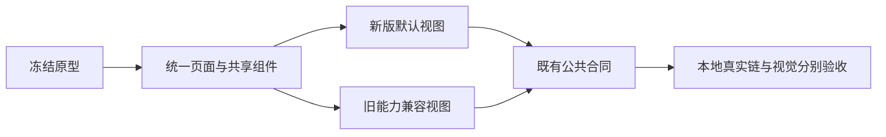
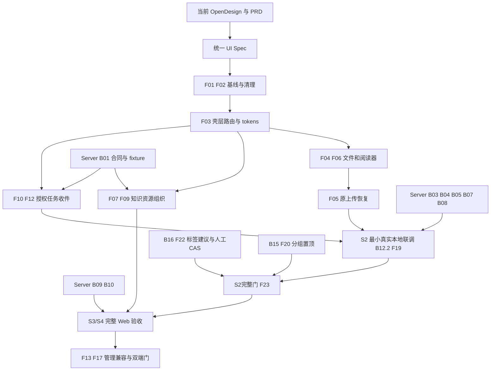

## Context

唯一 owner 为 `cli/drivebridge`，web/server/CLI 为同仓模块；src/tests 相对 web/。OpenSpec、任务工具和统一证据位于仓库根，见 [开发入口](../../../docs/development.md)。

[PRD](../../../docs/web/product/personal-agent-workspace-prd.md) 固定用户/场景/R01–R15；
[UI Spec](../../../docs/web/ui/personal-workspace-ui-spec.md) 固定页面、tokens、控件和状态；
[清理清单](../../../docs/web/ui/personal-workspace-rebuild.md) 固定 owned paths 与删除条件。
这些文件是本包的一部分，以链接维护单一真源。[技术决定 D01–D14](../../../docs/architecture/personal-workspace-technical-decisions.md) 固定现有栈、hash路由/reducer/fetch和合同工具选型；原型采用下节所述最新冻结快照；v39 仅为历史基线。

## 2026-10-07 全站 Web 体验对齐（当前执行范围）

用户确认本轮为全站 Web 对齐和文件/普通笔记、Agent/收件两条本地真实闭环；真实云、Pinax 真实接入、Electron 三平台另验，不以前述桌面 D03 缺口阻塞独立 Web 改进。采用 Open Design MCP 确认后的最新双读快照：46 个实际加载资源、桌面/手机各 15 个导航页及初始页、桌面 Agent 创建弹层，证据 `20261007T153519Z-539b03a2`；这不是完整动态路径或业务通过。产品基线 `20261007T154713Z-ea66209f`；差距与保护清单见 [全站基线](../../../docs/web/ui/workspace-visual-gap-baseline.md)。v39 仅为历史基线，不继续当最新版本。

F87 优先消除主路径重复结构：新版首页/Agent/任务/收件为默认视图，旧观察/授权/传输/收件使用明确命名的兼容视图，仍可操作，不删旧 API 或恢复身份。视图切换复用 Base UI Tabs、共享草稿离开确认，身份范围改变时沿用既有重挂边界。共享页面标题采用18px、桌面控件32px/手机44px；取消外层装饰大卡片，保留必要权限、观察范围与恢复信息。接口缺口只根据真实验证补齐，不复制领域实现。

### F91 导航、共享壳层与移动恢复

主导航统一首页/任务/Agent/存储名称，不改 Page ID、canonical/alias、表单字段或权限筛选。手机去掉重复工作空间前缀，主题切换保留在导航抽屉；页面动作移回内容区，顶栏保持48px。`WorkspaceViews.actions` 可选槽不放入 tablist，不改选择与草稿保护。存储页采用共享标题。删除 `finder.css` 中旧绝对定位传输条遗留的90px面包屑占位；用 mobile 条件挂载用量入口，避免760/767媒体切换竞争时与桌面入口重名。AppDialog/AppSheet关闭触控至少44px。

截图检查暴露搜索窄屏按钮组超宽与深色说明对比度3.27，已用现有语义token/换行布局修正，新增实测≥4.5断言；不改查询或保存合同。非空旧收件箱没有返回传输记录的入口，现常驻显示，组件先红后绿；原预览/复制仍传同一operation。新增 `workspace-navigation.spec.ts` 覆盖六宽度×浅深×四主要入口、唯一选中、键盘、44px、48px、标题无裁切、搜索浮层内部无溢出/返焦/对比度；不等于所有页面业务通过。

定向证据（`temp/integration-test-runs/20261007T*`）：157组件 `182053Z-3113b89a`；类型/UI `181202Z-9a1863d3`；Vite `181927Z-1252b880`，旧大chunk警告保留；搜索/六视口/兼容4browser `181941Z-f3f9f36d`；浅深设置与旧内容能力降级2browser `181418Z-ff0bfd2c`；真实team fixture表单/权限2browser `181502Z-25e8ac59`；共享表格/命令搜索2browser `181542Z-d5826985`；容量/旧布局6browser `175915Z-67acedba`。LSP9路径7clean2inconclusive，类型检查补证，不冒全LSP clean。保留失败证据：`173537Z-b2740aa0`名称先红、`174358Z-648f0fa9`触控、`174750Z-cb86ea67`标题占位、`180427Z-0cff9e06`搜索溢出/非空返回、`180857Z-e1a27ec8`返回组件先红、`181830Z-566447b0`对比度；`181202Z-be139be6`旧断言分别按Pine侧栏规则与元数据独立能力修正，没有恢复错误产品行为。

### F92 普通笔记阅读布局

KnowledgePage取消重复外框，来源与扫描数量保留；目录筛选/说明用默认收起的原生disclosure，不重复读取。NotebookWorkspace/Document/Directory对齐阅读surface、紧凑行及44px手机操作；文档大纲为独立默认收起按钮，保原章节details、窗格作用域、标题聚焦和hash。没有更改文档保存/恢复接口、固定版本、草稿策略或Pinax边界。

实测先红：`20261007T183258Z-e9b219b7`320px文档起点356px；修后要求≤300px、文档高度≥450px与标题≤400px。96笔记组件 `185347Z-86c5faab`；type/UI `185347Z-0f1a1a11`；build `185347Z-692e5d9e`（原大chunk警告未扩大结论）；三条真实fixture浏览器 `191233Z-a8d5ad85` 覆盖上传固定读、保存差异/冲突、六尺寸浅深、键盘大纲定位及resize/theme零重取。已看320浅色/390深色与桌面图。LSP4路径3clean/1inconclusive，不称全clean。

保留失败材料：`185443Z-2159359c`有一条在进入笔记前等待上传结果超时，确切原因未完全确认；全局hidden input在网盘首页也存在，测试现改从用户可见上传入口选择文件，并断言POST的space_id等于新选空间。重复验证暴露同名测试空间冲突 `190959Z-5cb84b52`，用repeatEachIndex隔离；修后5次 `191056Z-6a6e0ba3`与完整三条重跑通过。不以重跑证明原超时根因已确认，不改上传业务。

### F93 文件目录、工具条与列表

复用Finder、目录adapter和现有Sheet，手机不再把目录树堆在文件上方；四种视图经菜单切换。单一文件列表保持挂载；桌面目录偏好与手机抽屉分开，关闭/选目录返焦。最窄320px不溢出，主控件44px；桌面约36–40px行，手机长名最多两行。checkbox hover/focus规则对齐实际Base UI节点。文件键盘命令只处理列表或列表容器自身，不夺工具条或独立按钮的Enter/Space，也不重复处理defaultPrevented事件；无新传输/权限合同。

先红材料：`20261007T192117Z-2e4f2953`320px内部溢出；`193628Z-8be68ace`目录Enter被文件快捷键夺取，`20261008T021433Z-996adffc`组件复现后修复；`021554Z-d8715f25`为测试用role定位被正确的modal无障碍隔离隐藏背景，几何检查改DOM定位；`022326Z-85408db2`视图菜单退场瞬态导致未限定menu双匹配，helper等待真实关闭；`023054Z-25f11a37`手机旧32px断言及知识库hidden-input上传同步问题分开修正，不改业务。

47组件 `022245Z-d59791cc`、类型/UI `023054Z-8519751a`、构建 `022739Z-005d2e6d`（旧大chunk警告）；六条浏览器 `022845Z-6599984a`覆盖六尺寸浅深、44px、长名、抽屉宽度/返焦/真实触控、四视图与安全HTML；13兼容 `023236Z-6b52cdc0`覆盖真实本机owner启停、上传版本/原operation恢复、固定引用、分享撤销与知识笔记。LSP5路径3clean/2inconclusive，typecheck补证。截图已复查320浅色、390深色目录和1440桌面。此批仍不关闭整体files-notes-ui或真实链任务。

### F94 文件预览外壳与安全阅读器保护

FilePreviewDialog提取展示状态，保信息/reader在同一React位置，未修改读取/属性/标签/版本/复制服务合同；手机标题与动作两行，1280以下默认信息覆盖关闭，桌面360px且正文≥640px。面板覆盖时正文inert；嵌套弹窗、覆盖、预览按Escape分层关闭并返焦，缩窗隐藏字段返焦。移除workspace-layout旧grid行/位置规则，不层叠补丁保留220px空白。外层方向键不夺笔记页签、contenteditable或嵌套弹窗。预览笔记保持原只读，编辑仍走知识库。

先红：`20261008T023942Z-85fb8cb5`320标题不可见；`024809Z-8268985f`实际220px空行；`025146Z-e6714b3c`笔记ArrowRight错切外层文件（已用第二文件反例复现修正），其余是resize状态同步/iframe焦点旧测试假设；`025736Z-ff6336eb`隐藏信息字段焦点；`025928Z-70086fd3`CSV未等首上传完成就再次设置隐藏input，改可见入口与顺序等待，未改传输；`030528Z-b9574f1a`缩窗测试聚焦已收起disclosure，改聚焦稳定信息关闭按钮。上述失败保留，不混同全部产品缺陷。

验证：98笔记/外壳组件 `025505Z-0d96e273`、65预览/属性组件 `025843Z-8065596f`；type/UI `025843Z-a3eeb722`、build `025843Z-3e98d73f`（旧chunk警告）；13browser `030300Z-a0e17621`包括属性默认开启fixture中的原键丢响应恢复/旧版本/引用权限、标签子集、PDF中文/损坏/密码/失权、CSV/XLSX/HTML隔离及笔记；六尺寸浅深/触控/缩窗返焦与零正文重取 `030758Z-21dd21d8`。LSP4路径2clean/2inconclusive，不声称全clean。已复看手机浅深和桌面图；不关闭全站或两条完整业务链。

### F95 非空信息页面与独立搜索

正式search改为独立SearchWorkspace，与命令搜索共享同一能力读取/显式重试，不叠加上传整理交付。旧flows深链保留。资源/集合/属性压缩重复大卡片、标识进详情、动作保完整accessible name；首页长集合名左对齐两行，完整名称可读。共享标题保最小换行基准，Combobox尾部取消负边距并增手机44px触发区。固定引用、原请求恢复、草稿和权限未改。

先红：`20261008T031617Z-b4ddbd9c`正式search仍叠流程；`032616Z-3ed18691`与`032800Z-d315bc2b`首页320内部溢出，`033105Z-e6750c56`截图证实标题竖排/选择器尾部越界；`033759Z-84d8747a`非空搜索深色对比度1.179。改用语义结果面后≥4.5。几何通过不代表视觉通过，已查看首页320、资源390深色、集合1440、搜索320深色并补对比度断言。

307组件 `033845Z-64874443`；type/UI `034607Z-20164707`；build `033845Z-c4e81c1e`仍有原大chunk警告；9browser `035118Z-d221ebf7`（真实owner搜索/首页与覆盖/故障/分页显式替身分开）；团队表单 `035209Z-3a1deeb2`；10browser `035357Z-c3fe6412`含非空信息五页六尺寸浅深、固定引用/正文返焦、资源/集合/属性恢复、笔记和共享导航。LSP6路径4clean/1inconclusive/1误报；useComboboxAnchor实际调用React.useRef，规则漏命名空间，已按误报记录，不改名。

`034607Z-4b2cfa6c`组合执行被外层240秒超时中断且无完成回执，不算通过；残留本轮33988 fixture导致`035051Z-bc65684f`端口冲突。确认PID后只停止本轮三个子进程，使用33989拆开重验通过；未动其他既有服务。文件/知识/信息页面前端阶段收口，后续Agent/管理前端和两条完整本地业务链继续，不混同后端与全站验收。

### F96 Agent卡片、调用观察与刷新返焦

复用GrantOverview/AgentInvocations/原授权弹窗，短动作文案保完整accessible name；长名两行、目录完整断行、44px手机两列/32px桌面三列。时间筛选默认收起，保原日期/时区/高级互替合同及未应用输入，已应用边界不藏入折叠。修正“分组创建入口迁移中”的过期说明，指向既有管理分组。

先红`20261008T035926Z-88296c84`320长名按钮溢出；改布局后`040328Z-af95716b`实证关闭管理授权刷新卸载原按钮丢焦点。现用非秘密grant ID/动作的ref映射，在新列表挂载后返焦，目标移除/列表错误回刷新，context/失权清候选。三组件反例验证同节点替换/移除/503不写业务。`041134Z-2d1ef439`触控默认入场缩放瞬态43.07px，断言改等待稳定≥44px，不降低标准或关掉动效。

130组件`041042Z-b8bf9e91`、type/UI`041042Z-4edb7393`、build`041105Z-f37d5235`；9真实授权/分组/组织/轮转/期限/原键恢复browser`040646Z-53a91af3`；调用/时区/排序与组织/导航5成功见`041134Z-2d1ef439`；最终`041246Z-09809bb5`非空六尺寸浅深、首屏记录、筛选展开/草稿、四弹窗返焦、真实触控default motion、零UI写和原grant/invocation回读通过。LSP6路径全部clean。已看320卡片/1440双列、390深色调用及触控展开；secret仅fixture词法内存，截图仅安全状态，无真实云/race/发布。整体Agent/管理与两条完整业务链仍待。

### F97 任务与收件列表/详情

长ID不再重复进入动作按钮可见文本，accessible name及正文原身份保留。七项进度仍显示原数值/未提供，网格仅调整密度；观察时间/revision折叠，收件授权/上传/归档细节按需展开，认证身份/固定版本/决定常驻。任务详情使用既有AppSheet440px/手机全宽、键盘调宽，OperationTaskDetail/BatchTaskItems取消重复内框但不改读取/轮询/恢复。收件决定/归档刷新后按ID返焦，列表移除/503回刷新，失权清候选；纯文本reader保持不可信内容转义。

先红`20261008T041820Z-52fc59e6`320长ID按钮溢出；`042317Z-5384b107`5条通过/3条失败：两处旧定位把portal详情当列表子节点，一处仍假设新投影与旧历史同时挂载。改从侧栏定位、嵌套Escape回父弹窗、显式legacy深链切换；所有原版本/进度/隔离断言保留，三例`042659Z-e21060ea`通过。

118组件`042930Z-d7a65401`含收件刷新目标保留/移除/错误返焦与原AppSheet；type/UI`042930Z-e7fa91f0`；build`042954Z-335e45ea`旧chunk警告；7browser`043037Z-5a4f6013`六宽度浅深/触控默认动效/440与调宽/安全文本/只读回读，原批量和双Agent撤权、原版本/偏好及计划观察；`043149Z-3a29bd6d`两条真实归档故障resume和拒绝丢响应原键恢复。轮询失权/Retry-After/可见性三例也于`042317Z-5384b107`通过。LSP6路径全部clean；看过320任务/390深色收件/1440详情/转义正文图。此片不把只读计划投影升级为执行，不关全Agent/管理或两条完整业务链。

### F98 管理面布局与真实状态

存储连接行复用原callback，状态显示已配置/验证记录/未知/断开，不假称在线；非空删除重复添加卡片但保标题入口。分享复用DataTable、选择/列设置/撤销确认，取消双搜索/双空态，手机名称列≥170px；增加读取loading/error/denied、手动重试、context/卸载abort、迟链接不复制、401/403停止批量撤销。没有改服务合同或静默重试。回收站移除旧file-toolbar/file-row布局，保目录/网格/精确file回调/选择隔离/保留策略与禁永久删除；设置共用标题、左侧桌面大纲、紧凑主题行和44px。

先红：`20261008T043707Z-fb6d1a3a`存储未验证冒称已连接；`044040Z-14e39fe1`分享加载/失权错误空态；`050500Z-92aeb093`链接与批量401/403未清数据/未停止后项。布局测试`044733Z-690a9d97`是alertdialog而非dialog定位错误；`044959Z-552823bf`回收手机32px；`045426Z-7778ff81`全选新增标签改变accessible name，现视觉说明aria-hidden保原名；`045948Z-31e81f48`测试错误解包stat，修为data.file并断言200，不改业务。

27组件`050851Z-7c1d9a8a`、type/UI`050851Z-a49d1820`、build`050915Z-951be184`；9browser`051000Z-9bb32d82`含四页六尺寸浅深、私有同fixture用户分享取消/确认撤销HTTP回读、原版本恢复、资料保存/头像/外观跨会话、回收故障恢复、连接与旧页边界替身及DataTable。截图复查后补修手机名称列过窄并加≥170px断言；深色390最终图复看通过。错误级LSP7路径6clean/1inconclusive，非全诊断clean；旧chunk保留。仅本地合成数据，分享token不出词法内存/截图，未连接真实云/未放开永久删除。自动化操作和Agent配置还须核实，整体agent-management-ui不关闭。

### F99 授权绑定接入配置

`GrantOverview → GrantConnectionDialog → AppDialog/Input/Button/details`：卡片按已读GrantView生成只含占位秘密的MCP/HTTP模板，不新增API或保存token；HTTP文件示例带原空间/目录编码，无files.read只示例能力查询。源地址不允许userinfo/path/query/hash；不静默去敏感字段后换目标。不安装CLI、不注册客户端、不执行网络请求。关闭返来源焦点、context清除，复制异步反馈按地址代次隔离；失效授权模板不恢复权限。完整范围/恢复说明默认收起，保全部身份与服务限制。

组件先因缺文件零命中，随后Clipboard不存在属于jsdom替身问题，用局部stub并还原；不是生产错误。初版六宽度几何通过但截图显示模板被长说明挤到825px，加入≤440px断言于`20261008T053501Z-6a71b1e0`失败，收起说明后`070241Z-1cde25d6`两条配置/Agent六宽度浅深与默认动效触控通过。`070709Z-04ff87f9`142组件、`070709Z-d2ca3738`type/UI、`070220Z-24fee2d0`build；5浏览器`053206Z-c265e96e`含创建/丢响应原键恢复/旧预览指南。LSP曾残留缺文件诊断，与构建不符；新增测试修改后主动重查两路径clean，不冒全树clean。旧chunk告警保留。

### 当前树后端验证（V100/V101）

只使用本地fixture的临时SQLite/HTTP/S3替身，`CGO_ENABLED=0 GOFLAGS=`，通过根`check.py`运行`go -C server test -count=1 -v ./internal/service -run ...`，不启动新长期进程、不改后端、不跑race。V100的`20261008T070806Z-26fb31ec`12项通过：普通文档HTTP新旧版本/幂等lookup/两用户/Agent禁写/CAS、固定版本读重校验、上传原批次/条目/续传/取消/撤权/源重选/会话到期。V101的`070806Z-9bd07ba7`60顶层项通过（子项不重复计数）：期限矩阵/默认权限/创建轮转生命周期与旧端点拒绝、目录与身份绑定、MCP工具过滤、调用保守结果、双Agent收件、固定字节人工决定、归档原操作与故障恢复、数据库重新打开。详细命令及子项在各run六件套；仍不是浏览器首尾链或真实云。

受管Pinax不得从这些普通Server测试推定可编辑；根CLI现有managed_vault_admission测试含旧状态绕过的准入反例，不是已安装防护验收。本轮不新增Pinax写能力，需另核普通笔记入口的只读隔离及本机既有guard。自动化读取/执行合同另需验证，不能借V101给旧自动化全部授权。

### I102/I103 本地真实首尾链

`20261008T072700Z-2e487dc1`8条：新增file-note-loop从正式上传后刷新、原media版本预览、知识库源码/差异确认、新版本到真实commit后丢响应；刷新只用原key lookup，不再PUT，三版本/原operation/旧正文回读，浏览器不存正文，Bob的content/save/lookup均404。既有knowledge-workspace同run覆盖双标签真实409并保草稿。Agent新测试从正式创建表单核默认只读长期、显式增加inbox.submit，真实一次凭据留浏览器闭包（不返回runner/不写window/storage）；关闭秘密DOM后读取新配置、按实际HTTP示例受限读，越目录/文件拒绝；交回正文、调用unknown观察、原任务固定输出、人类预览/接收/归档、正式撤销后原凭据401、刷新源/归档正文与操作关联、Bob拒绝。其余同run为创建限时/丢响应、生命周期/轮转和双Agent独立原键与撤权反例。

`072812Z-c58a2a08`两条归档真实publish故障+原操作resume及拒绝丢响应后原body/key重试通过。测试故障注入只丢响应/破坏本地存储读取，不替代服务端业务。新增失败归因：`071522Z-cba6eb90`监听错content，原预览实际media；`071902Z-63c18a3f`CodeMirror逐行DOM无textContent换行，改逐行完整断言，正文请求和回读仍逐字相等；`072552Z-5c95b5eb`测试漏掉正式状态“尚未归档”，修测试，不删业务区分。

`072905Z-ec176d06`4项本机adopt元数据保护及guard不可用拒绝通过；不覆盖旧状态别名绕过反例或宣称Pinax完整保护。`072905Z-2b4d5016`23项笔记读取/保存/桌面未连接准入组件通过；`072905Z-722163fe`type/UI通过。两新浏览器测试LSP错误级0诊断但2inconclusive，类型检查为当前静态证据。两条核心链有本轮证据，自动化与最终全站仍开。

### B104 自动化安全修补边界（实施中）

自动化是当前管理面fit能力；手机后台备份仍split-owner。本次先修既有应用层而不是搭新执行器。隔离分支`feature/workspace-automation-safety`，工作区`temp/automation-safety-worktree`；因主树server尚未纳入HEAD，将547个当前源码/模块/runner文件复制入隔离副本，不复制数据库/凭据/运行产物。无自动提交、合并、push，回拷前核原文件SHA256；隔离运行只用t.TempDir与临时端口，不和Web 33989共享数据。

反例`temp/automation-safety-worktree/temp/integration-test-runs/20261008T074022Z-0280adf2`确认现时权限遗漏、规则并发CAS双成功、标签/回执/checkpoint非原子、读取失败空成功、回收文件仍执行，历史四绿测试不能替代；旧countIntents固定返回3属验证缺口。本片修复计划：事务内重新鉴权人类/Agent、rule scope与逐文件，空间/规则行锁和expected_revision条件更新，标签/意图/checkpoint同事务且每步检查错误；当前允许的add_label不增加删除/外发/后台权限。

意图现有RuleID列参与新唯一索引`automation_intent_rule_identity`，先建包含rule_id的索引，再仅移除过窄旧索引`automation_intent_identity`；不删除/改写表、列、历史ID或actor/event值。必须有旧行迁移与重复初始化测试、不同rule同事件测试。此索引修正不会恢复被旧去重吞掉的副作用；不回放历史。回滚需停自动化写并保留新数据，旧二进制不能重建旧窄索引或错误串规则。规则启停/新建/手动运行UI在本端验收后再接入，结果未知不自动换键重发。

B104结果：隔离17项`20261008T075418Z-7f671290`通过，含真实旧索引迁移/重复迁移不改历史、两规则独立、同事件重放/并发、CAS、撤权、数据库故障回滚、规则暂停原回读；vet/build为`075826Z-4ea5f03a`/`075826Z-edfe3a9e`。首次修复旧Agent运行失败为GORM复用query叠加条件（introduced），分开构造后`074839Z-ddb336b5`通过；未放宽权限。已核3个原文件SHA256后回拷7文件，无commit/push；主树`080033Z-439f0f1e`自动化/文档/创建/收件/归档回归通过。索引变更仅放宽错误约束，保已有字段/状态/SDK签名，权限收紧是安全修复，不保留越权宽限期。历史状态漂移/被吞事件不会自动修复或重放。

### C105 自动化人工管理增量合同

仅增量新增：`GET /spaces/{id}/automation-management`报告`available`；`POST /spaces/{id}/automation-rules/changes`与`changes/lookup`；`POST /automation-rules/{id}/preview`、`execute`与`execute/lookup`。新入口受`--automation-management`默认关闭开关控制；旧GET/PUT/run不改路径、必填项或响应数组。仅当前scope的有写权限人类进入；旧Agent只能保其原受限运行合同，不能使用新确认入口。

规则变更body固定action=add_label、action_detail、prefix、budget_items、enabled、clear_pause、expected_revision；已有policy_id可保留，UI不扩大未知动作。变更回执复用WorkspaceRequest存original key/digest/rule/revision/time，lookup不重写。预览只读单个规则当前checkpoint后至多200个事件，回显规则修订/checkpoint/扫描与命中数/预算/固定file+version列表及digest，覆盖不足明确partial。digest绑定身份/规则全部安全字段、事件身份与顺序、现时文件版本/路径/删除状态；执行携expected_revision+preview_digest，事务中重算后不一致409，不能自动重算批准。执行与原回执同事务，丢响应lookup只返回原rule/修订/时间，逐项实际结果从既有任务/意图读，不把回执当独立效果证明。不同action的request key互不混用。

不新增表、正文持久化、后台宿主或自动重试；使用既有WorkspaceRequest与AutomationIntent。新规则默认禁用，用户明确确认后才允许一次运行；规则enabled不等于后台执行器。条目预算可配置；字节预算与有效期仅可来自已绑定的现有OrganizationPolicy，未绑定时明确“未设置”，不能虚构期限。前端只持久化key/digest/action/目标身份，草稿不写storage；未知先lookup，未查到不证明未执行，关闭重入保持原键。生成合同来自Go DTO，不手写JSON/schema。

C105/B106/F107/I108实现与证据：Go DTO注册6个增量入口，既有规则/run/SDK签名保留；生成器更新OpenAPI/TS/fixture，`20261008T082802Z-55c5bd5a`生成、`082958Z-907b5586`76schema正反例/`082958Z-11538911`合同测试。默认关闭CLI flag及独立fixture开关已验。新管理HTTP测试初误认为unsupported=400，真实既有映射422，修测试后`082319Z-e72da113`通过；安全合同不改HTTP码。隔离回归`082447Z-a71d629a`及vet`082518Z-ddea5d66`通过。

前端37组件`084225Z-5dd3cc45`：创建默认禁用/确认、只读预览、丢响应重挂只lookup、回执绑定、漂移不重跑、失权/离线/存储清除与Web Locks拒写。真实3browser`085841Z-e49fd1b5`：同规则全链、六尺寸浅深、手机默认动效触控、标签与原版本回读/Bob拒绝、旧任务与管理页面。旧topic自定义namespace仍允许人类原合同，Agent限制不放宽；首次实现误收窄旧namespace已恢复并于`084919Z-856e134c`回归。手机规则元数据两列降低行高，截图复查过，不以几何代视觉。

稳定全量：Web154文件1099测试`085229Z-d957144c`；Server全模块`085229Z-b06bb177`；type/UI`085229Z-e70a3ac3`/build`085254Z-aefe0dff`通过，无race，保留>500kB警告。LSP对AutomationActionDialog测试/automation_management保留新增文件未同步的旧缺模块诊断；对应模块probe/完整tsc/Go全测试已证存在且可编译，不修改正确业务以迎合过期诊断。最终全站汇合继续。

### 审计返工 C110–V114（2026-10-08，已实现与本地验证，提交独立复审）

独立审计不批准上一轮完成声明：收件以ID为主而非真实文件/来源名称；预览仅UTF-8，二进制产物无验前检查路径；204截图含loading瞬态，详情弹层对照不完整。I109通过项保留为局部证据，不再当作目标完成证明。不得删减图片等产物范围或降低稳定截图门。

C110/B111增量增加SubmissionView可选`file_name`/`mime_type`/`size_bytes`/`agent_name`。文件信息来自已鉴权且绑定的原upload operation，非可变文件head；Agent名为服务端记录当前可读名，不将source_claim升级为认证。旧字段、URL、状态与恢复身份不变，无数据库迁移；旧响应缺字段显示“名称未提供”。DTO生成器更新schema/TS，不手写机器产物。后端继续同一隔离worktree单writer，回拷前核原文件摘要。回退只需回退展示字段与新UI，不改历史数据。

F112复用已有安全reader，原submission/file/version绑定经服务端重查后才打开。文本继续转义；图片/PDF/音视频/表格用原reader；不自动生成转换衍生物、不启用HTML交互脚本。不支持内嵌的格式提供原固定版本受权下载，下载前重鉴权；失权/context/offline清除当前内容。不以当前head取代提交版本。I113真实PNG等产物上传/检查/决定/归档回读，V114固定本地原型补参考与稳定态截图/逐弹层矩阵。

返工验证与实际缺陷修复：

- 合同：四字段均optional增量，Go DTO派生schema/TS；`20261008T134558Z-3f799a7e`无漂移、`134600Z-d60056b8`76schema正反例通过，不冒充endpoint。
- 后端：隔离worktree原operation的space/grant/Agent/purpose/owner反例、foreign scope/tenant/DataOwner与作者缺失/别属验证`123812Z-b7678d38`；核diff后回拷。主Server全模块普通测试`124821Z-ee3e4959`通过，vet/build`130746Z-3b0950dd`/`130748Z-7225c7b9`通过。中途180秒外层中断无完整receipt，不算通过，之后使用充分预算复验；无race。
- 前端：`readSubmissionFile`验证最新submission/ref、固定版本与context lifetime；`downloadSubmissionFile`先重鉴权。修复真实反例“下载清掉解码错误，显示空文件”（`114900Z-c0745c83`红→`114942Z-e13d945f`66绿）。独立正文/下载错误、HTML转义、错误版本/外部URL拒绝、权限/context/unmount迟回包等组件覆盖。
- 真链：最终构建`140404Z-b6b40e0d`6条业务/布局通过（含此前`135219Z-0fbe2e40`4条场景），文件上传/原版/保存差异/实际提交丢响应原键回查；官方Agent模板真实Bearer调用（omit human cookies）、收件/任务/验收归档；320×180 PNG、中文双页PDF、非UTF8 bin原字节下载回读、版本漂移原图仍可检查但人工决定409、拒绝保留/撤权/Bob拒绝。测试header中的Unicode导致请求构造失败、PDF缩放太小像素阈值、已有目标空间选择等均归因测试环境，不降低服务安全。
- 全站：`140335Z-8cebb779`204个明确终态观察，六宽度浅深，无loading/溢出/页面异常。不得与写入suite共享空fixture：`134558Z-f15cfbc2`3真链通过而空首页断言失败，独立重验解决，不放宽空态。18条非空/详情/弹层/授权/自动化/触控`130746Z-553b338f`通过；分享最后输入/按钮及复选框label44px修复包含在`140404Z-b6b40e0d`，真实切换断言通过。
- 冻结参考：只读资源28终态补拍`134859Z-b3a1c23b`；旧补拍history/activity/links/task-plan加载瞬态不采纳。手机任务从详情图标进入，不沿用桌面文案定位。矩阵17页+35详情/关键弹层，图集`140543Z-2c1dd519`227有效图片链接；搜索独立两宽度，分享缺原型明确保留既有能力而非假同构，文件活动收敛真实版本/任务/调用、Pinax反链不冒充已接入。
- 看图/交互修复：资源登记关闭刷新后ID稳定返焦，失败回刷新，用户新焦点不抢；存储和分享手机输入/按钮44px。笔记补拍等待ResizeObserver内宽提交再切侧栏，避免按旧aria状态误关（`135006Z-dd7ae3c3`失败→`135219Z-0fbe2e40`通过），不改产品断点。
- 当前全量：Web155文件1120测试`140400Z-4ce0dd4a`、type/UI`140335Z-a30ed9d2`、build`140246Z-6c6cef92`、比较脚本6测试`135430Z-25c637cf`通过。原2020保护路径仍存在；路径保护不是内容质量证明。9路径LSP6确认clean/3未确认，最后5路径4确认clean/1未确认，不称全树clean；>500kB chunk警告仍在。未提交/推送、未触真实账号/付费/远端写原型/部署。

所有短run均前缀`20261008T`，证据位于本owner `temp/integration-test-runs/`。本节不宣称整包OpenSpec/原生/Pinax/云端/发布完成，旧目标9/9与I109不是验收依据，最终整体结果交独立审计。

### I109 视觉、兼容与首尾链汇合（审计未批准整体完成，以下为历史分片证据）

本轮范围为全站 Web 与两条本地真实链，不等于原生、Pinax 或发布完成。17页×6宽度×浅深主题204个当前树观察全部覆盖、零横向溢出/页面异常，证据`20261008T104422Z-2864b33f`；非空列表/详情/弹层、44px触控、键盘与reduced-motion等17条汇合`103025Z-2c0b5f33`通过。逐页处理/合同/测试与冻结原型对照由`workspace_visual_baseline.py`生成到原[差距矩阵](../../../docs/web/ui/workspace-visual-gap-baseline.md)，不另建任务账本；HTML图集本地图片链接校验100个无缺项。初始页截图不替代非空或业务证据，原型缺独立分享页截图明确记缺，不伪造对照。

最终关键修复：

- `093922Z-0531d715`发现长文件任务行413px；两行标题保title与完整披露，≤340px严格断言不降低，额外长名fixture保证独立复现。
- 同轮搜索关闭后抢导航；加强两帧稳定聚焦断言，`094341Z-e2b7bf32`重复6例中5红。关闭后仅在body未被其他控件接管焦点时补返焦，`094646Z-e19918e6`6/6、最终汇合通过。
- 团队手机顶栏145px挤正文，租户选择器手机移入已有工作区Popover、桌面不改；48px断言和全权限/管理入口保留。`103650Z-52a096bc`7条兼容通过，未隐藏管理能力。
- 普通拖拽立即沿用未清理的newVersion状态导致冲突；`101231Z-dd688f88`固定“服务端提交后响应尚未返回”时序先红。picker同步消费并显式传resume/version，普通drop默认无替换目标；同一文件仍2个版本，新文件独立，原续传不改。`101618Z-3559f9e4`3条及最终13条通过。
- 旧自定义topic namespace被前端白名单误拒；`102817Z-2f480eda`反例先红，保留原namespace/目录/动作身份，只改启停/预算，不扩Agent权。38自动化组件`102911Z-4ea3b4fe`通过。

最终验证：Web154文件1100测试`104422Z-0a915228`、type/UI`104432Z-2c090a7d`、build`102939Z-8d6bac98`；Server全模块普通测试`085229Z-b06bb177`及vet/build`100439Z-b7c6dbed`/`100441Z-c04306cb`通过。13条两真实链/版本-拖拽/授权/两Agent撤权/自动化回读`103332Z-f6c55249`，归档事务故障/原operation恢复和拒绝原键恢复2条`103429Z-290ccfeb`，资源集合属性搜索/安全阅读器30条`101654Z-de846baa`通过。76schema正反例`103543Z-44750938`、personal-workspace漂移`103541Z-64a511a4`通过，非desktop合同门。

失败归因保留：个人Key不可混入team-demo，独立`095518Z-251d3fa6`通过；账号接管受其他测试分配职责污染，干净fixture`095526Z-4864b10d`通过，不删接管确认。旧收件/Agent定位改显式兼容tab；desktop36px/56px侧栏按现行合同，不降低手机44px。Agent按真实响应查置顶顺序而非跨分组DOM排名；懒加载以Key专属筛选就绪避免匹配旧用户行，`102618Z-47a89c06`通过。修复中route.fulfill被提前unroute属测试时序，等待路由完成后再解除，不改业务。

安全/质量复核仅对本轮路径：鉴权/CSRF/目录交集、原键与digest、CAS、事务/回执、撤权迟包、秘密生命周期、内容转义与阅读器隔离均结合反例测试复核。未进行全仓渗透或CVE扫描，不能代替专业生产安全审计。保持现有依赖栈，无race/真实云/付费/提交/推送/发布。LSP当前7路径6clean1inconclusive；自动化新增文件曾保留旧缺模块诊断，完整编译测试通过但不冒称全树LSP clean。>500kB chunk警告保留；backend隔离worktree留存未提交成果，不强制清理用户工作。

### 当前合同映射与实施顺序（开工截面；完成证据见上文）

本轮不新增替代文件库、授权模型、任务状态或恢复协议。`server/internal/contract/routes.go` 为登记合同，`server/internal/service/http.go` 及 document handler 为运行入口；两者必须分别检查。生成真源继续为 Go DTO，产物为 `contracts/personal-workspace/` 与 `web/src/generated/personal-workspace.ts`。实际源码已经具备下列合同，接下来的 BACKEND 任务先跑定向验证，仅修实证缺口；仅有 schema 不视为后端通过。

| 用户动作 | 已有合同 / 调用方 | 关键状态与本轮验收 |
| --- | --- | --- |
| 登录、上传、刷新、预览 | 既有 session/CSRF、uploads/operations、files/stat 与 `content?version=`；FilesPage/Finder、安全 reader | 上传已发送不等于已发布；刷新核同 file/version/operation；旧传输恢复仍可达 |
| 普通 Markdown 编辑 | `GET files/{id}/document-capability`、`PUT document`、`POST document/lookup`；`features/notebook/document-client.ts` | `base_version_id` + `Idempotency-Key`；差异确认后写；409 保草稿；未知先原键 lookup；旧版正文仍能读，不改成最新版本 |
| 创建与维护 Agent | `agent-grants`、create/rotate/change lookup、revision PATCH/revoke；`features/agents/grant-client.ts` | 默认 files.read 与 never，duration 六档；单 connection/space/prefix；secret 仅内存一次交付；检查不等于调用，恢复不重新签发 |
| 受限实际调用与观察 | `/mcp` 与 HTTP 公共入口、`agent-invocations`、`workspace/tasks` | 测试客户端用独立 Bearer、无人工 cookie；回读同 Agent/operation；两用户两 Agent、越目录与撤权反例；原任务结果不编造 |
| 产物接收、拒绝、归档 | `inbox-submissions` 创建/分片/完成、decision/archive、operations/get/resume；`features/inbox/submission-client.ts` | submitted 不等于 accepted；拒绝保留原文件；归档核原键/原 body/原 operation 与目标固定版本；202 仅受理 |
| 其余信息工作台 | 既有 resource-descriptors/checks、collections/snapshots、property-definitions、file-queries、saved searches | 复用固定引用、分页/预算、显式人工修改与原回执；前端不得执行资源文件或批改 YAML |
| 管理与能力 | 既有 capabilities/check、automation-rules、connection、trash、sharing/settings | 页面读能力不自动探测；人工自动化由C105–I108补齐，默认关闭、预览/确认/原键回执；原生备份不据此关F15，永久删除不开放 |

准入沿用 PRD 账本：Web 与普通文件/Agent/收件为 **fit**；Pinax 笔记身份、外部生成和原生宿主为 **split-owner**，只消费公开合同；复制原型内存业务状态、假在线/假进度、前端持有 token/领域数据库为 **reject-now**。初始复用阶段不添加稳定字段；后续实证缺口由C105按增量合同补齐，先更新owner DTO再生成，不手改schema/TS。

实施与验收依赖：CONTRACT 当前映射 → FRONTEND 壳层/页面组件 → BACKEND 已有服务实证及必要修补 → INTEGRATION 两条完整路径与六视口浅深主题。前端留当前 checkout；若需新增后端实现，另隔离分支/工作区及临时数据/端口，禁止覆盖现有 dirty 工作。本轮前端验证使用既有 Vitest/Testing Library；跨端只使用明确的 INTEGRATION 验收，不把组件替身提升为真实流程。

本地数据复用 `server/cmd/drivebridge-fixture`：可丢弃 SQLite、平台存储与 Alice/Bob 身份；每个场景创建专用空间、文件及 Agent，不使用个人 vault 或真实云。既有 `knowledge-workspace.spec.ts` 可覆盖版本与冲突，`grant-create`/`grant-lifecycle`/`agent-invocations`/`submission-isolation`/`submission-inbox` 可覆盖授权及收件分段；需在当前版本重跑并补首尾关联，不能拼历史通过冒完整闭环。敏感步骤关闭 screenshot/trace/video，截图只在秘密已清除后进行。

当前验证：F89 的资源/集合/属性标题布局定向 285 组件通过（`20261007T172210Z-be0784bd`），type/UI `172351Z-4a5b6ad0`、build `172248Z-37c8f4b8`；6 个真实 fixture 浏览器场景与双端路由检查 `172351Z-1de9188e`。首轮属性文案断言失败 `171557Z-77797aaa` 已通过恢复明确“使用次数尚未提供”修正，未放宽测试。personal-workspace 合同漂移检查 `172718Z-781045e3`、70 个 schema 正反例 `172718Z-26410e0c` 通过；均是定向证据，不代表全站验收、桌面合同或实际服务全部通过。

## 2026-10-01 桌面阅读交接

Electron已由用户选择，新包 [drivebridge-desktop-knowledge-reader-v1](../drivebridge-desktop-knowledge-reader-v1/design.md) 消费本包F06/F07/F09的共用阅读基础，D05只补Pinax来源适配。Pinax首片只读，F07.2普通文件编辑不变；受管范围禁文件写旁路。F18.2保留移动/相册/后台等原生需求，桌面宿主交D06/D07与三平台D10，不能以Web测试勾选。新的阅读D09独立，不等待F17或全部Agent/团队任务；原F/B状态和历史证据保留。

## F86 收尾与主路径重新评估（2026-10-07）

用户指出推进过于机械后停止继续拆同类外围任务。此前留下的RegisterResourceDialog改动已完成定向复核：未提交名称/固定目标/空间/类型变化接route guard与beforeunload，关闭需明确丢弃；unknown领取原键后不当未提交草稿，offline/context/storage强清字段与保护，初始离线拒用。13项组件20261007T062828Z-52bbf111、UI/type062834Z-79e3823f通过，LSP error级1clean1inconclusive。首红为20261006T181321Z-135abb9c。没有新增browser证据或重build；Webdist仍F85，不能以本片宣称资源页真实集成完成。

停止用外围修补代替桌面交付。D03复核20261007T063031Z-99421e4e三项真实临时fixture通过，证明的仍是另一state可绕过原adopt登记、未知新表不能阻止旧writer，以及登记读取故障failclosed；不是managed保护验收通过。Preflight仍只有blocked路径。下一关键决策是旧writer保护域与可执行隔离方案，不能默默放宽要求或安装系统服务，亦不应继续无限追加草稿小片掩盖主链不可达。

## F85 / F85.1 属性字典草稿离开保护

PropertyEditor复用既有dirty（完整baseline与draft比较）且无record注册F83 route guard；新增字段、改显示名/分组均保护，撤回baseline或删除新增字段解除。PropertiesPage主动space变化/refresh确认先于setChosen/setAttempt，不改原保存、receipt、CAS与类型/key迁移禁用边界。未知结果已有原key不冒unsent，强制offline/context失效清稿不受确认阻挡，零正文/定义持久化。

首红20261006T180431Z-8391f50e五例证实未注册guard/主动刷新切space无确认。最终49组件180538Z-09eae670（含sidecar与scope回归）、UI/type180544Z-8b727f17、build180703Z-74a1a9e2、真实properties浏览器180738Z-4f5d5368通过（均20261006），六件套核验。组件含干净/撤回/新增移除/确认/unknown解除、强清、程序触发背景refresh取消保稿零GET/批准、controlled空间选择取消不改value不请求新scope；不声称人在modal打开时可穿透背景。

浏览器真实新增定义预览→hash离开取消保原差异零PUT→批准离开关闭草稿且恢复槽为空→重进读原空字典→重新编辑并真实提交丢响应→原lookup→并发冲突/权限链回归。只离开未提交草稿不擅自保存。LSP error级3clean1inconclusive，strict/diff通过，旧大chunk提示保留。WebdistF85、desktop旧，未覆盖所有创建表单/退出登录/内部预览关闭或全站视觉；D03不变，无race/真实账号/commit。

## F84 / F84.1 集合创建与页内离开保护

CreateCollectionDialog将既有dirty（名称/规则条件/非默认sort）且无record接F83 route guard，manual/rule复用同一入口，不新增草稿存储。Collection页主动切换space（仅实际变化时）和刷新列表前调用同一确认，拒绝不setChosen/setAttempt、不丢dialog或发新GET；批准才按旧流程remount/清表单。失权/offline清理仍直接执行；unknown已领取原key不当未提交草稿，原lookup/重试/CAS不改。

新增组件覆盖manual/rule空表单不拦、条件单独dirty、确认页拦、网络丢响应unknown解除、unmount/offline/context清guard；真实创建dialog背景刷新取消/批准（程序事件测试，未宣称人可穿透modal）、共享guard拒空间变更时controlled input仍原值且零新GET、批准/clean切换继续。真实rule-create浏览器新增名称+两规则hash离开取消保值→批准离开无POST/恢复槽→重新进入空表单→按原业务创建，原提交丢响应查回执/动态成员及权限链保持。没有跳过规则或从本地恢复正文。

首红20261006T175458Z-a29d6de5四例证实创建未注册route guard；第二175832Z-f7f748af是将combobox input误用textContent断言，按实际value修。最终62组件175935Z-93078ce4、UI/type175638Z-be730960、build175942Z-3eb0acd1、两条真实browser180014Z-0a216fb4通过（均20261006），六件套核；strict/diff通过、LSP error级4clean1inconclusive，原>500kB chunk提示保留。WebdistF84，desktop旧。

仅集合创建/成员关联的导航及集合列表主动操作；属性字典、其它表单、退出登录和其它页内部跳转仍待覆盖，不把只读snapshot观察当已编辑草稿。无race/真实账号/commit，未扩Pinax正文权限。

## F83 / F83.1 hash离开确认先于范围切换

盘点发现ScopedWorkspace父级hash监听可能在WorkspaceApp确认前setDataContext并卸载草稿；正式navigatePage/openDrive还会先直接setPage。新增app/route-leave.ts内存布尔/message注册，useLayoutEffect注册清理，零正文/身份/token持久化。ScopedWorkspace在hashchange capture阶段先统一window.confirm，取消则保history.state恢复accepted hash并stopImmediatePropagation，不变context、不卸载、不让子页读取新scope；批准后才走原路由/scope。复用既有原生确认，不新增保存或恢复引擎。强制drivebridge-context变更仍立即重挂页面，不允许草稿阻塞身份隔离。

WorkspaceApp笔记/文件属性dirty接共享入口，删除重复hash确认和主导航提前setPage/setSpace；aliases/tab由原workspaceRoute统一解析。已批准但同页仍挂载的草稿不直接清dirty，后续离开仍受保护。CollectionMembersDialog仅未领取原key的unsent差异注册；unknown/已提交恢复不冒未提交draft，beforeunload保持F78。此片只覆盖三类已接草稿和hash导航；不宣称所有创建/规则/属性定义表单、页面内部切space/预览关闭、logout或直接context修改都有用户离开确认。全站接线仍有后续，安全失权清理不受影响。

组件首红173939Z-eb78bd0b是测试缺jest-dom matcher，174024Z-7528e12f是假定personal drive等于managed scope；修为DOM原生属性与真实路由语义，未改权限判断。最终60组件174923Z-7cfc5b52、type174131Z-913b23e7、最终build174930Z-15ce7508、三browser175004Z-d469dc14通过（均20261006）。单独browser首轮174444Z-d7d5797b端口占用属environment，未停止或复用未知进程，改32987后通过。保留既有>500kB chunk提示。

真实集合链新增同scope切files、跨tenant/managed hash取消：URL回原collections、原差异/对话框保留、零成员写；原beforeunload取消、提交后丢响应reload原key恢复及权限链回归。知识库原侧栏离开取消/真实保存与冲突回归；文件属性默认gate-off链通过，不冒enabled属性全矩阵。批准跨scope切换/同scope仍dirty/强制context不弹确认在组件验证，浏览器未新增批准跨scope丢弃矩阵。六件套核，LSP error级6clean1inconclusive，strict/diff通过。Webdist更新F83，desktop未重打，非全站视觉/所有表单验收，无race/真实账号/commit。

## F82 / F82.1 回收站读取状态与安全重读

盘点确认回收站已有正式TrashPage、原restore/batch restore/trash-policy owner和禁止永久删除边界，不新增重复服务。缺口为WorkspaceApp refreshFiles仅设置全局短暂error，TrashPage在初次loading/error时可能显示空成功，重读失败可能留旧记录/选择。本片增加与space+page绑定的fileRead状态，沿既有request token与view身份判断，仅当前请求可写状态。回收站请求开始清旧files/picked/selected/versions，失败持续error并清旧数据，成功才ready；非可用空间显示unavailable。普通文件页只记录状态，不改原展示/选择行为。

TrashPage必传readState/onReload；非ready隐藏旧行、计数和空成功，禁批量恢复；loading/失败/不可用独立文案，失败不冒空库。新增显式“重读回收站”，使用原GET和act错误处理，loading/busy禁重复触发。只有ready可以显示空回收站或无匹配结果；不新增永久删除、hold或自动重试，不更改服务端保留政策。状态不能替代当前owner授权，最终restore仍原服务裁决。

首红20261006T141033Z-c84ca573三个非ready状态仍暴露旧行；最终16组件/选择/history测试141138Z-043e23b6、type141143Z-64295fec、build141254Z-14367367、真实browser两链141328Z-421a5035通过。新链真实上传→trash后，只对列表GET延迟/abort模拟网络故障，不mock成功；加载不报空、错误不报空、手动真GET恢复、勾选后再次失败清行/选择、重读不复选，观察阶段零mutation。原trash-batch跨space清选择与双文件批量恢复回归。四路径LSP clean，六件套核，既有build大chunk提示保留。

WebdistF82，desktop旧。F21.2父项未关：hold展示/操作及全部权限恢复矩阵仍需独立准入和验收，未将本片当全回收站/全站视觉完成。无race/个人账号/commit。

## F81 / F81.1 正式调用记录服务端排序

AgentInvocations新增共享SelectAdapter排序选择，默认legacy省略order兼容原服务；用户选择“开始时间最新优先”才发送B67/B68 order=started_desc。切换清items/cursor/next并abort旧页，保留已应用日期/高级时间与result；续页和result切换仍带order，切回legacy省略而不是发送空字符串。不在前端sort或按Date.parse毫秒重判纳秒顺序；原服务端投影顺序直接显示。错误（包括旧服务400）清列表并明确不会自动放宽条件，不隐式退回legacy或去掉时间。权限/离线/scope处理不变，排序纯会话且只有GET。

首红20261006T140231Z-953c36fa缺排序控件。最终47组件/parser测试140614Z-1efda739（含旧服务400零自动回退）、type140319Z-52c44dfb、build140451Z-22374188通过。真实browser双链140525Z-5bb92f0c：新增fixture连续三个独立Agent HTTP调用、逐次查出新原ID，正式页legacy显示ID序→日期范围→服务端返回顺序与调用原ID逆序相同→UI原样显示→result=denied仍保order且空；观察阶段零写。原日期UTC/纽约23h25h/圣保罗缺午夜及高级条件链回归。组件验证pending旧cursor abort、迟包不混入、date保留、新cursor带排序、切回清cursor；真实多页/纳秒tie由B68服务HTTP证据覆盖，本浏览器只有3条不冒50条跨页。三路径LSP clean，构建旧大chunk提示保留，六件套核。

WebdistF81，desktop旧。F10.3的时间/日期/排序片完成不代表完整调用详情、资源/operation可信关联、全部视觉和三平台完成；父项继续。无race/个人账号/commit。

## F80 / F80.1 调用观察日期半开筛选

正式AgentInvocations新增共享Input原生date控件、UTC/本机时区显式选择。默认UTC，local明确显示Intl时区名；开始日零点包含、结束日次日零点排除，消费B65/B66 started_at_or_after+started_before。invocation-dates.ts先核有效日历日期，再推进UTC日历得到下一民用日并独立解析所选本地午夜，不固定加24小时、不减毫秒；Date本地重复午夜采用较早瞬间，跳过/调整午夜按字段回核拒绝（包括结束日），四位年份越界拒绝。只支持UTC或当前本机时区，不冒任意IANA选择器。旧高级时间点表单继续started_after开区间；两表单只显式应用才替换bounds，绝不同时传两个下界；UTC回显含边界类型和实际应用时区，清除一并清日期草稿。仍纯内存、零业务写，复用原cursor/result/权限处理。

组件首红20261006T135020Z-729c006f两个新增日期入口断言失败；最终45组件/parser测试135112Z-61025eab、type135117Z-0ddbbd78、build135233Z-75b4d6a4、真实browser135305Z-8bb0b0bc通过，六件套核。真实HTTP Agent观察→正式UTC日期查询包含原ID且无legacy下界；纽约浏览器2026-03-08生成05Z→次日04Z共23h、2026-11-01生成04Z→次日05Z共25h，均真实owner响应；圣保罗2018-11-04午夜不存在时提示并零新增请求/保留旧列表。原高级时区/范围/result/零业务写回归保留。五路径LSP clean，构建既有大chunk提示保留。

Webdist更新F80，desktop仍旧。F10.3不整体关闭：时间排序、完整业务关联/详情及全站视觉仍待；此处只日期/显式本机时区/DST与半开owner消费证据，不冒任意时区或三平台实机。无race/个人账号/commit。

## F79 / F79.1 调用观察显式时间区间

盘点B37现有workspaceInvocationList已经提供started_after/started_before，均严格排除边界，并把规范时刻纳入cursor绑定。本片直接由AgentInvocations消费，不新造审计引擎或拉全库前端筛选；F10.3要求的半开日期区间仍待增量owner合同，不修改旧参数语义，不减毫秒伪造包含下界。日期输入为显式时区RFC3339窄子集（0–3位小数），拒非法历日、24点、闰秒、未知时区-00:00、过精度、无时区及逆序/相同瞬间；按UTC规范回显，留空不限。没有隐含浏览器时区或DST猜测。

输入草稿与已应用bounds分开；只显式应用才GET，清除时间保留result条件。每次应用清items/cursor/next，abort前页，下一页与result变更保留已应用bounds；非法输入零请求且不改旧查询。复用共享Input、按钮44px、纯内存；原best_effort/unknown/原身份/失权离线清空不变，读取不执行业务。schema与server无修改。

首红20261006T133631Z-add5ea7d为两个新增控件断言失败；最终35组件/parser测试133755Z-5d9800fd、type133800Z-ca781a87、build133941Z-373d913c、真实browser134015Z-db9c8dd0通过。真实fixture先执行一次已授权Agent HTTP读形成owner观察，再正式页带+08:00区间读回该ID、严格更早上界排除、清除恢复、result=denied组合返回空；后续全程GET且原调用ID未新增。组件另核旧游标清除、pending页abort、迟包拒绝、无网络输入校验与时区等价。五路径LSP clean；构建仍有既有大chunk提示。六件套核，无race/个人账号/commit；Webdist更新F79，desktop旧。非半开日期、非全站视觉、非完整调用详情或operation关联验收。

## F78 / F78.1 成员未提交草稿刷新保护

回到正式CollectionsPage盘点发现CollectionMembersDialog有关闭确认，但缺beforeunload保护。新增仅在无原恢复record且完整成员决策与base有差异时注册监听：编辑/确认页均保护，撤销回基线立即解除，成功领取原key后不再把pending/unknown当未提交草稿；offline/context清草稿和unmount解除。仍不保存成员列表/路径或正文到localStorage，只有既有key/digest恢复槽。使用preventDefault及兼容returnValue；TS有returnValue deprecated提示，保留与既有创建/属性/笔记入口一致的浏览器兼容行为。

首红组件 `20261006T131631Z-495c09de` 四个新增保护断言失败，原21测试通过。修复后两组件文件38测试 `131734Z-58f6f762`、typecheck `131741Z-be58fc2e`、build `132013Z-c6079d7d`通过。真实collections流程扩展：未提交差异→reload原生beforeunload→取消后原editor/差异仍可见且零成员写/零恢复槽；确认写已提交丢响应→reload无未提交提示→原key lookup恢复且只写一次，旧固定阅读/并发冲突/Bob隔离均继续。浏览器首红 `132048Z-3364999d` 已出现提示，但Chromium取消reload后promise悬挂；给导航等待5s上界后仍以原DOM和零写证明，不把timeout当完成，最终 `132253Z-9a90bfd6` passed。全部六件套核。

此片FRONTEND与独立INTEGRATION分别登记；未解决全站hash/scope路由离开保护，也不声称浏览器一定在无用户激活/强杀下给提示。无新依赖/服务合同/外部账号/race/commit。Webdist更新F78，desktop仍旧；其他父项及三平台实机保留。

## F77 / F77.1 正式历史快照索引与固定阅读

新增SnapshotHistory.tsx及组件/真实browser测试，接CollectionsPage集合行“历史快照”。打开零请求，人工GET B62才加载；closed DTO核collection/id/revision/time/唯一项/≤1000，拒附counts/receipt/cursor。local50展开不冒server分页，空/429预算/404不可见/错误/失权分开；明确列表非原receipt，原创建unknown须原key查询，不用列表猜提交。手动刷新清旧子阅读，context/offline abort清index与child、晚包拒、401/403父清，联网不自动读。

显式选择原snapshot复用ResourceSnapshot→SearchFileReference→HomeFileText。ResourceSnapshot新增可选expectedCollection核原集合身份，旧资源入口不传保持兼容；不复制reader、不隐式登记资源或跑检查器，不自动body。历史索引列表不含成员计数；进入原snapshot之后才显示owner授权返回的历史/可见口径，仍不冒内容安全。三层关闭返焦（正文引用→snapshot成员→索引条目→集合行）通过。

54组件20261006T064031Z-83fa29c8/type064036Z-d5ee90a9/build064227Z-1e49015f/browser2 064301Z-853e05e8通过。真实legacy snapshot→普通document新head→keyed later snapshot，正式历史索引两项按时间倒序；打开旧snapshot仍读原版本bytes，metadata阶段零content、操作全程零write/register；Bob index和旧snapshot404。旧快照创建丢响应原receipt/固定阅读回归；组件验证local50、closed坏payload、空与错误分流、wrong collection拒、offline/context晚包及403父清。LSP1clean4inconclusive，不合称clean；六件套核。WebdistF77/desktop旧；本片只历史索引与阅读，不新增删除/批量管理或把历史snapshot当永远可读。全站视觉/三平台、Markdown属性及其他父项继续，无race/真实账号/commit。

## F76 / F76.1 跨空间成员选择

CollectionsPage把现有已按当前scope过滤的spaces传给CollectionMembersDialog，新增来源空间选择，不另发目录请求或推断空间权限。搜索POST仅所选space_ids，candidate显式绑定该次来源；切换时清候选/游标/搜索状态，保留已有include/exclude草稿；保存仍B51完整原revision决策与原receipt引擎。现有跨space基线不被过滤删除，新增选项只能来自当前列表，owner提交时再次裁同owner/tenant/scope/read。显式行、候选与差异展示来源名称和ID，同名path按fileID区分，不移动文件。候选列表改变会abort旧请求、清编辑基线，必须重新读取；迟包不能重置成可保存状态。搜索busy期间禁止切换，避免原请求归到新space；关键词预算改UTF8字节。

33组件20261006T061938Z-1d0bb44c/type061944Z-bad0fb58/build062115Z-3a37d2c0/browser2 062148Z-1cd1e9ea通过；LSP2clean2inconclusive。组件核清旧cursor、同名跨space两identity完整提交、来源列表撤除拒迟包。真实browser两个人space同path：初始本space成员保留→切第二space查询加入→POST真实200后route.fetch/abort→刷新原lookup一次写→回执返焦→重读两成员且file原space/path未变，零content；原collections链回归。首组件061747Z-4b0c54a0/061854Z-7951126e仅测试未正确聚焦打开共享Combobox，focus+ArrowDown+输入后选项可见，未改变产品控件/放宽断言。

WebdistF76，desktop旧。只证明当前授权列表下两个个人空间的添加闭环，团队跨scope拒绝与失权全矩阵仍由独立验收覆盖，不把前端列表当权限凭证。历史snapshot管理、Markdown属性、规则编辑/团队入口及全站视觉/三平台仍待；无race/真实账号/commit，父项未关。

## F75 / F75.1 正式规则集合创建

正式#/collections增加私有规则集合按钮，复用CreateCollectionDialog（kind参数）与原collection-recovery同scope/space槽、claim/lookup/CAS；未另造恢复engine。新增collection-rule.tsx消费Go生成Rule/Filter/Sort联合，typed field/op/value与单排序，当前space显式绑定；64条件、64KiB、值4096UTF8bytes、非负安全整数，日期含时区；不支持组合不提供。人工/规则标签的contains为完整标签存在而非子串；path prefix说明目录后代语义。空条件在确认页明确整个授权space动态观察，不冒snapshot。条件草稿/名称只内存，准备零网络，确认才创建；JSON规则完整展示供人核对。创建不取正文、不补member/snapshot。

Creation类型扩manual/rule，摘要rule字段为JSON.stringify(input.rule)字符串；api JSON.stringify嵌套发送同对象同字段顺序，无额外HTML重写内层，再对外层legacy摘要作Go HTML/2028/2029转义。新增rule恢复沿原closed key/digest槽，不存规则/名称，成功lookup原receipt才确认，刷新可从任一种创建入口恢复同槽。400/409/422清原body但保身份，不换键；仅lookup404且原body仍在才人工retry。关闭dirty需确认/beforeunload；offline/context/storage/403清草稿，claim撞原槽清新draft。完整外部hash跳转草稿矩阵未验，不能冒全部导航保护。

31组件20261006T060843Z-bf952acd/type060848Z-410ca787/build061019Z-557714ab/browser2 061212Z-688283af过，LSP6inconclusive。真实UI两条件（path contains与manual label ne）含中文/<>&/引号/反斜线/Unicode分隔符，create200后route.fetch/abort→刷新原lookup仅1POST且owner摘要一致；槽无name/rule，回执返焦。实际匹配1文件→公开上传第二匹配文件→dynamic观察2且集合revision不变；原HomeCollection显示成员，零content；Bob成员/receipt404，manual创建/编辑/固定阅读旧链回归。首组件060800Z-826f3e5b误用Playwright getByLabel于TestingLibrary，改getByLabelText；首browser061052Z-e02586c9把带前缀的成员按钮误当纯path文本，改准确accessible name，无产品门限放宽。

WebdistF75，desktop旧。只交私有规则创建，不是规则编辑/团队创建/历史snapshot或全F09；Markdown属性、跨spacepicker、Pinax/D03及全站视觉/三平台仍继续。无race/真实账号/commit，任务父项不关闭。

## F74.4 引用值真实提交与当前可见性

新增file-properties-reference.spec.ts，仅显式PropertyEditing fixture执行。真实上传binary与引用目标，通过stat取得本instance固定ref；正式详情第六类reference输入→人工确认→PATCH真实200后route.fetch/abort。随后公开trash目标，GET属性404且没有data/ref，不返回部分可编辑表单；刷新只lookup原key成功，回执与初次服务端receipt完全一致且无values，未第二次PATCH。确认回执后读取依旧拒绝、无修改控件；公开restore目标后手动重读恢复原ref。

另经真实HTTP验证跨instance合法形状ref写403且没有原receipt、不改已有值；Bob读属性/查回执均404。属性所属file本身trash后原receipt亦404，restore后才再次返回原历史事实，证明原成功不绕过当前主体/文件准入。此片是回收站可见性变化，不冒团队ACL撤销全矩阵；隐藏ref显式删除app支持，但当前UI完整读取失败不开放盲删，专门修复流程仍待。

browser2 20261006T053500Z-f33981c0通过，含F74.3真实上传换版回归；LSP1inconclusive。首053353Z-3bb07468 fixture与前测复用同image bytes，上传创建已completed/blob reuse却继续PUT part导致失败；修fixture为仅非completed才发part，仍经complete及completed断言，不改产品或模拟成功。此片无产品源码改动，无需重build，Webdist仍F74.2，desktop旧。六件套/strict/diff核；无race/真实账号/commit，父项未关闭。

## F74.2 / F74.3 历史版本属性恢复与真实上传换版

WorkspaceApp原详情“版本记录”中为非当前版本增加FilePropertiesEntry history入口，复用同一属性面板；history强制readOnly，即使调用方遗漏readOnly也不允许写入或原body重试。入口标明固定版本，成功返焦；无恢复记录时可显式只读旧值，有原slot时只查原receipt，不用当前值推断。按现有授权版本列表的file/version＋当前scope精确读槽，不扫描localStorage、不展示跨scope未知请求，不将历史值复制给head。失权或历史版本不可见时仍由owner拒绝，不能把浏览器原key当读授权。

新file-properties-history.spec.ts通过公开/uploads→parts→complete真实发布同file第二版本，使用file_id/expected_version CAS；同bytes依然产生新Version，断言completed、fileID不变、新head ID不同且files列表指新head。旧UI属性PATCH真实200后丢响应，换head后刷新：当前属性revision0/空值；展开“版本记录（2）”从原version入口只lookup原key，显示原receipt且仅一次PATCH；人工确认CAS清槽，重开历史读到旧值且无设置按钮，原revision1/新revision0，未继承。此证明是真实上传链，不再依赖DB造head；不是多进程所有并发/PG证明。

18组件20261006T052551Z-b44f3e87/type052556Z-6a5b7356/build052619Z-a2e69f49/真实browser2 052902Z-ac39e493通过（含F74原写删/冲突回归）。新增组件证明history强制只读与精确slot恢复，不碰foreign-scope坏槽。首browser052654Z-f61a541e仅测试遗漏展开默认折叠的版本记录，修正常操作步骤后通过，未改产品权限或放宽断言。LSP4inconclusive，非全clean；六件套核验，WebdistF74.2，desktop仍旧。

引用撤权真实HTTP/UI矩阵、历史版本本身不可见时恢复入口、Markdown无损属性、全站视觉/三平台仍另验。没有因为本片关闭F09/B09.2父项，没有race/真实账号/提交发布。

## F74 / F74.1 原文件详情中的固定版本属性

新增 features/properties/FileProperties.tsx、sidecar-client.ts 与组件/浏览器测试；接入 WorkspaceApp 现有 quicklook 信息栏（非另造页面）。支持 B57 binary 扩展名的显式入口，Markdown/frontmatter 明确尚不支持，不替换 canonical。打开零请求，人工读取字典与指定 version_id 属性，字典revision一致才显示；本地50展开，未知key只提示保留不解释。六type校验；文本/列表复用Textarea保多行，日期原生date，布尔是/否。保持/设置/删除使用独立≥44px按钮，只有明确设置/删除的key进入PATCH，未改数值与未知raw不往返重写。constructor等合法key按own-property访问，不误认原型成员。数字输入要求与JSON.stringify一致的有限安全范围表示，避免1.00000000000000001静默舍入；1.250须用户明确改成1.25，不冒无损任意十进制编辑。

差异确认绑定file/version、字典revision与值revision；scope+file+version恢复槽复用property-recovery的WebLocks/closed properties-48hex key+digest/CAS（独立slot namespace），不持久化values、草稿或引用。摘要updates按key排序，RawMessage数字沿发送JSON字面，HTML/Unicode分隔符按Go转义。PATCH后显式lookup原version原key才成功，unknown刷新不读current猜结果，404且原body在内存才允许人工原key重试；409/422清original不自动改版换键。失权父清、offline/context/storage清并拒晚包，关闭dirty确认与beforeunload，hash离开接现有主壳确认；箭头快捷键排除子属性dialog，避免编辑时换file。完整外部导航/键盘矩阵仍未全部验。

F74.1给disposable fixture加PropertyEditing/--property-editing opt-in，默认false不变；Playwright DRIVEBRIDGE_TEST_PROPERTY_EDITING显式选测试模式。真实上传PNG→字典→原详情→五类值设置→PATCH200后route.fetch/abort→刷新只lookup原回执，一次原PATCH，slot无值，Go摘要匹配；owner读回中文/特殊字符/数字/list/date/bool，再显式删除rank且其他值保留；第二writer推进revision后旧UI409保新值，Bob固定version读取404，返焦通过。属性面板第一轮操作不额外取content；原quicklook自身图片预览仍会读内容，不声称打开文件详情零内容。单独默认关用例PATCH422且revision0/空values，lookup404不提供冲突原body重试。

最终35组件20261006T051934Z-41fec907、type051939Z-48328370、build052001Z-83637c0d、启用browser3 052034Z-b1ebdc55（含原标签建议与字典回归）、默认关browser1 052050Z-7db55386、fixture vet051629Z-d899399e通过。LSP5inconclusive，不称全clean。首组件050522Z-7ff46016/随后一次失败为Base UI option激活测试事件不足，pointerdown后过；真实browser051019Z-1628b9da与051253Z-2fb5bbaa暴露嵌套select交互不稳定，改明确按钮后过，不放宽断言；type051851Z-169dcebf原生textarea被共享组件gate拒，改既有Textarea后过。

Webdist更新F74，desktop旧。未将本片当作Markdown属性、字段迁移、Pinax managed准入、真实新版本上传隔离/引用撤权全矩阵、全站视觉或三平台实机完成；这些下一片补验。无race/真实账号/commit，父F09/B09.2仍未关闭。

## F73 / F73.1 正式标签与属性页的字典管理

新增features/properties/PropertiesPage、PropertyEditor、property-recovery，Page union/nav-groups/WorkspaceApp lazy接正式#/properties“标签与属性”。授权space读取B55完整字典，virtual0空定义与无space/权限/不可见/错误分开；最多200/local50展开非server分页，使用次数未知不造0。新增六type字段，已有key/type禁改且无删除按钮，仅显示名/group可改；新未提交行可删除。标签字典/文件属性值/字段迁移明确未接，不冒全部F09完成。

编辑器显式重读完整基线，draft仅内存，取消dirty须确认与beforeunload保护；未知/不合法/重复key/控制字符拒绝，完整列表diff保未改项，原revision+人确认PUT→lookup原receipt才成功。scope+space恢复槽只properties-48hex key/digest、WebLocks claim/CAS清槽；digestGo JSON space_id/request(expected_revision/definitions)，row按key/display_name/group/type，HTML/Unicode分隔符转义。unknown刷新只lookup，404内存原body才人工原keyretry，409/422清original不改rev/key；context/offline/storage清拒晚包、403父清，online不自动读取；成功关闭返焦、列表手动刷新。

25组件20261006T041733Z-bc6a34b9/type041739Z-c2a83d5e/build041909Z-0a28cfca/browser2 041942Z-9291d4c4通过。properties真实UI新字段含中文/<>&/引号/反斜线/Unicode分隔符，owner提交后route.fetch/abort→刷新原lookup，一次PUT、Go摘要一致、slot无定义正文；刷新owner读回、既有key/type禁改；并发owner改名推进revision，旧UI保存拒且新名称保留；Bob dictionary/receipt404、零content。collections旧真实链回归，trace/video/screenshot off。LSP1clean/4inconclusive非全clean；WorkspaceApp旧ChevronDown/LogOut unused告警未作为本轮引入处理，type通过。

WebdistF73，desktop旧；全站视觉/三平台、值CRUD、迁移/标签字典与unknown槽安全解除仍未验。普通关闭/卸载安全清内存，不声称已完成所有外部hash跳转dirty交互矩阵。无race/真实账号/commit。

## F72 / F72.1 正式集合快照创建与固定阅读

新增CreateSnapshotDialog/snapshot-recovery及正式集合行创建快照入口。打开零请求，人工GET当前dynamic collection观察，校完整coverage/唯一file与version/≤30000/安全revision后预览，本地50展开；明确只冻结提交阶段捕获的可见成员，不保证与预览逐字节一致，也不冒全catalogue原子snapshot。人确认B53 POST后lookup原receipt才成功，创建回包/最新snapshot不代历史证据。slot scope+space+collection，仅snapshot-48hex key/digest，digest为Go `{collection_id,expected_revision}` SHA256，WebLocks claim与CAS清除；unknown刷新仅lookup，404且内存original允许明确原keyretry，409清original不改revision/key。context/offline/storage拒迟包清信息、403父清。

成功后显式打开复用ResourceSnapshot→SearchFileReference→HomeFileText，未复制reader。原snapshot ID可人工复制/手动选择，提示到资源库登记资料包；不自动登记、不称安全/执行许可。回执人确认清槽与关闭返焦；复制失败明确手动路径。历史快照索引/管理仍未接，不能因本片创建可用勾完整F09。

71组件20261006T034954Z-1f95f121/type034959Z-20080d4c/build035020Z-9406a2c2/browser3 035052Z-9fce4925通过。新collection-snapshot-create真实human UI预览→提交200后route.fetch/abort丢响应→改file head→刷新同scope lookup原snapshot，create一次、Go摘要一致、slot无path/version；显式固定成员阅读仍创建时原version；预览/元数据零content，零resource register，Bob原snapshot/receipt404，返焦。F71创建/成员丢响应/冲突/hidden exclude与旧资源包fixed阅读回归。trace/video/screenshot off。首组件034749Z-fbbd5768仅toHaveFocus matcher未加载，改原生activeElement断言后通过；LSP5inconclusive非clean。

Web dist更新F72，desktop旧，既有chunk>500KiB警告保留；完整视觉/三平台/规则创建/属性/跨spacepicker/历史快照管理/unknown槽解除仍待。无race/真实账号/commit。

## F71 / F71.1 正式集合显式成员编辑

新增CollectionMembersDialog/member-recovery及正式集合行编辑入口。打开零请求，显式加载B52完整include/exclude基线才编辑，hidden/坏合同/超预算不提供部分表单。保所有决策，包含/排除互换、移除决策（不删文件），当前集合space的真实file-queries路径搜索picker每页50、明确下一页，不读正文。既有跨space决策保留，新增picker本片限当前space；完整跨space选择尚待。草稿/搜索/路径仅内存，10000决策预算与本地50展开，差异列表明确before→after，未改项保留，人确认原revision全替换；取消未提交草稿须确认。

B51 POST→lookup核collection/digest/result_revision=base+1（刷新仅历史安全revision）/time与closed字段；owner digest为collection_id/request(expected_revision/include/exclude)保数组序。恢复槽scope+space+collection绑定，仅members-48hex key/digest，WebLocks claim、CAS清除；存储失败不写，已有claim不抢，未知刷新只lookup、无body不retry；404且内存original可人工原key重试，409清original禁止自动改revision/换key覆盖。成功人确认清槽返焦，列表手动刷新。context/offline/storage拒晚包清内存、403父清；online不自动请求。不编辑规则、不创建snapshot，父F09保留。

44组件20261006T033029Z-0d8a3078/type033034Z-58531f1b/build033056Z-897a1240通过，最终真实browser2 033300Z-425aebda通过（先绿033129Z-ab2e2150）。collections真实UI搜索添加→差异确认→owner提交200后丢响应→刷新仅原lookup，member POST1次、Go摘要匹配、恢复槽无path/选择；重新读取已有成员，第二writer旧PUT推进rev后旧UI保存409且服务器exclude保留；真实trash exclude→编辑基线拒绝/无保存表单；Bob基线及原回执404，无新增content。旧fixed成员/F70创建/首页全部回归。trace/video/screenshot off，LSP1clean/4timeout非全clean。初type032837Z-b4e22767仅测试误用Playwright exact选项于TestingLibrary，删多余选项后过。

Web dist更新F71，包含F70最后catch规范化；desktop包仍旧，chunk警告保留。全站视觉矩阵/三平台/规则创建/属性/snapshot/安全解除unknown恢复槽仍待；本片不声称完成全站或D03。无race/真实账号/commit。

## F70 / F70.1 正式手动集合创建与原回执恢复

CollectionsPage新增新建私有手动集合按钮，复用AppDialog/Button/Input；选择已授权space后名称仅内存，准备阶段零网络/零存储，人确认后scope+space绑定恢复槽与WebLocks claim，POST旧owner创建后lookup验证B50原receipt才成功。slot仅collection-48hex key与64hex digest，closed/≤256字符；原名称不持久化。digest按Go旧字段space/name/kind/scope/rule顺序与HTML/2028/2029转义匹配；名称校UTF8≤200bytes/无孤立surrogate/control，不提升TS target。原receipt校closed字段、ID/space/digest/revision1/time，当前列表/创建返回view不冒历史回执。

未知刷新仅显式lookup；404且原body仍内存才允许人确认原key retry，404不清槽或换key。回执人确认CAS清槽，晚包/context/offline/storage变化清内存，401/403父清；online不自动读取。范围/space重建、关闭返焦；成功关闭后手动刷新索引。规则/团队创建、成员修改、snapshot管理仍未接，不删F09目标。

48组件20261006T030513Z-735f0bf5/type030518Z-331f4ca3/build030541Z-2295478d/browser2 030613Z-89445296通过。collections真实human UI POST提交200后route.fetch/abort丢响应→刷新同space→lookup同ID，createCount=1，恢复槽无名称，Bob原key404，无额外content；中文/引号/反斜线/<>&/Unicode分隔符名称真实Go摘要匹配，原固定成员/首页回归。trace/video/screenshot off。首type030342Z-fc652a0c因String.isWellFormed不在现lib，改TextEncoder/Decoder往返不改target。LSP5中4timeout、1aux unchecked JSON.parse；加本地try/catch统一invalid_recovery，最终定向13组件030731Z-f347e4a5/type030736Z-58e7396d过，非全LSP clean。该catch调整在browser/build之后，dist仍先前F70业务版，后续最终构建须同步catch。旧chunk>500KiB警告保留，desktop旧；完整视觉/实机未验，无race/真实账号/commit。

## F69 / F69.1 正式项目集合索引与固定阅读

新增features/collections/CollectionsPage.tsx与正式#/collections/Page union/工作台导航、WorkspaceApp lazy入口。授权space选择后消费B47旧数组≤1000合同，50本地展开非server分页；不显示members_total为可见成员总数，不解析rule执行。context/scope/space切换和offline清列表/成员/正文并拒晚包，online不自动读，401/403父清。空列表/无space/服务未提供/错误分开；当前只读页明确创建/成员修改/快照尚未接入，不替F09父。

复用HomeCollection动态成员→stat/pinnedFile固定ref与WorkspaceHome导出的FixedReference/HomeFileText，不复制reader；仅追加sourceLabel可选参数，首页默认行为文案不变。成员元数据打开后再人点正文才2MiB UTF8读取，固定原version，不追head；两级关闭返焦，min-h-11与现有主题原语。组件测试列表合同/重复/跨space/预算/本地展开/失权/断网/迟包/scope重建；列表与动态成员本地展开不冒服务端cursor或固定snapshot。

最终67组件20261006T022247Z-f74c19bc、type022251Z-2acd7c0e、build022313Z-fd40bd03、真实browser2 022346Z-0656b408通过。collections.spec真实创建文件和集合→正式导航/选择空间→GET成员→owner CAS改head→仍原version正文，metadata阶段零content、阅读阶段零业务写、Bob跨owner404、返焦；首页workspace-home旧链回归。敏感trace/video/screenshot关闭。首次组件022143Z-75668516只因HomeCollection通用化文案改变首页旧断言，改sourceLabel分支保首页原文后过；document测试请求字段核Go合同用base_version_id。

LSP5timeout/inconclusive不冒clean，原WorkspaceApp unused ChevronDown/LogOut静态提示未为本片清理，type过；build既有大chunk警告保留。Web dist已F69，desktop仍旧包；完整视觉矩阵、写入和三平台未验，无race/真实账号/commit。

## F68 / F68.1 固定字节编码检查与历史回执

正式ResourcesPage描述详情增加显式编码检查入口，ResourceIntegrity.tsx消费B46生成request/receipt，不新建job或客户端持久存储。打开面板不请求；查询原回执与准备→确认检查分开。仅服务端读取固定字节，说明100文件/累计2MiB、SHA256/UTF8/无NUL谓词，不执行Skill/template或抓外部链接；passed显示为历史编码与字节完整性通过，不证明Skill格式、内容安全、安装许可或当前存储健康，ResourceView总览继续unknown。完整格式检查/安装/handoff仍未提供。

执行未知/合同错只开放lookup，不自动重发；lookup404不能当从未执行，明确人工再次确认才可能首次检查。409请关闭刷新，401/403清父列表；offline/context清结果/abort拒晚包，online不自动读。receipt核原descriptor/revision/checker/scope/check ID/state/time；信息仅内存，刷新后通过相同身份lookup恢复。关闭面板返焦原入口，沿min-h-11/theme tokens。完整视觉/键盘矩阵另验。

41组件 `20261006T004157Z-874d5d55`、type `004202Z-73b3e847`、build `004224Z-4ab36fea`、真实browser2 `004256Z-e4455358`通过。resources.spec实际POST检查成功后route.fetch/abort丢响应→刷新→只lookup原check ID，执行POST一次、浏览器零content请求；不以浏览器计数声称provider读取次数（后端B46已有Get计数验证）。F66登记恢复/Bob隔离与F67资料包固定版本阅读回归。trace/video/screenshot off，LSP3clean1inconclusive；build既有大chunk警告保留，Web dist更新F68，desktop包未更新。无race/真实账号/commit；F08/B10以及全站/Pinax/三平台父门不关闭。

## Goals / Non-Goals

完成个人多 Agent 工作台的正式前端重建，桌面和手机同等优先。首先拆旧页面编排，再建立新默认入口。保留文件/权限/恢复/分享/团队/本机 view 能力；不迁移 domain owner，不重写后端 Provider，不复制原型内存状态到生产。

## Decisions

1. 复用现有 React/TS/Vite/Tailwind/Base UI/shadcn，生产逻辑与原型分离；Ponytail 原则应用于依赖和共享组件，不减少必需安全校验。
2. 新 src/app 壳+src/features 页面；api/reader/recovery/组件原语按审查保留。完整 disposition 与旧路由表在清理文档。
3. 当前原型为视觉输入，用户数据与状态以 Server 合同为准；新功能未就绪显示 blocked/unsupported，不用模拟结果补齐。
4. 首页/任务用聚合投影，写动作回到原 owner。非秘密 UI 偏好可本地存；文件/权限/计划/回执不在客户端 canonical store。
5. 当前默认无全局聊天主菜单。外部 Agent S2 主链先交付；内置助手 S5 保留范围，受 runtime 合同与分析同意限制。
6. 新 grant 默认长期，六档限时从服务端签发/期限修改成功计时；验证和轮转不续期。分组/置顶为服务端个人组织数据，删除组不撤销授权；正式页面不提供演示执行或外部任务派发。
7. 复杂状态/错误/边界与测试夹具用英文代码注释，中文文档说明行为和证据；遵循本地语言政策。

## F28 新授权列表与显式配置检查首片

正式WorkspaceApp的agents路由增加GrantOverview，复用已有GET agent-grants（limit50+opaque cursor）及POST agent-grants/{id}/checks（expected_revision），共享transport继续携带session/CSRF和scope revision防晚响应。类型引用生成personal-workspace合同，不手写Grant DTO；卡片展示真实protocol/actions/expiry never或期限/state/revision，没有模拟执行或探测远端按钮。检查明确标本地配置观察，connection_state unknown展示未验证，不续期/轮转/派发任务。

loading/empty/unsupported/error/403清除/410分页失效分别展示；刷新重置游标，更多页去重而不算全库总量。上下文事件及卸载abort请求、递增epoch清报告；检查409保留授权展示并要求刷新，禁用继续用旧revision重试，不自动重放。旧LegacyAgentPage和旧撤销/归档/连接指南保留，当前迁移过渡会并列显示，不能把新列表当旧grant已迁移。

证据：8组件测试 `20261005T122859Z-d9c13080`（原3兼容例+5新增），Web typecheck `20261005T122903Z-698d6533`。生成fixture+fetch替身校验真实路径/CSRF/expected_revision、分页编码/失效、权限清除与迟到检查、409不自动调用、404/empty/403区分。首红是测试误用未注册toHaveTextContent matcher，改用现有textContent断言，不改产品逻辑。该前端证据不含真实browser HTTP集成/像素/键盘全矩阵，F10/F20整体仍未验；后续优先接创建/原键恢复与分组，而非认为只读卡片已完成Agent。

F28.1补真实本地纵切 `20261005T124421Z-d3d4e0e8`：既有OIDC/Server/SQLite fixture，Alice通过API创建合成只读长期grant（credential不回传test runner/不输出），正式/#/agents读取→点击检查→服务端回读grant，revision/issued_at/credential_generation及never期限均不变；刷新仍有grant但旧观察清除；独立Bob会话列表不可见且按ID读取404。trace/video/screenshot关闭，无真实账户/云调用。Web build `20261005T124337Z-dd4db872`通过，保留已有大chunk警告。首次默认端口占用 `20261005T124407Z-ef37197c`为environmental、未执行测试，不杀未知进程，改32987启动独立fixture通过。此证据只证明列表与检查纵切；创建UI/轮转丢回执/收件与原operation全链仍由F19/F23验收，不能关闭这些父项。

## F29 / F29.1 新授权创建与原键恢复

正式Agent页增加接入对话框，复用既有AppDialog/Input/SelectAdapter/Checkbox；默认MCP、files.read、never，支持HTTP与独立labels.suggest/inbox.submit以及六档限时。connection_id由已授权space选择推导，非手填provider配置；范围/权限仍由Server裁决。不执行任务、不自动探测；生成CreateGrantRequest和GrantWrite类型直接消费原合同。主要触点与本对话框关闭按钮至少44px。

创建前以Web Locks登记按instance/user/tenant/space隔离的恢复槽；localStorage仅保存grant-随机key，不保存正文、请求表单或secret。冲突槽只进入查询；未知结果只lookup，404不证明未创建。同一内存会话保留原payload，只有查询404后才显示显式按原key原payload重试；刷新后丢弃payload，只允许原key查询，不伪造可安全重签。400/422明确格式拒绝允许清槽保表单修正；网络/404/409/5xx不清槽。存储异常/缺Web Locks/坏key均拒绝新建。成功secret只在对话框内存和password input一次显示；关闭不自动确认清槽，下次只能lookup且not_replayable。明确已保存/已知原结果才CAS清槽，不能清另一tab新key。上下文/storage事件和卸载取消请求、清敏感展示，晚响应不再显示。

F29组件证据 `20261005T125511Z-04f5c1bc`：22例（新增创建14例+原列表兼容8例）通过，含三动作/六期限、原key/原payload重试、刷新lookup、secret不存储、失权/晚响应/跨tab清除、不可用锁与坏key、明确格式拒绝保表单。最初六期限测试没有发pointerDown，Base UI拒绝模拟click，已按实际pointer序列修测试；未为测试更换控件或修改组件库。类型检查 `20261005T130047Z-4dd63740`。

F29.1真实OIDC/Server/SQLite/浏览器 `20261005T130020Z-e0d9d481` 两例通过：正式表单7天只读目录授权→一次内存凭据→明确确认→刷新→server回读期限604800秒/revision1/仅files.read；第二例通过route.fetch真实提交后仅丢浏览器响应→刷新→原key lookup→not_replayable→服务端只有一个身份。secret不回传runner、不打印、禁trace/video/screenshot。首轮 `20261005T125715Z-967061ea` 失败因fixture API新建space后hash导航沿用旧已加载列表，测试补真实reload加载空间后通过（测试setup introduced，不改产品权限）。build `20261005T125645Z-4d4db292`通过，既有大chunk警告保留。

F10.1/.2仍未整体验收：完整连接配置投影、轮转/禁用/撤销/期限修改CAS和丢回执恢复、过期重接、全视觉/键盘矩阵继续待办；未将新grant从旧列表剔除，旧接口语义需在迁移前另验证。未访问真实账户，未race/发布/commit。

## F30 / F30.1 轮转凭据与原代次恢复

Agent卡片凭据管理进入独立RotateGrantDialog，按当前grant revision显式确认轮转，复用生成GrantWrite/RotationReplay合同和shared transport。active/disabled可轮转但不改变禁用状态，expired/revoked无新轮转按钮；如已存在恢复槽仍可查询历史原请求。slot包含可信scope与grant ID，复用Web Locks只保存opaque key；secret仅对话框内存/password input，不进入列表或持久化。关闭前未明确已保存仍保留key。scope/storage事件及列表发现401/403卸载凭据对话框，清secret/拒晚响应。

POST rotate若返回not_replayable，其grant可能是最新投影，不能当原代次；必须继续rotate/lookup取历史credential_generation。unknown不自动重试/重签，404也保持unknown。仅本会话已收到明确revision_conflict且lookup404后，显示人工结束已拒绝尝试并刷新；网络失败/普通409/idempotency_conflict不能使用此路径。原结果确认后可明确清槽，刷新新revision，再独立确认新轮转（非自动恢复）。历史代次明确不保证仍有效，权限/期限不因查询或轮转延长。

证据：33组件用例 `20261005T131328Z-0c01337d`（新轮转11例+原22），含CAS/key/一次secret、原代次与新投影区分、lost+404不再轮转、明确CAS冲突结束、过期/撤销、跨主体grant隔离、失权/晚响应、错grant回执拒绝、缺锁。typecheck `20261005T130904Z-02c8265a`，build `20261005T131056Z-99627d77`通过，旧大chunk警告保留。

真实browser/Server/SQLite/OIDC四场景组合 `20261005T131228Z-10cd1502`通过，新增轮转链：确认轮转→代次2/revision2→到期与签发时间不变；第二次真实提交后丢响应→再由独立fixture操作推进到代次4→刷新正式UI按原key查询仍代次3，不回放secret、不多发rotate。原创建/丢响应/列表/Bob隔离同时回归。禁截图trace/video，secret不输出runner。初组合 `20261005T131127Z-5d87a07c` 旧overview期限断言匹配两个grant，限定目标卡片后通过（测试选择器introduced，未改业务或清测试数据）。F10.2整体仍待禁用/撤销/改期限等CAS与视觉矩阵；F19/F23未关闭。

## F31 / F31.1 生命周期CAS与原回执

正式卡片增加管理授权对话框，消费B18及既有PATCH/revoke端点，不重写业务层。支持禁用/恢复、永久撤销、never与六档限时期，明确期限修改从服务端提交时起算、不轮转secret、不删文件。过期/撤销禁止新变更，但原pending仍可查询。每次写使用所见revision，成功返回的GrantView也不当原结果，继续changes/lookup核对grant/action/original result_revision/committed_at。

单一scope+grant生命周期slot由应用在Web Locks内写入action+opaque key，不存正文/表单/secret；不同动作不能覆盖同一pending。刷新只读取原action/key查询，无自动重新提交。404保持unknown；只有同会话明确revision_conflict再lookup404时，允许重读当前grant、CAS清原槽，保留所选动作和期限供用户再次确认，绝不自动换revision重发。对话框scope/storage事件及列表403均清结果，abort/active检查丢晚响应，缺锁/坏slot拒写。创建、轮转和生命周期分别恢复，不混用action回执。

组件 `20261005T133455Z-e639a205` 共51例（新增生命周期18+原33）通过，覆盖disable/enable/revoke、六档+never、原action跨刷新、最新GrantView revision9但原receipt2、404不重发、冲突保期限重读、坏回执/失权/晚响应、跨主体grant隔离/多动作抢槽/不可用锁/终态。类型 `133106Z-3d1d9127`、构建 `133257Z-b736c6b1`通过，旧大chunk警告保留。

真实OIDC/SQLite/Server/浏览器5场景组合 `20261005T133328Z-2224d529`通过：新lifecycle正式UI禁用2→恢复3→改1小时期限4；禁用5真实提交后丢响应，fixture独立恢复到6；刷新UI按原disable/key仍查到结果5，当前回读active6且期限不变；最后正式UI撤销7，重新打开无恢复/续期入口。原创建/轮转/历史代次/Bob隔离同时回归。无secret出runner、trace/video/screenshot禁用，无race/真实账户/发布。F10全项仍待完整连接配置、旧新列表迁移、视觉/键盘矩阵；F19/F20/F23继续未完成。

## F32 / F32.1 个人归组与置顶写入

正式卡片增加AgentOrganizationDialog，只消费现有组织GET/PATCH与group分页GET，不复制B15规则。使用agent_id而非grant_id，组织revision独立于授权revision；仅提交有变化的group_id/pinned，移出分组显式null且不带未改pinned。选择器50条分页、手动加载更多，不把第一页当全量；当前组未载入用不可选择的未知项表示，不能静默改成未分组。权限仍由owner write规则判断。

组织接口没有独立原回执lookup，但已有严格原key/body重放：本片恢复槽由应用在Web Locks内写入scope+agent隔离的key及非秘密原body（revision/group_id/pinned），不存名称/正文/credential，closed schema/2048字节预算验证。失联不自动写重试，跨刷新先GET观察当前状态，明确该观察不是原成功证明；用户再次确认后才按原key/body重试，并明确可能首次执行。成功重放返回的是当前组织投影，UI不冒称原提交版本。409 revision_conflict保留意图，重新读取当前组织和组列表、CAS清槽，等待新确认。scope/storage/403清数据并丢晚响应；无锁/坏存储拒写。

证据 `20261005T134704Z-6f971365` 59组件用例（组织8+既有51）通过；typecheck `134458Z-cf50f759`，build `134518Z-7e26e99a`通过。初类型失败 `134243Z-06bb6f15` 是测试把group_id:null推为固定null，改引用生成AgentOrganization类型，不使用unknown绕过。真实6浏览器组合 `134549Z-8636b612`通过：fixture仅API建组，新UI归组+置顶→刷新→移出保pin；取消置顶真实提交后丢响应，另fixture再次置顶到revision4，刷新先观察再原键重试返回4且不覆盖新pin；grant始终revision1/generation1/active，Bob组织GET404；原grant创建/生命周期/轮转回归同过。无secret出runner，trace/video/screenshot禁用，无race/真实账号。

本片置顶只完成服务端组织数据编辑，尚未用于卡片排序/分组导航。组创建/改名/删除UI、全部展开收起、排序/筛选偏好和视觉矩阵继续待办，F20整体不勾选。旧新授权列表并列过渡尚未清理。

## F33 / F33.1 分组CRUD与恢复

正式Agent页新增管理分组入口，AgentGroupsDialog复用既有group GET/list/POST/PATCH/DELETE；分页50条、手动加载更多。创建/改名使用名称输入，改名/删除携带所选group revision；删除另屏明确目标名称/版本及只解绑、保授权/pinned，不立即执行。所有写先scope单槽Web Locks登记原action/id/body/key；原body包含非秘密组名/版本，不包含凭据或领域文件正文。应用写入并closed校验4096字节恢复记录，不能跨动作覆盖pending。

丢响应后先观察GET当前group或创建列表首页，明确404/名称匹配都不能证明原提交；用户再次确认后才原key原body重试，可能首次执行，不伪装只读lookup。成功replay可能返回后续group投影，不当原版本。明确revision/name冲突或invalid_request拒绝后可重读、清原槽、保意图再确认；其他unknown保槽不自动重试。scope/storage/403清数据、迟响应拒绝、缺锁或坏记录不发写。分组删除恢复不依赖被删group还存在，原DELETE重放走owner回执。

证据：67组件 `20261005T140015Z-812313f4`（分组8+原59）、类型 `140022Z-5351b9fb`通过；build `135804Z-32b92198`及真实7browser组合 `135836Z-1301e8fe`通过。新链正式UI创建组→改名revision2→删除，fixture成员group_id归null/org revision推进且pin保留，grant rev1/active不变；第二组创建提交后丢响应→跨刷新观察→原key/body重试→仅一个组。既有组织/生命周期/创建/轮转/Bob隔离组合回归。末补删除确认目标名称/版本后组件和类型复验；未冒充全视觉验收。初类型失败 `135521Z-8956f311` 为discriminated union展开丢相关性，改显式分支构造，未用unknown强转绕过。

F20仍待服务端组织数据在列表的置顶排序/分组导航、全部展开收起、隔离偏好与视觉矩阵；本片只完成CRUD入口。禁止race/真实账号/发布/commit，敏感浏览器场景trace/video/screenshot关闭。

## F34 / F34.1 服务端分页组织导航

正式GrantOverview接GrantOrganizationNav：默认全部授权保留原read范围；另提供置顶优先/仅置顶/未分组/指定组按钮，消费B19新增query在Server分页前过滤排序，不拉全量到客户端排序、不拼两份独立分页。导航groups单独50条手动更多，失败/410显示重读而不当无分组。切换筛选清旧卡片/cursor/reports、递增epoch取消check，旧响应不能回填；作用域卸载及403清导航与授权，刷新dialog修改后重新读取组导航。组件仅scope存在才开启新导航，旧嵌入调用保持原请求。

71组件 `20261005T141145Z-b5d102b6`（新增导航4+原67）、类型 `141152Z-07b5d8fd`、build `141349Z-2c11b927`通过。真实8浏览器组合 `141538Z-1a0f8075` 新增从正式页面点击置顶优先（默认末位grant置顶后排前）、分组/未分组/仅置顶/全部切换且请求包含server query；原CRUD、组织、生命周期、创建/rotation及Bob隔离同过。首红 `141421Z-3399f12e` fixture用含空格名称当幂等键被400拒绝，修测试key未放宽server。LSP对生成新类型曾沿用旧cache报缺字段，实际tsc通过；不得因此改生成类型或加cast。

F20仍待全部展开/收起与隔离偏好、任务状态筛选、手机键盘焦点与完整视觉矩阵；不以新导航关闭父任务。全站其他业务与Pinax/Electron guard/成功body链/三平台要求保持，无race/真实账号/发布/commit。

## F35 / F35.1 授权状态筛选与本机偏好

正式GrantOverview增加all/active/disabled/expired/revoked状态选择，原服务端state query在分页前过滤，可与B19组织筛选组合；切换清cursor/cards/reports并递增epoch，旧分页响应不回填。仅保存state枚举到instance/user/tenant/space隔离的本机key，不保存grant、组、任务或credential；恢复严格enum校验，坏值默认all，存储禁用时保持会话可用。沿用sidebar偏好的身份切换读回模式，无跨设备真源主张。

本轮曾准备接agent-invocations，实际源码核实只有合同路由/schema，无运行时handler，B03.2未完成；没有把旧audit组装成完整Invocation。UI规格§v39全部展开收起要求当前可见分组，本轮未用整页/卡片折叠冒充，组分段与任务状态偏好继续待办。

证据76组件 `20261005T142421Z-069e03bf`（新增5+原71），类型 `142428Z-b691358f`、build `142610Z-360ac855`通过。真实9browser组合 `142641Z-5e972a06`新增正式disabled筛选→刷新恢复→另一Bob浏览器仅复制UI preference不复制身份后保持all，原8授权/组织链回归通过。无race/真实账号/commit，secret不出runner、trace/video/screenshot关闭。仅完成授权状态部分；F10.3调用/任务和F20可见分组折叠/任务状态/完整视觉仍未完成。

## F36 / F36.1 收件读取与原版本预览

正式inbox路由新增SubmissionInbox，保留LegacyInboxPage。消费既有submission分页/state filter，区分uploading/submitted/accepted/rejected/archiving/archived；认证agent/grant与source_claim分列，不把上传完成当人工接收。展示原upload/archive operation引用及决定version，未有链接合同不伪造可执行任务。410清页重读、403/context清列表和预览，epoch拒晚页。

SubmissionPreview先重新授权GET submission核对原file/space/version，再复用readMarkdownFile的固定版本、2MiB/UTF-8有界reader，纯pre文本转义不渲染HTML/脚本/嵌入，不持久化正文。缺version、变更绑定、非文本/超预算安全拒绝，不改读File最新版本；对旧服务缺B20保持预览不可用。普通文件读取合同仍负责权限，不旁路Pinax。当前不提供人工接收/拒绝/归档按钮，明确下一片实现，不把预览升级为验收。

证据6组件 `20261005T143818Z-2cf94771`（可信身份/自述分离、uploading无预览、原version非最新、转义、绑定变化拒绝、分页/filter/迟响应、旧缺version）和type `143822Z-eaae78e9`通过；首红 `143738Z-2039d423` 测试同Agent两条收件文案多匹配，改数量断言未改业务。build `144033Z-9af6e9cd`及真实browser `144105Z-95205c78`两例通过：本地OIDC人类发专用inbox.submit grant→Agent credentials:omit创建submission/上传part/complete→正式inbox submitted/原version内容预览→刷新仍待验收→Bob不可见且ID404；原state-filter回归。secret仅evaluate内存、不回传runner、不截图trace/video。part_path先验证同源规范路径再发字节，未跟随任意URL。

F12/F19/F23接收/拒绝/归档完整人类闭环、富预览及全站视觉仍未完成；无race/真实账号/commit，六件套分层不冒全链交付。

## F37 / F37.1 人工接收与拒绝

正式收件卡片增加人工验收／恢复入口，独立SubmissionDecisionDialog加载owner当前submission并核对原file/space/version；只有submitted可新决定。POST decision携带expected_revision、原version_id和accept/reject；accept仅人工决定不归档，reject保文件不删除。scope+submission恢复槽在Web Locks内持久原key与固定元数据，closed校验拒reason/未知字段，首片不提供自由文本理由，避免评语落浏览器存储；该输入扩展仍待后续，不删除需求。

unknown先GET观察当前状态，明确非原回执；用户确认后可原key/body重试（可能首次执行），不自动換键。即使当前accepted/rejected/archived，恢复入口仍可用；没有pending则终态禁止新决定。重放响应可为后续状态，验证decision/version与原意图匹配后才允许清槽；冲突保留意图重读，但固定版本不同不套用到新版本。scope/storage/unmount/403停止并拒迟响应，缺锁/坏slot拒写。

证据13收件组件 `20261005T145126Z-3b607d7d`（新增7+原6）、type `145130Z-ebc5d87d`通过；build `145350Z-1423c073`、3真实browser场景 `145421Z-579ecde6`通过：在原受限Agent真实submission/part/complete链后，正式UI原version预览→accept rev3无archive；另一用例reject真实提交后丢响应→refresh→原key/body重试仍rev3，原内容200保留；两个用例Bob均不可见/ID404，state-filter回归保留。secret仅evaluate内存，trace/video/screenshot关闭，无race/真实账号/commit。

归档UI/原operation恢复仍未接，F12/F19/F23总体未关闭；仅收件人工决定切片，不能称已完成全收件交付。

## F38 / F38.1 独立归档与原operation恢复

SubmissionArchiveDialog接accepted后的目标空间/目录显式确认，POST archive以原revision/version/target+Idempotency-Key提交；scope+submission Web Locks持久非秘密原body/key，不存正文/credential。恢复先GET当前submission，仅观察不能证明原请求键；存在pending时须明确原key replay核对返回operation_ref与submission绑定，再读取原operation的kind/source_id/source_version/目标space。未有pending的archiving/archived可按owner绑定原operation查询，不能分配新任务。

202不当completed：只有submission archived、operation completed、结果file ID一致且file stat授权/空间一致、不trashed才显示完成；file当前后续版本不冒原发布version，界面展示原operation.version_id。failed/paused/awaiting_upload/verifying仅提供显式恢复原ID，先复查submission关联，不自动轮询或恢复；其他状态保持观察。权限/context/storage变化清数据拒迟响应。来源/目标未知或冲突不换key/目标自动再归档。

证据20收件组件 `20261005T151030Z-801c6e47`（新增归档7+原13）及build含tsc `151034Z-6ff1c2ce`通过；原类型 `150533Z-ebd78be0`亦通过。首次真实browser `150802Z-bb535953`发现新增getArchiveFile误将files.stat的data.file当扁平对象，组件替身同错导致漏检；已改复用现有statFile并修正fixture envelope，不改server合同。修后真实3browser `151107Z-4ef1b9c7`通过：限定Agent上传→原version预览→人工接收→UI独立归档→真实提交后丢响应→refresh原key/body重放→同operation及结果内容核对，原文件200保留，最终refresh archived；reject/Bob隔离及state-filter回归同过。没有第二次任务分配，202仅作受理。

真实归档失败resume已有owner Go HTTP恢复证据（B20 `144224Z-347d2b8d`含audit故障保archiving、原operation resume完成）；本片browser覆盖成功后丢响应，resume按钮只有组件替身验证，不能冒称浏览器真实故障resume已验。完整F19/F23跨账号/两Agent/所有冲突与恢复矩阵、自由理由、UI视觉仍未完成。无race/真实账号/commit，浏览器secret仅evaluate，trace/video/screenshot关闭。

## F39 真实归档失败后的浏览器恢复

复用既有fixtures.Runtime/GORM回调，在Options与drivebridge-fixture命令增加显式FailArchivePublishOnce / `--fail-archive-publish-once`；默认关闭，仅数字loopback可启动，不加生产Config、HTTP控制端点或伪响应。回调只匹配首次workspace.submission.archived审计，以atomic one-shot拒绝插入，让真实发布事务回滚；之后保留无副作用回调，不在并发请求中修改callback registry。

既有submission-inbox.spec.ts通过DRIVEBRIDGE_TEST_ARCHIVE_FAILURE=1启动该fixture，正常请求真实得到503 audit failure，不在route层伪造状态。UI按原key重放得到原archiving operation，无archived_file；Bob已认证会话+合法CSRF恢复该任务404；Alice正式页面显式resume原ID→submission archived/operation completed→结果内容和原文件保留，原分配次数1。默认无故障分支仍覆盖提交成功丢浏览器响应。

证据 `20261005T151913Z-114a4cbb` fixture测试（默认off/首次失败/第二次成功/无关审计不受影响/事务未留audit/非loopback拒绝），强化真实故障browser两场景 `152033Z-2004d986`通过；默认无故障browser两场景 `152045Z-6a05da12`通过；vet `152056Z-c89b4dcc`、Web type `152057Z-dff33dc2`通过。本片未改生产业务/UI，也未重建既有未改web/dist；复用F38构建。此前F38的browser resume证据缺口在此补上，但仅特定发布审计失败，不等于所有网络/配额/存储/跨平台故障。完整F19/F23两Agent/撤权/冲突矩阵与全视觉仍未关。无race/真实账号/commit，secret不出runner。

## F40 / F40.1 非法归档目录预检与限定纠正

归档目标原先只有HTML maxlength限制，非法目录仍会先占恢复槽再被owner拒绝。新增archive-target.ts仅做与owner无条件拒绝规则对齐的UX预检：空串根目录允许，绝对路径、反斜杠、ASCII控制字符、空/点/上级段、UTF-8超过1024字节及.inbox-staging段拒绝；不trim、不normalize，避免悄悄改目标。预检在Web Locks登记前完成，不替代owner权限检查。

对历史已登记的非法prefix，仅GET原submission仍accepted、相同revision/version且无archive_operation_ref时提供纠正按钮；点击后再次核对同一状态，CAS清除原槽、保留目标文本，让用户修正后重新确认。依据是此prefix对所有同body调用都在owner分配前拒绝，不是凭一次无operation观察推断合法请求未执行。合法目录unknown/409/网络故障不进入该解锁；期间source revision变动、关联operation或另一tab替换slot都拒清。没有自动重签/重发。

证据39收件组件 `20261005T153302Z-1bbbc70c`（归档26+原13）、type `152852Z-aa350495`、build含tsc `153145Z-3e996a1e`通过，含9类非法输入/UTF8边界、合法空根目录、不normalize、历史slot纠正、复查revision/op/slot变化拒绝、合法unknown不清。owner真实HTTP/服务reopen `153140Z-e3a98b3f`对相同非法集合逐次验证400/403、accepted3不变、无archive operation/receipt，再继续原发布失败/恢复流。普通browser `153215Z-4f3fd48b`与故障browser `153227Z-0b27692c`各两例通过：UI非法目录不发送POST且不登记恢复槽，修为有效目录后正常丢响应与真实audit失败原任务resume均通过。无race/真实账户/commit，敏感trace/video/screenshot关闭。

范围限制：未把name_conflict/合法target权限故障或版本冲突归为可清槽，完整恢复纠正合同仍待owner提供可靠原请求查询；F19/F23/全视觉与Pinax平台门保持未完成。

## F41 两Agent提交隔离与撤权

新增submission-isolation.spec.ts，复用现有OIDC/Server/S3/SQLite fixture与正式inbox，无生产逻辑变更。Alice签发两个同范围inbox.submit-only身份，完全相同创建key分离submission/operation；各自list/lookup仅自己，跨Agent submission GET404、operation/part/complete与伪造agent_id过滤403；未授权分片后owner恢复查询仍received_parts为空。A完成一份提交，再创建另一未完成份；专用身份准入层对无files.read正文及人工decision/archive路由返回401，不可自批。

通过真实本人HTTP revoke A（非直接DB改标记）后，A create/lookup/submission/operation/part/complete六类旧token请求均401，未完成提交仍uploading且无固定file/version；B仍完成自己的operation并读取submitted。正式人类inbox显示A/B已提交及A未完成份，A虽撤权其已发布原version仍可经本人预览；Bob列表空且三条按ID均404。credential只在单次evaluate词法内存中，runner仅获状态/布尔和公开ID，禁trace/video/screenshot。

证据：真实browser组合 `20261005T154120Z-cb813143` 三例（新隔离+既有accept/archive/reject）通过；原Go HTTP/MCP隔离 `154134Z-1b2308f8` 顶层+empty/with_part两子例通过；Web type `154136Z-bd0ebebe`通过。首红 `153913Z-f548738f` 测试将准入层401误期望403，读取authenticateWorkspaceAgent动作白名单后改精确断言，不放宽为任意4xx且未改权限。复用F40既有dist，无源码变更无需重新build；未race/真实账号/commit。

仅补提交身份矩阵；正式UI多人冲突、标签建议、调用记录/任务投影、全视觉和Pinax平台门仍未完成，F19/F23父项不整体关闭。

## F42 同会话双标签页验收隔离

扩原submission-inbox.spec.ts accept分支，不复制fixture或新增产品逻辑。两个同browser context标签页打开同一submitted2/fixed version：第一页准备accept，第二页已选reject并看见确认按钮；第一页提交后，第二页因原恢复槽storage事件进入停止态，拒绝按钮消失。观察整context决定请求仅一条，localStorage只原accept/revision2/version元数据（不读取或输出key/secret）；第一页确认清槽后，第二页刷新重新打开只显示终态不可新决定。后续归档和Bob拒绝保持原断言。

普通真实browser `20261005T154629Z-b83e3ddf`两例与发布audit故障browser `154641Z-7f103944`两例均通过，Web type `154654Z-2ff2b991`通过。该调度证明另一页已经打开且有相反意图时，首次登记会使其停止；不宣称穷举同时点击的所有事件交错，原Web Locks组件原子性测试及服务端CAS仍独立负责其他调度。没有修改产品代码或重建未变dist，无race/真实账号/commit，敏感trace/video/screenshot关闭。

F19/F23全部提交/标签建议/任务/跨端矩阵及全视觉未关闭；本片只补同会话UI竞争证据。

## F43 / F43.1 文件详情标签建议审阅

正式文件详情信息栏增加按需LabelSuggestionEntry，未展开不请求；file/version/instance/user/tenant/space变化重建panel，旧标签功能保留。固定version分页50条、按服务端认证Agent显示建议，默认零选，仅待审建议可选择子集；采纳/拒绝均二次确认expected_revision/base_version_id，拒绝labels空，不直接调用宽manual标签替换接口。scope/file/version恢复槽Web Locks保存原suggestion/key及所选非秘密标签元数据，closed校验拒未知字段/超预算；不存正文/credential。unknown先观察原version列表（非原receipt），人工原key原body重试，不自动扩大子集或换最新版本；409保留原请求不盲目清槽。scope/storage/403清选择及展示，缺锁/坏slot拒写，managementRestricted仅只读。

证据8组件 `20261005T160221Z-57df7fcc`、类型 `155701Z-e8e87efc`、build `160025Z-11075199`通过；覆盖按需加载、零选、子集CAS/原key、reject空labels、刷新丢响应恢复、version冲突不换目标、分页异版拒绝、失权迟响应、只读/存储失败。owner既有5项suggestion测试 `160224Z-4e735392`通过，含HTTP/MCP授权流、两Agent/版本隔离、manual并集合并和失败回滚。

真实browser `160057Z-87d074f4`通过：正式文件上传→手工existing-manual→labels.suggest-only Agent提两条建议→不能自批401→正式文件详情只选new-label→真实采纳提交丢响应→reload同key/body恢复accepted2→另一条reject2，最终manual只有existing-manual/new-label，未选和拒绝标签未加入，Bob建议GET404。secret只evaluate内存，trace/video/screenshot关闭。不是Pinax标签计划，也未接无handler invocation；F22完整双Agent UI/冲突纠正/视觉与F23仍未整体关闭。无race/真实账号/commit。

## F44 标签建议离线保护

对照F22补显式离线门：初始离线不加载，确认前与取得Web Lock后发请求前重新检查navigator.onLine；offline事件使当前panel失效、abort在途请求、清除展示选择而不删原恢复槽。online事件不自动重试/重新授权，用户收起再展开时重新GET固定版本建议，由服务端重鉴权。浏览器online仅是提前阻止的提示，不证明服务可达；网络unknown仍走原键恢复。

10组件 `20261005T161458Z-dca63203`通过，新增离线确认无POST/无slot、online不自动发请求而重新打开GET，以及在途offline保留原identity/丢晚回包。type `161502Z-c837f155`、build `161522Z-2597ebe2`、真实标签browser回归 `161554Z-488441cc`通过；后者验证在线原业务，不冒真实浏览器离线矩阵。完整F22的冲突后纠正、来源分组/局部失败/焦点与视觉仍保留，父项未关闭。

## F45 原标签事实观察与来源分组

建议按认证agent_id聚合当前已加载页，跨页同Agent合并到同区域；明确不是该来源全量。unknown恢复先读固定version建议列表，再读既有GET files/{id}/labels的当前manual事实；文件级标签不是版本快照，两次读取也不是事务快照。只有两次读取成功且仍在原scope时才允许人工原键重试；当前标签相同、已采纳状态或未找到原建议都不证明原请求成功。每次开始操作清除旧观察，标签读取失败/403禁重试，403清展示/选择，原槽保留。manual可能多次累积，不能套用单次建议100个标签上限。

13组件 `20261005T162013Z-1a104d1c`与type `162017Z-08137a1e`通过；新增跨页多Agent分组、503/403标签事实失败不POST不清原槽，原恢复测试同时检验manual展示和非回执。build `162145Z-a17e8f99`、既有真实标签链增强回归 `162215Z-11ece64c`通过：真实采纳丢响应后观察到existing-manual/new-label但仍不显示原请求成功，明确原键重试后才确认。未改后端，无race/真实账号/commit；F22完整冲突纠正/局部重试/焦点/视觉及F23仍不整体关闭。

## F46 / F46.1 可见组织分段及展开收起

消费B21显式组织grant响应内的同事务organization，不拼接独立组织分页。GrantSections只在置顶优先/仅置顶/未分组/指定组视图按已加载group_id分段；默认全部授权仍原read列表，不因缺写权限丢读取范围。缺投影/agent不匹配拒分组，不能当未分组。组标题首片显示可信组标识，不从另一时点group导航推断最新名字。服务端先过滤排序分页，前端组内保留返回顺序，组顺序按首次出现；分段不表示全局置顶跨组排名。

单组aria-expanded/aria-controls和全部展开/收起仅作用当前可见分组，真实hidden使内部按钮退出可访问树，不更改授权/组织/任务。分页追加保已收起组，新出现组默认展开；scope/筛选/刷新/失权通过key重建，折叠暂仅会话内存不持久化。F20任务状态筛选/偏好及完整视觉仍未完成。

79 Agent组件 `20261005T165854Z-527ccb7d`、type `165901Z-00b98b9a`、build `165921Z-623fecc9`通过。首组件run `165654Z-f6df974b`三旧替身失败，组织请求仍返回无organization；更新其替身响应匹配B21，保默认无投影和缺投影拒绝测试，不降低产品校验。真实browser `165953Z-6fd32fae`两例通过：服务端置顶/分组/未分组筛选、当前分组全部收起隐藏内部卡片并全部展开、返回默认列表，状态偏好刷新及Bob隔离。此为明确INTEGRATION F46.1证据，非全站/全F20验收。无race/真实账号/commit。

## F47 / F47.1 原任务历史状态偏好

核查正式#/tasks仍为LegacyTransfersPage/History，读取授权/operations与/inbox；未发现规格中的workspace/tasks TaskProjection handler。因此只补现有operation列表的状态显示枚举偏好，不把它当Agent持久TaskProjection/进度聚合交付。复用historyScope的instance/user/tenant/space/page身份，独立history-status键只存all/active/completed/failed/interrupted/cancelled。坏值默认all，无scope不访问共享键，存储故障仅会话内存；筛选变化取消旧清理确认，不修改operation，不保存搜索/来源。原active包含可恢复未完成操作的既有含义不改，未把字节传完视为发布完成。

13定向组件 `20261005T170859Z-506f534c`覆盖原History/Legacy任务行为以及刷新、四维身份/页面切换、坏值、无scope、存储失败和搜索不持久；type `170903Z-abddecb8`、build `171107Z-f5fc26c9`通过。真实browser `171138Z-fb09a5f8`：普通UI上传→completed原operation→筛选failed零匹配→刷新保failed→切completed显示结果，GET原ID/status/version不变；Bob仅复制Alice非秘密偏好、不复制会话，默认all且原operation404。禁trace/video/screenshot，无race/真实账号/commit。F20 Agent任务区域及完整F11/F23任务投影仍未完成。

## F48 / F48.1 正式操作任务投影消费

新增OperationTasks消费B22生成TaskPageEnvelope；#/tasks保原LegacyTransfersPage恢复/固定结果入口，同时显示只读原操作投影，Agent卡片按需dialog以可信agent_id同一组件查询。kind固定operation、50条手动分页与服务端ui_state筛选，scope/Agent变化重建，context/abort拒迟响应，401/403清除并停止；410重新从首页，404旧服务与429/503来源失败不冒空态。progress逐字段校验，null显示未提供，不用传输字节或收件状态反推成功；显示owner_kind:id/原状态/ui_state/actor/观察时间/变更标识。无执行按钮、无自动轮询，完成不等于人工接收归档。

94任务/Agent组件 `20261005T173448Z-0cc4bbbe`及type `173455Z-14a66c13`通过；补筛选取消迟页后11专用组件 `174000Z-ccbc5e1b`通过。最终build `174005Z-aff079ae`与真实browser两例 `174036Z-38b2af9b`通过：普通UI上传后原operation投影completed/null进度，刷新/原ID结果保留；两Agent提交→A撤权后本人按A查看其completed及awaiting_upload原操作，B不混入，随后收件仍submitted待验收。首browser `173731Z-6de6a7c9`任务用例因共享fixture存在三条completed而全列表文案locator歧义，改按原operation ID定位单卡，不改产品；其Agent链已通过。敏感trace/video/screenshot关闭，无race/真实账号/commit。

只补operation读链，不冒全任务聚合：batch/plan/automation/invocation、owner详情/原动作与真实progress、自动轮询及新投影筛选持久偏好未交付；旧历史筛选偏好不等于新投影筛选。WorkspaceApp既有ChevronDown/LogOut未用提示未改业务，tsc/build通过。F20/B03.2/F23与全站视觉未完成。

## F50 / F50.1 原操作元数据详情

OperationTasks卡片增加按原owner_id只读查询B24入口，内嵌OperationTaskDetail可用于任务页和Agent dialog，不叠第二层modal。详情复验operation/id/space/actor/agent，available仅接受completed且恰好一项非空固定file/version/同space；其他output_state必须空引用。请求不读取正文、不请求stat最新head、不生成任意下载URL。显示引用可用/不可用/未发布/未投影，与网络失败/404/403分开；引用可用不等于正文权限或人工验收。

context/换scope/换卡/重读先清输出并abort旧请求；详情403同时abort父列表、清卡片与当前详情，防迟列表重新显示。打开聚焦详情标题，关闭返回原卡按钮；刷新/筛选清选中项。固定输出只是本次授权观察，task revision不当整个detail ETag。

30任务组件 `20261005T180705Z-a430b844`通过，含身份错配/六类坏输出合同、三不可用状态、不发content请求、重读故障清除旧引用、403清父列表、换scope/卡拒迟响应与焦点恢复。首type `180709Z-a99860a4`因fixture JSON枚举宽化为string，仅测试构造明确literal修复，产品类型不放宽；type `180937Z-3cfd8cf6`、build `180958Z-779c251d`通过。真实browser `181030Z-7c301713`两例：普通UI上传后通过owner API上传新版本，再打开原任务详情仍为旧version并且零content请求；关闭焦点回卡；两Agent链中本人查看撤权A的已发布固定引用，切未完成任务显示not_published无引用，随后原收件仍待人工验收。没有正文预览/执行动作/跨平台声明，无race/真实账号/commit。F11/B03.2完整inputs/逐项结果/其他owner/actions及全站视觉仍未完成。

## F51 / F51.1 任务第一页只读轮询

OperationTasks复用既有poll/taskPollDelay/readRetryDelay，不新建轮询框架。仅可信完整shell scope（instance/user/tenant/space）启用；每次自动读取前verifySessionIdentity，不更新shell身份或CSRF。可见第一页活跃2秒、全completed/cancelled或空页30秒，当前请求结束后再排下一次；失败保留旧投影且明确上次观察，退避遵守Retry-After；401/403清列表并停止。初始读取仍由原列表effect负责；无完整scope调用者保持手动读取。

有界范围：追加游标页后停止自动刷新，避免新第一页混旧代次；打开详情期间暂停列表，隐藏时关闭详情，返回前台再鉴权回读。详情/多页不是完整实时视图；不自动写、不将新数据重置表单。初始与轮询共用page合同检查。既有poll对取消前旧代次作signal fence，不宣称能够让忽略abort的远端服务瞬间停止处理。

47任务/poll/cadence定向测试 `20261005T181754Z-4f27fe62`、type `181759Z-a0cc5e49`通过；新增假时钟验证先me后tasks、慢读不重复、终态改30秒、401/403与身份切换停止、503旧投影提示及60秒Retry-After、后台暂停/前台核身份、详情/追加页暂停。build `181932Z-e9806ae7`、真实browser两例 `182003Z-a3e5fa47`通过：两Agent收件页原初始加载后等待真实自动GET agent_id过滤200，再继续固定输出/未完成详情与验收隔离；普通上传换版原详情回归通过。真实browser不冒全后台/休眠/网络故障矩阵；无race/真实账号/commit。其他owner/调用/动作/全视觉仍未完成。

## F52 / F52.1 正式批量任务类别

OperationTasks任务页与Agent面板共用类别选择operation/upload_batch，显式kind请求并严格校验响应owner_kind；切换清cursor/items/详情/状态筛选，取消旧读，不能把原operation分页拼进batch。保原kind+id与owner_status/ui_state分列，批量只展示owner计数，不算未经证明的百分比；未接批量详情时只有边界说明，不把batch ID发到operation详情。类别暂会话内，不冒跨设备偏好。

轮询节奏改依据ui_state而非owner_status，原phase completed但recoverable的失败批量仍2秒，不误停到终态30秒；未知operation批量锚点也保持活跃观察。全部字节值仍由B25明确null展示。真实批量native文件选择/逐项恢复/动作未接入，旧传输入口保留。

41任务/cadence组件 `20261005T183831Z-0fb523e1`、type `183836Z-b3df69b9`、build `184006Z-35b98915`通过。新增跨kind迟页拒绝/第一页重置/无batch详情按钮/错kind拒绝，以及phase completed、ui recoverable仍2秒的假时钟测试。真实browser三例 `184038Z-678afada`通过：新增batch-tasks.spec.ts真实HTTP创建/枚举→正式页total未知→seal total2→单项完成success1/pending1→第二项完成success2/pending0→刷新保原batch ID→取消另一批→Bob空；原两Agent收件/自动回读与普通换版固定输出链回归。没有DB注入伪批量页面；部分失败completed语义由B25合成故障及组件证明，不冒该browser覆盖故障。禁trace/video/screenshot，无race/真实账号/commit。F11/F20/B03.2全范围仍未完成。

## F53 / F53.1 批量逐项只读详情

新增BatchTaskItems消费B26生成安全envelope，OperationTasks按owner_kind选择单操作详情或批量逐项详情，沿同一selected状态暂停父轮询，关闭回原卡焦点。首次打开按batch ID读取50条，cursor只追加相同batch/revision；HTTP410或revision不一致都清页后人工第一页重读，不拼新旧结果。条目ID/状态/相对路径/目录与原关联operation明确分列，confirmed必须completed且非空op，目录不可虚构op；没有自动恢复、正文或把itemID请求到operation的入口。

context/父scope换/卸载abort，403清条目并使父列表失效；错合同/网络/预算故障不当空列表，重读不改key或创建任务。条目列表本身手动回读，非实时逐项流，当前仅显示原关联ID，跳转操作详情/执行恢复另任务。

50任务组件 `20261005T185651Z-73e65bb2`、type `185655Z-95d2ec20`、build `185819Z-63cac990`通过。新增10例覆盖同revision分页、跨batch/坏certainty/目录op/重复ID拒绝、HTTP410及revision变化清页、403父通知、context晚包拒绝。真实browser三例 `185851Z-d6a001cf`通过：批量枚举时两个未调度项无op→每项真实上传发布后按原op ID显示confirmed→手动重读不改身份→关闭焦点返回；原两Agent隔离/自动回读和普通文件换版固定引用链保持。新入口零恢复写调用，不冒原生批量选择或全故障矩阵。无race/真实账号/commit，F11/B03.2全任务仍未完成。

## F54 / F54.1 正式首页分段摘要

新增features/home/WorkspaceHome.tsx，在原#/home（overview）InfoWorkspace前接B29个人空间摘要，原网盘DriveHome与总览不删除。生成WorkspaceHomeEnvelope为消费合同，个人空间选择器不持久化，scope/space key隔离；四段ready/partial/unavailable独立展示，收件仅submitted/accepted不冒全待办，逻辑容量不冒provider状态。context/offline清内存并abort，联网不自动请求，401/403清摘要与引用；错误不当空，无空间/纯团队不请求。样式复用既有主题token，卡片自适应两列/一列，控件最小44px；此片不是完整视觉矩阵验收。

最近文件按原ref请求GET references重新鉴权，逐项核file/space/version/ref，不查最新head、不读正文。打开标题聚焦、关闭回原按钮；失权清父摘要。当前只展示已鉴权固定元数据引用，全文阅读/集合钻取/待办深链仍待集成，不能据此关闭F21.1全部能力；不复用含自由讨论草稿持久化的旧详情组件来悄悄扩大本片范围。

最终29组件/路由测试 `20261005T195112Z-59c62081`（12新首页+17原路由）与type `195116Z-6ff42411`、build `194816Z-fd467ca8`通过。真实browser `195016Z-a61dd910`：HTTP建空间/集合→正式普通上传→首页摘要→发布替换版→未刷新卡仍GET原版本ref→手动刷新才新版本，无content请求，关闭焦点返回。首红组件 `194615Z-a03abb2b`为重复消费同一mock Response，改每调用新Response；browser `194847Z-8865d526`误用collections路径改既有file-collections，`194924Z-b8ceded5`为集合名称与类型同listitem精确text locator，改定位对应集合行。没有弱化产品鉴权/版本断言。无trace/video/screenshot/race/真实账号/commit，完整首页/全视觉/三平台尚未交付。

## F55 / F55.1 首页普通文件固定版本纯文本阅读

HomeFileText复用notebook-adapters.readMarkdownFile，不新增内容服务：引用先经原references鉴权，用户明确点击“读取原版本正文”后才按space/file/version读取；owner metadata成员检查、固定version内容GET、禁止redirect、Content-Length及实际流2MiB预算、严格UTF8解码，额外拒绝NUL。纯pre转义显示，不执行HTML/脚本/Markdown嵌入；空文件合法。正文只在当前组件内存，关闭/离线/context/换scope取消并清正文，联网不自动读取；401/403触发父摘要一起清除，不把失权当空文件，不重读最新head。普通文件身份不扩展成Pinax来源、无编辑写入。PDF/图片/富文档等全格式阅读不由此片宣布完成。

23首页组件 `20261005T195833Z-5d582097`通过：原版本而非metadata最新head、HTML转义、空文档、NUL/非法UTF8/长度及实际流超限/404拒绝、body403父清、offline不自动重发/context晚包拒绝。type `195837Z-b1bc65e6`、build `195716Z-628e7985`通过。真实browser两例 `195747Z-e0896898`：首页上传后换新版，未点正文零content；旧卡读原version且内容为original；手动刷新后才读取new version及updated正文；关闭清文并焦点恢复，原任务固定引用回归不新增content。trace/video/screenshot关闭，无race/真实账号/commit。F21完整集合钻取/待办深链/全视觉仍未关闭。

## F56 / F56.1 首页集合成员只读钻取

新增HomeCollection复用已修复的GET file-collections/{id}，首页集合按钮按需打开成员；校collection ID/kind/revision/coverage/visible_count及条目身份，重读替换而不拼接不同revision。现有owner无分页，响应最多30000项客户端校验（owner规则200×100与manual10000预算），首次本地显示50，展开不产生分页HTTP；文案明确非服务端分页、非集合固定快照。集合版本变化明确提示，不假冒首页旧revision。空集合与网络/预算/合同错误分开；scope/context/offline取消成员和正在解析的引用，401/403父摘要清除，不自动重读或创建snapshot。

点击成员复用statFile/pinnedFile与原version，核实际file/space/version/ref再交给F55固定引用与显式正文入口；保同owner合同允许的跨space成员，不将集合space强加到文件上。无正文自动读、无集合编辑、无私有规则payload持久化。成员关闭回集合按钮、引用关闭回成员按钮。读取是当前owner的动态观察，完整事务授权快照、稳定服务端分页和全规则规模另验。

33首页组件 `20261005T201941Z-ffe3574f`、type `201946Z-87e4580c`、build `202056Z-322b1401`通过。新增10例含51项本地展开零新请求、跨space原版本固定解析、四种坏合同、错误非空、重读替换、403父通知、离线晚成员解析拒绝。真实browser `202128Z-79bf039b`：HTTP建集合及成员，首页打开成员后更新file head，旧成员仍读取原version原正文；重读集合才切新version；原首页刷新/正文链继续通过，并核两级关闭焦点。没有截图/trace/video/race/真实账号/commit，F21待办深链、全视觉及其余全站要求仍未完成。

## F57 / F57.1 首页收件待办深链

首页新增待人工决定/已接收待归档入口，导航到正式#/inbox?submission_space=...&submission_state=submitted|accepted。submission-route独立校验白名单state及单值有界space，坏链接拒读而非退化全列表；space只是server list filter，实际tenant/scope通过原context合同保留，workspaceRoute仅为inbox识别scope不把submission_space当授权。SubmissionInbox按scope/深链space/state重建，服务端GET带space_id/state，返回项验证匹配当前过滤，旧页/游标/弹窗和晚包不能混入新筛选。正式页面状态切换更新URL，刷新/前进后退保筛选；未提供routeHash的旧组件调用仍保原本地状态行为，旧收件任务并列。只读导航，不发人工决定/归档写，无新增localStorage。

99首页/收件/路由组件 `20261005T202915Z-173dbf80`、type `202920Z-16c13fe3`、build `203109Z-cdd4347e`通过；helper7例验证filter与scope区分/编码/坏query，新增收件3例验证服务端过滤与错误匹配拒绝/坏链不读/切深链清游标晚包。真实browser三例 `203140Z-06ff6c67`：home选择真实空间→submitted深链HTTP200且保持space→刷新→accepted→后退submitted/前进accepted；原普通上传/集合/原版本正文链继续通过，原收件真实accept/reject双链回归。导航测试所选新空间收件为空，不冒此导航用例覆盖非空跨space隔离；后端列表及既有收件测试另证。初编辑漏JSX闭合括号已即时修复，未放宽类型或产品校验。无race/trace/video/screenshot/真实账号/commit；F21完整视觉、离线全矩阵与全站父范围保留。

## F58 / F58.1 整理计划任务类别

OperationTasks新增organization_plan选项，复用既有按kind服务端筛选、scope清理、游标和有界轮询；详情渲染明确operation/batch分支，整理计划卡不提供详情或执行按钮，不将plan ID传入batch/operation。界面说明原模型创建者未知、确认人不能当创建者、文件数与动作数不同导致进度未知，以及原completed不代表全部动作成功。Agent面板选择此类时提示归属无法证明，空结果不表述为Agent没有计划。传输计划/自动化仍明确未接，不删除原入口。

52任务组件 `20261005T204705Z-7b1bf3ed`、type `204710Z-403e626b`、build `204731Z-8406153b`通过。新增两例确认plan无错误详情请求/7个进度未知、Agent空归属说明。真实browser三例 `204803Z-7a507c11`通过：新organization-tasks.spec.ts真实HTTP上传→创建整理计划→正式页待确认→原owner confirm后进行中→原owner execute后原completed/UI未知，原ID不变，无新执行UI；旧batch与单operation固定输出/换版回归保持。写动作仅测试显式owner API fixture，不冒产品执行入口验收。无race/trace/video/screenshot/真实账号/commit，计划详情/逐动作结果证明/真实执行UI与B03.2父范围仍未完成。

## F59 / F59.1 传输计划类别及部署关闭状态

OperationTasks第四类transfer_plan消费B33，计划卡仅只读，只有明确operation/upload_batch提供既有详情；不把传输plan ID发到错误owner。copy/migrate标题由owner提供，文案与source_cleanup_pending单独说明复制不代表源清理，原copied/completed未知结果、creator及进度未知；Agent空归属不冒无计划。初读400 unsupported或轮询中unsupported清卡并转未支持/未启用，停止自动读取，不伪空或无限退避。401/403仍独立失权清理。

可丢弃fixture CLI新增默认false --transfer-plans透传已存在的fixtures.Options.TransferPlans，Playwright仅DRIVEBRIDGE_TEST_TRANSFER_PLANS=1启用；生产配置未动，默认测试保持关闭。新transfer-tasks.spec.ts按实际gate验证：默认关闭不显示空列表；显式启用时真实上传同源→copy/migrate两独立计划→执行复制/迁移→源清理的原owner状态在正式UI分层观察。清理仅测试中的可丢弃源软删，不新增产品写按钮。

55任务组件 `20261005T211700Z-0fb59429`、type `211706Z-2bd6abad`、fixture vet `211846Z-7bf8b70f`、build `211850Z-22d6d723`通过；新增迁移说明/无错误详情及两假时钟gate初始与poll关闭后60秒零额外读。真实默认gate browser `211922Z-88f2369b`一例、启用 `211929Z-cd3df511`两例（transfer与organization回归）通过。无trace/video/screenshot/race/真实账号/commit。自动化intent、计划结果证明/详情/执行UI与全站父范围未完成。

## F60 / F60.1 自动化intent任务类别

OperationTasks新增第五类automation_intent，沿原kind筛选、scope隔离、分页代次与只读轮询。自动化意图卡明确区别于计划，不提供错误的operation/batch详情或规则执行按钮；文案说明读取不执行规则、不推进checkpoint，当前规则不代表历史payload，原completed的效果未独立证明，actor和progress未知。Agent视图空列表提示归属证据不足，不声称该Agent没有自动化意图。

57任务组件 `20261005T213504Z-ba04dc32`、type `213509Z-369d5d01`、build `213530Z-8c9cc81d`通过；新增两例跨kind未完成页取消/迟包拒绝/只GET/无错误详情与Agent空归属。真实browser三例 `213602Z-68bc1edc`：新automation-tasks.spec.ts真实upload→原owner创建rule/run→GET持久intent completed（不依赖run返回的创建时pending）→正式任务页显示原ID与unknown效果，手动刷新后原rule全字段（含checkpoint/revision）与labels不变且未发automation写请求；organization链回归与transfer默认gate关闭通过。启用transfer链仍见F59独立证据，本轮不冒覆盖。无race/trace/video/screenshot/真实账号/commit。五类列表子片齐备不代表B03.2完整任务：详情、动作恢复、可信Agent归属与逐项效果证明仍缺，完整全站/Pinax/桌面验收继续。

## F61 / F61.1 正式Agent调用记录

GrantOverview每张授权卡新增按需调用记录对话框，消费B37原agent_id列表，不自动制造演示调用。AgentInvocations仅GET、50条手动分页与服务端result筛选，scope/agent切换重建并取消旧请求；context/offline清空拒晚包，恢复网络不自动读；401/403清父授权，410清分页后人工首页重读。校best_effort/unknown total/身份、时间、枚举、重复ID，不渲染未经支持的resource/op关联；未知结果不冒成功，finished null不冒在线运行，按原ID序不称时间排序。无参数、正文、token持久化或执行/业务重试按钮。完整时间范围筛选控件、跨页长期规模与视觉矩阵仍待后续验收。

18组件 `20261005T221153Z-cd2d5fbd`、type `221158Z-e7385570`、build `221219Z-0a06dee8`通过。组件覆盖安全投影/只GET、410重来、401/403清、context/offline迟包、scope重建、合同拒绝、结果筛选。首红 `221048Z-1b2f5bce`为Base UI测试在trigger同时pointerDown/click关闭选单，按既有模式click trigger再pointerDown/click option修，不改产品逻辑。真实browser两例 `221304Z-119d051d`：新agent-invocations.spec.ts在browser evaluate词法内存签发凭据并真实HTTP读，再正式UI观察原invocation/request ID和actual protocol/unknown，重读不新增调用或业务写，关闭返焦；原授权检查/期限/用户隔离回归。trace/video/screenshot禁用，秘密不回runner。Web dist为F61，desktop旧包不冒本轮更新。全站/Pinax/三平台父目标继续，无race/真实账号/commit。

## F62 / F62.1 真实路径检索与条件保存

复用SearchCenter而非另造搜索页：元数据请求采用B38 path_prefix/contains并明确查询整个路径字面子串，不再声称标签或正文搜索；保存使用原owner {name,query:FileQueryRequest}，query与实际查询同构且无分页cursor。discovery保存明确未支持且禁按钮，不降级为exact或发送错误payload。内容发现仅mode级capability控制，CommandSearch/ConsumerFlows的内容probe失败不遮挡独立鉴权的普通元数据查询，错误仍显示可重试。保留旧#/flows与#/search和CtrlK入口。context/offline清结果拒晚包，联网不自动查；401/403拒继续，保存失权同时取消并行查询，不能由迟到搜索恢复已清权限。保存无回执只提示unknown、不自动重发；完整保存条件列表/原写幂等恢复仍未交付。

最终43组件 `20261005T223112Z-da29e11e`、type `223117Z-121af9de`、build `223139Z-c2b51023`通过；真实browser及旧路由/probe失败/mock分页四例 `223226Z-4842b773`通过。新search-owner.spec.ts未拦截查询/保存：真实上传含%_路径与相似非匹配路径→正式search只显示原file/version→保存query HTTP回读→CtrlK同结果→刷新继续查询。其他三例分别属于能力故障网络替身、路由及mock分页证据，不冒真实大规模分页。trace/video/screenshot禁。首红 `222435Z-8afb91be`是旧组件断言整搜索受content gate控制，改检验exact可用/discovery仍受门；browser `222728Z-b3940819`夹具同内容第二上传分片失败，使用不同内容避免依赖重复内容上传行为；`222819Z-24d3e01c`新space尚未进入壳层已加载space集合，刷新授权空间后 `222928Z-bd39f39b`通过。未把这些红例归为搜索后端失败。静态页仍只显示file/version IDs，固定结果钻取与完整搜索视觉/跨来源/内容发现真实链未关闭；Web dist F62、desktop仍旧。无race/真实账号/commit。

## F63 / F63.1 搜索固定版本钻取

原SearchCenter精确结果新增固定版本按钮，SearchFileReference复用statFile与pinnedFile：先校当前file/space/未trash，再解析原version固定引用，结果身份/version/ref不一致即拒绝，不改读head。元数据成功后仍须二次明确点击才挂载既有HomeFileText（增加可选无障碍label，首页默认不变），复用2MiB/fatal UTF-8/NUL拒绝/纯文本转义/正文内存规则，不复制reader或绕过Pinax。TopK原ref不猜文件ID。结果/条件/模式/页切换、context/offline/失权会关闭固定面板并取消旧请求，正文挂载随之解除；关闭返焦，面板标题可聚焦。非UTF8/大型/富格式阅读及跨来源仍未由此片补齐。

33组件 `20261005T223726Z-7c19c607`、type `223731Z-2619ee35`、build `223900Z-58945461`通过：新固定引用7例与现搜索/首页正文回归，覆盖原版本、零自动body、身份漂移拒绝、401/403、离线/context晚包及卸载abort。真实search-owner与mock分页两例 `223933Z-5a323919`通过；真实原查询后替换head，旧结果打开仍原version/body，关闭返焦，CtrlK重新查询后新版body，请求版本逐次核对；已有保存查询/刷新链保留。trace/video/screenshot禁用。LSP1clean4inconclusive不冒全clean。Web dist F63，desktop未重包；无race/真实账号/commit，全站搜索视觉/Pinax/三平台父门仍未关闭。

## F64 / F64.1 已保存条件核对与显式重用

原SearchCenter新增按需SavedSearches列表：GET旧数组合同，校1000条上限/身份/名称/时间/query object/重复ID；只允许本编辑器能完整表达的exact单path_prefix contains、无sort/cursor、默认或50limit、唯一且有界space_ids选用。duplicates/复合谓词/排序/未知字段或不同limit明确暂不能表达，不丢弃后执行。选用填文本并绑定原space集合，不扩大为当前所有spaces；普通失败重试仍保原范围，人工“改用当前空间范围”才切换，context清除范围。选用焦点回输入框，不自动搜索、不再次保存；discovery切换不继承saved exact范围。

读取只保内存，scope/offline取消晚包并清列表，online不自动读取；401/403清父搜索与并行请求。明确同名/条件列表不是原保存请求receipt，空列表不证明未提交；不升级为创建幂等恢复。现列表非服务端分页，B39预算超限明确错误；完整保存条件编辑/删除/迁移和多条件UI仍保留后续范围。

最终50组件 `20261005T225334Z-21ffa19d`、type `225339Z-ef82702e`、build `225400Z-2273acc5`通过。SavedSearches16例覆盖不简化query/坏合同/失权/晚包，SearchCenter补选用不执行/原space重试保留；首type `225215Z-a71dfab3`发现it.each数组被当参数展开（先前unit `225210Z-6513e6f9`不能证明该无效数组分支正确），改object包裹data后实际校验数组。真实browser两例 `225433Z-adebd2c9`：search-owner保存后reload→读取→选用零file-query/零saved-write→人工查询一次，原版本换head阅读链回归；另一能力失败网络替身通过。无trace/video/screenshot/race/真实账号/commit。LSP1clean3inconclusive，Web dist F64、desktop旧包；不关闭全站/Pinax/三平台父门。

## F65 / F65.1 正式资源库只读入口

新增features/resources/ResourcesPage.tsx，接现有WorkspaceApp lazy page、Page union、工作台nav group与#/resources；不另建演示站或替换旧入口。消费生成ResourcePageEnvelope/ResourceEnvelope，50项手动分页、kind/space服务端筛选，scope keyed重建；详情按原ID重新读取并核revision/kind/space/固定target，漂移不静默替换。所有check unknown显示未检查，snapshot展示原集合快照标识且明确不是单文件；不提供正文、安装、执行、无恢复保护的创建按钮。

context/offline清列表详情/拒迟包，online不自动刷新；401/403清，410清页重来，404/405明确未支持，错误/超预算不伪空。选择详情标题聚焦、关闭返原按钮，触点min-h-11，沿既有token。此片仅资源列表与描述，不代表完整F08：登记确认恢复UI、checker、owner handoff、资料包成员阅读和视觉矩阵仍需完成。

31组件/route/nav `20261005T231959Z-db4c65f4`、type `232004Z-a060a3b3`、build `232121Z-85e9f2fa`通过。新resources.spec.ts真实upload/register→正式nav→列表原描述/unknown→GET detail固定ref→关闭返焦→reload原ID，零body/资源write，Bob列表空/detail404；与旧search路由browser两例 `232153Z-c06430fc`通过。trace/video/screenshot禁，LSP5inconclusive不冒clean。WorkspaceApp既有ChevronDown/LogOut unused诊断不属本片且typecheck通过，未为清告警动无关代码。Web dist F65，desktop旧包；无race/真实账号/commit，全站/Pinax/三平台父门继续。

## F66 / F66.1 资源登记与原回执恢复

ResourcesPage新增RegisterResourceDialog，显式空间/kind/固定file_ref或snapshot。文件预检GET references核space/file/version/ref、不读正文；snapshot预检现有snapshot元数据计数，明确不证明所属space，提交由B40重核space及所有固定条目，reference_pack禁file目标。预读后独立人确认登记，不安装/执行/check。表单名称/ref仅内存；resource-recovery槽仅closed<=256字节{resource-48hex key, SHA256摘要}，摘要固定字段数组，scope隔离/WebLocks claim和CAS clear，损坏存储/无锁failclosed。两tab不覆旧槽；storage/context/offline撤有效状态并拒迟包。

先claim再POST，任何未知保持原key；成功POST后也lookup原receipt，校ID/revision/time/unknown与原创建字段摘要。刷新丢表单只lookup不再创建；同会话lookup404后才允许人确认原key/body重试，明确可能首次执行。404非未提交证明，409/5xx不清槽不换键；确认匹配回执后才CAS清槽。网络在未发送阶段中断也可能留下待查槽，暂不提供无证据的强制清理；未解决请求不以新key掩盖。

最终17资源组件 `20261005T234302Z-0e35732a`、type `234128Z-69a8980d`、最终build（含tsc）`234307Z-bdf2dabd`通过。覆盖metadata无body/资料包snapshot、只有key摘要持久、原key重试/刷新lookup、错receipt、缺锁/坏槽、他页迟包/CAS保护。真实resources.spec `234340Z-6ea29c55`：upload固定ref→UI预检确认POST已201后丢响应→reload→lookup原ID→确认清槽，仅一次create、一条descriptor、零body；原列表/detail/返焦/Bob隔离继续。trace/video/screenshot禁。LSP先2clean/2inconclusive及parse unchecked辅助诊断，JSON.parse显式转换安全invalid_recovery错误后定向0诊断但push-only未确认，不冒全clean。Web dist F66 desktop旧；无race/真实账号/commit。文件/快照选择器、checker/owner_handoff/包阅读与完整视觉仍后续，F08/B10父未闭。

## F67 / F67.1 资料包原快照成员阅读

资源详情显式打开ResourceSnapshot，只GET原snapshot ID，不查询当前集合替代；校snapshot身份/历史revision/计数/重复file/固定version、30000合同预算；每次本地展示50项，展开无额外HTTP，不冒服务端分页。可见少于历史总数明确部分不可见，不认定完整；计数相同也不表示安全或执行许可。成员点击复用SearchFileReference的stat/pinnedFile原version鉴权，新增可选sourceLabel保持搜索默认不变；再明确点击才复用HomeFileText纯文本正文。未新增reader/Pinax旁路，不执行Skill/template；资料包与单file仍分开。

scope/offline/403清列表及成员阅读、abort拒晚包，online不自动读；失败不当空快照，原快照变化只重读原ID。成员/快照/描述三层关闭各返焦。34组件 `20261006T000410Z-18247893`、type `000415Z-82afda2c`、build `000538Z-bd55ed74`通过；覆盖partial、50本地展开、原version metadata零body、身份计数反例、offline/context/403，以及资源创建恢复与原搜索阅读回归。真实browser三例 `000612Z-3edc6c3d`：新resource-snapshot真实upload→collection/snapshot/register→CAS换head→正式UI旧member正文、零自动body与零write/三层返焦；F66丢登记返回恢复和搜索owner链通过。trace/video/screenshot禁。LSP3clean2inconclusive；实现初即时source命名碰撞已改sourceLabel，未放宽检查。Web dist F67，desktop旧包；checker/owner_handoff/富格式与完整视觉仍未完成，F08/B10及全站/Pinax/三平台父门未关闭，无race/真实账号/commit。

## Architecture and Dependencies

同仓同路径单 writer；按用户统一开发决定默认同 checkout，开发 fixture 使用独立 loopback 端口、disposable 数据/日志。只有确需并行分支才另开本仓 worktree，不再默认分离前后端。上图是依赖，未授权子 Agent 不自动 delegation。

## Delivery lanes and readiness

| 任务范围 | 依赖 | 验收界限 |
| --- | --- | --- |
| F01–F03 | 当前设计即可开工 | 清理旧壳、薄入口、导航/深链/视觉基线 |
| F04–F06 | F03/B01生成合同；现有文件 API | fixture下本端状态/请求；真实文件版本恢复由集成门验收 |
| F07–F09 | F03/B01及前端直接依赖；B09/B10为后续联调门 | 本端fixture独立验收；真实持久化由F17验收 |
| F10 | B01及本端依赖；B04/B05是联调门 | mock状态/请求与一次secret处理；真实限制由F19/F23验收 |
| F11–F12 | B01及本端依赖；B03/B06/B07/B08是联调门 | fixture覆盖原计划/收件状态，真实恢复归档由F19/F23验收 |
| F13–F16 | 对应旧合同、F03 | 管理/分享/设备能力/旧入口兼容 |
| F19 | F05/F06/F10/F12 与 B12.2 | S2 首条真实 Agent 收件链，不等知识资源 |
| F20 | F10.1、B01.3；真实组织 B15.2 | 服务端分组置顶、跨设备与冲突恢复 |
| F21 | 对应聚合/管理合同 | 首页与回收站/能力/设置完整页面 |
| F22 | F06.2/B01.3；联调B16.2 | S2建议审阅，不等待S3标签管理 |
| F23 | F19/F20/F22/F11.2与B06/B15.2/B16.2 | S2三动作/生命周期/组织/计划完整门，不等待S3 |
| F17 | F01–F16、F19–F23及相关B任务稳定 | 完整测试、build、视觉与旧客户端兼容 |
| F18 | 只保留 S5 需求；runtime/宿主合同先就绪 | 不阻塞 S0–S4 Web；不能以文档完成勾选实现 |

## Risk, migration and rollback

旧大入口清理容易误伤登录、管理路由、本机 view 和恢复数据。F01 先跑并记录旧行为；拆除依据 import/entry/CSS/测试引用清单。旧深链保持同义别名，新 UI 不把 overview 悄悄改成 home。

新客户端只新增 API 消费。对旧 Server 不支持的新能力明确降级；不回退到更宽 Agent 授权。回滚客户端资产不会改 DB，进行中的上传与固定 ref 必须仍可查。不要清空浏览器恢复库或恢复服务端旧快照。

## Validation and completion

[AC01–30](../../../docs/web/ui/personal-workspace-acceptance.md) 逐项关联任务、层级和证据。真实命令见开发入口；根runner直接运行 pnpm --dir web exec vitest run 或 pnpm --dir web exec playwright test，避免嵌套模块runner。实现阶段 focused，稳定后完整门；禁止 race。只完成本包 strict 不能勾选代码、真实云或发布任务。
