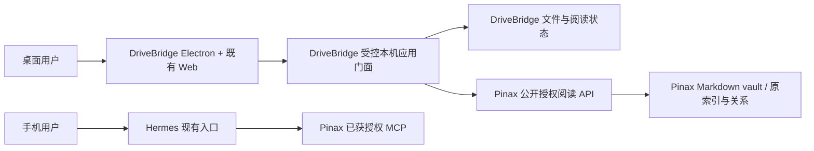

## Context

2026-10-01 设计交付。用户明确选择 Electron、三个桌面平台同时验收及阅读先行。DriveBridge 已合仓至 `cli/drivebridge`，现有 74 条工作台任务仍待实施；Pinax 已有 CLI/MCP/REST/RPC，但新渲染、完整阅读与附件 HTTP 不能根据 CLI 能力推定可用。

## Goals / Non-Goals

目标是无需编辑器、云登录或模型即可打开本机知识库；首次绑定后从首页最多两次导航进入正文。非目标是新建 Reader 产品、合并数据库、实现手机 Pinax UI、自动同步、部署 Hermes 或实施后续编辑。本轮只完成设计与任务，不把设计验收当作产品完成。

## 能力账本与职责

| ID | 必需能力 | 准入 / owner | 首片与交接 |
| --- | --- | --- | --- |
| K01 | 一个 Electron 桌面客户端 | fit / DriveBridge | 复用 web，新 desktop 宿主；三平台门必需 |
| K02 | 普通 Markdown 与 Pinax 共享阅读体验 | split-owner | DriveBridge 渲染交互；Pinax 提供笔记语义 |
| K03 | 本机浏览、关键词搜索、完整正文、双链、附件 | split-owner | 无云/模型依赖；缺合同显式 unavailable |
| K04 | 继续阅读、收藏、稍后读 | fit / DriveBridge application | 本机引用状态，不写 Pinax metadata |
| K05 | 管理范围不能绕过笔记 owner | split-owner | 显式绑定；DriveBridge 所有可写入口保护 |
| K06 | 手机获取笔记 | split-owner / Hermes + Pinax | 保留现有接入；本轮不改真实授权/部署 |
| K07 | 捕获、编辑、提案审阅、小批整理 | split-owner | 后续任务保留；首片禁正文 mutation |
| K08 | DriveBridge 移动客户端及其他工作台能力 | fit / DriveBridge | 原需求保留；不扩大桌面阅读首片 |

## Architecture

这是一个体验、两个领域 owner，不是通用跨产品执行 broker。`backend-server/client-runtime` 不是必需依赖。固定 Pinax sidecar 生命周期不授权任意命令执行、provider 访问或第二 scheduler。

## 交接与兼容

- DriveBridge 详细产品/宿主/验收分别在其[设计](../drivebridge-desktop-knowledge-reader-v1/design.md)、[Electron 架构](../../../docs/architecture/electron-desktop.md)、[验收矩阵](../../../docs/delivery/desktop-knowledge-acceptance.md)。根不复制 API 字段。
- Pinax 详细合同在[人类阅读 API](../../../../pinax/docs/interfaces/human-reading-api.md)；旧 note read、Agent render、URI、MCP 正文开关保持原义。新 reader grant 不能由 caller 自称 human 获得。
- UI 只得到 opaque binding、对象与 revision；不访问 `.pinax/**`、私有 DB 或任意 vault 路径。
- 旧 DriveBridge overlay/mount 是文件通道，不自动获得受管身份。显式绑定必须检查同实例所有可写范围及在途任务；识别不全时拒绝，不自动迁移、挂载或清理。
- 绑定保护覆盖应用可控制入口，不声称能禁止用户外部编辑器或不受控实例。旧 binary 不认识新保护时不得带着有效保护 state 降级。
- 回退先关闭新客户端/新 API 入口、保留 vault 和新状态；不以恢复旧 DB 抹掉阅读状态或解除保护。解除保护另行显式确认。

## 任务与证据边界

根 G01–G04 只接受治理、规格、追溯与文档验证。DriveBridge Dxx、Pinax Pxx 实施任务各在本地 change；既有 F/B 保留 ID、状态与历史，仅补交接与依赖。CONTRACT 完成后各端独立验收，真实链路由具名 INTEGRATION 任务推进，不授权子 Agent。

首片工程完成必须有 macOS 14+ arm64、Windows 11 x64、Ubuntu 24.04 LTS x64（X11/Wayland）的安装与离线阅读实测；其他架构保留候选。签名/公证/公开发布是独立门，不能通过关闭系统安全来通过验收。两周自然阅读观察单独报告，不能替代 Pinax 原五 change 的 11 个真实任务或重置 continuity 原窗口。

文档验证：在根执行 `openspec validate drivebridge-pinax-reading-integration-v1 --strict --no-interactive` 与 `git diff --check`，另验证两个子项目包及被修改的既有包。产品测试、race、真实 vault、远端写和发布不在本轮。
