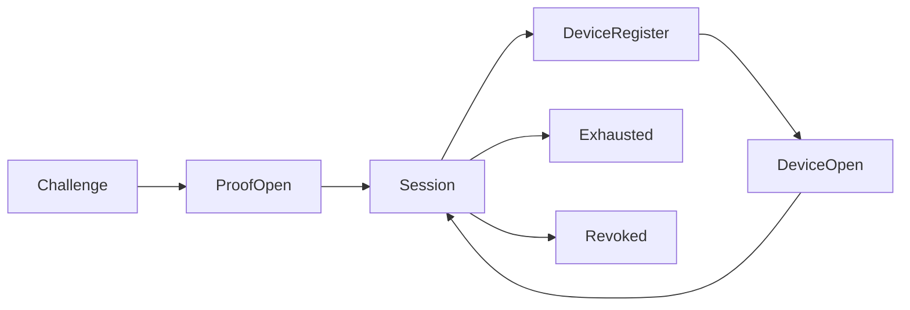

# 分享接收方：挑战应答打开、设备绑定与额度

## 当前依据与交付边界

既有分享要求接收方每次持有完整链接秘密并重复提取码；打开事实只有匿名观测，`shares`/`media-sharing-contract` 只覆盖创建、展示、成员受众、固定版本与安全媒体读取，`drivebridge-fixed-delivery-v2` 规划了清单与接收事实分级但没有定义接收方如何被稳定识别。本包补齐接收侧：一次性完整验证、后续免密打开、有限额度与可验证的接收类别。

当前依据：[internal/service/shares.go](../../../server/internal/service/shares.go)（Share/ShareRequest/openShare/authorizeShare/sharePrincipal）、[internal/service/http.go](../../../server/internal/service/http.go)、[web/src/Sharing.tsx](../../../web/src/Sharing.tsx)（grant 已置于 URL fragment）、[docs/media-sharing.md](../../../docs/server/media-sharing.md)。检查源码只证明当前实现形状，本文没有执行新增运行时测试或真实后端验证。

本包 owner：`cli/drivebridge/server`；准入：`fit`；能力账本：`required / design`。消费方只能通过公开合同；新表、新会话与新命令仍归现有 owner，不新增产品仓库。

## 设计参照：AlterSend 接收方机制对照

参照 [denislupookov/altersend](https://github.com/denislupookov/altersend) 的公开架构（docs/architecture.md，Apache-2.0）。逐项判断采纳与否，不整体移植其 P2P 形态：

| AlterSend 机制 | 本包处置 | 理由 |
| --- | --- | --- |
| join code 为一次性随机密钥，置于链接 fragment 不入请求 | 基线已满足 | 既有 grant + fragment（Sharing.tsx）；保留 |
| topic auth：接收方以密钥对服务端 nonce 出证明，密钥不出网 | 采纳为 proof-open | 密钥不进请求体/Cookie/日志，防日志与代理侧泄露；服务端可用既有加密持久化的链接秘密本地校验 |
| 设备配对：一次验证后记住设备公钥，后续免码 | 采纳为接收设备绑定 | 免去重复提取码；按设备撤销、按设备观测；AlterSend 的"识别只出签名不暴露身份"对应为假名设备指纹 |
| 会话上限（每次传输文件数、中继转发量） | 采纳为打开/下载额度 | 显式限额 + 耗尽即拒 + 不泄露距离上限的差距 |
| 浏览器免安装接收 | 基线已满足 | 既有 `/api/v1/shared/{id}` 接收页 |
| 固定版本交付 | 基线已满足 | ShareItem.VersionID 与 fixed-delivery |
| 断点续传（pread/pwrite + resume bitmap） | 部分 | 既有 Range 媒体读取保留；本包只规定续传计数规则，不新建传输引擎 |
| E2EE（服务器不可见明文）/盲中继/DHT-P2P | 不采纳 | 服务端渲染预览、MIME 嗅探与转换是既有产品合同，明文在服务器与 E2EE 矛盾；P2P 传输与单实例服务器模型冲突。若未来需要密文接收是独立新能力，不在本包夹带 |

## 前置、任务依赖与唯一写入

- [drivebridge-fixed-delivery-v2](../drivebridge-fixed-delivery-v2/design.md)：接收事实分级（`receiver_verified` 等）合同先稳定；本包输出接收类别（anonymous/device/user），其回执落地由该包实现。该包未实现时本包按规格独立工作，不伪造回执。
- 既有 `shares`/`media-sharing-contract` 已实现合同为直接基线，不设前置任务。

本包内部主链为1.1→1.2→2.1→2.2→3.1→3.2→4.1→4.2→5.1；5.2规模验收和6.1文档在5.1后推进，6.2等待二者完成。没有子 Agent 自动授权，后续实现按拥有路径串行写；独立规格可分别审阅，稳定 diff 后才验收。

## 用户流程与状态

场景：完整打开→注册设备→额度内免密复访→耗尽/撤销。



- 首次：`challenge` 取 nonce → `proof-open`（或旧 `open`）→ 服务端颁发不透明会话（存哈希）；需要提取码时沿用既有校验。
- 注册：有效会话内 `POST devices` 登记 Ed25519 公钥（幂等按指纹），得到 device id。
- 复访：`challenge` → `device-open`（设备签名）→ 颁发带设备指纹的会话；不再需要链接秘密与提取码。
- 额度：会话颁发计打开数；（会话、文件、固定版本）的下载流首次建立计下载数，Range 续传不重复计。
- 终态：耗尽（拒新动作、保记录）、撤销（拒一切新读取；设备绑定随分享失效）；已传出字节不可收回。

只读检查、执行意图和最终结果分开；结果未知先回读原分享与额度视图。恢复不更换来源、身份、目标或幂等键；取消不等于删除已完成副作用。

## 数据与版本

- 新增 `ShareSession`（不透明令牌哈希、share id、kind=grant|proof|device、设备指纹可空、created/expires/revoked）与 `ShareDevice`（share id、公钥指纹唯一、公钥、标签、created/last_seen/opens、revoked）。
- `Share` 增可空 `MaxOpens`、`MaxDownloads`、`SingleUse`（等价 1/1）与计数列；沿用既有 `Secret`/`TokenHash`/`Passcode`。
- 挑战 nonce 为短生命周期服务端状态（单次、≤5 分钟），不持久化业务含义。
- 新增关系字段采用可空或安全默认值，新增索引可回填；不删旧列、不改旧 ID、URI 或 Cookie 名。配置/会话/绑定不由 Agent 手写。

## 公开接口与具体行为

| HTTP / 入口（规划，非已上线） | MCP / 客户端面 | SDK / 应用服务操作（规划） | 输入与结果 |
| --- | --- | --- | --- |
| GET /api/v1/shared/{id}/challenge | 浏览器接收页 | IssueShareChallenge | nonce、expires_at；对不可用分享与已撤销不可区分 |
| POST /api/v1/shared/{id}/proof-open | 浏览器接收页 | OpenShareProof | HMAC 证明、可选提取码；成功颁发会话凭证 |
| POST /api/v1/shared/{id}/devices | 浏览器接收页 | RegisterShareReceiverDevice | 有效会话内提交公钥+标签；幂等返回设备身份 |
| POST /api/v1/shared/{id}/device-open | 浏览器接收页 | OpenShareWithDevice | device id+nonce+签名；成功颁发设备会话 |
| GET /api/v1/shares/{id}/receivers | 用户会话（owner 管理） | ListShareReceivers | 设备假名列表：指纹、标签、时间、opens |
| DELETE /api/v1/shares/{id}/receivers/{device} | 用户会话（owner 管理） | RevokeShareReceiver | 单设备撤销；不影响其他设备 |

表中的 SDK 名称是待实施应用操作名，不表示已有导出符号。落地时 HTTP/SDK 必须调用同一应用服务；接收侧为浏览器/本机设备，不注册 MCP 工具，Agent 不能注册或使用设备绑定；`POST /api/v1/shares` 的请求体增 `max_opens`、`max_downloads`、`single_use` 可选字段。

- proof 失败与提取码失败分别计数，阈值与锁定时长沿用既有 passcode 合同（10 次/5 分钟）。
- 设备数上限每分享 20；注册要求 kind 为 grant|proof 的完整打开会话（device 会话内不能再注册新设备，防止绑定链扩散）。
- `audience=users` 不提供设备路径；登录身份即接收类别 user。
- 额度耗尽、未知设备、坏签名对未持凭据者返回与已撤销不可区分的稳定错误（`share_unavailable` 族），owner 视图可见真实计数；不新增专有错误码。
- 撤销分享先拒未来读取（含全部设备路径），不承诺收回已落地副本；接收确认语义仍归 fixed-delivery 的回执合同。

## 共同合同约束

本包为 **设计与待实施合同**。本文规划路径、字段、类型和状态尚未上线；不能把 spec strict 成功当成实现、真实后端或部署验收。既有接口须先从实际 tools/list、inputSchema、CLI help 与公开 API 确认。新能力默认关闭，部署配置未启用时报告 unsupported/blocked。

- HTTP 沿用本 owner 现有错误信封及认证；接收侧入口沿用 `Origin` 固定校验与既有分享节流；管理侧入口要求用户会话。CLI 保留 human/--json/--agent 与已实现输出选项，不为旧入口改变必填字段或输出类型。
- 新写请求采用 Idempotency-Key 或该工具对应 idempotency_key，作用域为 instance+tenant+actor+action，指纹覆盖所有业务输入；同键同指纹复用，同键异指纹拒绝。设备注册以公钥指纹天然幂等。已有入口保持原幂等作用域，禁止重解释旧键。
- 分页默认 50、最大 200；游标不透明，绑定规范查询、身份范围、排序与数据代次。所有页重新授权；跨查询、跨身份游标拒绝。
- 新元数据与会话由应用服务生成，GORM 为 Go 业务持久访问层；禁止在 handler/SDK 适配器拼接 SQL。
- 保持现有 Share/ShareItem、URI、旧 open 请求、Cookie 名、旧状态枚举与字段含义。未知外部结果以新增 certainty/恢复信息表达，不伪报失败或成功。
- 整理、传输、内容处理与领域采纳是不同事实；接收设备绑定不是领域采纳。会话与设备视图不含凭据、临时 URL、原始模型请求或完整内部推理。
- 基本错误：沿用既有映射（invalid_share=400、throttled、share_unavailable、forbidden=403 等）；本包不新增错误码，新语义全部映射到既有稳定码。

## 输入、结果与错误样例（规划）

以下标识符为说明性占位，不是可执行请求；实现测试由 fixture/CLI 生成合法 ID。HTTP 成功结果沿用 owner 现有信封，下面展示 payload。示例不授予权限。

打开证明：

```json
{"proof": "hex(hmac-sha256(link_secret, share_id + ':' + nonce))"}
```

会话颁发（Set-Cookie 为不透明令牌，服务端存哈希）：

```json
{"opened": true, "session_kind": "device", "receiver_kind": "device"}
```

创建带额度：

```json
{"max_opens": 3, "max_downloads": 5, "single_use": false}
```

owner 额度视图：

```json
{"opens_used": 2, "opens_max": 3, "downloads_used": 1, "downloads_max": 5, "devices": 2}
```

| 沿用码 | 触发 | 恢复行为 |
| --- | --- | --- |
| `share_unavailable` | 额度耗尽、未知设备、坏签名、过期/撤销 | 未持凭据者与已撤销不可区分；owner 查看计数后显式新意图 |
| `throttled` | 证明或签名连续失败达阈值 | 等待锁定窗口，不改用其他身份绕过 |
| `invalid_share` | 畸形注册体、超上限设备数、audience=users 注册 | 修正输入；user 受众走登录身份 |

本包规模验收固定为：单分享 20 设备注册与并发挑战；1000 次打开计数的精确性与续传单计；耗尽/撤销后的不可区分性；旧客户端与旧 Cookie 过渡期并存。

## 测试规格与故障注入

| 场景 | Requirement | 正常与反例 | 必须断言 |
| --- | --- | --- | --- |
| 1 | 挑战应答打开 | 正确 HMAC 颁发会话；nonce 重放/过期；错误证明达阈值 | 会话同范围同时效；重放不耗额度；proof 与 passcode 计数隔离；秘密不出现在请求体/Cookie/日志 |
| 2 | 设备绑定 | 完整打开后注册并免密复访；重复注册；按设备撤销；user 受众注册 | 幂等返回原身份；单设备撤销不影响他设备；unknown device 与已撤销不可区分 |
| 3 | 额度 | 上限 3 的第 4 次；续传单计；耗尽后清单可读；无额度保持原行为 | 精确计数；耗尽不删记录；既有会话内缩略图可读；旧客户端不受影响 |
| 4 | 接收类别衔接 | 设备会话下载；前置未实现时下载 | receiver_verified=device 且不自动 confirmed；前置缺失不伪造回执；自报类别被忽略 |

还需覆盖相同请求重放、并发打开竞态（额度不多扣不少扣）、进程重启后的会话与 nonce 状态、撤销后既有会话失效时机，以及旧客户端缺新字段时的行为。性能验收只覆盖本包相关部分，统一目标见 [本 owner 验收与路线文档](../../../docs/server/file-platform/verification.md)。

实施任务先加入明确测试入口后运行以下命令；无匹配测试或输出 no tests to run 属于失败，不能以空运行关闭任务。当前文档轮次不执行产品测试。

```bash
python3 scripts/check.py -- go test ./internal/service -run TestFPShareReceiver -count=1
python3 scripts/check.py -- go test -race ./internal/service -run TestFPShareReceiver -count=1
```

集成证据由现有 runner 写入本 owner `temp/integration-test-runs/<run-id>/`，包含 summary.json、command.txt、stdout.log、stderr.log、env.json 与 artifacts/；失败同样保留并脱敏。真实存储、身份、模型费用与部署分别验证，不由 fixture 代替。

代码、定向测试和文档稳定后，才执行本包所需最终门：

```bash
python3 scripts/check.py
go vet ./...
CGO_ENABLED=0 go build ./cmd/drivebridge-server
openspec validate drivebridge-share-receiver-v1 --strict --no-interactive
git diff --check
```

## 迁移、回滚与完成定义

- 当前只新增设计文档，运行时迁移未执行；实现按 expand-then-contract，兼容既有客户端、元数据和凭据来源。
- 默认关闭新能力；关闭开关停止新意图，保留原 Share、会话、设备绑定、计数与审计。新版本已产生业务写入时，不允许回滚为丢弃这些写入的旧数据库快照。
- 本包负责自身配置与状态，不替消费者执行部署、发消息、真实云写入、付费调用或发布；这些门由相应 owner 独立验收。
- 设计完成=proposal/design/spec/tasks 可追溯且 strict 通过。实现完成=任务指定运行证据通过。真实后端验证与发布部署是后续独立事实。

## 范围记录

2026-09-26：参照 AlterSend 接收方机制（挑战证明、设备配对、会话上限）建立本包；不采纳 E2EE 与 P2P 传输，理由见对照表。目标未验收，required 能力仅分期，不删除。
