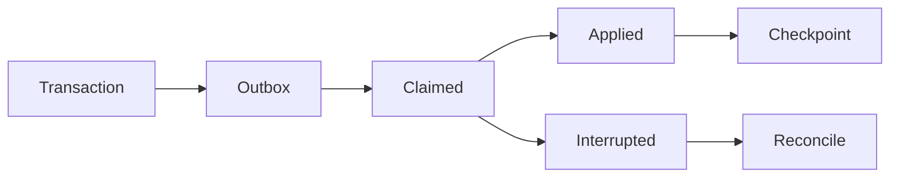

# 团队事务、持久任务与投影运行时

## 当前依据与交付边界

现有单机 SQLite、进程锁与同步统计不足以证明百万文件、多 worker 和千万事件目标；需要保留单机的独立团队运行模式。

当前依据：[internal/service/http.go](../../../server/internal/service/http.go)、[internal/service/tools.go](../../../server/internal/service/tools.go)、[internal/service/model.go](../../../server/internal/service/model.go)、[docs/contract-map.md](../../../docs/server/contract-map.md)。检查源码只证明当前实现形状，本文没有执行新增运行时测试或真实后端验证。

本包owner：`cli/drivebridge/server`；准入：`fit`；能力账本：`required / design`。消费方只能通过公开合同；新库、新worker和新命令仍归现有owner，不新增产品仓库。

## 前置、任务依赖与唯一写入

- [drivebridge-capability-readiness-v2](../drivebridge-capability-readiness-v2/design.md)：依赖合同先稳定；本包消费其公开接口，不写其私有状态。

本包内部主链为1.1→1.2→2.1→2.2→3.1→3.2→4.1→4.2→5.1；5.2规模验收和6.1文档在5.1后推进，6.2等待二者完成。前置包的1.2合同稳定即可启动设计；运行集成需对应应用服务与入口已通过定向验证，不能以仅有spec满足运行依赖。没有子Agent自动授权，后续实现按拥有路径串行写；独立规格可分别审阅，稳定diff后才验收。

## 用户流程与状态

场景：上传→重启 worker→原任务完成→投影重建→受权查询。



只读检查、执行意图和最终结果分开；partial保留逐项结果，结果未知先回读原ID。恢复不更换来源、身份、目标或幂等键；取消不等于删除已完成副作用。

## 数据与版本

GORM PostgreSQL 团队库新增 Job、OutboxEvent、ProjectionCheckpoint、ProjectionGeneration、WorkerLease；原 File/Version/Operation ID 不变。SQLite 默认继续使用。任务与 Outbox 同业务提交事务写入。

新增关系字段采用可空或安全默认值，新增索引可回填；不删旧列、不改旧ID或URI。引用资源通过application service建立，配置/计划/回执/清单不由Agent手写。

## 公开接口与具体行为

| HTTP / 入口（规划，非已上线） | MCP / 客户端面 | SDK / 应用服务操作（规划） | 输入与结果 |
| --- | --- | --- | --- |
| GET /api/v1/runtime/status | runtime_status（只读、operator） | RuntimeStatus | 返回队列、worker、投影水位，不返回 DSN |
| POST /api/v1/projections/{name}/rebuild | 不向普通 Agent 注册 | RebuildProjection | operator 发起新代次，返回原 Operation |
| drivebridge-server metadata export/import/verify | 终端 operator | application migration service | 规划命令：显式源/目标引用与停写证明；不含凭据参数 |

表中的SDK名称是待实施应用操作名，不表示已有导出符号。落地时CLI/MCP/HTTP必须调用同一应用服务，SDK无付费重试、权限扩张或自动切换后端逻辑；开发者不能把接口表当作当前可执行命令。

- 团队 API 与 worker 属于本仓，复用应用合同。队列用 PostgreSQL，不引入 Kafka/Redis/RabbitMQ。队列领取的 SKIP LOCKED 例外集中仓储适配并参数绑定。
- lease 带单调 fencing token；每次发布元数据检查 token。租约过期不证明旧 worker 停止；外部副作用先凭原操作标识对账，不由新 worker 直接重做。
- Outbox 为至少一次，消费者按 event_id、resource_revision 幂等；墓碑与新修订优先，乱序不回滚资源。按 owner/tenant 投影检查点，不串租户。
- 重建新 generation：冻结快照水位、分页 backfill、追平增量、校验数量/摘要/权限覆盖后原子切换读指针；旧代次留作诊断，不混查。
- SQLite→PostgreSQL：停写并隔离旧 worker，CLI 导出/导入，核对实例ID、文件/版本/操作/授权/配额及独立密钥引用，再切换。对象字节不搬运；产生新写入后禁止直接回退旧 SQLite 快照。
- GORM 正常读写、pure-Go PostgreSQL driver；默认 CGO_ENABLED=0 主程序构建保持。SQLite 不开放多机 writer。

## 共同合同约束

本包为 **设计与待实施合同**。本文规划路径、工具、字段、类型和状态尚未上线；不能把 spec strict 成功当成实现、真实后端或部署验收。既有接口须先从实际 tools/list、inputSchema、CLI help 与公开API确认。新能力默认关闭，部署配置未启用时报告 unsupported/blocked。

- HTTP 沿用各 owner 现有错误信封及认证；身份从会话/令牌推导，body 中的 tenant/actor/project 只能收窄选择范围。CLI 保留 human/--json/--agent 与已实现输出选项，不为旧入口改变必填字段或输出类型。
- 新写请求采用 Idempotency-Key 或该工具对应 idempotency_key，作用域为 instance+tenant+actor+action，指纹覆盖所有业务输入；同键同指纹复用，同键异指纹拒绝。已有入口保持原幂等作用域，禁止重解释旧键。编辑/执行携 expected_revision/expected_version；过期拒绝，不自动重算或批准。
- DriveBridge新分页默认50、最大200；Manju既有查询保留默认20/最大100及8秒预算，旧分页不变；游标不透明，绑定规范查询、身份范围、排序与数据代次。所有页重新授权；跨查询、跨身份游标拒绝。精确列表使用keyset稳定排序，以ID破同值；语义Top-K不是全集，异步导出使用独立原Operation。
- 新元数据与类型由应用服务/CLI生成，GORM为Go业务持久访问层；禁止在handler/SDK适配器拼接SQL。迁移、专用队列领取和分析器例外集中adapter、绑定参数、限定标识符，并在实现review列明理由。
- 保持现有 File/Version/Operation、URI、旧状态枚举与字段含义。本文流程节点描述新增流程或展示阶段，不是把旧 Operation.status 替换成一套新枚举。未知外部结果以新增 certainty/恢复信息表达，不伪报失败或成功。
- 整理、传输、内容处理与领域采纳是不同事实；不会因保存文件批准生成、付费、发布或采纳。回执不含凭据、临时URL、原始模型请求或完整内部推理。
- 基本错误：invalid_query/invalid_request=400，forbidden=403，not_found=404，idempotency_conflict/version_conflict/plan_stale=409，cursor_expired=410，unsupported=400（沿用既有Server映射），budget_exceeded=429，dependency_unavailable=503。保留已有错误码及状态码，专有新码见本包表；不得把旧同名码改义。


## 输入、结果与错误样例（规划）

以下标识符为说明性占位，不是可执行请求；实现测试由fixture/CLI生成合法ID。HTTP成功结果沿用owner现有信封，下面展示payload；CLI/MCP映射保持各自旧信封。示例不授予权限。

输入：

```json
{
  "projection": "file_catalogue",
  "expected_generation": "GEN_A"
}
```

结果：

```json
{
  "operation_id": "OP_ID",
  "generation": "GEN_B",
  "phase": "backfill",
  "source_watermark": 12000,
  "applied_watermark": 11000,
  "ready": false
}
```

Job拥有kind、original_operation_id、attempt_generation、lease_epoch、owner_scope；OutboxEvent拥有event_id、resource_id、resource_revision、tombstone、source_sequence。持久checkpoint仅在幂等投影成功后推进。status页面不能输出DSN或连接secret。

| 新码/沿用码 | HTTP状态（旧码保留现有映射） | 恢复行为 |
| --- | --- | --- |
| `worker_fenced` | 409 | 旧worker不能提交；新worker只对账原副作用。 |
| `projection_not_caught_up` | 409 | 继续追平，不切换generation。 |
| `metadata_migration_requires_quiescence` | 409 | 确认停写和旧writer隔离后再迁移。 |

本包规模验收固定为：100万目录/1000万事件，100events/s持续15分钟，重复乱序重放与20并发读取；核对generation一致、队列无重复发布，投影P95延迟≤30秒。

## 测试规格与故障注入

| 场景 | Requirement | 正常与反例 | 必须断言 |
| --- | --- | --- | --- |
| 1 | 事务与投影分层 | 分析库失联；数据库业务提交失败 | 文件可读，投影显示滞后，事件可恢复。 / 不得发布未提交业务事件。 |
| 2 | 原任务与 fencing | worker 崩溃后接管；旧 worker 晚到 | 继续原 Operation 且不重复发布版本。 / 拒绝写入并保留诊断，不覆盖新状态。 |
| 3 | 迁移与代次切换 | 新代次追平；切换后已有新写入 | 数量、摘要及墓碑一致后切换。 / 拒绝直接回旧快照，要求反向迁移或向前修复。 |

还需覆盖相同请求重放、并发编辑、权限撤销、跨租户、来源变更、进程重启、响应丢失，以及旧客户端缺新字段时的行为。性能验收只覆盖本包相关部分，统一目标见 [本owner验收与路线文档](../../../docs/server/file-platform/verification.md)。

实施任务先加入明确测试入口后运行以下命令；无匹配测试或输出no tests to run属于失败，不能以空运行关闭任务。当前文档轮次不执行产品测试。

```bash
python3 scripts/check.py -- go test ./internal/service -run TestFPTeamRuntime -count=1
python3 scripts/check.py -- go test -race ./internal/service -run TestFPTeamRuntime -count=1
```

集成证据由现有runner写入本owner `temp/integration-test-runs/<run-id>/`，包含summary.json、command.txt、stdout.log、stderr.log、env.json与artifacts/；失败同样保留并脱敏。真实存储、身份、模型费用与部署分别验证，不由fixture代替。

代码、定向测试和文档稳定后，才执行本包所需最终门：

```bash
python3 scripts/check.py
go vet ./...
CGO_ENABLED=0 go build ./cmd/drivebridge-server
openspec validate drivebridge-team-runtime-projections-v1 --strict --no-interactive
git diff --check
```

## 迁移、回滚与完成定义

- 当前只新增设计文档，运行时迁移未执行；实现按expand-then-contract，兼容既有客户端、元数据和凭据来源。
- 默认关闭新能力；关闭开关停止新意图，保留原Operation、文件、版本、计划、回执与审计。新版本已产生业务写入时，不允许回滚为丢弃这些写入的旧数据库快照。
- 本包负责自身配置与状态，不替消费者执行部署、发消息、真实云写入、付费调用或发布；这些门由相应owner独立验收。
- 设计完成=proposal/design/spec/tasks可追溯且strict通过。实现完成=任务指定运行证据通过。真实后端验证与发布部署是后续独立事实。

## 范围记录

2026-09-25：按用户确认的百万文件/万文件批次/100GiB目标和分层数据方案建立本包；目标未验收，required能力仅分期，不删除。
